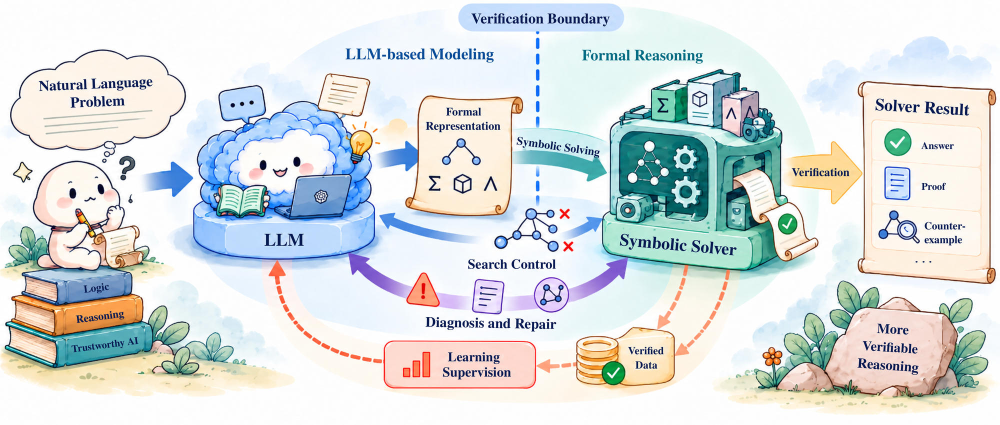
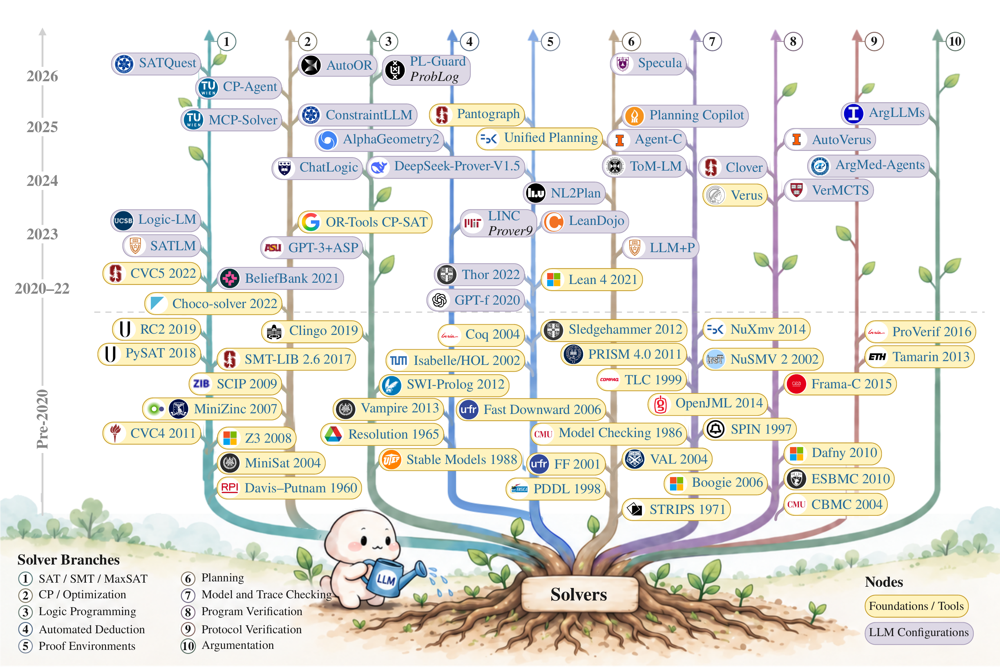

<div align="center">

<h1>Symbolic Solvers for Large Language Model Reasoning: A Survey</h1>

Yishuai Geng · Guohui Xiao · Guilin Qi · Tianxing Wu · Huajun Chen · Haofen Wang

Paper link forthcoming · [Manuscript information](manuscript/README.md)

**[Paper list](papers/) · [Solver evolution](#solver-evolution) · [Benchmarks & analysis](analysis/README.md) · [Citation](#citation)**

</div>

This repository accompanies *Symbolic Solvers for Large Language Model Reasoning: A Survey*. We organize the literature around five uses of solver feedback: **symbolic solving, verification, diagnosis and repair, search control, and learning supervision**.

The review covers **1,429 studies** from January 2020 through September 2026.

<p align="center">
  
</p>

## Solver evolution

Formal foundations, solver tools, and LLM–solver configurations across ten solver families.

[](assets/figures/solver-evolution.png)

[Open at full resolution](assets/figures/solver-evolution.png) · [Role taxonomy](docs/taxonomy.md)

## Find papers

**[Open the classified paper list →](papers/)** — papers grouped by solver role and subcategory, with authors, source links and years.

| Looking for | Open |
| --- | --- |
| A method named in the survey | [Methods → papers](docs/method-index.md) — method names, categories, paper titles and source links |
| A reference cited in the manuscript | [References](references/README.md) — 488 entries; [BibTeX](references/references.bib) |
| Papers by role or year | [Full catalogue](papers/catalogue.md) — all 1,429 studies |
| Searchable metadata | [CSV](data/papers.csv) / [JSON](data/papers.json) — titles, authors, identifiers and classifications |

Use **Ctrl+F / ⌘F** on an index page to find a method, title or author. For the full catalogue, download the CSV and filter it in a spreadsheet.

[Benchmarks and analysis](analysis/README.md) · [Scope and interpretation](docs/methodology.md) · [Data field definitions](data/schema.md)

## Contributing

Suggestions and corrections are welcome through [Issues](https://github.com/YishuaiGeng/Solvers-in-the-loop-Survey/issues/new/choose). Include a paper link and explain the relevant solver interaction or correction. See the [contribution guide](CONTRIBUTING.md).

## Citation

A paper citation will be added when the manuscript is public. For now, you can cite this companion repository.

```bibtex
@misc{geng2026solvers_companion,
  author = {Yishuai Geng},
  title = {Symbolic Solvers for Large Language Model Reasoning: Survey Companion Repository},
  year = {2026},
  howpublished = {GitHub repository},
  url = {https://github.com/YishuaiGeng/Solvers-in-the-loop-Survey}
}
```

For a specific state of the catalogue, include an access date or commit in your citation. GitHub's **Cite this repository** button uses [CITATION.cff](CITATION.cff).

Copyright is retained; see [LICENSE](LICENSE) and [figure credits](assets/README.md).
