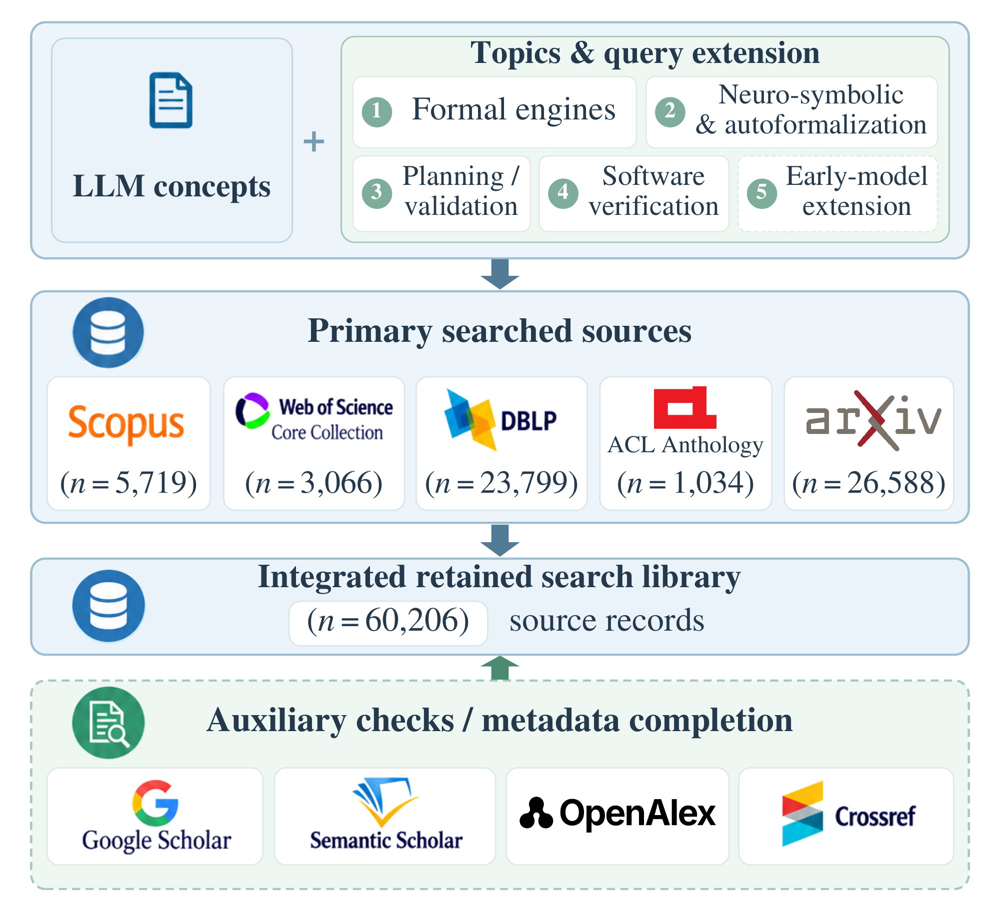
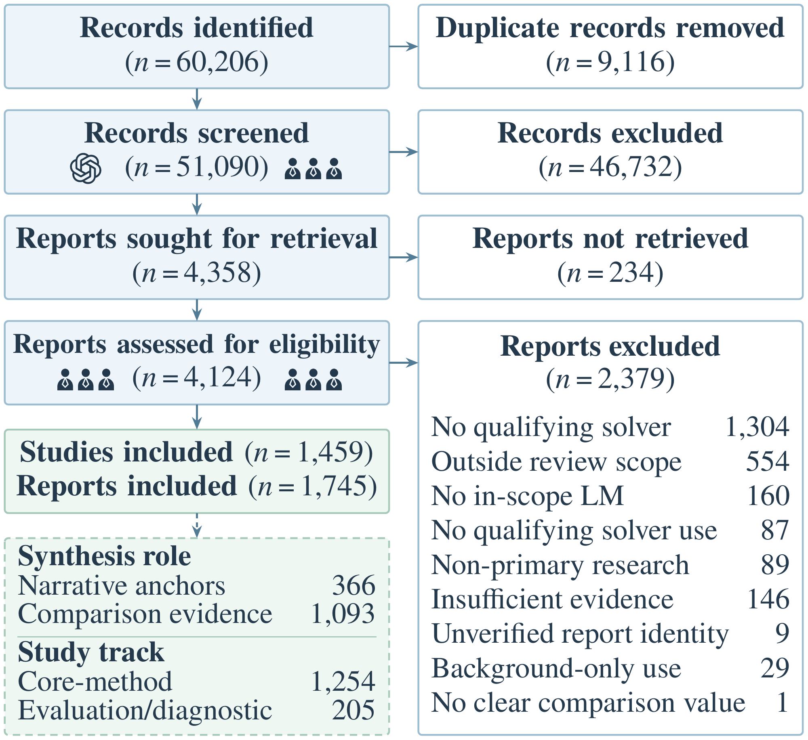

# Search and study selection

[Scope and interpretation](methodology.md) · [Machine-readable counts](../data/review-flow.json)

The review covers January 2020–October 2026. Counts refer to the cohort with completed selection outcomes within this window. Records outside this reporting cohort remain in the research records; they are not reclassified as eligibility exclusions.

| (a) Search concepts and source records | (b) PRISMA 2020-based selection flow |
| --- | --- |
|  |  |

## Sources before deduplication

| Source | Records |
| --- | ---: |
| Scopus | 5,719 |
| Web of Science | 3,066 |
| DBLP | 23,799 |
| ACL Anthology | 1,034 |
| arXiv | 26,588 |
| Total | 60,206 |

## Selection flow

| Stage | Count |
| --- | ---: |
| Records identified | 60,206 |
| Duplicate records removed | 9,116 |
| Records screened | 51,090 |
| Records excluded | 46,732 |
| Reports sought for retrieval | 4,358 |
| Reports not retrieved | 234 |
| Reports assessed for eligibility | 4,124 |
| Reports excluded | 2,379 |
| Reports included | 1,745 |
| Studies included | 1,459 |

Source counts sum to the flow input; each subsequent stage balances with its corresponding removal count. Reports and studies are different units. Exclusion reasons and study partitions are retained in the machine-readable counts.
