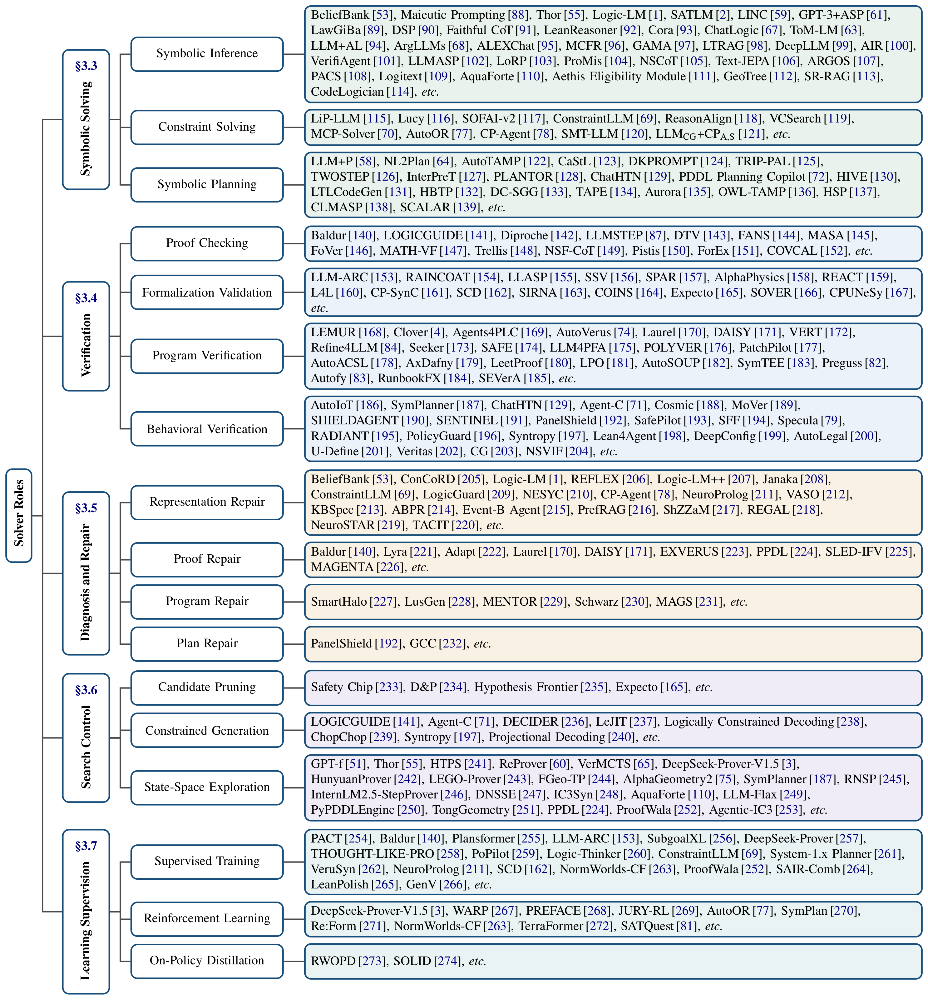
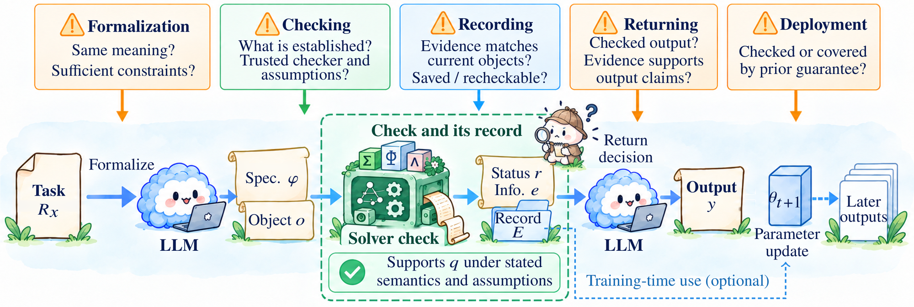

# Solver roles and verification boundaries

[Method index](method-index.md) · [Classified papers](../papers/README.md)

The taxonomy follows the **consumer of the solver signal**. The same symbolic engine can support different roles, and one system can combine several roles.

| Role | Signal use | Reading guide |
| --- | --- | --- |
| R1 · Symbolic Solving | The returned consequence, model, plan or proof supplies an answer relative to the encoding | [Illustration and papers](../papers/roles/symbolic-solving.md) |
| R2 · Verification | A verdict governs acceptance or rejection under a formal obligation | [Illustration and papers](../papers/roles/verification.md) |
| R3 · Diagnosis and Repair | Counterexamples or errors guide revision of a candidate or representation | [Illustration and papers](../papers/roles/diagnosis-repair.md) |
| R4 · Search Control | Solver feedback guides expansion, pruning or selection | [Illustration and papers](../papers/roles/search-control.md) |
| R5 · Learning Supervision | Solver outcomes supply or filter training material, rewards or targets | [Illustration and papers](../papers/roles/learning-supervision.md) |

## Role taxonomy

[Open the taxonomy at full resolution](../assets/figures/taxonomy.png). Representative methods follow the current manuscript diagram.

## From a formal check to a claim about a task

The review distinguishes the formal object, checked obligation, assumptions, checker, trust conditions, returned evidence and coverage. Interpreting a successful result requires asking:

1. **Formalization:** Does the encoded obligation represent the intended task?
2. **Checking:** What precisely did the checker establish, under which assumptions and limits?
3. **Recording:** Is there a retained result or certificate that supports the claim?
4. **Returning:** Does the answer or explanation preserve what was checked?
5. **Later deployment:** If the signal trained a model, are later outputs checked under the same conditions?

Execution success and task accuracy are useful evidence, but neither alone establishes semantic fidelity. An unresolved query, timeout or unsupported fragment must not be converted into a negative theorem. Learning from checked examples does not confer the same guarantee on unchecked deployment outputs.
