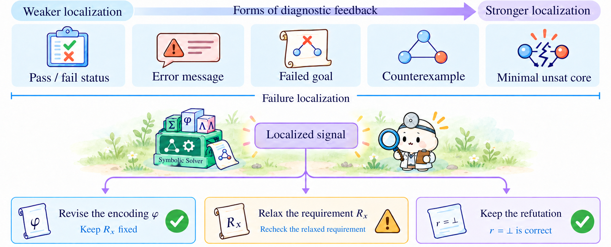

# R3 · Diagnosis and Repair

[All papers](../README.md) · [Taxonomy](../../docs/taxonomy.md) · [CSV metadata](../../data/papers.csv)

Use counterexamples, errors, or other diagnostic feedback to revise a candidate.

574 studies in the confirmed corpus snapshot. Role assignments overlap; a diagnostic study carrying a role label is not thereby a deployed method.

## Core methods

- [130k Lines of Formal Topology in Two Weeks: Simple and Cheap Autoformalization for Everyone?](<https://arxiv.org/abs/2601.03298>) (2026) — Josef Urban.
- [A Balanced Neuro-Symbolic Approach for Commonsense Abductive Logic](<https://arxiv.org/abs/2601.18595>) (2026) — Joseph Cotnareanu;  Didier Chetelat;  Yingxue Zhang et al.
- [A Logic-Driven Workflow Based on LLM Agents for High-Fidelity SMT Code Generation](<https://doi.org/10.1145/3788731.3788734>) (2026) — Liu Z.;  Wang K.
- [A machine-checked proof of the Dong–Yang classification of optimal (n, 4) binary codes for BSCs](<https://arxiv.org/abs/2609.10579>) (2026) — Shenghao Yang;  Yanyan Dong.
- [A Machine-Verified Proof of a Quantum-Optimization Conjecture](<https://arxiv.org/abs/2606.29687>) (2026) — Uri Kol;  Maor Ben-Shahar;  Kfir Sulimany et al.
- [A Minimal Agent for Automated Theorem Proving](<https://arxiv.org/abs/2602.24273>) (2026) — Borja Requena;  Austin Letson;  Krystian Nowakowski et al.
- [A property-registry contract for retrieve-or-refuse thermal–mechanical lattice search](<https://arxiv.org/abs/2609.14741>) (2026) — Shaoliang Yang;  Henry Chu;  Zu Yashengjiang et al.
- [A Structural Proof of the Lower Bound 21 for 3 × 3 Matrix Multiplication over F₂](<https://arxiv.org/abs/2609.18722>) (2026) — Shuxing Yang;  Rui Zhao;  Junyao Wu et al.
- [A Tale of 1001 LoC: Potential Runtime Error-Guided Specification Synthesis for Verifying Large-Scale Programs](<https://doi.org/10.1145/3798268>) (2026) — Wang Z.;  Lin T.;  Chen M. et al.
- [A Verifier-Guided Explainable Reasoning Framework with Gold-Anchored QLoRA, Task-Aware Mixture-of-Experts, and Group-Relative RLVR](<https://arxiv.org/abs/2609.05221>) (2026) — Thi Kim Trang Vo;  Nam Tien Le;  Thi Kim Nguyet Vo et al.
- [Abstraction Generation for Generalized Planning with Pretrained Large Language Models.](<https://arxiv.org/abs/2602.10485>) (2026) — Zhenhe Cui;  Huaxiang Xia;  Hangjun Shen et al.
- [Accountable AI with Grounded, Faithful, Consistent, Actionable Rationales: A Case Study in Clinical Trial Matching with VERDICT](<https://arxiv.org/abs/2609.03366>) (2026) — Zikai Zhou;  Yufei Jin;  Yilin Xu et al.
- [ActGov: Governing LLM Agent Actions via Policy-Constrained Validation](<https://arxiv.org/abs/2609.24446>) (2026) — Kaiyuan Zhang;  Yuke Peng;  Ke Jiang et al.
- [Advancing Mathematics Research with AI-Driven Formal Proof Search](<https://arxiv.org/abs/2605.22763>) (2026) — George Tsoukalas;  Anton Kovsharov;  Sergey Shirobokov et al.
- [ADVENT: LLM-Driven Automatic Predicate Invention for ILP](<https://arxiv.org/abs/2607.01585>) (2026) — Tingting Yu;  Pei-Cing Huang;  Chan Hsu et al.
- [Agent Hunt: Bounty Based Collaborative Autoformalization With LLM Agents](<https://www.scopus.com/pages/publications/105048467247?origin=resultslist>) (2026) — Brown C.E.;  Kaliszyk C.;  Urban J.
- [Agent-Aided Design for Dynamic CAD Models](<https://doi.org/10.1145/3786335.3813198>) (2026) — Adler M.;  Russo M.;  Cafarella M.
- [Agent-Driven Verification of Memory Safety for liblzma Decoder Components with VST](<https://arxiv.org/abs/2608.29716>) (2026) — Prokhor Shlyakhtun;  Alexander Gryzlov;  Vladimir Kukharenko et al.
- [Agentic Model Checking](<https://arxiv.org/abs/2605.21434>) (2026) — Youcheng Sun;  Jiawen Liu;  Daniel Kroening et al.
- [Agentic Proof Automation: A Case Study](<https://arxiv.org/abs/2601.03768>) (2026) — Yichen Xu;  Martin Odersky.
- [Agentic Proving for Program Verification](<https://arxiv.org/abs/2605.23772>) (2026) — Alessandro Sosso;  Akhil Arora;  Bas Spitters.
- [Agentic Taxation Optimization via LLM SMT-Constraint Reasoning](<https://doi.org/10.1145/3786583.3786917>) (2026) — Hwang T.-C.;  Yu F.;  Jiang J.-H.R.
- [Agentic-IC3: Enabling Semantic Proof Search in IC3 Model Checking](<https://arxiv.org/abs/2609.27162>) (2026) — Yu-Wei Fan;  SooHyuk Cho;  Aarti Gupta et al.
- [AGREE-Dog Copilot: A Neuro-Symbolic Approach to Enhanced Model-Based Systems Engineering](<https://doi.org/10.1007/978-3-032-07132-3_8>) (2026) — Tahat A.;  Amundson I.;  Hardin D. et al.
- [AI-Assisted Completion of CertiGC Proofs: An Experience Report](<https://arxiv.org/abs/2606.21167>) (2026) — Shengyi Wang.
- [An exponential lower bound for the bit pigeonhole principle in resolution over parities](<https://arxiv.org/abs/2609.23015>) (2026) — Kamil Braun.
- [AutoACSL: Synthesizing ACSL Specifications by Integrating LLMs with CPG-Based Static Analysis](<https://arxiv.org/abs/2606.20969>) (2026) — Han Zhou;  Yu Luo;  Dianxiang Xu.
- [AutoCedar: An Agentic Framework for Verifier-Guided Access Control Policy Synthesis](<https://arxiv.org/abs/2607.03656>) (2026) — Adarsh Vatsa;  Sachi Shome;  Yingming Zhou et al.
- [Autoformalization of Agent Instructions into Policy-as-Code](<https://arxiv.org/abs/2606.26649>) (2026) — Adam Mondl;  Matthew Maisel;  John H. Brock.
- [Autoformalizing Argumentative Material Inferences](<https://arxiv.org/abs/2609.16991>) (2026) — Xin Quan;  Reto Gubelmann;  André Freitas.
- [Autofy: Automated Synthesis of Formally Verified Code](<https://doi.org/10.1145/3793656.3793688>) (2026) — Purschke N.;  Schamschurko A.;  Kirchner S. et al.
- [AutoGraphForge: Towards Automated Graph Theory Discovery](<https://arxiv.org/abs/2609.03478>) (2026) — Ján Pastorek.
- [AutoJML: Generation and Verification of JML Specifications Using LLM Agents](<https://doi.org/10.1109/mpuls.2026.3659250>) (2026) — Shahariar Ayon R.;  Ahmed S.
- [Automated Conjecture Resolution with Formal Verification](<https://arxiv.org/abs/2604.03789>) (2026) — Haocheng Ju;  Guoxiong Gao;  Jiedong Jiang et al.
- [Automated Repair of Alloy Specifications in the Era of Large Language Models](<https://doi.org/10.1109/tse.2026.3682711>) (2026) — Hasan M.R.;  Li J.;  Ahmed I. et al.
- [Automatic Theorem Proving Based on Pre-trained Language Models and Unification; \[基于预训练语言模型和合一算法的自动定理证明\]](<https://doi.org/10.11896/jsjkx.251000066>) (2026) — Chen H.;  Zeng X.;  Liu Z. et al.
- [Automating Formal Verification with Reinforcement Learning and Recursive Inference](<https://arxiv.org/abs/2605.30914>) (2026) — Max Tan.
- [AutoQL: Retrieval-Augmented CodeQL Query Generation with Compiler Feedback](<https://doi.org/10.1109/asens69964.2026.11605289>) (2026) — Chen X.;  Wen W.;  Xu J. et al.
- [AutoReSpec: A Framework for Generating Specification using Large Language Models](<https://doi.org/10.1145/3793655.3793731>) (2026) — Ayon R.S.;  Ahmed S.
- [AutoTrans: AI-Assisted Automatic Translation of Security Assertions for RISC-V Processors](<https://arxiv.org/abs/2609.10057>) (2026) — Sharjeel Imtiaz;  Uljana Reinsalu;  Tara Ghasempouri.
- [Ax-Prover: a deep reasoning agentic framework for theorem proving in mathematics and quantum physics](<https://doi.org/10.1088/2632-2153/ae9452>) (2026) — Breen, Benjamin;  Del Tredici, Marco;  McCarran, Jacob et al.
- [AxDafny: Agentic Verified Code Generation in Dafny](<https://arxiv.org/abs/2606.32007>) (2026) — Benjamin Breen;  Austin Letson;  Borja Requena Pozo et al.
- [BALI: Branch-Aware Loop Invariant Inference with Large Language Models.](<https://arxiv.org/abs/2601.00882>) (2026) — Mingxiu Wang;  Jiawei Wang;  Xiao Cheng.
- [BarrierBench: Evaluating Large Language Models for Safety Verification in Dynamical Systems](<https://www.scopus.com/pages/publications/105046074992?origin=resultslist>) (2026) — Taheri A.;  Taban A.;  Soudjani S. et al.
- [BEHAVE: Functional Behavior Modeling Enables Self-Improving Agents for Hardware Design and Verification](<https://arxiv.org/abs/2609.34785>) (2026) — Yuheng Wu;  Berk Gokmen;  Sujeeth Jinesh et al.
- [BELMA: Integrating Formal Verification and Large Language Models for Enhanced Smart Contract Security](<https://doi.org/10.1109/tdsc.2026.3725656>) (2026) — Sosu R.N.A.;  Chen J.;  Boahen E.K. et al.
- [Benchmarking Agents for Proving Theorems in Quantum Algorithms and Quantum Information](<https://arxiv.org/abs/2607.21533>) (2026) — Lei Zhang;  Yusheng Zhao;  Yimeng Cao et al.
- [Benchmarking Large Language Models on Power System Logic: The "Five Preventions"Challenge for Safety-Critical Physical Reasoning](<https://doi.org/10.1109/psesg69490.2026.11544817>) (2026) — Li Y.;  Zhang Z.
- [Beyond Basic Specifications? A Systematic Study of Logical Constructs in LLM-based Specification Generation](<https://arxiv.org/abs/2602.00715>) (2026) — Zehan Chen;  Long Zhang;  Zhiwei Zhang et al.
- [Beyond the Library: An Agentic Framework for Autoformalizing Research Mathematics](<https://arxiv.org/abs/2606.31134>) (2026) — Arshia Soltani Moakhar;  Iman Gholami;  Max Springer et al.
- [BlueprintRepair: Typed Local Edits for Failed Lean Proof Blueprints](<https://arxiv.org/abs/2607.28110>) (2026) — Ruslan Khrulev.
- [Breaking the Dependency Chaos: A Constraint-Driven Python Dependency Resolution Strategy with Selective LLM Imputation](<https://doi.org/10.1145/3803437.3808241>) (2026) — Chowdhury K.;  Banik D.;  Shamim S.I.
- [Bridging Generative AI and Formal Methods for High-Assurance Test Generation in Safety-Critical Embedded Systems](<https://doi.org/10.1117/12.3109487>) (2026) — Zheng J.;  Lu J.
- [Bridging the semantic gap: Trajectory-guided domain repair for reliable planning](<https://doi.org/10.1016/j.rcim.2026.103290>) (2026) — Liu R.;  Li R.;  Dong Q. et al.
- [Bridging Values and Behavior: A Hierarchical Framework for Proactive Embodied Agents](<https://arxiv.org/abs/2604.27699>) (2026) — Chunhui Zhang;  Yuxuan Wang;  Aoyang Qin et al.
- [Can Formal Specifications Be Synthesized from Tests Alone?](<https://arxiv.org/abs/2608.13240>) (2026) — Tianhai Liu;  Maximilian Müller;  Tobias Hey et al.
- [Case study: proving 2 irrational with LPTP and an LLM](<https://doi.org/10.4204/eptcs.450.5>) (2026) — Mesnard F.;  Payet É.;  Vanhoof W.
- [Case study: solving P-99 with LPTP and an LLM](<https://doi.org/10.4204/eptcs.450.17>) (2026) — Mesnard F.;  Marianne T.;  Payet É. et al.
- [Certified Program Synthesis with a Multi-Modal Verifier](<https://arxiv.org/abs/2604.16584>) (2026) — Yueyang Feng;  Dipesh Kafle;  Vladimir Gladshtein et al.
- [Choir: An Open Protocol for Distributed Multi-Agent Autoformalization](<https://arxiv.org/abs/2609.31903>) (2026) — Yidi Qi;  Melanie Weber.
- [CIR+CVN: Bridging LLM Semantic Understanding and Petri-Net Verification for Concurrent Programs.](<https://arxiv.org/abs/2604.09318>) (2026) — Kaiwen Zhang 0010;  Guanjun Liu.
- [CloudFix: Automated Policy Repair for Cloud Access Control Policies Using Large Language Models](<https://doi.org/10.1109/saner67736.2026.00042>) (2026) — Hall B.;  Ungaro O.;  Eiers W.
- [COBALT-TLA: A Neuro-Symbolic Verification Loop for Cross-Chain Bridge Vulnerability Discovery](<https://arxiv.org/abs/2604.12172>) (2026) — Dominik Blain.
- [Compile to Compress: Boosting Formal Theorem Provers by Compiler Outputs](<https://arxiv.org/abs/2604.18587>) (2026) — Guchan Li;  Rui Tian;  Hongning Wang.
- [Compiler-Guided Adaptive Proof Search with Cross-Model Synergy on Context-Dependent Theorem Proving](<https://arxiv.org/abs/2608.18084>) (2026) — Zhuo Liu;  Ding Yu;  Hangfeng He.
- [Contract-Aware Rescue of a Drifted Isabelle Development: The Double-Tank Case Study](<https://arxiv.org/abs/2608.18822>) (2026) — Jim Woodcock;  Gabriel Leite;  Augusto Sampaio et al.
- [ConVer: Using Contracts and Loop Invariant Synthesis for Scalable Formal Software Verification](<https://arxiv.org/abs/2605.27051>) (2026) — Muhammad A. A. Pirzada;  Weiqi Wang;  Yiannis Charalambous et al.
- [CounterMem: World-Model-Verified Counterfactual Memory for Language Agents](<https://arxiv.org/abs/2609.31874>) (2026) — Hongji Pu;  Ruixiang Tang;  Yongfeng Zhang.
- [CP-SynC: Multi-Agent Zero-Shot Constraint Modeling in MiniZinc with Synthesized Checkers](<https://arxiv.org/abs/2605.01675>) (2026) — Yuliang Song;  Eldan Cohen.
- [Decompose, Structure, and Repair: A Neuro-Symbolic Framework for Autoformalization via Operator Trees](<https://arxiv.org/abs/2604.19000>) (2026) — Xiaoyang Liu;  Zineng Dong;  Yifan Bai et al.
- [Decompose-and-Formalise: Recursively Verifiable Natural Language Inference](<https://arxiv.org/abs/2601.19605>) (2026) — Xin Quan;  Marco Valentino;  Louise A. Dennis et al.
- [Deep Interaction Timing: FOL-based Complexity Differentiation for Legal Queries](<https://doi.org/10.1145/3769126.3769248>) (2026) — Zhang T.;  Wu Y.;  Yao R. et al.
- [DeepConfig: A verifiable configuration generation framework for MAN overlays using LLMs](<https://doi.org/10.1016/j.comnet.2026.112177>) (2026) — Lin C.;  Zhu L.;  Liu H. et al.
- [Designability of RNA Targets with Up to Two Length-2 Helices](<https://arxiv.org/abs/2608.25194>) (2026) — Ashutosh S. Jogalekar.
- [Diffusion-Proof: Recipe for Formal Theorem Proving Beyond Auto-Regressive Generation](<https://arxiv.org/abs/2606.19315>) (2026) — Ruida Wang;  Rui Pan;  Pengcheng Wang et al.
- [Directed Neuro-Symbolic Stochastic Execution for Verification of Distributed Parallel AI Programs](<https://arxiv.org/abs/2608.07947>) (2026) — Gautham Koorma;  Vikas Sharma;  George Edwards et al.
- [Discovering New Theorems via LLMs with In-Context Proof Learning in Lean](<https://aclanthology.org/2026.naloma-1.5/>) (2026) — Kasaura, Kazumi; Onda, Naoto; Oriike, Yuta et al.
- [Distilling Answer-Set Programming Rules from LLMs for Neurosymbolic Visual Question Answering](<https://doi.org/10.1017/s1471068426100684>) (2026) — Higuera Ruiz N.;  Oetsch J.;  Eiter T.
- [Djinnlang: Higher-Level Programming by Unambiguous Specification with an LLM in the Compiler](<https://arxiv.org/abs/2609.23954>) (2026) — Simon Henniger;  Stephen Chong;  Nada Amin.
- [Does the Proof Prove It That Way? Faithful Formalization of Elements Proofs](<https://arxiv.org/abs/2608.15432>) (2026) — Tadd Mao;  Tianjun Zhong;  Dhruva Arekar et al.
- [DSPy-based neural-symbolic pipeline to enhance spatial reasoning in LLMs](<https://doi.org/10.1016/j.neunet.2025.108022>) (2026) — Wang R.;  Sun K.
- [DUPLEX: Agentic Dual-System Planning via LLM-Driven Information Extraction](<https://arxiv.org/abs/2603.23909>) (2026) — Keru Hua;  Ding Wang;  Yaoying Gu et al.
- [Enhancing Word-Level Property Directed Reachability with LLM-Driven Semantic Guidance](<https://arxiv.org/abs/2609.30131>) (2026) — Guangyu Hu;  Mingkai Miao;  Zhiyuan Yan et al.
- [Environment-Driven and LLM-Guided Multi-Robot Task Inference and Allocation Under Temporal Logic Specifications](<https://doi.org/10.1109/tase.2026.3659055>) (2026) — Li L.;  Chen Z.;  Kan Z.
- [Evaluating Theory of Mind and Internal Beliefs in LLM-Based Multi-agent Systems](<https://doi.org/10.1007/978-3-032-09318-9_2>) (2026) — Kostka A.;  Chudziak J.A.
- [Event-B Agent: Towards LLM Agent for Formal Model Synthesis and Repair.](<https://doi.org/10.1145/3808218>) (2026) — Hongshu Wang;  Xinyue Zuo;  Yuhan Sun et al.
- [Evidence-Grounded Verified Agentic Reasoning: A Path Toward Eliminating LLM Hallucination in Empirical Inference via Tool-Attested Kernel Proofs](<https://arxiv.org/abs/2607.12650>) (2026) — Junyu Ren.
- [EvoPlan: Evolutionary Neuro-Symbolic Robot Planning with Spatio-Temporal Guarantees](<https://arxiv.org/abs/2607.06724>) (2026) — Bhavya Sai Nukapotula;  Samin Moosavi;  Haoze Wang et al.
- [Explaining Textual Entailment with Lexical Entailments: Using LLMs to Supply Lexical Relations for Formal Proofs](<https://arxiv.org/abs/2609.32491>) (2026) — Jorryt de Jong;  Stefan Morača;  Ettore Cesari et al.
- [ExVerus: Verus Proof Repair via Counterexample Reasoning](<https://arxiv.org/abs/2603.25810>) (2026) — Jun Yang;  Yuechun Sun;  Yi Wu et al.
- [Faithful Autoformalization via Roundtrip Verification and Repair](<https://arxiv.org/abs/2604.25031>) (2026) — Daneshvar Amrollahi;  Jerry Lopez;  Clark Barrett.
- [Feedback Granularity in Bounded Repair of LLM-Generated PDDL Domains](<https://doi.org/10.1109/caibda70336.2026.11621110>) (2026) — Zhang Y.;  Li N.;  Zhou Z. et al.
- [Fewer Assumptions by Design: A Reusable Skill for LLM-Assisted Verus Verification](<https://arxiv.org/abs/2609.34886>) (2026) — Andrada-Livia Antoneac;  Dorel Lucanu;  Dragoş Teodor Gavriluţ.
- [Formal Disco: Scalable Open-Ended Generation of Formally Verified Programs](<https://arxiv.org/abs/2607.04631>) (2026) — Gabriel Poesia;  Simon Henniger;  Tzu-Han Hsu et al.
- [Formal Model Construction Guided by Model-Based Proof Sketches](<https://arxiv.org/abs/2609.29870>) (2026) — Hongshu Wang;  Xinyue Zuo;  Yufan Cai et al.
- [Formal Verification of Agentic Systems over Operational Data](<https://arxiv.org/abs/2608.03609>) (2026) — Alejandro J. Mercado;  Alessio Lomuscio.
- [Formal-Method-Guided Vibe Coding: Closing the Verification Loop on AI-Generated Safety-Critical Software Through Model-Driven Engineering](<https://arxiv.org/abs/2606.22413>) (2026) — Ran Wei;  Le Zhu;  Haochi Wang et al.
- [Formalization of Sullivan's No Wandering Domains Theorem in Lean](<https://arxiv.org/abs/2609.16027>) (2026) — Ziang Li;  Yusheng Luo.
- [Formally Specifying the Intended Behavior of the Program: LLM-Driven Neuro-Symbolic Program Specification Synthesis](<https://doi.org/10.18653/v1/2026.acl-demo.66>) (2026) — Wen, Cheng; Junjie, Hu; Hu, YiKun et al.
- [FormalScience: Scalable Human-in-the-Loop Autoformalisation of Science with Agentic Code Generation in Lean](<https://doi.org/10.18653/v1/2026.acl-long.1057>) (2026) — Meadows, Jordan; Zhang, Lan; Freitas, Andre.
- [FormalTCS: Benchmarking End-to-End Frontier Formal Theoretical Computer Science Research of Large Language Models](<https://arxiv.org/abs/2608.20153>) (2026) — Dingzirui Wang;  Xuanliang Zhang;  Keyan Xu et al.
- [From Errors to Proofs: Minimal-Core-Guided Repair for Neuro-Symbolic Constraint Solving](<https://arxiv.org/abs/2608.14771>) (2026) — Dipankar Sarkar.
- [From LLM Suggestions to Lean Proofs: Verified Redundant Constraints for MiniZinc](<https://doi.org/10.4230/lipics.cp.2026.17>) (2026) — Danzinger P.;  Musliu N.
- [From Natural Language to Verified Code: Toward AI Assisted Problem-to-Code Generation with Dafny-Based Formal Verification](<https://arxiv.org/abs/2604.22601>) (2026) — Md Erfan;  Md Kamal Hossain Chowdhury;  Ahmed Ryan et al.
- [From Semantic Decisions to Feasible Trajectories: Self-Evolving LLM-Guided Optimal Control for Narrow-Space Parking](<https://arxiv.org/abs/2609.24631>) (2026) — Zhengbao Yao;  Yuanfu Luo;  Kehan Xue.
- [From Solver Feedback to Faithful Plans: Multi-Role Reinforcement Learning for Symbolic Planning](<https://arxiv.org/abs/2608.21897>) (2026) — Chenghao Zhang;  Yikai Mao;  Shanqi Liu et al.
- [Fun2spec: Code Contract Synthesis At Scale](<https://doi.org/10.1145/3803437.3805262>) (2026) — Ugare S.;  Suresh T.;  Misailovic S. et al.
- [Generating Instance Generators in PDDL Planning](<https://arxiv.org/abs/2609.06071>) (2026) — Nicola J. Müller;  Naya Rudolph;  Katharina Stein et al.
- [GenLimitLib: A Formal Library for Language Generation in the Limit and AI-Assisted Mathematical Research](<https://arxiv.org/abs/2609.36663>) (2026) — Shuangping Li;  Peng Zhang.
- [GenOR-Twin: A Semantic Middleware for Integrating Operational Discourse with Mathematical Optimization](<https://arxiv.org/abs/2609.12863>) (2026) — Rahimeh Neamatian Monemi;  Shahin Gelareh;  Lubin Cui et al.
- [Goedel-Architect: Streamlining Formal Theorem Proving with Blueprint Generation and Refinement](<https://arxiv.org/abs/2606.06468>) (2026) — Jui-Hui Chung;  Ziyang Cai;  Zihao Li et al.
- [Grounded Continuation: A Linear-Time Runtime Verifier for LLM Conversations](<https://arxiv.org/abs/2605.14175>) (2026) — Qisong He;  Yi Dong;  Xiaowei Huang.
- [Grounded Evaluation and Repair for NL-to-PDDL Problem Generation](<https://arxiv.org/abs/2609.09898>) (2026) — Joana Rosa;  Pedro Santos;  Valdemar Oliveira et al.
- [Guiding LLM-Based Loop Invariant Synthesis via Feedback on Local Reasoning Errors](<https://doi.org/10.1145/3806652>) (2026) — Li T.;  Yan Z.;  Liu J. et al.
- [Heimdall: Formally Verified Automated Migration of Legacy eBPF Programs to Rust](<https://arxiv.org/abs/2605.25411>) (2026) — Vishnu Asutosh Dasu;  Monika Santra;  Md Rafi Ur Rashid et al.
- [Heuristically motivating large language models for task planning](<https://doi.org/10.1016/j.knosys.2026.115725>) (2026) — Wang C.;  Cao L.;  Qi J. et al.
- [Hierarchical LLM-Based Multi-Agent Framework with Prompt Optimization for Multi-Robot Task Planning](<https://arxiv.org/abs/2602.21670>) (2026) — Tomoya Kawabe;  Rin Takano.
- [How Well Does Knowledge Injection Enhance LLM-Aided Formal Protocol Modeling?](<https://doi.org/10.1109/saner67736.2026.00103>) (2026) — Yajia Lin;  Jie Su 0002;  Cheng Wen 0002 et al.
- [Hypothesis Frontier: Verifier Guided LLM and Symbolic Search for First-Order Induction](<https://arxiv.org/abs/2608.10843>) (2026) — Serafim Batzoglou.
- [Imandra CodeLogician: Neuro-Symbolic Reasoning for Precise Analysis of Software Logic](<https://arxiv.org/abs/2601.11840>) (2026) — Hongyu Lin;  Samer Abdallah;  Makar Valentinov et al.
- [Improved Generalized Planning with LLMs Through Strategy Refinement and Reflection](<https://doi.org/10.1609/icaps.v36i1.42886>) (2026) — Stein K.;  Hodel N.;  Fišer D. et al.
- [Inductive Deductive Synthesis: Enabling AI to Generate Formally Verified Systems](<https://arxiv.org/abs/2605.23109>) (2026) — Shubham Agarwal;  Alexander Krentsel;  Shu Liu et al.
- [Industrial-grade trustworthy embodied system for power battery disassembly based on the disassembly NeuroSymbolic World Model](<https://doi.org/10.1016/j.jmsy.2026.03.008>) (2026) — Peng Y.;  Wang Z.;  Zhang Y. et al.
- [Intent-aligned Formal Specification Synthesis via Traceable Refinement](<https://arxiv.org/abs/2604.10392>) (2026) — Zhe Ye;  Aidan Z. H. Yang;  Huangyuan Su et al.
- [InvWeaver: Deductive Feedback for Invariant Synthesis in Interacting-Loop Programs](<https://arxiv.org/abs/2607.05478>) (2026) — Guangyuan Wu;  Weining Cao;  Zehui Tan et al.
- [Iterative Formalization and Planning in Partially Observable Environments](<https://doi.org/10.18653/v1/2026.findings-acl.620>) (2026) — Gong, Liancheng; Zhu, Wang Bill; Thomason, Jesse et al.
- [JURY-RL: Votes Propose, Proofs Dispose for Label-Free RLVR](<https://arxiv.org/abs/2604.25419>) (2026) — Xinjie Chen;  Biao Fu;  Jing Wu et al.
- [Just Type It in Isabelle! AI Agents Drafting, Mechanizing, and Generalizing from Human Hints](<https://arxiv.org/abs/2604.15713>) (2026) — Kevin Kappelmann;  Maximilian Schäffeler;  Lukas Stevens et al.
- [KaPilot: LLM-Assisted Generation of Kani Specifications for Unsafe Rust Verification](<https://arxiv.org/abs/2607.21957>) (2026) — Minghua Wang;  Yuxi Ling;  Mingzhi Gao et al.
- [KBSpec: LLM-driven Formal Specification Generation with Evolving Domain Knowledge Base](<https://arxiv.org/abs/2606.21339>) (2026) — Wenhan Wang;  Zeyu Sun.
- [Knowledge-Driven Hypothesis Generation for Burn Diagnosis from Ultrasound with Vision-Language Model](<https://doi.org/10.1007/978-3-031-98688-8_19>) (2026) — Rahman M.M.;  El Masry M.;  Gordillo G. et al.
- [KVerus: Scalable and Resilient Formal Verification Proof Generation for Rust Code](<https://arxiv.org/abs/2605.03822>) (2026) — Yuwei Liu;  Xinyi Wan;  Yanhao Wang et al.
- [LAMP: Lean-based Agentic framework with MCP and Proof Repair](<https://arxiv.org/abs/2606.28841>) (2026) — Santhana Srinivasan R;  Maithilee Patawar.
- [Lazy Validation and Self-Healing for Agentic Programs](<https://doi.org/10.1145/3819802.3820582>) (2026) — Tsampouris T.;  Ioannidis E.;  Symeonidis A.
- [LCR-RAG: Enhancing Logical Consistency in Retrieval-Augmented Generation via Neuro-symbolic Reinforcement Learning](<https://doi.org/10.18653/v1/2026.acl-long.814>) (2026) — Zheng, Wenxiang; Tang, Guo; Jiang, Shixin et al.
- [Lean Pool: An AI-Maintained Archive of Formalized Mathematics](<https://arxiv.org/abs/2609.25199>) (2026) — Vasily Ilin.
- [Lean4Agent: Formal Modeling and Verification for Agent Workflow and Trajectory](<https://arxiv.org/abs/2606.06523>) (2026) — Ruida Wang;  Jerry Huang;  Pengcheng Wang et al.
- [LEAP: Supercharging LLMs for Formal Mathematics with Agentic Frameworks](<https://arxiv.org/abs/2606.03303>) (2026) — Po-Nien Kung;  Linfeng Song;  Dawsen Hwang et al.
- [Learning to Disprove: Formal Counterexample Generation with Large Language Models](<https://arxiv.org/abs/2603.19514>) (2026) — Zenan Li;  Zhaoyu Li;  Kaiyu Yang et al.
- [Learning to Optimize through Solver-Grounded Self-Play](<https://arxiv.org/abs/2609.34205>) (2026) — Xia Jiang;  Yaoxin Wu;  Chenyu Zhou et al.
- [Lexical-Prior-Free Planning: A Symbol-Agnostic Pipeline that Enables LLMs and LRMs to Plan under Obfuscated Interfaces](<https://doi.org/10.32604/cmc.2025.074520>) (2026) — Du Z.;  Wang H.;  Hashimoto K.
- [LiveFMBench: Unveiling the Power and Limits of Agentic Workflows in Specification Generation](<https://arxiv.org/abs/2605.01394>) (2026) — Dong Xu;  Jialun Cao;  Guozhao Mo et al.
- [LLM-assisted formalization for deterministic detection of statutory inconsistency in tax law](<https://doi.org/10.1007/s10506-026-09525-6>) (2026) — Yadamsuren B.;  Platt S.K.;  Diaz M.
- [LLM-Assisted PDDL Modeling for Reliable Network Configuration Synthesis](<https://doi.org/10.1109/icc59461.2026.11587622>) (2026) — Fukuda N.;  Ito Y.;  Nozue H.
- [LLM-based Framework for Generating and Verifying Parallel DEVS Statecharts](<https://arxiv.org/abs/2608.14956>) (2026) — Vamsi Krishna Vasa;  Hessam S. Sarjoughian;  Edward J. Yellig.
- [LLM-Based Grid-World Path Planning With Probabilistic Model Checking](<https://doi.org/10.1145/3803437.3806714>) (2026) — Arya A.T.;  Babikian A.A.;  Jit S. et al.
- [LLM-enabled Behavior Driven Development Workflow for Formally Verified Hardware Designs](<https://arxiv.org/abs/2609.15318>) (2026) — Luca Müller;  Qian Liu;  Rolf Drechsler.
- [LLM-Enabled Low-Altitude UAV Natural Language Navigation via Signal Temporal Logic Specification Translation and Repair](<https://doi.org/10.1109/tccn.2026.3717937>) (2026) — Ping Y.;  Ding H.;  Liang T. et al.
- [LLM-Flax : Generalizable Robotic Task Planning via Neuro-Symbolic Approaches with Large Language Models](<https://arxiv.org/abs/2604.26569>) (2026) — Seongmin Kim;  Daegyu Lee.
- [LLM-Grounded Dynamic Task Planning with Hierarchical Temporal Logic for Human-Aware Multi-Robot Handover](<https://arxiv.org/abs/2602.09472>) (2026) — Shuyuan Hu;  Tao Lin;  Kai Ye et al.
- [LLM-Guided Quantified SMT Solving over Uninterpreted Functions](<https://doi.org/10.1609/aaai.v40i17.38445>) (2026) — Lv K.;  Dong Y.;  Han R. et al.
- [LLMs as ASP Programmers: Self-Correction Enables Task-Agnostic Nonmonotonic Reasoning](<https://doi.org/10.18653/v1/2026.findings-acl.1151>) (2026) — Ishay, Adam; Lee, Joohyung.
- [LLVM Translation Validation Automated with Large Language Models and Lean](<https://arxiv.org/abs/2609.19583>) (2026) — Chunhao Liao;  Hongxu Xu;  Xintong Zhou et al.
- [Logic-Parametric Neuro-Symbolic NLI: Controlling Logical Formalisms for Verifiable LLM Reasoning](<https://arxiv.org/abs/2601.05705>) (2026) — Ali Farjami;  Luca Redondi;  Marco Valentino.
- [LogicTrack: Auditing Reasoning Trajectories of Large Language Models with Formal Logic Solvers](<https://arxiv.org/abs/2609.21492>) (2026) — Jingyu Hu;  Shu Yang;  Weiru Liu et al.
- [Long-horizon autoformalization of a core theorem underlying MIP\*=RE](<https://arxiv.org/abs/2609.19814>) (2026) — Sirui Lu;  Ruixuan Deng;  David Zhu et al.
- [LPO: Discovering Missed Peephole Optimizations with Large Language Models](<https://doi.org/10.1145/3779212.3790184>) (2026) — Xu, Zhenyang;  Xu, Hongxu;  Tian, Yongqiang et al.
- [LTLGuard: Formalizing LTL Specifications with Compact Language Models and Lightweight Symbolic Reasoning](<https://arxiv.org/abs/2603.05728>) (2026) — Medina Andresel;  Cristinel Mateis;  Dejan Nickovic et al.
- [LusGen: Leveraging LLMs for Safety-Critical Lustre Design and Requirements Traceability](<https://doi.org/10.1007/978-3-032-22774-4_4>) (2026) — Jiang Y.;  Yan Z.;  Ge N. et al.
- [MAC-Reasoner: A Multi-Agent Collaborative Framework for Enhancing Logical Reasoning in Large Language Models](<https://doi.org/10.18653/v1/2026.findings-acl.233>) (2026) — Lin, Yehua; Zheng, Liping; Chen, Yin.
- [MAGENTA: Closing the Loop Between Mathematical Reasoning and Lean Verification](<https://arxiv.org/abs/2609.11319>) (2026) — Joshua Ong Jun Leang;  Haonan Li;  Zheng Zhao et al.
- [MAGS: Multi-agent Auto-formalization Guarantees Safety for Agentic Outputs](<https://arxiv.org/abs/2609.19391>) (2026) — Albert Wu;  Nicholas Roberts;  Tzu-Heng Huang et al.
- [MathCoPilot: An Interactive System for Human-AI Symbiotic Paradigm of Mathematical Research](<https://arxiv.org/abs/2607.14582>) (2026) — Junjie Zhang;  Jiayu Liu;  Wenbin Liu et al.
- [MathlibLemma: Folklore Lemma Generation and Benchmark for Formal Mathematics](<https://arxiv.org/abs/2602.02561>) (2026) — Xinyu Liu;  Zixuan Xie;  Amir Moeini et al.
- [MaxSAT-Based Feedback for Guiding Vision-Language Models in Sudoku](<https://arxiv.org/abs/2607.12711>) (2026) — Pedro Orvalho;  Guillem Alenyà;  Felip Manyà.
- [MechGeo: Autoformalizing and Proving Euclidean Geometry in Lean 4](<https://arxiv.org/abs/2608.02295>) (2026) — Hao Shen;  Junyu Guo;  Tian Cui et al.
- [MechMath: Sorrifier-Driven Formal Decomposition Workflow for Automated Theorem Proving](<https://arxiv.org/abs/2603.24465>) (2026) — Ruichen Qiu;  Yichuan Cao;  Junqi Liu et al.
- [MENTOR: Fixing introductory programming assignments with formula-based fault localization and LLM-driven program repair](<https://doi.org/10.1016/j.jss.2025.112690>) (2026) — Orvalho P.;  Janota M.;  Manquinho V.
- [MIPA: Multi-Agent Interval Analysis via Value-Flow and LLM-Solver Co-Reasoning](<https://doi.org/10.1109/isctis70043.2026.11571895>) (2026) — Yang X.;  Yue G.;  Liu G.
- [MoCS: Modular configuration synthesis via large language models and graph neural network-augmented recommendation](<https://doi.org/10.1016/j.comcom.2026.108428>) (2026) — Dai Y.;  Zhang H.;  Wang J. et al.
- [Model Space Reasoning as Search in Feedback Space for Planning Domain Generation](<https://arxiv.org/abs/2604.08712>) (2026) — James Oswald;  Daniel Obolensky;  Volodymyr Varha et al.
- [Model-Driven Discipline for Multi-Agent LLMs: Requirement-to-Verification Generation of Traceable System Models](<https://arxiv.org/abs/2607.16708>) (2026) — Ran Wei;  Le Zhu;  Haochi Wang et al.
- [ModelWisdom: An Integrated Toolkit for TLA+ Model Visualization, Digest and Repair (Short Tool Paper)](<https://doi.org/10.1007/978-3-032-26204-2_11>) (2026) — Chen Z.;  Cao J.;  Xu C. et al.
- [Monotonic Reference-Free Refinement for Autoformalization](<https://arxiv.org/abs/2601.23166>) (2026) — Lan Zhang;  Marco Valentino;  André Freitas.
- [MPC-Coder: A Dual-Knowledge Enhanced Multi-Agent System with Closed-Loop Verification for PLC Code Generation](<https://doi.org/10.3390/sym18020248>) (2026) — Zhang Y.;  Xia W.;  Zhao B. et al.
- [Munkres' General Topology Autoformalized in Isabelle/HOL](<https://arxiv.org/abs/2604.07455>) (2026) — Dustin Bryant;  Jonathan Julián Huerta y Munive;  Cezary Kaliszyk et al.
- [NeSy-RAG: Neuro-Symbolic RAG for Explainable Question Answering](<https://arxiv.org/abs/2608.06292>) (2026) — Jonas Gann;  Michael Gertz.
- [Neural-Symbolic Verification of Blockchain-Enabled IoT Systems via Refinement Mapping in TLA+](<https://doi.org/10.1109/smartnets69662.2026.11604597>) (2026) — Lu T.
- [Neuro-Symbolic Generation and Validation of Memory-Aware Formal Function Specifications](<https://arxiv.org/abs/2603.13414>) (2026) — Liao Zhang;  Tong Chen;  Xiwei Wu et al.
- [Neuro-symbolic Hierarchical Learning for Long-Horizon Robotic Tasks](<https://doi.org/10.1145/3808338>) (2026) — Huang Y.;  Wu Z.;  Ma Z. et al.
- [Neuro-Symbolic Verification for Preventing LLM Hallucinations in Process Control](<https://doi.org/10.3390/pr14020322>) (2026) — Galitsky B.;  Rybalov A.
- [NeuroProlog: Multi-Task Fine-Tuning for Neurosymbolic Mathematical Reasoning via the Cocktail Effect](<https://arxiv.org/abs/2603.02504>) (2026) — Pratibha Zunjare;  Michael Hsiao.
- [NeuroSTAR: Automata-guided Neuro-symbolic Specification Formalization](<https://arxiv.org/abs/2609.03161>) (2026) — Joy Saha;  Trey Woodlief;  Sebastian Elbaum et al.
- [Neurosymbolic Auditing of Natural-Language Software Requirements](<https://arxiv.org/abs/2605.13817>) (2026) — Bethel Hall;  William Eiers.
- [Neurosymbolic Language Reasoning as Satisfiability Modulo Theory](<https://arxiv.org/abs/2602.18095>) (2026) — Hyunseok Oh;  Sam Stern;  Youngki Lee et al.
- [Non-Parametric Structural Priors for Geometry Theorem Prediction](<https://arxiv.org/abs/2603.04852>) (2026) — Junbo Zhao;  Ting Zhang;  Can Li et al.
- [NSEV: A neuro-symbolic framework for automated equivalent mutant detection](<https://doi.org/10.1016/j.array.2026.100939>) (2026) — Tanhaei M.
- [On Integrating Large Language Models and Scenario-Based Modeling for Improving Software Reliability](<https://doi.org/10.5220/0014211100004058>) (2026) — Berzack A.;  Katz G.
- [Open-World Task and Motion Planning via Vision-Language Model Generated Constraints.](<https://doi.org/10.1109/lra.2026.3656799>) (2026) — Nishanth Kumar;  William Shen;  Fabio Ramos 0001 et al.
- [OptiSkill: A Hierarchical and Evolving SkillBank for LLM-Based Optimization Modeling](<https://arxiv.org/abs/2609.22987>) (2026) — Ruiqing Zhao;  Rui Liu;  Yuan Zuo et al.
- [ORLoopBench: Solver-in-the-Loop Benchmarks for Self-Correction and Behavioral Rationality in Operations Research](<https://arxiv.org/abs/2601.21008>) (2026) — Ruicheng Ao;  David Simchi-Levi;  Xinshang Wang.
- [PanelShield: Verifiable Closed-Loop Safe Planning for Robotic Industrial Panel Operation](<https://arxiv.org/abs/2608.28305>) (2026) — Guipeng Xin;  Jiahe Xu;  Chenhui Wan et al.
- [Partial Contracts Suffice: Sound, LLM-Inferred Regression Verification](<https://arxiv.org/abs/2607.10291>) (2026) — Yiannis Charalambous;  Rafael Menezes;  Youcheng Sun et al.
- [Path2Spec: Path-Aware Specification Generation via Large Language Models](<https://arxiv.org/abs/2609.33438>) (2026) — Dan Huang;  Zhensu Sun;  Huihui Huang et al.
- [PathSymphony: Harmonizing symbolic planning and Large Language Models for curriculum-guided mathematical reasoning](<https://doi.org/10.1016/j.knosys.2026.116598>) (2026) — Mo M.;  Zhang H.;  Tan Y. et al.
- [PDDLCoder: Agentic PDDL Generation for LLM-Assisted Symbolic Planning](<https://arxiv.org/abs/2608.16637>) (2026) — Veit Laule;  Jiangtao Shuai;  Manfred Hauswirth et al.
- [Pipeline for Verifying LLM-Generated Mathematical Solutions](<https://arxiv.org/abs/2602.20770>) (2026) — Varvara Sazonova;  Dmitri Shmelkin;  Stanislav Kikot et al.
- [Plan Right, Then Plan Tight: Symbolic RL for Efficient Embodied Reasoning](<https://arxiv.org/abs/2606.31260>) (2026) — Xiangli Shi;  Xiaomeng Zhu;  Ye Tian et al.
- [PPDL: LLM-Based Flows as Probabilistic Programs](<https://arxiv.org/abs/2608.05234>) (2026) — Louis Mandel;  Guillaume Baudart;  Mandana Vaziri et al.
- [PrefRAG: Correcting Semantic Errors in Auto-Formalization for Logical Reasoning with Program Preference RAG](<https://doi.org/10.18653/v1/2026.findings-acl.795>) (2026) — Zhou, Yuyin; Liu, Yongmei.
- [Procedural Refinement by LLM-driven Algorithmic Debugging for ARC-AGI-2](<https://arxiv.org/abs/2603.20334>) (2026) — Yu-Ning Qiu;  Lin-Feng Zou;  Jiong-Da Wang et al.
- [Process-Verified Reinforcement Learning for Theorem Proving via Lean](<https://arxiv.org/abs/2606.20068>) (2026) — Minsu Kim;  Se-Young Yun.
- [Projectional Decoding: Towards Semantic-Aware LLM Generation](<https://doi.org/10.1145/3803437.3805571>) (2026) — Chen B.;  López J.A.H.;  Babikian A.A.
- [Prolog-Driven Rule-Based Diagnostics with Large Language Models for Precise Clinical Decision Support](<https://doi.org/10.1007/978-3-032-05127-1_40>) (2026) — Tan X.;  Li B.;  Xu W. et al.
- [PrologMCP: A Standardized Prolog Tool Interface for LLM Agents](<https://www.scopus.com/pages/publications/105045919020?origin=resultslist>) (2026) — Mensfelt A.;  Prabhakaran A.;  Haret A. et al.
- [Proof-Carrying Certificates for LLM Pipelines: A Trust-Boundary Architecture](<https://arxiv.org/abs/2605.16407>) (2026) — George Koomullil.
- [ProofEvolve: Neuro-Symbolic Evolution for Formal Automated Theorem Proving](<https://arxiv.org/abs/2608.26334>) (2026) — Wenqian Ye;  Ziwei Guan;  Eric Xie et al.
- [ProofGap: Benchmarking Step-Level Formal Reasoning with Local Obligations Derived from Natural-Language Solutions](<https://arxiv.org/abs/2609.29296>) (2026) — Lihan Xie;  Zhicheng Hui;  Yingjun Lan et al.
- [ProofLoom: Proof-Obligation-Driven Theory Construction for Autoformalizing Research-Level Stochastic Optimization](<https://arxiv.org/abs/2609.34960>) (2026) — Feiming Wang;  Daibo Li;  Kun Yuan.
- [Provably Complete Generalized Planning with LLMs](<https://arxiv.org/abs/2609.27105>) (2026) — Katharina Stein;  Chaahat Jain;  Jörg Hoffmann et al.
- [Putnam 2025 Problems in Rocq using Opus 4.6 and Rocq-MCP](<https://arxiv.org/abs/2603.20405>) (2026) — Guillaume Baudart;  Marc Lelarge;  Tristan Stérin et al.
- [Quantifying Cross-Query Contradictions in Multi-Query LLM Reasoning](<https://arxiv.org/abs/2604.14525>) (2026) — Rohit Kumar Salla;  Ramya Manasa Amancherla;  Manoj Saravanan.
- [RAISE: Reinforcing Access Control Policy Synthesis in LLMs via Symbolic Evaluation](<https://arxiv.org/abs/2609.33796>) (2026) — Yingming Zhou;  Adarsh Vatsa;  William Eiers.
- [Reachability-based Temporal Logic Verification for Reliable LLM-guided Human-Autonomy Teaming](<https://arxiv.org/abs/2603.08633>) (2026) — Joonwon Choi;  Kartik Anand Pant;  Karthik Nune et al.
- [REGAL: Extracting Implicit Rules in Text Using LLMs with Logic Program Feedback](<https://doi.org/10.1007/978-3-032-15981-6_10>) (2026) — Rajasekharan A.;  Gupta G.
- [Reinforcement Learning Enhanced LLM Agents for Complex Vehicle Routing Problems](<https://arxiv.org/abs/2609.00859>) (2026) — Yi Chen;  Zikang Yu;  Jiahai Wang et al.
- [Research on Formal Specification Generation Methods forAirborne Software Testing](<https://doi.org/10.1145/3803633.3803662>) (2026) — Wen J.;  Wu L.;  Chen X. et al.
- [Research on network configuration analysis technology empowered by large language models; \[大语言模型赋能的网络配置分析技术研究\]](<https://doi.org/10.11959/j.issn.1000-436x.2026014>) (2026) — Li P.;  Liu Y.;  Su J. et al.
- [Rethinking Supervision Granularity: Segment-Level Learning for LLM-Based Theorem Proving](<https://arxiv.org/abs/2605.11905>) (2026) — Shuo Xu;  Jiakun Zhang;  Junyu Lai et al.
- [RunbookFX: Type- and Effect-Safe LLM Synthesis for Executable Incident Diagnosis and Mitigation](<https://doi.org/10.1145/3828675>) (2026) — Xiao Y.;  Li S.;  Ge Y.
- [SafePilot: A Framework for Assuring LLM-enabled Cyber-Physical Systems](<https://arxiv.org/abs/2603.21523>) (2026) — Weizhe Xu;  Mengyu Liu;  Fanxin Kong.
- [Safety Guardrails for LLM-Enabled Robots](<https://doi.org/10.1109/lra.2026.3667488>) (2026) — Ravichandran Z.;  Robey A.;  Kumar V. et al.
- [Sage: Formalization with Semantic Correction](<https://arxiv.org/abs/2609.35790>) (2026) — Thomas Hirtz;  Farzad Jafarrahmani;  Abdelmouksit Sagueni et al.
- [SAIL: Sound Abstract Interpreters with LLMs](<https://doi.org/10.1145/3808308>) (2026) — Gu Q.;  Singh A.;  Singh G.
- [SAIR-Comb : A Structure-Aware Iterative Refinement Framework for Combinatorics Autoformalization](<https://doi.org/10.18653/v1/2026.acl-long.1075>) (2026) — Jiang, Weijie; He, Gaolei; Xiong, Beibei et al.
- [SATQuest: A Verifier for Logical Reasoning Evaluation and Reinforcement Fine-Tuning of LLMs](<https://doi.org/10.18653/v1/2026.acl-long.96>) (2026) — Zhao, Yanxiao; Li, Yaqian; Bo, Zihao et al.
- [SCALAR: Learning and Composing Skills through LLM Guided Symbolic Planning and Deep RL Grounding](<https://arxiv.org/abs/2603.09036>) (2026) — Renos Zabounidis;  Yue Wu;  Simon Stepputtis et al.
- [Scaling Verification of Cryptographic Software with Aeneas, Rust, and Lean](<https://arxiv.org/abs/2609.15648>) (2026) — Son Ho;  Cédric Fournet;  Jonathan Protzenko et al.
- [Schwarz: Solver-Aware Agentic Program Verification](<https://arxiv.org/abs/2608.30803>) (2026) — Jingyu Ke;  Ling-I Wu;  Guoqiang Li.
- [SCOPE: Evolving Symbolic World for Planning in Open-Ended Environments](<https://arxiv.org/abs/2606.22488>) (2026) — Yundaichuan Zhan;  Minghe Gao;  Zhongqi Yue et al.
- [Seeking Specifications: The Case for Neuro-Symbolic Specification Synthesis](<https://doi.org/10.1145/3785411>) (2026) — Granberry G.;  Ahrendt W.;  Johansson M.
- [SemOPT: Fixing Semantic Errors in LLM-based Optimization Modeling via Reward-Guided Search](<https://arxiv.org/abs/2609.37361>) (2026) — Zetong Zhou;  Wentao Zhang;  Jingyuan Wang et al.
- [SEVerA: Verified Synthesis of Self-Evolving Agents](<https://arxiv.org/abs/2603.25111>) (2026) — Debangshu Banerjee;  Changming Xu;  Eugene Ie et al.
- [Shift-Left Requirements Verification: Integrating LLMs and Formal Methods for Automotive Systems](<https://doi.org/10.1007/978-3-032-26220-2_31>) (2026) — Lim Z.;  Wu B.;  Teo Y.S. et al.
- [Show Me The Money: An Exercise in Proof-Driven Software Understanding](<https://doi.org/10.1007/978-3-032-32537-2_11>) (2026) — Tafese J.;  Nukala K.;  Saïdi H. et al.
- [ShZZaM: An LLM+ATP Natural Language to Logic Translator](<https://doi.org/10.32473/flairs.39.1.141689>) (2026) — Sutcliffe G.;  Haroon D.
- [SITA: A Framework for Structure-to-Instance Theorem Autoformalization](<https://doi.org/10.1609/aaai.v40i23.38997>) (2026) — Li C.;  Ma W.;  Wang Z. et al.
- [SKILLFORGE: Compositional Skill Synthesis with Verification-in-the-Loop for Generating Formally Verified Dafny Programs](<https://arxiv.org/abs/2608.29841>) (2026) — Yanming Liu;  Xinyue Peng;  Jiannan Cao et al.
- [SLED-IFV: Solver-Validated LLM-Guided Decomposition for Scalable Hardware Information-Flow Verification](<https://arxiv.org/abs/2609.25637>) (2026) — Liangtao Dai;  Yimin Gao;  Melika Morsali et al.
- [SokoBench: Evaluating Long-Horizon Planning and Reasoning in Large Language Models](<https://www.scopus.com/pages/publications/105037206085?origin=resultslist>) (2026) — Monti S.;  Nicolini C.;  Pellegrini G. et al.
- [Specification-Guided Repair of Arithmetic Errors in Dafny Programs Using LLMs](<https://doi.org/10.1007/978-3-032-10444-1_16>) (2026) — Wu V.;  Mendes A.;  Abreu A.
- [SpecPylot: Python Specification Generation with Large Language Models](<https://doi.org/10.1145/3803437.3806427>) (2026) — Ayon R.S.;  Ahmed S.
- [Specula: Scaling formal specifications for autonomous model checking of system code](<https://arxiv.org/abs/2607.25333>) (2026) — Qian Cheng;  Saad Mohammad Rafid Pial;  Ruize Tang et al.
- [SPL: Orchestrating Workflows with Declarative Deterministic-Probabilistic Composition](<https://arxiv.org/abs/2607.07727>) (2026) — Wen G. Gong.
- [Statistical Theory in the Age of Machine-Assisted Mathematics: Rethinking How Theory Is Made and Taught](<https://arxiv.org/abs/2609.04481>) (2026) — Pietro Coretto.
- [SWE-Proof: Can Language Models Resolve Real-World Issues with Machine-Checked Proofs?](<https://arxiv.org/abs/2609.21190>) (2026) — George Ma;  Benjamin Mikek;  Haoyu Li et al.
- [SymbolicAnalysis and LLM-Guided Debugging of Digital Twin Models with ASP Chef and DTDL †](<https://doi.org/10.3390/info17050506>) (2026) — Alviano M.;  Guarasci P.
- [SymbolLKG: Towards Verifiable Logical Reasoning via Logical Knowledge Graph and Symbolic Solvers](<https://arxiv.org/abs/2608.26836>) (2026) — Haizhao Fan;  Yuchi Xiong;  Jize Wang et al.
- [SymStep: Symbolic Step Verification for Logical Reasoning](<https://arxiv.org/abs/2607.23055>) (2026) — Aida Usmanova;  Rui Gao;  Dilshod Azizov et al.
- [Synergizing LLM-Driven Semantic Reasoning with Assertion-Guided Analysis for Enhanced Vulnerability Detection](<https://doi.org/10.1109/saner67736.2026.00075>) (2026) — Wang Y.;  Su J.;  Wen C. et al.
- [TACIT: Optimization Models that Learn from Their Mistakes](<https://arxiv.org/abs/2609.38434>) (2026) — Maxime Bouscary;  Marco Molinaro;  Sirui Li et al.
- [TaoBench: Do Automated Theorem Prover LLMs Generalize Beyond MathLib?](<https://arxiv.org/abs/2603.12744>) (2026) — Alexander K Taylor;  Junyi Zhang;  Ethan Ji et al.
- [TerraFormer: Automated Infrastructure-as-Code with LLMs Fine-Tuned via Policy-Guided Verifier Feedback](<https://doi.org/10.1145/3786583.3786898>) (2026) — Jana P.;  Davidson S.;  Bhasker B. et al.
- [Text2Model: Modeling Copilots for Text-to-Model Translation](<https://arxiv.org/abs/2604.12955>) (2026) — Serdar Kadioglu;  Karthik Uppuluri;  Akash Singirikonda.
- [The AGI-Powered Metaverse: A Decentralized Task-Based Cognitive Architecture](<https://doi.org/10.1109/access.2026.3697396>) (2026) — Nechesov A.;  Ruponen J.
- [The Case for Automated Hyperspecialization: Evidence from SAT](<https://arxiv.org/abs/2609.14836>) (2026) — Harrison Green;  Claire Le Goues;  Fraser Brown.
- [The Power of Reframing: Using LLMs in Synthesizing RV Monitors](<https://doi.org/10.1007/978-3-032-05435-7_12>) (2026) — Cohen I.;  Havelund K.;  Peled D. et al.
- [TheoremForge: Scaling up Formal Data Synthesis with Low-Budget Agentic Workflow](<https://arxiv.org/abs/2601.17332>) (2026) — Yicheng Tao;  Hongteng Xu.
- [TLA-Prover: Verifiable TLA+ Specification Synthesis via Preference-Optimized Low-Rank Adaptation](<https://arxiv.org/abs/2606.06133>) (2026) — Eric Spencer;  Arslan Bisharat;  Brian Ortiz et al.
- [Toward Secure and Reliable PDDL Formalization of Large Language Models with Planner-in-the-Loop Feedback](<https://arxiv.org/abs/2606.29700>) (2026) — Jiamei Jiang;  Jiajing Zhang;  Feifei Mo et al.
- [Towards a Trustworthy Co-pilot for IEC 61499 Function Block Composition](<https://doi.org/10.1007/978-3-032-18786-4_35>) (2026) — Ovsiannikova P.;  Wiesmayr B.;  Liakh T. et al.
- [Towards auto-shot learning of Temporal Constraints in LLMs](<https://doi.org/10.1109/cai68641.2026.11536381>) (2026) — Rajput S.N.;  Sala P.
- [Towards Automated Formal Verification of zkEVMs Using LLM-Guided Constraint Synthesis](<https://arxiv.org/abs/2607.19795>) (2026) — Shichen Huang;  Zhenghe Jiang;  Yi Jiang et al.
- [Towards Automating Blockchain Consensus Verification with IsabeLLM](<https://doi.org/10.1007/978-3-032-12335-0_1>) (2026) — Jones E.;  Knottenbelt W.
- [Towards Reliable and Robust LLM Planning: Symbolic Feedback-Driven Iterative Self-Refinement Framework.](<https://arxiv.org/abs/2606.27757>) (2026) — Jiajing Zhang;  Jiamei Jiang;  Chenyang Zhang 0003 et al.
- [Towards Tackling Application Logic Flaws through Autonomous Formal-Logic Modeling and Automated Reasoning](<https://arxiv.org/abs/2609.10537>) (2026) — Yiwei Fang;  Yichen Liu;  Ze Jin et al.
- [Towards Trustworthy Smart Contract Synthesis: A Multi-Agent Framework with Lean-Based Verification](<https://doi.org/10.18653/v1/2026.acl-long.1836>) (2026) — Zhang, Bowei; Liu, Hanbing; Tian, Qixin et al.
- [Towards Verified Security: Formal Methods for LLM-Based Defenses](<https://doi.org/10.1109/icc59461.2026.11587351>) (2026) — Daukševič D.;  Magán-Carrión R.;  Laibinis L.
- [TraceFix: Repairing Agent Coordination Protocols with TLA+ Counterexamples](<https://doi.org/10.1145/3786335.3813159>) (2026) — Xia S.;  Li Q.;  Ehsan T. et al.
- [Training Language Models to Use Prolog as a Tool](<https://doi.org/10.18653/v1/2026.findings-acl.1644>) (2026) — Mellgren, Niklas; Schneider-Kamp, Peter; Galke Poech, Lukas.
- [TrustTable: A Neuro-Symbolic Auditing Framework for Faithful Table QA](<https://doi.org/10.18653/v1/2026.acl-long.1612>) (2026) — Zhao, Guangzhen; Kong, Dechang; Wu, Tongyu et al.
- [Trustworthy Software Project Generation : a Case Study with an Interactive Theorem Prover](<https://arxiv.org/abs/2605.26017>) (2026) — Jian Fang;  Yingfei Xiong.
- [TUCNLP at SemEval-2026 Task 11: Neuro-Symbolic Content Stripping for Debiased Syllogistic Reasoning](<https://doi.org/10.18653/v1/2026.semeval-1.423>) (2026) — Butas, Rafael; Lapusan, Alex; Lemnaru, Camelia et al.
- [Understanding Tool-Augmented Agents for Lean Formalization: A Factorial Analysis](<https://arxiv.org/abs/2604.16538>) (2026) — Ke Zhang;  Patricio Gallardo;  Maziar Raissi et al.
- [Unifying Inference-Time Planning Language Generation](<https://doi.org/10.18653/v1/2026.findings-acl.415>) (2026) — Kagitha, Prabhu Prakash; Sun, Bo; Desai, Ishan et al.
- [VERGE: Formal Refinement and Guidance Engine for Verifiable LLM Reasoning](<https://arxiv.org/abs/2601.20055>) (2026) — Vikash Singh;  Darion Cassel;  Nathaniel Weir et al.
- [Verifiable Checks for Business Rule Consistency](<https://arxiv.org/abs/2608.00396>) (2026) — Joseph Tafese;  Milad Hooshyar;  Sam Bayless et al.
- [Verifiable Language-Guided Task Planning for Service Robots via Hierarchical Reasoning and Structured Memory](<https://doi.org/10.1109/arso68304.2026.11536129>) (2026) — You K.-X.;  Wei C.-R.;  Lee W.-P.
- [Verified LLM-Driven Synthesis for Concept Design](<https://arxiv.org/abs/2607.15718>) (2026) — Alcino Cunha.
- [VeriSoftBench: Repository-Scale Formal Verification Benchmarks for Lean](<https://arxiv.org/abs/2602.18307>) (2026) — Yutong Xin;  Qiaochu Chen;  Greg Durrett et al.
- [Veritas: Structuring and verifying LLM knowledge for logically consistent behavior tree generation in LLM-based agents.](<https://doi.org/10.1016/j.ipm.2026.104830>) (2026) — Hao Tang;  Feng Zhang;  Kejia Wan et al.
- [VERITAS: Verifier-Guided Proof Search for Zero-Shot Formal Theorem Proving](<https://arxiv.org/abs/2606.19399>) (2026) — Manish Acharya;  Zhenyu Liao;  Yueke Zhang et al.
- [VeriTrans: Fine-Tuned LLM-Assisted NL→PL Translation via a Deterministic Neuro-symbolic Pipeline](<https://doi.org/10.1145/3805760.3814906>) (2026) — Liu X.;  Kodakandla D.;  Srivastva K. et al.
- [Visored: A Controlled-Natural-Language Prover for LLM-Generated Mathematics](<https://arxiv.org/abs/2606.17581>) (2026) — Xiyu Zhai;  Xinyi Chen;  Yiping Wang et al.
- [Visual Task Modeling and Automated Planning for Humanoid Robots in Education of Individuals with Autism Spectrum Disorder](<https://doi.org/10.1109/aicconf69182.2026.11600719>) (2026) — Kudláčková L.
- [What Is Worth Representing? Representational Empowerment for Continual Model Construction](<https://arxiv.org/abs/2609.02322>) (2026) — Fei Dai;  Hanqi Zhou;  Alison Gopnik et al.
- [When Does Structured Knowledge Help Neural Theorem Proving?](<https://arxiv.org/abs/2609.34460>) (2026) — Sareh Nabi;  Roland Vogl;  Marzieh Nabi.
- [WybeCoder: Verified Imperative Code Generation](<https://arxiv.org/abs/2603.29088>) (2026) — Fabian Gloeckle;  Mantas Baksys;  Darius Feher et al.
- [YNU-NLP at SemEval-2026 Task 11: A Neuro-Symbolic Approach with Reflexion Mechanism Disentangling Content and Formal Reasoning in Language Models](<https://doi.org/10.18653/v1/2026.semeval-1.126>) (2026) — Wang, Yu; Zhang, You; Zhang, Hao et al.
- [A Dependency Parser LLM Prolog Pipeline for Story Understanding](<https://doi.org/10.1109/gcwcn66157.2025.11448316>) (2025) — Panchal V.;  Kumar R.;  Motghare M. et al.
- [A Framework for LLM-Based Conceptual Modeling: Application to BPMN Collaboration Diagrams](<https://www.webofscience.com/wos/woscc/full-record/WOS:001708920300015>) (2025) — Safan, Aya;  Koepke, Julius.
- [A Neurosymbolic Approach to Loop Invariant Generation via Weakest Precondition Reasoning](<https://arxiv.org/abs/2512.15816>) (2025) — Daragh King;  Vasileios Koutavas;  Laura Kovacs.
- [A New Era in Software Security: Towards Self-Healing Software via Large Language Models and Formal Verification](<https://doi.org/10.1109/ast66626.2025.00020>) (2025) — Tihanyi N.;  Charalambous Y.;  Jain R. et al.
- [A Reality Check of Language Models as Formalizers on Constraint Satisfaction Problems](<https://arxiv.org/abs/2505.13252>) (2025) — Rikhil Amonkar;  Ceyhun Efe Kayan;  Qimei Lai et al.
- [A Systematic Study of Large Language Models for Task and Motion Planning With PDDLStream](<https://arxiv.org/abs/2510.00182>) (2025) — Jorge Mendez-Mendez.
- [Accessible Smart Contracts Verification: Synthesizing Formal Models with Tamed LLMs](<https://doi.org/10.1109/icst62969.2025.10989026>) (2025) — Corazza J.;  Gavran I.;  Moreira G. et al.
- [Adaptive Proof Refinement with LLM-Guided Strategy Selection](<https://arxiv.org/abs/2510.25103>) (2025) — Minghai Lu;  Zhe Zhou;  Danning Xie et al.
- [Agentic Specification Generator for Move Programs](<https://arxiv.org/abs/2509.24515>) (2025) — Yu-Fu Fu;  Meng Xu;  Taesoo Kim.
- [Agentic Verification of Software Systems](<https://arxiv.org/abs/2511.17330>) (2025) — Haoxin Tu;  Huan Zhao;  Yahui Song et al.
- [AI-Assisted Autoformalization of Combinatorics Problems in Proof Assistants](<https://doi.org/10.1109/icse-nier66352.2025.00006>) (2025) — Doan L.;  Nguyen T.
- [Aligning LLM+PDDL Symbolic Plans with Human Objective Specifications through Evolutionary Algorithm Guidance](<https://doi.org/10.1109/case58245.2025.11163939>) (2025) — Burns O.;  Hughes D.;  Sycara K.
- [AlphaVerus: Bootstrapping Formally Verified Code Generation through Self-Improving Translation and Treefinement](<https://www.webofscience.com/wos/woscc/full-record/WOS:001669603900023>) (2025) — Aggarwal, Pranjal;  Parno, Bryan;  Welleck, Sean.
- [An empirical evaluation of pre-trained large language models for repairing declarative formal specifications](<https://doi.org/10.1007/s10664-025-10687-1>) (2025) — Alhanahnah M.;  Rashedul Hasan M.;  Xu L. et al.
- [APOLLO: Automated LLM and Lean Collaboration for Advanced Formal Reasoning](<https://www.scopus.com/pages/publications/105048583222?origin=resultslist>) (2025) — Ospanov A.;  Farnia F.;  Yousefzadeh R.
- [Aria: An Agent For Retrieval and Iterative Auto-Formalization via Dependency Graph](<https://arxiv.org/abs/2510.04520>) (2025) — Hanyu Wang;  Ruohan Xie;  Yutong Wang et al.
- [ATLAS: Automated Toolkit for Large-Scale Verified Code Synthesis](<https://arxiv.org/abs/2512.10173>) (2025) — Mantas Baksys;  Stefan Zetzsche;  Olivier Bouissou et al.
- [Augmenting Smart Contract Decompiler Output Through Fine-Grained Dependency Analysis and LLM-Facilitated Semantic Recovery](<https://doi.org/10.1109/tse.2025.3623325>) (2025) — Liao Z.;  Nan Y.;  Gao Z. et al.
- [Autoformalization in the Wild: Assessing LLMs on Real-World Mathematical Definitions](<https://doi.org/10.18653/v1/2025.emnlp-main.90>) (2025) — Zhang L.;  Valentino M.;  Freitas A.
- [Autoformalizer with Tool Feedback](<https://arxiv.org/abs/2510.06857>) (2025) — Qi Guo;  Jianing Wang;  Jianfei Zhang et al.
- [AutoICE: Automatically Synthesizing Verifiable C Code via LLM-driven Evolution](<https://arxiv.org/abs/2512.07501>) (2025) — Weilin Luo;  Xueyi Liang;  Haotian Deng et al.
- [AutoIoT: Automated IoT Platform Using Large Language Models](<https://doi.org/10.1109/jiot.2024.3523907>) (2025) — Cheng Y.;  Xu M.;  Zhang Y. et al.
- [Automated Program Refinement: Guide and Verify Code Large Language Model with Refinement Calculus](<https://doi.org/10.1145/3704905>) (2025) — Cai Y.;  Hou Z.;  Sanan D. et al.
- [AUTOMATED PROOF GENERATION FOR RUST CODE VIA SELF-EVOLUTION](<https://www.scopus.com/pages/publications/105010213814?origin=resultslist>) (2025) — Chen T.;  Lu S.;  Lu S. et al.
- [Automated Repair of OpenID Connect Programs](<https://doi.org/10.1109/ase63991.2025.00187>) (2025) — Al Rahat T.;  Chen Y.;  Feng Y. et al.
- [Automatic Generation of Safety-compliant Linear Temporal Logic via Large Language Model: A Self-supervised Framework](<https://arxiv.org/abs/2503.15840>) (2025) — Junle Li;  Siqi Chen;  Jiakai Li et al.
- [Automaton-Based Representations of Task Knowledge from Generative Language Models](<https://www.scopus.com/pages/publications/105014758691?origin=resultslist>) (2025) — Yang Y.;  Neary C.;  Topcu U.
- [AutoVerus: Automated Proof Generation for Rust Code](<https://doi.org/10.1145/3763174>) (2025) — Yang C.;  Li X.;  Misu M.R.H. et al.
- [Beyond Test Cases: Multi-Agent Collaboration for Detecting Defects in Full-Score Code Implementations](<https://doi.org/10.18293/seke2025-053>) (2025) — Li Y.;  Liu J.;  Hu Y. et al.
- [BPMN-Chatbot++: LLM-Based Modeling of Collaboration Diagrams with Data](<https://www.scopus.com/pages/publications/105017763204?origin=resultslist>) (2025) — Safan A.;  Köpke J.
- [Breaking the Self-Evaluation Barrier: Reinforced Neuro-Symbolic Planning with Large Language Models](<https://doi.org/10.24963/ijcai.2025/682>) (2025) — Shao J.-J.;  You H.-J.;  Cai G. et al.
- [BRIDGE: Building Representations In Domain Guided Program Synthesis](<https://arxiv.org/abs/2511.21104>) (2025) — Robert Joseph George;  Carson Eisenach;  Udaya Ghai et al.
- [Bridging Language Models and Symbolic Solvers via the Model Context Protocol](<https://doi.org/10.4230/lipics.sat.2025.30>) (2025) — Szeider S.
- [Bridging Large Language Models and Logic Programming](<https://doi.org/10.1109/metroxraine66377.2025.11340308>) (2025) — Crocetti V.;  Dragoni A.F.
- [Building A Proof-Oriented Programmer That Is 64% Better Than GPT-4o Under Data Scarcity](<https://doi.org/10.18653/v1/2025.findings-acl.1186>) (2025) — Zhang D.;  Wang J.;  Sun T.
- [Building A Proof-Oriented Programmer That Is 64% Better Than GPT-4o Under Data Scarsity.](<https://arxiv.org/abs/2502.11901>) (2025) — Dylan Zhang;  Justin Wang;  Tianran Sun.
- [Can Large Language Models Autoformalize Kinematics?](<https://doi.org/10.34727/2025/isbn.978-3-85448-084-6_13>) (2025) — Aditi Kabra;  Jonathan Laurent;  Sagar Bharadwaj et al.
- [Can large language models correctly interpret equations with errors?](<https://doi.org/10.1103/v8f8-s11v>) (2025) — McGinness L.;  Baumgartner P.
- [Can LLMs Enable Verification in Mainstream Programming?](<https://arxiv.org/abs/2503.14183>) (2025) — Aleksandr Shefer;  Igor Engel;  Stanislav Alekseev et al.
- [ChopChop: a Programmable Framework for Semantically Constraining the Output of Language Models](<https://arxiv.org/abs/2509.00360>) (2025) — Shaan Nagy;  Timothy Zhou;  Nadia Polikarpova et al.
- [Clarifying Before Reasoning: A Coq Prover with Structural Context](<https://arxiv.org/abs/2507.02541>) (2025) — Yanzhen Lu;  Hanbin Yang;  Xiaodie Wang et al.
- [Combining Large Language Models and Symbolic Reasoning for Multi-Robot Temporal Planning through Explainable Knowledge Bases](<https://arxiv.org/abs/2502.19135>) (2025) — Enrico Saccon;  Matteo Saveriano;  Edoardo Lamon et al.
- [Combining LLM, Non-Monotonic Logical Reasoning, and Human-In-the-loop Feedback in an Assistive AI Agent](<https://doi.org/10.1109/ro-man63969.2025.11217618>) (2025) — Fu T.;  Jauw B.;  Sridharan M.
- [Combining Reasoning Optimized LLMs and SMT Solvers for Automated Loop Invariant Synthesis](<https://doi.org/10.1109/aiware69974.2025.00028>) (2025) — Bharti V.;  Jha S.;  Kumar D. et al.
- [Concurrency Bug Detection via Static Analysis and Large Language Models](<https://doi.org/10.3390/fi17120578>) (2025) — Feng Z.;  Chen Y.;  Zhang K. et al.
- [ConstraintLLM: A Neuro-Symbolic Framework for Industrial-Level Constraint Programming](<https://doi.org/10.18653/v1/2025.emnlp-main.809>) (2025) — Shi W.;  Liu M.;  Zhang W. et al.
- [Context Matters! Relaxing Goals with LLMs for Feasible 3D Scene Planning](<https://arxiv.org/abs/2506.15828>) (2025) — Emanuele Musumeci;  Michele Brienza;  Francesco Argenziano et al.
- [Dafny as Verification-Aware Intermediate Language for Code Generation](<https://arxiv.org/abs/2501.06283>) (2025) — Yue Chen Li;  Stefan Zetzsche;  Siva Somayyajula.
- [DEEPSEEK-PROVER-V1.5: HARNESSING PROOF ASSISTANT FEEDBACK FOR REINFORCEMENT LEARNING AND MONTE-CARLO TREE SEARCH](<https://www.scopus.com/pages/publications/105010181109?origin=resultslist>) (2025) — Xin H.;  Ren Z.Z.;  Song J. et al.
- [Detecting Misleading Information with LLMs and Explainable ASP](<https://doi.org/10.5220/0013357400003890>) (2025) — Nguyen Q.-A.;  Pham T.-T.;  Vuong T.-H.-Y. et al.
- [Documentation Retrieval Improves Planning Language Generation](<https://doi.org/10.18653/v1/2025.ijcnlp-short.14>) (2025) — Wang, Renxiang; Zhang, Li.
- [Enforcing Temporal Constraints for LLM Agents](<https://arxiv.org/abs/2512.23738>) (2025) — Adharsh Kamath;  Sishen Zhang;  Calvin Xu et al.
- [Enhancing LLM-based Specification Generation via Program Slicing and Logical Deletion](<https://arxiv.org/abs/2509.09917>) (2025) — Zehan Chen;  Long Zhang;  Zhiwei Zhang et al.
- [Enhancing the Geometric Problem-Solving Ability of Multimodal LLMs via Symbolic-Neural Integration](<https://doi.org/10.1145/3746027.3754571>) (2025) — Pan Y.;  Zhang Z.;  Hu P. et al.
- [Extremal descendant integrals on moduli spaces of curves: An inequality discovered and proved in collaboration with AI](<https://arxiv.org/abs/2512.14575>) (2025) — Johannes Schmitt.
- [Faithful and Robust LLM-Driven Theorem Proving for NLI Explanations](<https://doi.org/10.18653/v1/2025.acl-long.867>) (2025) — Quan X.;  Valentino M.;  Dennis L.A. et al.
- [FMC: Formalization of Natural Language Mathematical Competition Problems](<https://arxiv.org/abs/2507.11275>) (2025) — Jiaxuan Xie;  Chengwu Liu;  Ye Yuan et al.
- [FROM AN LLM SWARM TO A PDDL-EMPOWERED HIVE: PLANNING SELF-EXECUTED INSTRUCTIONS IN A MULTI-MODAL JUNGLE](<https://www.scopus.com/pages/publications/105010244573?origin=resultslist>) (2025) — Vyas K.;  Graux D.;  Yang Y. et al.
- [GAR: Generative Adversarial Reinforcement Learning for Formal Theorem Proving](<https://arxiv.org/abs/2510.11769>) (2025) — Ruida Wang;  Jiarui Yao;  Rui Pan et al.
- [Generating Quality Assurance Constraints From Natural Language With LLMs.](<https://doi.org/10.1002/smr.70062>) (2025) — Christoph Mayr-Dorn;  Anmol Bilal;  Cosmina-Cristina Ratiu et al.
- [Generating Structured Plan Representation of Procedures with LLMs](<https://arxiv.org/abs/2504.00029>) (2025) — Deepeka Garg;  Sihan Zeng;  Sumitra Ganesh et al.
- [Generative Agents for Multi-Agent Autoformalization of Interaction Scenarios](<https://doi.org/10.3233/faia251256>) (2025) — Mensfelt A.;  Stathis K.;  Trencsenyi V.
- [Goedel-Prover-V2: Scaling Formal Theorem Proving with Scaffolded Data Synthesis and Self-Correction](<https://arxiv.org/abs/2508.03613>) (2025) — Yong Lin;  Shange Tang;  Bohan Lyu et al.
- [Gold-medalist Performance in Solving Olympiad Geometry with AlphaGeometry2](<https://www.scopus.com/pages/publications/105032500506?origin=resultslist>) (2025) — Chervonyi Y.;  Trinh T.H.;  Olšák M. et al.
- [Grounded Vision-Language Interpreter for Long-Horizon Bimanual Task and Motion Planning](<https://arxiv.org/abs/2506.03270>) (2025) — Jeremy Siburian;  Keisuke Shirai;  Cristian C. Beltran-Hernandez et al.
- [Guiding Likely Invariant Synthesis on Distributed Systems with Large Language Models](<https://doi.org/10.34727/2025/isbn.978-3-85448-084-6-29>) (2025) — Xia Y.;  Pingle A.S.;  Sur D. et al.
- [Guiding Long-Horizon Task and Motion Planning with Vision Language Models.](<https://doi.org/10.1109/icra55743.2025.11128705>) (2025) — Zhutian Yang;  Caelan Reed Garrett;  Dieter Fox et al.
- [Gödel's Poetry](<https://arxiv.org/abs/2512.14252>) (2025) — Kelly J. Davis.
- [Harmonizing Parameterized Verification and Invariant Synthesis for Safety Envelopes in Black-Box Autonomy](<https://doi.org/10.1002/cpe.70339>) (2025) — Lu Y.;  Xiong Z.;  Huang H. et al.
- [Here's your PDDL Problem File! on Using VLMs for Generating Symbolic PDDL Problem Files](<https://doi.org/10.1109/icra55743.2025.11127832>) (2025) — Aregbede V.;  Forte P.;  Gupta H. et al.
- [HERMES: Towards Efficient and Verifiable Mathematical Reasoning in LLMs](<https://arxiv.org/abs/2511.18760>) (2025) — Azim Ospanov;  Zijin Feng;  Jiacheng Sun et al.
- [Hierarchical Planning for Complex Tasks with Knowledge Graph-RAG and Symbolic Verification](<https://www.scopus.com/pages/publications/105023640696?origin=resultslist>) (2025) — Petruzzellis F.;  Cornelio C.;  Liò P.
- [Hilbert: Recursively Building Formal Proofs with Informal Reasoning](<https://arxiv.org/abs/2509.22819>) (2025) — Sumanth Varambally;  Thomas Voice;  Yanchao Sun et al.
- [IMPROVER: AGENT-BASED AUTOMATED PROOF OPTIMIZATION](<https://www.scopus.com/pages/publications/105010186016?origin=resultslist>) (2025) — Ahuja R.;  Avigad J.;  Tetali P. et al.
- [Improving Efficiency of Answer Set Planning with Rough Solutions from Large Language Models for Robotic Task Planning](<https://doi.org/10.24963/ijcai.2025/509>) (2025) — Lin X.;  Wu Y.;  Yang H. et al.
- [IndiMathBench: Autoformalizing Mathematical Reasoning Problems with a Human Touch](<https://arxiv.org/abs/2512.00997>) (2025) — Param Biyani;  Shashank Kirtania;  Yasharth Bajpai et al.
- [Inductive Learning of Logical Theories with LLMs: A Expressivity-graded Analysis.](<https://doi.org/10.1609/aaai.v39i22.34546>) (2025) — João Pedro Gandarela de Souza;  Danilo S. Carvalho;  André Freitas.
- [Instantiation-based Formalization of Logical Reasoning Tasks using Language Models and Logical Solvers](<https://doi.org/10.24963/ijcai.2025/516>) (2025) — Raza M.;  Milic-Frayling N.
- [Integrating Answer Set Programming and Large Language Models for Enhanced Structured Representation of Complex Knowledge in Natural Language](<https://doi.org/10.24963/ijcai.2025/482>) (2025) — Alviano M.;  Grillo L.;  Lo Scudo F. et al.
- [Integrating Symbolic Execution with LLMs for Automated Generation of Program Specifications](<https://arxiv.org/abs/2506.09550>) (2025) — Fanpeng Yang;  Xu Ma;  Shuling Wang et al.
- [Investigating Neurosymbolic AI for Intent-based Service Management](<https://doi.org/10.23919/cnsm67658.2025.11297547>) (2025) — Colombi L.;  Cavicchi S.;  Poltronieri F. et al.
- [Investigating the Robustness of Deductive Reasoning with Large Language Models](<https://doi.org/10.3233/faia251007>) (2025) — Hoppe F.;  Ilievski F.;  Kalo J.-C.
- [LaMMA-P: Generalizable Multi-Agent Long-Horizon Task Allocation and Planning with LM-Driven PDDL Planner](<https://doi.org/10.1109/icra55743.2025.11127951>) (2025) — Zhang X.;  Qin H.;  Wang F. et al.
- [Language Models Can Infer Action Semantics for Symbolic Planners from Environment Feedback](<https://doi.org/10.18653/v1/2025.naacl-long.440>) (2025) — Zhu W.B.;  Singh I.;  Jia R. et al.
- [Large Language Models Can Solve Real-World Planning Rigorously with Formal Verification Tools](<https://doi.org/10.18653/v1/2025.naacl-long.176>) (2025) — Hao Y.;  Chen Y.;  Zhang Y. et al.
- [Laurel: Unblocking Automated Verification with Large Language Models](<https://doi.org/10.1145/3720499>) (2025) — Mugnier E.;  Gonzalez E.A.;  Polikarpova N. et al.
- [Leanabell-Prover-V2: Verifier-integrated Reasoning for Formal Theorem Proving via Reinforcement Learning](<https://arxiv.org/abs/2507.08649>) (2025) — Xingguang Ji;  Yahui Liu;  Qi Wang et al.
- [Leanabell-Prover: Posttraining Scaling in Formal Reasoning](<https://arxiv.org/abs/2504.06122>) (2025) — Jingyuan Zhang;  Qi Wang;  Xingguang Ji et al.
- [LeanCat: A Benchmark Suite for Formal Category Theory in Lean (Part I: 1-Categories)](<https://arxiv.org/abs/2512.24796>) (2025) — Rongge Xu;  Hui Dai;  Yiming Fu et al.
- [Learning Interestingness in Automated Mathematical Theory Formation](<https://www.scopus.com/pages/publications/105048518881?origin=resultslist>) (2025) — Tsoukalas G.;  Saha R.;  Thakur A. et al.
- [LLM plus Reasoning plus Planning for Supporting Incomplete User Queries in Presence of APIs](<https://doi.org/10.4204/eptcs.416.3>) (2025) — Agarwal, Sudhir;  Sreepathy, Anu;  Alonso, David H. et al.
- [LLM+AL: Bridging Large Language Models and Action Languages for Complex Reasoning About Actions](<https://doi.org/10.1609/aaai.v39i23.34597>) (2025) — Ishay A.;  Lee J.
- [LLM+MAP: Bimanual Robot Task Planning using Large Language Models and Planning Domain Definition Language](<https://arxiv.org/abs/2503.17309>) (2025) — Kun Chu;  Xufeng Zhao;  Cornelius Weber et al.
- [LLM-based Satisfiability Checking of String Requirements by Consistent Data and Checker Generation](<https://doi.org/10.1109/re63999.2025.00030>) (2025) — Chen B.;  Babikian A.A.;  Feng S. et al.
- [LLM-BASED TYPED HYPERRESOLUTION FOR COMMONSENSE REASONING WITH KNOWLEDGE BASES](<https://www.scopus.com/pages/publications/105010254310?origin=resultslist>) (2025) — Toroghi A.;  Pesaranghader A.;  Sadhu T. et al.
- [LLM-Enhanced Symbolic Control for Safety-Critical Applications](<https://doi.org/10.1016/j.ifacol.2025.12.008>) (2025) — Bayat A.;  Abate A.;  Ozay N. et al.
- [LLM-powered Datalog Code Translation and Incremental Program Analysis Framework.](<https://doi.org/10.21655/ijsi.1673-7288.00367>) (2025) — Xizao Wang;  Tianqi Shen;  Xiangrong Bin et al.
- [LLMSR@XLLM25: SWRV: Empowering Self-Verification of Small Language Models through Step-wise Reasoning and Verification](<https://doi.org/10.18653/v1/2025.xllm-1.29>) (2025) — Chen, Danchun.
- [LogicGuard: Improving Embodied LLM agents through Temporal Logic based Critics](<https://arxiv.org/abs/2507.03293>) (2025) — Anand Gokhale;  Vaibhav Srivastava;  Francesco Bullo.
- [LogicReward: Incentivizing LLM Reasoning via Step-Wise Logical Supervision](<https://arxiv.org/abs/2512.18196>) (2025) — Jundong Xu;  Hao Fei;  Huichi Zhou et al.
- [Loop Invariant Generation: A Hybrid Framework of Reasoning optimised LLMs and SMT Solvers](<https://arxiv.org/abs/2508.00419>) (2025) — Varun Bharti;  Shashwat Jha;  Dhruv Kumar et al.
- [LOOP: A Plug-and-Play Neuro-Symbolic Framework for Enhancing Planning in Autonomous Systems](<https://arxiv.org/abs/2508.13371>) (2025) — Ronit Virwani;  Ruchika Suryawanshi.
- [LoRP: LLM-based Logical Reasoning via Prolog](<https://doi.org/10.1016/j.knosys.2025.114140>) (2025) — Di Z.;  Zhang C.;  Lv H. et al.
- [LTLCodeGen: Code Generation of Syntactically Correct Temporal Logic for Robot Task Planning](<https://doi.org/10.1109/iros60139.2025.11246351>) (2025) — Rabiei B.;  Mahesh Kumar A.R.;  Dai Z. et al.
- [LTRAG: Enhancing Autoformalization and Self-refinement for Logical Reasoning with Thought-Guided RAG](<https://doi.org/10.18653/v1/2025.findings-acl.126>) (2025) — Hu R.;  Lin S.;  Xiu Y. et al.
- [MA-LoT: Model-Collaboration Lean-based Long Chain-of-Thought Reasoning enhances Formal Theorem Proving](<https://www.scopus.com/pages/publications/105023824393?origin=resultslist>) (2025) — Wang R.;  Pan R.;  Li Y. et al.
- [MASA: LLM-Driven Multi-Agent Systems for Autoformalization](<https://doi.org/10.18653/v1/2025.emnlp-demos.44>) (2025) — Zhang L.;  Valentino M.;  Freitas A.
- [Mathematical exploration and discovery at scale](<https://arxiv.org/abs/2511.02864>) (2025) — Bogdan Georgiev;  Javier Gómez-Serrano;  Terence Tao et al.
- [Memory-Safety Verification of Open Programs with Angelic Assumptions](<https://doi.org/10.1145/3763090>) (2025) — Takhar G.;  Bijlani B.;  Chatterjee P. et al.
- [MiniF2F in Rocq: Automatic Translation Between Proof Assistants -- A Case Study](<https://arxiv.org/abs/2503.04763>) (2025) — Jules Viennot;  Guillaume Baudart;  Emilio Jesùs Gallego Arias et al.
- [MINIF2F-DAFNY: LLM-Guided Mathematical Theorem Proving via Auto-Active Verification](<https://arxiv.org/abs/2512.10187>) (2025) — Mantas Baksys;  Stefan Zetzsche;  Olivier Bouissou et al.
- [MoVer: Motion Verification for Motion Graphics Animations](<https://doi.org/10.1145/3731209>) (2025) — Ma J.;  Agrawala M.
- [NESYC: A NEURO-SYMBOLIC CONTINUAL LEARNER FOR COMPLEX EMBODIED TASKS IN OPEN DOMAINS](<https://www.scopus.com/pages/publications/105010273779?origin=resultslist>) (2025) — Choi W.;  Park J.;  Ahn S. et al.
- [Neuro-Symbolic Compliance: Integrating LLMS and SMT Solvers for Automated Financial Legal Analysis](<https://doi.org/10.1109/aiware69974.2025.00010>) (2025) — Hsia Y.-S.;  Yu F.;  Jiang J.-H.R.
- [Next Steps in LLM-Supported Java Verification](<https://doi.org/10.1109/nse66660.2025.00007>) (2025) — Teuber S.;  Beckert B.
- [NL2Lean: Translating Natural Language into Lean 4 through Multi-Aspect Reinforcement Learning](<https://doi.org/10.18653/v1/2025.emnlp-main.1586>) (2025) — Fang Y.;  Huang S.;  Yu X. et al.
- [On Effectiveness of Formal Model Repair by Large Language Models](<https://doi.org/10.1109/asew67777.2025.00033>) (2025) — Carvalho S.;  Kobayashi T.;  Ishikawa F.
- [PAT-Agent: Autoformalization for Model Checking](<https://doi.org/10.1109/ase63991.2025.00176>) (2025) — Zuo X.;  Zhang Y.;  Wang H. et al.
- [PatchPilot: A Cost-Efficient Software Engineering Agent with Early Attempts on Formal Verification](<https://www.scopus.com/pages/publications/105023828073?origin=resultslist>) (2025) — Li H.;  Tang Y.;  Wang S. et al.
- [PAVE-MAVLink: Formal Verification of MAVLink 2 for Secure UAV Communications](<https://doi.org/10.1109/milcom64451.2025.11310743>) (2025) — Wray T.;  Wang Y.
- [PEIRCE: Unifying Material and Formal Reasoning via LLM-Driven Neuro-Symbolic Refinement](<https://doi.org/10.18653/v1/2025.acl-demo.2>) (2025) — Quan X.;  Valentino M.;  Carvalho D.S. et al.
- [PIP-LLM: Integrating PDDL-Integer Programming with LLMs for Coordinating Multi-Robot Teams Using Natural Language](<https://arxiv.org/abs/2510.22784>) (2025) — Guangyao Shi;  Yuwei Wu;  Vijay Kumar et al.
- [Planning in the Dark: LLM-Symbolic Planning Pipeline Without Experts](<https://doi.org/10.1609/aaai.v39i25.34855>) (2025) — Huang S.;  Lipovetzky N.;  Cohn T.
- [PolyVer: A Compositional Approach for Polyglot System Modeling and Verification](<https://doi.org/10.34727/2025/isbn.978-3-85448-084-6-10>) (2025) — Chen P.-W.;  Lin S.;  Godbole A. et al.
- [PREFACE - A Reinforcement Learning Framework for Code Verification via LLM Prompt Repair](<https://doi.org/10.1145/3716368.3735300>) (2025) — Jha M.;  Wan J.;  Zhang H. et al.
- [Program Verification to Defend Chain-of-Thought Attacks for LLM Services](<https://doi.org/10.1109/icws67624.2025.00031>) (2025) — He S.;  Jiang J.;  Liu H. et al.
- [ProofBridge: Auto-Formalization of Natural Language Proofs in Lean via Joint Embeddings](<https://arxiv.org/abs/2510.15681>) (2025) — Prithwish Jana;  Kaan Kale;  Ahmet Ege Tanriverdi et al.
- [ProofFlow: A Dependency Graph Approach to Faithful Proof Autoformalization](<https://arxiv.org/abs/2510.15981>) (2025) — Rafael Cabral;  Tuan Manh Do;  Xuejun Yu et al.
- [ProofOptimizer: Training Language Models to Simplify Proofs without Human Demonstrations](<https://arxiv.org/abs/2510.15700>) (2025) — Alex Gu;  Bartosz Piotrowski;  Fabian Gloeckle et al.
- [PropertyGPT: LLM-driven Formal Verification of Smart Contracts through Retrieval-Augmented Property Generation](<https://doi.org/10.14722/ndss.2025.241357>) (2025) — Liu, Ye;  Xue, Yue;  Wu, Daoyuan et al.
- [Prover Agent: An Agent-Based Framework for Formal Mathematical Proofs](<https://arxiv.org/abs/2506.19923>) (2025) — Kaito Baba;  Chaoran Liu;  Shuhei Kurita et al.
- [PROVING OLYMPIAD INEQUALITIES BY SYNERGIZING LLMS AND SYMBOLIC REASONING](<https://www.scopus.com/pages/publications/105010229081?origin=resultslist>) (2025) — Li Z.;  Li Z.;  Tang W. et al.
- [PSALM-V: Automating Symbolic Planning in Interactive Visual Environments with Large Language Models](<https://arxiv.org/abs/2506.20097>) (2025) — Wang Bill Zhu;  Miaosen Chai;  Ishika Singh et al.
- [RAG-Verus: Repository-Level Program Verification with LLMs using Retrieval Augmented Generation](<https://arxiv.org/abs/2502.05344>) (2025) — Sicheng Zhong;  Jiading Zhu;  Yifang Tian et al.
- [Reliable Proof Generation with LLMs via Analogical Retrieval and Symbolic Verification: A Case Study in Euclidean Geometry](<https://arxiv.org/abs/2505.14479>) (2025) — Oren Sultan;  Eitan Stern;  Dafna Shahaf.
- [Scaling Natural-Language Graph-Based Test Time Compute for Automated Theorem Proving](<https://arxiv.org/abs/2503.11657>) (2025) — Vincent Li;  Tim Knappe;  Yule Fu et al.
- [Seed-Prover 1.5: Mastering Undergraduate-Level Theorem Proving via Learning from Experience](<https://arxiv.org/abs/2512.17260>) (2025) — Jiangjie Chen;  Wenxiang Chen;  Jiacheng Du et al.
- [Seed-Prover: Deep and Broad Reasoning for Automated Theorem Proving](<https://arxiv.org/abs/2507.23726>) (2025) — Luoxin Chen;  Jinming Gu;  Liankai Huang et al.
- [Solving Formal Math Problems by Decomposition and Iterative Reflection](<https://arxiv.org/abs/2507.15225>) (2025) — Yichi Zhou;  Jianqiu Zhao;  Yongxin Zhang et al.
- [SPAR: Scalable LLM-based PDDL Domain Generation for Aerial Robotics](<https://arxiv.org/abs/2509.13691>) (2025) — Songhao Huang;  Yuwei Wu;  Guangyao Shi et al.
- [Spark-Prover-X1: Formal Theorem Proving Through Diverse Data Training](<https://arxiv.org/abs/2511.13043>) (2025) — Xinyuan Zhou;  Yi Lei;  Xiaoyu Zhou et al.
- [SpecGen: Automated Generation of Formal Program Specifications via Large Language Models](<https://doi.org/10.1109/icse55347.2025.00129>) (2025) — Ma L.;  Liu S.;  Li Y. et al.
- [StepORLM: A Self-Evolving Framework With Generative Process Supervision For Operations Research Language Models](<https://arxiv.org/abs/2509.22558>) (2025) — Chenyu Zhou;  Tianyi Xu;  Jianghao Lin et al.
- [SymPlanner: Deliberate Planning in Language Models with Symbolic Representation.](<https://arxiv.org/abs/2505.01479>) (2025) — Siheng Xiong;  Jieyu Zhou;  Zhangding Liu et al.
- [Theorem Prover as a Judge for Synthetic Data Generation](<https://doi.org/10.18653/v1/2025.acl-long.1448>) (2025) — Leang, Joshua Ong Jun; Hong, Giwon; Li, Wenda et al.
- [Towards Advanced Mathematical Reasoning for LLMs via First-Order Logic Theorem Proving](<https://doi.org/10.18653/v1/2025.emnlp-main.628>) (2025) — Cao C.;  Li M.;  Dai J. et al.
- [Towards an LLM-Based Auto-Corrector Agent for Symboleo Specifications](<https://doi.org/10.1109/cascon66301.2025.00124>) (2025) — Singh G.;  Rajpal S.;  Anda A.A. et al.
- [Towards Automated Formal Verification of Backend Systems with LLMs](<https://arxiv.org/abs/2506.10998>) (2025) — Kangping Xu;  Yifan Luo;  Yang Yuan et al.
- [Towards Combining the Cognitive Abilities of Large Language Models with the Rigor of Deductive Progam Verification](<https://doi.org/10.1007/978-3-031-75387-9_15>) (2025) — Beckert, Bernhard;  Klamroth, Jonas;  Pfeifer, Wolfram et al.
- [Towards Logically Sound Natural Language Reasoning with Logic-Enhanced Language Model Agents](<https://doi.org/10.1109/ictai66417.2025.00122>) (2025) — Mensfelt A.;  Stathis K.;  Trencsenyi V.
- [Translating Human Instructions to AI Agents Using Language Models for Planning](<https://doi.org/10.1109/ictai66417.2025.00068>) (2025) — Tan, Teck Lian Aaron;  Ngu, Sook Ern Grace;  Narayan, Akshay.
- [Trusta: Reasoning about assurance cases with formal methods and large language models](<https://doi.org/10.1016/j.scico.2025.103288>) (2025) — Chen Z.;  Deng Y.;  Du W.
- [VeCoGen: Automating Generation of Formally Verified C Code with Large Language Models](<https://doi.org/10.1109/formalise66629.2025.00017>) (2025) — Sevenhuijsen M.;  Etemadi K.;  Nyberg M.
- [VeriCoT: Neuro-symbolic Chain-of-Thought Validation via Logical Consistency Checks](<https://arxiv.org/abs/2511.04662>) (2025) — Yu Feng;  Nathaniel Weir;  Kaj Bostrom et al.
- [VerifiAgent: a Unified Verification Agent in Language Model Reasoning.](<https://doi.org/10.18653/v1/2025.findings-emnlp.891>) (2025) — Jiuzhou Han;  Wray L. Buntine;  Ehsan Shareghi.
- [Verifying LLM-Generated Code in the Context of Software Verification with Ada/SPARK.](<https://doi.org/10.5220/0013461900003964>) (2025) — Marcos Cramer;  Lucian McIntyre.
- [VeriPlan: Integrating Formal Verification and LLMs into End-User Planning](<https://doi.org/10.1145/3706598.3714113>) (2025) — Lee C.P.;  Porfirio D.;  Wang X.J. et al.
- [VeriSafe Agent: Safeguarding Mobile GUI Agent via Logic-based Action Verification](<https://doi.org/10.1145/3680207.3765248>) (2025) — Lee J.;  Lee D.;  Choi C. et al.
- [VERT: Polyglot Verified Equivalent Rust Transpilation with Large Language Models](<https://doi.org/10.1109/ase63991.2025.00123>) (2025) — Yang A.Z.H.;  Takashima Y.;  Paulsen B. et al.
- [VERUS-LM: a Versatile Framework for Combining LLMs with Symbolic Reasoning](<https://doi.org/10.4204/eptcs.439.5>) (2025) — Callewaert, Benjamin;  Vandevelde, Simon;  Vennekens, Joost.
- [What's in a Proof? Analyzing Expert Proof-Writing Processes in F\* and Verus](<https://arxiv.org/abs/2508.02733>) (2025) — Rijul Jain;  Shraddha Barke;  Gabriel Ebner et al.
- [Whatever Remains Must Be True: Filtering Drives Reasoning in LLMs, Shaping Diversity](<https://arxiv.org/abs/2512.05962>) (2025) — Germán Kruszewski;  Pierre Erbacher;  Jos Rozen et al.
- [A Neurosymbolic Fast and Slow Architecture for Graph Coloring](<https://arxiv.org/abs/2412.01752>) (2024) — Vedant Khandelwal;  Vishal Pallagani;  Biplav Srivastava et al.
- [Autoformalization of Game Descriptions using Large Language Models](<https://arxiv.org/abs/2409.12300>) (2024) — Agnieszka Mensfelt;  Kostas Stathis;  Vince Trencsenyi.
- [Autoformalizing Euclidean Geometry](<https://www.scopus.com/pages/publications/85203840785?origin=resultslist>) (2024) — Murphy L.;  Yang K.;  Sun J. et al.
- [AutoGPT+P: Affordance-based Task Planning using Large Language Models.](<https://doi.org/10.15607/rss.2024.xx.112>) (2024) — Timo Birr;  Christoph Pohl;  Abdelrahman Younes et al.
- [Automated Repair of AI Code with Large Language Models and Formal Verification](<https://arxiv.org/abs/2405.08848>) (2024) — Yiannis Charalambous;  Edoardo Manino;  Lucas C. Cordeiro.
- [Automated Theorem Provers Help Improve Large Language Model Reasoning](<https://doi.org/10.29007/2n9m>) (2024) — McGinness L.;  Baumgartner P.
- [Automated Theory Substitution Toward Proof-Driven Software Development](<https://doi.org/10.1109/sera61261.2024.10685627>) (2024) — Scebold J.;  Bond E.;  Gray E. et al.
- [AutoTAMP: Autoregressive Task and Motion Planning with LLMs as Translators and Checkers](<https://doi.org/10.1109/icra57147.2024.10611163>) (2024) — Chen, Yongchao;  Arkin, Jacob;  Dawson, Charles et al.
- [Can LLMs plan paths with extra hints from solvers?](<https://arxiv.org/abs/2410.05045>) (2024) — Erik Wu;  Sayan Mitra.
- [ChatGPT in the Loop: A Natural Language Extension for Domain-Specific Modeling Languages](<https://doi.org/10.1007/978-3-031-46002-9_24>) (2024) — Busch D.;  Nolte G.;  Bainczyk A. et al.
- [Co-Synthesis of Code and Formal Models Using Large Language Models and Functors](<https://doi.org/10.1109/milcom61039.2024.10773930>) (2024) — Jha S.K.;  Jha S.;  Ewetz R. et al.
- [Consistent Autoformalization for Constructing Mathematical Libraries](<https://doi.org/10.18653/v1/2024.emnlp-main.233>) (2024) — Zhang L.;  Quan X.;  Freitas A.
- [dafny-annotator: AI-Assisted Verification of Dafny Programs](<https://arxiv.org/abs/2411.15143>) (2024) — Gabriel Poesia;  Chloe Loughridge;  Nada Amin.
- [Enchanting Program Specification Synthesis by Large Language Models Using Static Analysis and Program Verification](<https://doi.org/10.1007/978-3-031-65630-9_16>) (2024) — Wen C.;  Cao J.;  Su J. et al.
- [Enhancing Mathematical Reasoning in LLMs with Background Operators](<https://arxiv.org/abs/2412.04110>) (2024) — Jiajun Chen;  Yik-Cheung Tam.
- [Ensuring Safety in LLM-Driven Robotics: A Cross-Layer Sequence Supervision Mechanism](<https://doi.org/10.1109/iros58592.2024.10801576>) (2024) — Wang Z.;  Liu Q.;  Qin J. et al.
- [Exploiting Large Language Models for the Automated Generation of Constraint Satisfaction Problems](<https://www.scopus.com/pages/publications/85209381518?origin=resultslist>) (2024) — Hotz L.;  Bähnisch C.;  Lubos S. et al.
- [FVEL: Interactive Formal Verification Environment with Large Language Models via Theorem Proving](<https://www.scopus.com/pages/publications/105000505585?origin=resultslist>) (2024) — Lin X.;  Cao Q.;  Huang Y. et al.
- [ITG: Trace Generation via Iterative Interaction between LLM Query and Trace Checking](<https://doi.org/10.1145/3639476.3639779>) (2024) — Luo W.;  Fang W.;  Qiu J. et al.
- [Joint Verification and Refinement of Language Models for Safety-Constrained Planning](<https://arxiv.org/abs/2410.14865>) (2024) — Yunhao Yang;  Neel P. Bhatt;  William Ward et al.
- [Kgent: Kernel Extensions Large Language Model Agent](<https://doi.org/10.1145/3672197.3673434>) (2024) — Zheng Y.;  Yang Y.;  Chen M. et al.
- [Language-Augmented Symbolic Planner for Open-World Task Planning.](<https://doi.org/10.15607/rss.2024.xx.037>) (2024) — Guanqi Chen;  Lei Yang 0048;  Ruixing Jia et al.
- [LEGO-PROVER: NEURAL THEOREM PROVING WITH GROWING LIBRARIES](<https://www.scopus.com/pages/publications/85191726756?origin=resultslist>) (2024) — Wang H.;  Xin H.;  Zheng C. et al.
- [LEMUR: INTEGRATING LARGE LANGUAGE MODELS IN AUTOMATED PROGRAM VERIFICATION](<https://www.scopus.com/pages/publications/85198296534?origin=resultslist>) (2024) — Wu H.;  Barrett C.;  Narodytska N.
- [Leveraging Environment Interaction for Automated PDDL Translation and Planning with Large Language Models](<https://www.scopus.com/pages/publications/105000498452?origin=resultslist>) (2024) — Mahdavi S.;  Aoki R.;  Tang K. et al.
- [LLM Meets Bounded Model Checking: Neuro-symbolic Loop Invariant Inference](<https://doi.org/10.1145/3691620.3695014>) (2024) — Wu G.;  Cao W.;  Yao Y. et al.
- [LLM-ARC: Enhancing LLMs with an Automated Reasoning Critic](<https://arxiv.org/abs/2406.17663>) (2024) — Aditya Kalyanpur;  Kailash Karthik Saravanakumar;  Victor Barres et al.
- [LOGIC-LM++: Multi-Step Refinement for Symbolic Formulations](<https://www.scopus.com/pages/publications/85205108527?origin=resultslist>) (2024) — Kirtania S.;  Gupta P.;  Radhakrishna A.
- [Lyra: Orchestrating Dual Correction in Automated Theorem Proving](<https://www.scopus.com/pages/publications/85204811545?origin=resultslist>) (2024) — Zheng C.;  Wang H.;  Xie E. et al.
- [MUSTARD: MASTERING UNIFORM SYNTHESIS OF THEOREM AND PROOF DATA](<https://www.scopus.com/pages/publications/85197648800?origin=resultslist>) (2024) — Huang Y.;  Lin X.;  Liu Z. et al.
- [NL2Plan: Robust LLM-Driven Planning from Minimal Text Descriptions](<https://arxiv.org/abs/2405.04215>) (2024) — Elliot Gestrin;  Marco Kuhlmann;  Jendrik Seipp.
- [Normative Requirements Operationalization with Large Language Models](<https://doi.org/10.1109/re59067.2024.00022>) (2024) — Feng N.;  Marsso L.;  Yaman S.G. et al.
- [Optimal Scene Graph Planning with Large Language Model Guidance](<https://doi.org/10.1109/icra57147.2024.10610599>) (2024) — Dai Z.;  Asgharivaskasi A.;  Duong T. et al.
- [Plug in the Safety Chip: Enforcing Constraints for LLM-driven Robot Agents](<https://doi.org/10.1109/icra57147.2024.10611447>) (2024) — Yang Z.;  Raman S.S.;  Shah A. et al.
- [Poster Abstract: Assuring LLM-Enabled Cyber-Physical Systems](<https://doi.org/10.1109/iccps61052.2024.00039>) (2024) — Xu W.;  Liu M.;  Drager S. et al.
- [Poster: TAPChecker: Model Checking in Trigger-Action Rules Generation Using Large Language Models](<https://doi.org/10.1145/3658644.3691416>) (2024) — Bui H.;  Fu C.;  Lienerth H. et al.
- [Prompt-based automation of building code information transformation for compliance checking](<https://doi.org/10.1016/j.autcon.2024.105817>) (2024) — Yang F.;  Zhang J.
- [Proof Automation with Large Language Models](<https://doi.org/10.1145/3691620.3695521>) (2024) — Lu M.;  Delaware B.;  Zhang T.
- [Proving Theorems Recursively](<https://www.scopus.com/pages/publications/105000508677?origin=resultslist>) (2024) — Wang H.;  Xin H.;  Liu Z. et al.
- [Solving Zebra Puzzles Using Constraint-Guided Multi-Agent Systems](<https://arxiv.org/abs/2407.03956>) (2024) — Shmuel Berman;  Kathleen McKeown;  Baishakhi Ray.
- [Strategies for Improving NL-to-FOL Translation with LLMs: Data Generation, Incremental Fine-Tuning, and Verification](<https://arxiv.org/abs/2409.16461>) (2024) — Ramya Keerthy Thatikonda;  Jiuzhou Han;  Wray Buntine et al.
- [Structured Event Reasoning with Large Language Models](<https://arxiv.org/abs/2408.16098>) (2024) — Li Zhang.
- [Towards Automated Functional Equation Proving: A Benchmark Dataset and A Domain-Specific In-Context Agent](<https://arxiv.org/abs/2407.14521>) (2024) — Mahdi Buali;  Robert Hoehndorf.
- [Towards General Loop Invariant Generation: A Benchmark of Programs with Memory Manipulation](<https://www.scopus.com/pages/publications/105000528312?origin=resultslist>) (2024) — Liu C.;  Wu X.;  Feng Y. et al.
- [Towards Large Language Model Aided Program Refinement](<https://arxiv.org/abs/2406.18616>) (2024) — Yufan Cai;  Zhe Hou;  Xiaokun Luan et al.
- [Towards Practical Requirement Analysis and Verification: A Case Study on Software IP Components in Aerospace Embedded Systems](<https://arxiv.org/abs/2404.00795>) (2024) — Zhi Ma;  Cheng Wen;  Jie Su et al.
- [TR2MTL: LLM based framework for Metric Temporal Logic Formalization of Traffic Rules](<https://doi.org/10.1109/iv55156.2024.10588650>) (2024) — Manas K.;  Zwicklbauer S.;  Paschke A.
- [TRIP-PAL: Travel Planning with Guarantees by Combining Large Language Models and Automated Planners](<https://arxiv.org/abs/2406.10196>) (2024) — Tomas de la Rosa;  Sriram Gopalakrishnan;  Alberto Pozanco et al.
- [Verification and Refinement of Natural Language Explanations through LLM-Symbolic Theorem Proving](<https://doi.org/10.18653/v1/2024.emnlp-main.172>) (2024) — Quan X.;  Valentino M.;  Dennis L.A. et al.
- [Vision Paper: Proof-Carrying Code Completions](<https://doi.org/10.1145/3691621.3694932>) (2024) — Kamran P.;  Devanbu P.;  Stanford C.
- [Vision-Language Interpreter for Robot Task Planning](<https://doi.org/10.1109/icra57147.2024.10611112>) (2024) — Shirai K.;  Beltran-Hernandez C.C.;  Hamaya M. et al.
- [An In-Context Learning Agent for Formal Theorem-Proving](<https://arxiv.org/abs/2310.04353>) (2023) — Amitayush Thakur;  George Tsoukalas;  Yeming Wen et al.
- [Baldur: Whole-Proof Generation and Repair with Large Language Models](<https://doi.org/10.1145/3611643.3616243>) (2023) — First E.;  Rabe M.;  Ringer T. et al.
- [Counterexample Guided Inductive Synthesis Using Large Language Models and Satisfiability Solving](<https://doi.org/10.1109/milcom58377.2023.10356332>) (2023) — Jha S.K.;  Jha S.;  Lincoln P. et al.
- [Dehallucinating Large Language Models Using Formal Methods Guided Iterative Prompting](<https://doi.org/10.1109/icaa58325.2023.00029>) (2023) — Jha S.;  Jha S.K.;  Lincoln P. et al.
- [From Word Models to World Models: Translating from Natural Language to the Probabilistic Language of Thought](<https://arxiv.org/abs/2306.12672>) (2023) — Lionel Wong;  Gabriel Grand;  Alexander K. Lew et al.
- [Leveraging Large Language Models for Automated Proof Synthesis in Rust](<https://arxiv.org/abs/2311.03739>) (2023) — Jianan Yao;  Ziqiao Zhou;  Weiteng Chen et al.
- [Leveraging Natural Language Processing for a Consistency Checking Toolchain of Automotive Requirements](<https://doi.org/10.1109/re57278.2023.00029>) (2023) — Bertram V.;  Kausch H.;  Kusmenko E. et al.
- [LOGIC-LM: Empowering Large Language Models with Symbolic Solvers for Faithful Logical Reasoning](<https://doi.org/10.18653/v1/2023.findings-emnlp.248>) (2023) — Pan L.;  Albalak A.;  Wang X. et al.
- [Neuro Symbolic Reasoning for Planning: Counterexample Guided Inductive Synthesis using Large Language Models and Satisfiability Solving](<https://arxiv.org/abs/2309.16436>) (2023) — Sumit Kumar Jha;  Susmit Jha;  Patrick Lincoln et al.
- [Enhancing Self-Consistency and Performance of Pre-Trained Language Models through Natural Language Inference](<https://doi.org/10.18653/v1/2022.emnlp-main.115>) (2022) — Mitchell, Eric; Noh, Joseph; Li, Siyan et al.
- [Understanding Natural Language in Context](<https://arxiv.org/abs/2205.12691>) (2022) — Avichai Levy;  Erez Karpas.

## Evaluation and diagnostic studies

- [Agentic Generation of Structured Clinical Specifications for Digital Healthcare Services](<https://doi.org/10.1145/3786581.3786943>) (2026) — Guindani B.;  Camilli M.;  Lestingi L. et al.
- [Agents4PLC: Automating Closed-Loop PLC Code Generation and Verification in Industrial Control Systems Using LLM-Based Agents](<https://doi.org/10.1109/tse.2026.3667895>) (2026) — Liu Z.;  Zeng R.;  Wang D. et al.
- [AI Agent Swarms as Researchers: Progress, Challenges, and Open Questions](<https://arxiv.org/abs/2609.35719>) (2026) — Sergey Gusev;  David E. Bernal Neira.
- [ASP-Bench: From Natural Language to Logic Programs.](<https://arxiv.org/abs/2602.01171>) (2026) — Stefan Szeider.
- [AutoLegal: Toward Universal Traffic Compliance for Autonomous Vehicles Through Knowledge-Enhanced Language Models and Signal Temporal Logic](<https://doi.org/10.1109/tits.2026.3688663>) (2026) — Zhang S.;  Li H.;  Jiang Z. et al.
- [Automatic Knowledge Gap Detection and Plan Validation Using Counterfactual Justifications](<https://doi.org/10.1007/978-981-92-0184-6_13>) (2026) — Tudor A.R.;  Arias J.;  Gupta G.
- [CASP: An Evaluation Dataset for Formal Verification of C Code](<https://doi.org/10.1007/978-3-032-07132-3_5>) (2026) — Hertzberg N.;  Sevenhuijsen M.;  Kåreborn L. et al.
- [Codoku: Renewable Program-Reasoning Challenges for Frontier Coding Agents](<https://arxiv.org/abs/2609.34661>) (2026) — Cong Li;  Hao Sun;  Zenan Li et al.
- [Do LLMs Game Formalization? Evaluating Faithfulness in Logical Reasoning](<https://arxiv.org/abs/2604.19459>) (2026) — Kyuhee Kim;  Auguste Poiroux;  Antoine Bosselut.
- [Draw2Think: Harnessing Geometry Reasoning through Constraint Engine Interaction](<https://arxiv.org/abs/2605.20743>) (2026) — Juncheng Hu;  Jiawei Du;  Xin Zhang et al.
- [Evaluating the Architectural Reasoning Capabilities of LLM Provers via the Obfuscated Natural Number Game](<https://doi.org/10.1609/aaaiss.v8i1.42591>) (2026) — Li L.
- [Exploring proof autoformalization with Mistral on Herald](<https://doi.org/10.1007/978-3-032-07021-0_16>) (2026) — Horowitz L.;  Karatarakis M.;  Ren X. et al.
- [Fighting AI with AI: Leveraging Foundation Models for Assuring AI-Enabled Safety-Critical Systems](<https://doi.org/10.1145/3793656.3793697>) (2026) — Mavridou A.;  Gopinath D.;  Pasareanu C.S.
- [From Policy Documents to Audit Logic: A LLMs-based Framework for Extracting Executable Audit Rules.](<https://dblp.org/rec/conf/hicss/TangZWLF26>) (2026) — Bingxin Tang;  Jiajie Zhuang;  Zhiang Wu 0001 et al.
- [How Powerful are LLMs in Generating Formal Program Specifications?](<https://arxiv.org/abs/2608.13077>) (2026) — Fanpeng Yang;  Xing Li;  Shuling Wang et al.
- [Improving Dynamic Specification Inference with LLM-Generated Counterexamples](<https://doi.org/10.1109/icst69053.2026.00059>) (2026) — Balestra A.;  Nolasco A.;  Molina F. et al.
- [LGMT: Logic-Grounded Metamorphic Testing for evaluating the reasoning reliability of LLMs](<https://doi.org/10.1016/j.knosys.2026.116324>) (2026) — Zhou Z.;  Li M.;  Fang X. et al.
- [LLM as Automated Theorem Provers for Map-Reduce Code Generation](<https://doi.org/10.1109/edm69524.2026.11632200>) (2026) — Simonov V.;  Khairetdinov M.
- [Neuro-Symbolic Verification on Instruction Following of LLMs](<https://arxiv.org/abs/2601.17789>) (2026) — Yiming Su;  Kunzhao Xu;  Yanjie Gao et al.
- [NL2SMT — A LLM based SMT-LIB generation framework](<https://doi.org/10.1016/j.infsof.2026.108229>) (2026) — Miao Z.;  Shi J.;  Huang Y. et al.
- [NLP verification: towards a general methodology for certifying robustness](<https://doi.org/10.1017/s0956792525000099>) (2026) — Casadio M.;  Dinkar T.;  Komendantskaya E. et al.
- [OSVBENCH: Benchmarking LLMs on Specification Generation Tasks for Operating System Verification](<https://www.webofscience.com/wos/woscc/full-record/WOS:001769433900094>) (2026) — Li, Shangyu;  Jiang, Juyong;  Zhao, Tiancheng et al.
- [Probabilistic Model Checking of Autoregressive Neural Sequence Models](<https://arxiv.org/abs/2609.00838>) (2026) — Helge Spieker;  Dennis Gross;  Arnaud Gotlieb.
- [Residual Drift Dominates Contradiction in Multi-Turn Constraint Reasoning](<https://arxiv.org/abs/2605.23940>) (2026) — Sebastien Kawada.
- [SaltBench: A Referee-Gated Protocol for Measuring Method Effects in Machine-Checked Software Work](<https://arxiv.org/abs/2609.11076>) (2026) — Jason Hickey.
- [Spurious or Genuine? Evaluating Large Language Models in Validating Counterexamples for Loop Invariant Inference](<https://doi.org/10.3390/electronics15061148>) (2026) — Fan G.;  Wei D.;  Yin B.
- [StochBench: A Domain-Specific Benchmark for Stochastic Processes in Lean](<https://arxiv.org/abs/2609.09264>) (2026) — Idan Davidovich;  Debargha Ganguly;  Vikash Singh et al.
- [Synthesizing Precise Protocol Specs from Natural Language for Effective Test Generation](<https://doi.org/10.1109/icst69053.2026.00067>) (2026) — Liu K.;  Liggesmeyer A.;  Chakraborty D. et al.
- [Temporal Requirement Formalization Using Large Language Models](<https://doi.org/10.1109/saner67736.2026.00099>) (2026) — Hu Z.;  Ma W.;  Wang Q. et al.
- [VeriGeo: Controllable Geometry Question Generation with Numerical and Analytical Verification](<https://arxiv.org/abs/2606.14176>) (2026) — Xiaoxian Duan;  Zequn Liu;  Yingce Xia.
- [When the Chain Breaks: Interactive Diagnosis of LLM Chain-of-Thought Reasoning Errors.](<https://doi.org/10.1111/cgf.70439>) (2026) — Shiwei Chen;  Niruthikka Sritharan;  Xiaolin Wen et al.
- [Which Decisions Live in the Provable Layer? Formally Verified Safety Constraints for Agentic Clinical AI, with a Whole-Person Longitudinal Benchmark](<https://doi.org/10.3390/ai7070267>) (2026) — Basu S.;  Sheth P.;  Muralidharan B. et al.
- [A benchmark for vericoding: formally verified program synthesis](<https://arxiv.org/abs/2509.22908>) (2025) — Sergiu Bursuc;  Theodore Ehrenborg;  Shaowei Lin et al.
- [A comparison of large language models and model-driven reverse engineering for reverse engineering](<https://doi.org/10.3389/fcomp.2025.1516410>) (2025) — Siala H.;  Lano K.
- [ATLAS: Autoformalizing Theorems through Lifting, Augmentation, and Synthesis of Data](<https://www.scopus.com/pages/publications/105048592223?origin=resultslist>) (2025) — Liu X.;  Bao K.;  Zhang J. et al.
- [Automated Extraction of Conditional Causal Rules from Control Narratives Using Logic Programming and Large Language Models](<https://doi.org/10.1109/etfa65518.2025.11205764>) (2025) — Kunze F.C.;  Manca G.;  Fay A.
- [Can Large Language Models Verify System Software? A Case Study Using FSCQ as a Benchmark](<https://doi.org/10.1145/3713082.3730382>) (2025) — Qin J.;  Du A.;  Zhang D. et al.
- [Combining Logic and Large Language Models for Assisted Debugging and Repair of ASP Programs](<https://doi.org/10.1109/icst62969.2025.10988950>) (2025) — Brancas R.;  Manquinho V.;  Martins R.
- [Cross-Model Evaluation of LLMs for Generating Formal Specification of Distributed Industrial Control Systems](<https://doi.org/10.1016/j.procs.2025.10.053>) (2025) — Raptis G.E.;  Khan M.T.;  Koulamas C. et al.
- [DafnyBench: A Benchmark for Formal Software Verification](<https://www.scopus.com/pages/publications/85219619065?origin=resultslist>) (2025) — Loughridge C.;  Sun Q.;  Ahrenbach S. et al.
- [Generating SysML Behavior Models via Large Language Models: an Empirical Study](<https://doi.org/10.1145/3755881.3755926>) (2025) — Wang Y.;  Ge N.;  Liu J. et al.
- [In the Mood for Inference: Logic-Based Natural Language Inference with Large Language Models](<https://aclanthology.org/2025.naloma-1.4/>) (2025) — Noble, Bill; Blanck, Rasmus; Wijnholds, Gijs.
- [Ineq-Comp: Benchmarking Human-Intuitive Compositional Reasoning in Automated Theorem Proving on Inequalities](<https://www.scopus.com/pages/publications/105048511620?origin=resultslist>) (2025) — Zhao H.;  Geng Y.;  Tang S. et al.
- [KerSpecGen: Co-piloting formal Kernel specification synthesis with refined knowledge graphs and large language models](<https://doi.org/10.1371/journal.pone.0338821>) (2025) — Wang Z.;  Zhu X.;  Wang H. et al.
- [Lean4Physics: Comprehensive Reasoning Framework for College-level Physics in Lean4](<https://arxiv.org/abs/2510.26094>) (2025) — Yuxin Li;  Minghao Liu;  Ruida Wang et al.
- [LLM For Loop Invariant Generation and Fixing: How Far Are We?](<https://arxiv.org/abs/2511.06552>) (2025) — Mostafijur Rahman Akhond;  Saikat Chakraborty;  Gias Uddin.
- [LLM-Aided Automatic Modeling for Security Protocol Verification](<https://doi.org/10.1109/icse55347.2025.00197>) (2025) — Mao Z.;  Wang J.;  Sun J. et al.
- [LLM-based Generation of Formal Specification for Run-time Security Monitoring of ICS](<https://doi.org/10.1109/csr64739.2025.11130130>) (2025) — Raptis G.E.;  Khan M.T.;  Koulamas C. et al.
- [LLM-based Generation of Weakest Preconditions and Precise Array Invariants](<https://doi.org/10.1109/formalise66629.2025.00016>) (2025) — King D.;  Koutavas V.;  Kovács L.
- [LLM-Driven Automated Generation of Formal Specifications for C Programs](<https://doi.org/10.1109/icbctis66509.2025.11387183>) (2025) — He L.;  Zhang Y.;  Guo W. et al.
- [Natural Language Translation of Formal Proofs through Informalization of Proof Steps and Recursive Summarization along Proof Structure](<https://www.webofscience.com/wos/woscc/full-record/WOS:001733642900023>) (2025) — Hattrori, Seiji;  Matsuzaki, Takuya;  Fujiwara, Makoto.
- [On the self-verification limitations of large language models on reasoning and planning tasks.](<https://dblp.org/rec/conf/iclr/StechlyVK25>) (2025) — Kaya Stechly;  Karthik Valmeekam;  Subbarao Kambhampati.
- [Step-Wise Formal Verification for LLM-Based Mathematical Problem Solving](<https://arxiv.org/abs/2505.20869>) (2025) — Kuo Zhou;  Lu Zhang.
- [Towards More Dependable Specifications: An Empirical Study Exploring the Synergy of Traditional and LLM-Based Repair Approaches.](<https://doi.org/10.1109/dsn64029.2025.00023>) (2025) — Md Rashedul Hasan;  Mohannad Alhanahnah;  Clay Stevens et al.
- [Towards Solving More Challenging IMO Problems via Decoupled Reasoning and Proving](<https://arxiv.org/abs/2507.06804>) (2025) — Zhenwen Liang;  Linfeng Song;  Yang Li et al.
- [Towards the LLM-Based Generation of Formal Specifications from Natural-Language Contracts: Early Experiments with Symboleo](<https://doi.org/10.1109/raise66696.2025.00006>) (2025) — Zitouni M.N.;  Anda A.A.;  Rajpal S. et al.
- [You Take the High Road, and I'll Take the Low Road: Large Language Models Logical English and the Highway Code.](<https://doi.org/10.1145/3769126.3769254>) (2025) — Thiago Raulino Dal Pont;  Galileo Sartor;  Adam Z. Wyner et al.
- [CoT-TL: Low-Resource Temporal Knowledge Representation of Planning Instructions Using Chain-of-Thought Reasoning](<https://doi.org/10.1109/iros58592.2024.10801817>) (2024) — Manas K.;  Zwicklbauer S.;  Paschke A.
- [CryptoFormalEval: Integrating LLMs and Formal Verification for Automated Cryptographic Protocol Vulnerability Detection](<https://arxiv.org/abs/2411.13627>) (2024) — Cristian Curaba;  Denis D'Ambrosi;  Alessandro Minisini et al.
- [Formal Trust and Threat Modeling Using Large Language Models](<https://doi.org/10.1109/acsacw65225.2024.00033>) (2024) — Yao Z.
- [FIMO: A Challenge Formal Dataset for Automated Theorem Proving](<https://arxiv.org/abs/2309.04295>) (2023) — Chengwu Liu;  Jianhao Shen;  Huajian Xin et al.
