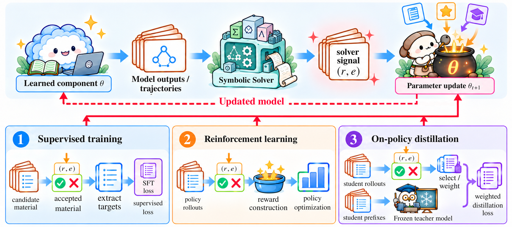

# R5 · Learning Supervision

[All papers](../catalogue.md) · [Taxonomy](../../docs/taxonomy.md) · [CSV metadata](../../data/papers.csv)

Use solver outcomes to construct or select training data, rewards, or learning targets.

262 studies in the confirmed corpus snapshot. Role assignments overlap; a diagnostic study carrying a role label is not thereby a deployed method.

## Core methods

- [A Solver-in-the-Loop Framework for Improving LLMs on Answer Set Programming for Logic Puzzle Solving](<https://doi.org/10.1609/aaai.v40i30.39714>) (2026) — Schrader T.P.;  Lange L.;  Kaminski T. et al.
- [A Verifier-Guided Explainable Reasoning Framework with Gold-Anchored QLoRA, Task-Aware Mixture-of-Experts, and Group-Relative RLVR](<https://arxiv.org/abs/2609.05221>) (2026) — Thi Kim Trang Vo;  Nam Tien Le;  Thi Kim Nguyet Vo et al.
- [Abstraction Generation for Generalized Planning with Pretrained Large Language Models.](<https://arxiv.org/abs/2602.10485>) (2026) — Zhenhe Cui;  Huaxiang Xia;  Hangjun Shen et al.
- [ADVENT: LLM-Driven Automatic Predicate Invention for ILP](<https://arxiv.org/abs/2607.01585>) (2026) — Tingting Yu;  Pei-Cing Huang;  Chan Hsu et al.
- [Agentic Taxation Optimization via LLM SMT-Constraint Reasoning](<https://doi.org/10.1145/3786583.3786917>) (2026) — Hwang T.-C.;  Yu F.;  Jiang J.-H.R.
- [Automatic Theorem Proving Based on Pre-trained Language Models and Unification; \[基于预训练语言模型和合一算法的自动定理证明\]](<https://doi.org/10.11896/jsjkx.251000066>) (2026) — Chen H.;  Zeng X.;  Liu Z. et al.
- [Automating Formal Verification with Reinforcement Learning and Recursive Inference](<https://arxiv.org/abs/2605.30914>) (2026) — Max Tan.
- [AutoOR: Scalably Post-training LLMs to Autoformulate Operations Research Problems](<https://arxiv.org/abs/2604.16804>) (2026) — Sumeet Ramesh Motwani;  Chuan Du;  Aleksander Petrov et al.
- [BEHAVE: Functional Behavior Modeling Enables Self-Improving Agents for Hardware Design and Verification](<https://arxiv.org/abs/2609.34785>) (2026) — Yuheng Wu;  Berk Gokmen;  Sujeeth Jinesh et al.
- [Beyond Solver Verdicts: Generative Reward Models for Autoformalization](<https://arxiv.org/abs/2609.11085>) (2026) — Vikash Singh;  Debargha Ganguly;  Aman Goel et al.
- [Beyond Verified Answers: Solver-Informed Self-Distillation for Bootstrapping Operations Research Language Models](<https://arxiv.org/abs/2609.09957>) (2026) — Rui Zhu;  Minglong Cao;  Chenyu Zhou et al.
- [Bridging Values and Behavior: A Hierarchical Framework for Proactive Embodied Agents](<https://arxiv.org/abs/2604.27699>) (2026) — Chunhui Zhang;  Yuxuan Wang;  Aoyang Qin et al.
- [CompassPlay: Rewarding the Proposer for Where It Moves the Solver](<https://arxiv.org/abs/2609.32228>) (2026) — Sophia Xiao Pu;  Ximeng Sun;  Jiang Liu et al.
- [Conjecture Extraction for Proof Autoformalization](<https://doi.org/10.1007/978-3-032-20322-9_35>) (2026) — Sorg S.;  Li W.;  Banerjee S.
- [CounterMem: World-Model-Verified Counterfactual Memory for Language Agents](<https://arxiv.org/abs/2609.31874>) (2026) — Hongji Pu;  Ruixiang Tang;  Yongfeng Zhang.
- [Directed Neuro-Symbolic Stochastic Execution for Verification of Distributed Parallel AI Programs](<https://arxiv.org/abs/2608.07947>) (2026) — Gautham Koorma;  Vikas Sharma;  George Edwards et al.
- [Discovering New Theorems via LLMs with In-Context Proof Learning in Lean](<https://aclanthology.org/2026.naloma-1.5/>) (2026) — Kasaura, Kazumi; Onda, Naoto; Oriike, Yuta et al.
- [DualGuard: Dual-Mode Quality Control for Logic-Preserving Data Augmentation](<https://arxiv.org/abs/2609.32431>) (2026) — Shenghao Li;  Lin Zhao.
- [EconProver: Towards More Economical Test-Time Scaling for Automated Theorem Proving](<https://doi.org/10.18653/v1/2026.acl-long.2121>) (2026) — Li, Mukai; Song, Linfeng; Liang, Zhenwen et al.
- [Efficient PRM Training Data Synthesis via Formal Verification](<https://doi.org/10.18653/v1/2026.findings-acl.403>) (2026) — Kamoi, Ryo; Zhang, Yusen; Zhang, Nan et al.
- [EnigmaForge: The Question Is Hidden in the Story](<https://arxiv.org/abs/2609.30144>) (2026) — Daniel Eisner.
- [Environment-Driven and LLM-Guided Multi-Robot Task Inference and Allocation Under Temporal Logic Specifications](<https://doi.org/10.1109/tase.2026.3659055>) (2026) — Li L.;  Chen Z.;  Kan Z.
- [Euclid-Omni : A Unified Neuro-Symbolic Framework for Plane Geometry](<https://arxiv.org/abs/2608.14585>) (2026) — Zhaoyu Li;  Hangrui Bi;  Youyuan Zhang et al.
- [Formal Disco: Scalable Open-Ended Generation of Formally Verified Programs](<https://arxiv.org/abs/2607.04631>) (2026) — Gabriel Poesia;  Simon Henniger;  Tzu-Han Hsu et al.
- [Formal Verification of Agentic Systems over Operational Data](<https://arxiv.org/abs/2608.03609>) (2026) — Alejandro J. Mercado;  Alessio Lomuscio.
- [From LLM-Generated Specifications to Learned Quadruped Locomotion](<https://arxiv.org/abs/2609.07111>) (2026) — Merve Atasever;  Keyan Azbijari;  Cagan Bakirci et al.
- [From Solver Feedback to Faithful Plans: Multi-Role Reinforcement Learning for Symbolic Planning](<https://arxiv.org/abs/2608.21897>) (2026) — Chenghao Zhang;  Yikai Mao;  Shanqi Liu et al.
- [Fun2spec: Code Contract Synthesis At Scale](<https://doi.org/10.1145/3803437.3805262>) (2026) — Ugare S.;  Suresh T.;  Misailovic S. et al.
- [Hard Constraints Meet Soft Generation: Guaranteed Feasibility for LLM-based Combinatorial Optimization](<https://arxiv.org/abs/2602.01090>) (2026) — Yang Liu;  Chuan Zhou;  Yancheng Chen et al.
- [Heuristically motivating large language models for task planning](<https://doi.org/10.1016/j.knosys.2026.115725>) (2026) — Wang C.;  Cao L.;  Qi J. et al.
- [Imandra CodeLogician: Neuro-Symbolic Reasoning for Precise Analysis of Software Logic](<https://arxiv.org/abs/2601.11840>) (2026) — Hongyu Lin;  Samer Abdallah;  Makar Valentinov et al.
- [Improving LLM Code Reasoning via Semantic Equivalence Self-Play with Formal Verification](<https://doi.org/10.18653/v1/2026.findings-acl.1615>) (2026) — Nok, Poon Tsz; Barone, Antonio Valerio Miceli.
- [InvWeaver: Deductive Feedback for Invariant Synthesis in Interacting-Loop Programs](<https://arxiv.org/abs/2607.05478>) (2026) — Guangyuan Wu;  Weining Cao;  Zehui Tan et al.
- [JURY-RL: Votes Propose, Proofs Dispose for Label-Free RLVR](<https://arxiv.org/abs/2604.25419>) (2026) — Xinjie Chen;  Biao Fu;  Jing Wu et al.
- [KBSpec: LLM-driven Formal Specification Generation with Evolving Domain Knowledge Base](<https://arxiv.org/abs/2606.21339>) (2026) — Wenhan Wang;  Zeyu Sun.
- [LAMP: Lean-based Agentic framework with MCP and Proof Repair](<https://arxiv.org/abs/2606.28841>) (2026) — Santhana Srinivasan R;  Maithilee Patawar.
- [LCR-RAG: Enhancing Logical Consistency in Retrieval-Augmented Generation via Neuro-symbolic Reinforcement Learning](<https://doi.org/10.18653/v1/2026.acl-long.814>) (2026) — Zheng, Wenxiang; Tang, Guo; Jiang, Shixin et al.
- [LeanPolish: Verified Supervision for Lean Proof Compression](<https://arxiv.org/abs/2609.38384>) (2026) — Pauline Bourigault.
- [Learning to Discover Interesting Mathematics](<https://arxiv.org/abs/2609.28603>) (2026) — Niket Patel;  Ahmad Rammal;  Amaury Hayat et al.
- [Learning to Disprove: Formal Counterexample Generation with Large Language Models](<https://arxiv.org/abs/2603.19514>) (2026) — Zenan Li;  Zhaoyu Li;  Kaiyu Yang et al.
- [Learning to Generate Formally Verifiable Step-by-Step Logic Reasoning via Structured Formal Intermediaries](<https://arxiv.org/abs/2603.29500>) (2026) — Luoxin Chen;  Yichi Zhou;  Huishuai Zhang.
- [Learning to Optimize through Solver-Grounded Self-Play](<https://arxiv.org/abs/2609.34205>) (2026) — Xia Jiang;  Yaoxin Wu;  Chenyu Zhou et al.
- [Learning to Prove, Not Just to Answer: Reinforcement Learning from Formal Verification for Natural-Language Logical Reasoning](<https://arxiv.org/abs/2609.37203>) (2026) — Qili Zhang;  Qianren Mao;  Hanze Cai et al.
- [LLM-Based Grid-World Path Planning With Probabilistic Model Checking](<https://doi.org/10.1145/3803437.3806714>) (2026) — Arya A.T.;  Babikian A.A.;  Jit S. et al.
- [LLM-Grounded Dynamic Task Planning with Hierarchical Temporal Logic for Human-Aware Multi-Robot Handover](<https://arxiv.org/abs/2602.09472>) (2026) — Shuyuan Hu;  Tao Lin;  Kai Ye et al.
- [LLM-VeriOpt: Verification-Guided Reinforcement Learning for LLM-Based Compiler Optimization](<https://doi.org/10.1109/cgo68049.2026.11395239>) (2026) — Fang X.;  Kang J.;  Rocha R. et al.
- [LLMs as Adaptive Meta-Solvers: Strategy-Diverse RL for Industrial-Scale Optimization](<https://arxiv.org/abs/2609.34427>) (2026) — Shihao Zhang;  Weiting Liu;  Siyu Shao et al.
- [LogicTrack: Auditing Reasoning Trajectories of Large Language Models with Formal Logic Solvers](<https://arxiv.org/abs/2609.21492>) (2026) — Jingyu Hu;  Shu Yang;  Weiru Liu et al.
- [LusGen: Leveraging LLMs for Safety-Critical Lustre Design and Requirements Traceability](<https://doi.org/10.1007/978-3-032-22774-4_4>) (2026) — Jiang Y.;  Yan Z.;  Ge N. et al.
- [M3P-R1: Reinforcement Learning for Large Language Model Guided Multi-Modal Motion Planning via MIP Code Generation](<https://arxiv.org/abs/2609.18669>) (2026) — Xingpeng Sun;  Zherong Pan;  Kai Cheng et al.
- [MAC-Reasoner: A Multi-Agent Collaborative Framework for Enhancing Logical Reasoning in Large Language Models](<https://doi.org/10.18653/v1/2026.findings-acl.233>) (2026) — Lin, Yehua; Zheng, Liping; Chen, Yin.
- [MAGS: Multi-agent Auto-formalization Guarantees Safety for Agentic Outputs](<https://arxiv.org/abs/2609.19391>) (2026) — Albert Wu;  Nicholas Roberts;  Tzu-Heng Huang et al.
- [MathCoPilot: An Interactive System for Human-AI Symbiotic Paradigm of Mathematical Research](<https://arxiv.org/abs/2607.14582>) (2026) — Junjie Zhang;  Jiayu Liu;  Wenbin Liu et al.
- [MaxSAT-Based Feedback for Guiding Vision-Language Models in Sudoku](<https://arxiv.org/abs/2607.12711>) (2026) — Pedro Orvalho;  Guillem Alenyà;  Felip Manyà.
- [MisCC: Misinformation Detection on Counterfactual Claims](<https://doi.org/10.1007/978-3-032-09087-4_18>) (2026) — Li X.;  Belle V.;  Ross B.
- [Monotonic Reference-Free Refinement for Autoformalization](<https://arxiv.org/abs/2601.23166>) (2026) — Lan Zhang;  Marco Valentino;  André Freitas.
- [NeSy-RAG: Neuro-Symbolic RAG for Explainable Question Answering](<https://arxiv.org/abs/2608.06292>) (2026) — Jonas Gann;  Michael Gertz.
- [Neuro-symbolic Hierarchical Learning for Long-Horizon Robotic Tasks](<https://doi.org/10.1145/3808338>) (2026) — Huang Y.;  Wu Z.;  Ma Z. et al.
- [Neurosymbolic Language Reasoning as Satisfiability Modulo Theory](<https://arxiv.org/abs/2602.18095>) (2026) — Hyunseok Oh;  Sam Stern;  Youngki Lee et al.
- [Non-Parametric Structural Priors for Geometry Theorem Prediction](<https://arxiv.org/abs/2603.04852>) (2026) — Junbo Zhao;  Ting Zhang;  Can Li et al.
- [NormWorlds-CF: Solver-Verified Counterfactual Normative Reasoning with Metamorphic-Relation GRPO](<https://arxiv.org/abs/2607.03957>) (2026) — Xinqi Zhang.
- [Numina-Lean-Agent: An Open and General Agentic Reasoning System for Formal Mathematics](<https://arxiv.org/abs/2601.14027>) (2026) — Junqi Liu;  Zihao Zhou;  Zekai Zhu et al.
- [Olympiad-level formal mathematical reasoning with reinforcement learning](<https://doi.org/10.1038/s41586-025-09833-y>) (2026) — Hubert T.;  Mehta R.;  Sartran L. et al.
- [On Reasoning-Centric LLM-based Automated Theorem Proving](<https://arxiv.org/abs/2604.19558>) (2026) — Yican Sun;  Chengwei Shi;  Hangzhou Lyu et al.
- [Open-World Task and Motion Planning via Vision-Language Model Generated Constraints.](<https://doi.org/10.1109/lra.2026.3656799>) (2026) — Nishanth Kumar;  William Shen;  Fabio Ramos 0001 et al.
- [ORACLE: Optimizing Reasoning Abilities of Large Language Models via Constraint-Led Synthetic Data Elicitation](<https://doi.org/10.1609/aaai.v40i40.40735>) (2026) — Yang Z.;  Wan W.;  Wang K.
- [PathSymphony: Harmonizing symbolic planning and Large Language Models for curriculum-guided mathematical reasoning](<https://doi.org/10.1016/j.knosys.2026.116598>) (2026) — Mo M.;  Zhang H.;  Tan Y. et al.
- [PhysProver: Advancing Automatic Theorem Proving for Physics](<https://arxiv.org/abs/2601.15737>) (2026) — Hanning Zhang;  Ruida Wang;  Rui Pan et al.
- [Plan Right, Then Plan Tight: Symbolic RL for Efficient Embodied Reasoning](<https://arxiv.org/abs/2606.31260>) (2026) — Xiangli Shi;  Xiaomeng Zhu;  Ye Tian et al.
- [PPDL: LLM-Based Flows as Probabilistic Programs](<https://arxiv.org/abs/2608.05234>) (2026) — Louis Mandel;  Guillaume Baudart;  Mandana Vaziri et al.
- [Precise LLM-based Semantic Slicing for Deadlock Detection in Concurrent Java Programs](<https://doi.org/10.1145/3794763.3794793>) (2026) — Martin T.G.;  Podorozhny R.;  Ahmed S.
- [Predicting the Next State Is Not Enough: JEPA Representations for Lean Theorem Proving](<https://arxiv.org/abs/2609.32908>) (2026) — Aarnav Choudhary.
- [Process-Verified Reinforcement Learning for Theorem Proving via Lean](<https://arxiv.org/abs/2606.20068>) (2026) — Minsu Kim;  Se-Young Yun.
- [Projectional Decoding: Towards Semantic-Aware LLM Generation](<https://doi.org/10.1145/3803437.3805571>) (2026) — Chen B.;  López J.A.H.;  Babikian A.A.
- [PROMISE: Proof Automation as Structural Imitation of Human Reasoning](<https://arxiv.org/abs/2604.05399>) (2026) — Youngjoo Ahn;  Sangyeop Yeo;  Gijung Im et al.
- [ProofWala: A Framework for Multilingual Proof Data Synthesis and Theorem-Proving](<https://doi.org/10.4230/lipics.itp.2026.24>) (2026) — Thakur A.;  Tsoukalas G.;  Durrett G. et al.
- [Putnam 2025 Problems in Rocq using Opus 4.6 and Rocq-MCP](<https://arxiv.org/abs/2603.20405>) (2026) — Guillaume Baudart;  Marc Lelarge;  Tristan Stérin et al.
- [Pythagoras-Prover: Advancing Efficient Formal Proving via Augmented Lean Formalisation](<https://arxiv.org/abs/2606.12594>) (2026) — Joshua Ong Jun Leang;  Zheng Zhao;  Mihaela Cătălina Stoian et al.
- [RAISE: Reinforcing Access Control Policy Synthesis in LLMs via Symbolic Evaluation](<https://arxiv.org/abs/2609.33796>) (2026) — Yingming Zhou;  Adarsh Vatsa;  William Eiers.
- [Re:Form — Reducing Human Annotations in Scalable Formal Software Verification with RL in LLMs: A Preliminary Study on Dafny](<https://www.scopus.com/pages/publications/105038385477?origin=resultslist>) (2026) — Yan C.;  Che F.;  Huang X. et al.
- [Reducing the Costs of Proof Synthesis on Rust Systems by Scaling Up a Seed Training Set](<https://arxiv.org/abs/2602.04910>) (2026) — Nongyu Di;  Tianyu Chen;  Shan Lu et al.
- [Reinforcement Learning Enhanced LLM Agents for Complex Vehicle Routing Problems](<https://arxiv.org/abs/2609.00859>) (2026) — Yi Chen;  Zikang Yu;  Jiahai Wang et al.
- [Rethinking Supervision Granularity: Segment-Level Learning for LLM-Based Theorem Proving](<https://arxiv.org/abs/2605.11905>) (2026) — Shuo Xu;  Jiakun Zhang;  Junyu Lai et al.
- [Reward-Oracle MCTS for Formal Theorem Proving: Sample-Efficient Search and the Need for Kernel-Level Proof Auditing](<https://arxiv.org/abs/2608.28639>) (2026) — Bodla Krishna Vamshi;  Haizhao Yang.
- [Reward-Weighted On-Policy Distillation with an Open Property-Equivalence Verifier for NL-to-SVA Generation](<https://arxiv.org/abs/2605.13501>) (2026) — Qingyun Zou;  Yingze Li;  Tianen Liu et al.
- [Rewarding Novel Deductions: Solver-guided Process Rewards for Logical Reasoning](<https://arxiv.org/abs/2609.34660>) (2026) — Muhammad Asif Ali;  Wenqing Wang;  Huan Wang et al.
- [SATQuest: A Verifier for Logical Reasoning Evaluation and Reinforcement Fine-Tuning of LLMs](<https://doi.org/10.18653/v1/2026.acl-long.96>) (2026) — Zhao, Yanxiao; Li, Yaqian; Bo, Zihao et al.
- [SCALAR: Learning and Composing Skills through LLM Guided Symbolic Planning and Deep RL Grounding](<https://arxiv.org/abs/2603.09036>) (2026) — Renos Zabounidis;  Yue Wu;  Simon Stepputtis et al.
- [Scaling Self-Play with Self-Guidance](<https://arxiv.org/abs/2604.20209>) (2026) — Luke Bailey;  Kaiyue Wen;  Kefan Dong et al.
- [SemOPT: Fixing Semantic Errors in LLM-based Optimization Modeling via Reward-Guided Search](<https://arxiv.org/abs/2609.37361>) (2026) — Zetong Zhou;  Wentao Zhang;  Jingyuan Wang et al.
- [SFT-GRPO Data Overlap as a Post-Training Hyperparameter for Autoformalization](<https://arxiv.org/abs/2604.13515>) (2026) — Xiaole Su;  Kasey Zhang;  Andy Lyu.
- [Shift-Left Requirements Verification: Integrating LLMs and Formal Methods for Automotive Systems](<https://doi.org/10.1007/978-3-032-26220-2_31>) (2026) — Lim Z.;  Wu B.;  Teo Y.S. et al.
- [SPL: Orchestrating Workflows with Declarative Deterministic-Probabilistic Composition](<https://arxiv.org/abs/2607.07727>) (2026) — Wen G. Gong.
- [StepFun-Formalizer: Unlocking the Autoformalization Potential of LLMs Through Knowledge-Reasoning Fusion](<https://doi.org/10.1609/aaai.v40i40.40691>) (2026) — Wu, Yutong;  Huang, Di;  Wan, Ruosi et al.
- [Stratified Consistency Distillation for Natural Language Formalization](<https://arxiv.org/abs/2608.30258>) (2026) — Zhichao Hou;  Ferhat Erata;  Joe Lilien et al.
- [Symbolic-Neural Soft-Logic Reasoning: Towards Robust and Verifiable Thinking Chains via Cooperative Evolution](<https://arxiv.org/abs/2605.25618>) (2026) — Rui Wang;  Zeming Wei;  Yihao Zhang et al.
- [TANDEM: Task and Motion Planning with As-Needed Demonstrations for Efficient Vision-Language-Action Model Fine-tuning](<https://arxiv.org/abs/2609.28314>) (2026) — Samrat Sahoo;  Liang Ji;  Tom Silver et al.
- [Teaching LLMs to Generate Challenging MILP Instances via Solver Feedback](<https://arxiv.org/abs/2609.37356>) (2026) — Jitin Singla;  Parikshit Pareek;  Pratik Jawanpuria et al.
- [TerraFormer: Automated Infrastructure-as-Code with LLMs Fine-Tuned via Policy-Guided Verifier Feedback](<https://doi.org/10.1145/3786583.3786898>) (2026) — Jana P.;  Davidson S.;  Bhasker B. et al.
- [The AGI-Powered Metaverse: A Decentralized Task-Based Cognitive Architecture](<https://doi.org/10.1109/access.2026.3697396>) (2026) — Nechesov A.;  Ruponen J.
- [The Faithfulness Gap: Certifying Semantic Equivalence Between Natural-Language and Formal Mathematical Statements](<https://arxiv.org/abs/2606.16541>) (2026) — Noor Islam S. Mohammad;  Tamim Sheikh.
- [The Interpreter as Teacher: GRPO with Execution Feedback for Prolog Code Generation](<https://www.scopus.com/pages/publications/105048495062?origin=resultslist>) (2026) — Pennino F.;  Raimondi B.;  Rondelli M. et al.
- [TheoremForge: Scaling up Formal Data Synthesis with Low-Budget Agentic Workflow](<https://arxiv.org/abs/2601.17332>) (2026) — Yicheng Tao;  Hongteng Xu.
- [TLA-Prover: Verifiable TLA+ Specification Synthesis via Preference-Optimized Low-Rank Adaptation](<https://arxiv.org/abs/2606.06133>) (2026) — Eric Spencer;  Arslan Bisharat;  Brian Ortiz et al.
- [Toward Secure and Reliable PDDL Formalization of Large Language Models with Planner-in-the-Loop Feedback](<https://arxiv.org/abs/2606.29700>) (2026) — Jiamei Jiang;  Jiajing Zhang;  Feifei Mo et al.
- [Towards Automating Blockchain Consensus Verification with IsabeLLM](<https://doi.org/10.1007/978-3-032-12335-0_1>) (2026) — Jones E.;  Knottenbelt W.
- [Towards Real-World Industrial-Scale Verification: LLM-Driven Theorem Proving on seL4](<https://arxiv.org/abs/2602.08384>) (2026) — Jianyu Zhang;  Fuyuan Zhang;  Jiayi Lu et al.
- [Training Language Models to Use Prolog as a Tool](<https://doi.org/10.18653/v1/2026.findings-acl.1644>) (2026) — Mellgren, Niklas; Schneider-Kamp, Peter; Galke Poech, Lukas.
- [Verifiable Checks for Business Rule Consistency](<https://arxiv.org/abs/2608.00396>) (2026) — Joseph Tafese;  Milad Hooshyar;  Sam Bayless et al.
- [Verified LLM-Driven Synthesis for Concept Design](<https://arxiv.org/abs/2607.15718>) (2026) — Alcino Cunha.
- [Veritas: Structuring and verifying LLM knowledge for logically consistent behavior tree generation in LLM-based agents.](<https://doi.org/10.1016/j.ipm.2026.104830>) (2026) — Hao Tang;  Feng Zhang;  Kejia Wan et al.
- [VeriTrans: Fine-Tuned LLM-Assisted NL→PL Translation via a Deterministic Neuro-symbolic Pipeline](<https://doi.org/10.1145/3805760.3814906>) (2026) — Liu X.;  Kodakandla D.;  Srivastva K. et al.
- [VLM Fine-Tuning for End-to-End Combinatorial Optimization](<https://arxiv.org/abs/2609.37175>) (2026) — Qingsong Yan;  Xia Jiang;  Yaoxin Wu et al.
- [A Combinatorial Identities Benchmark for Theorem Proving via Automated Theorem Generation](<https://arxiv.org/abs/2502.17840>) (2025) — Beibei Xiong;  Hangyu Lv;  Haojia Shan et al.
- [A Framework for LLM-Based Conceptual Modeling: Application to BPMN Collaboration Diagrams](<https://www.webofscience.com/wos/woscc/full-record/WOS:001708920300015>) (2025) — Safan, Aya;  Koepke, Julius.
- [Accessible Smart Contracts Verification: Synthesizing Formal Models with Tamed LLMs](<https://doi.org/10.1109/icst62969.2025.10989026>) (2025) — Corazza J.;  Gavran I.;  Moreira G. et al.
- [ALCHEMY: AMPLIFYING THEOREM-PROVING CAPABILITY THROUGH SYMBOLIC MUTATION](<https://www.scopus.com/pages/publications/105010204516?origin=resultslist>) (2025) — Wu S.;  Lu S.;  Gong Y. et al.
- [AlphaVerus: Bootstrapping Formally Verified Code Generation through Self-Improving Translation and Treefinement](<https://www.webofscience.com/wos/woscc/full-record/WOS:001669603900023>) (2025) — Aggarwal, Pranjal;  Parno, Bryan;  Welleck, Sean.
- [Autoformalizer with Tool Feedback](<https://arxiv.org/abs/2510.06857>) (2025) — Qi Guo;  Jianing Wang;  Jianfei Zhang et al.
- [BFS-Prover: Scalable Best-First Tree Search for LLM-based Automatic Theorem Proving](<https://doi.org/10.18653/v1/2025.acl-long.1565>) (2025) — Xin R.;  Xi C.;  Yang J. et al.
- [Building A Proof-Oriented Programmer That Is 64% Better Than GPT-4o Under Data Scarcity](<https://doi.org/10.18653/v1/2025.findings-acl.1186>) (2025) — Zhang D.;  Wang J.;  Sun T.
- [Building A Proof-Oriented Programmer That Is 64% Better Than GPT-4o Under Data Scarsity.](<https://arxiv.org/abs/2502.11901>) (2025) — Dylan Zhang;  Justin Wang;  Tianran Sun.
- [ChopChop: a Programmable Framework for Semantically Constraining the Output of Language Models](<https://arxiv.org/abs/2509.00360>) (2025) — Shaan Nagy;  Timothy Zhou;  Nadia Polikarpova et al.
- [Combining Large Language Models and Symbolic Reasoning for Multi-Robot Temporal Planning through Explainable Knowledge Bases](<https://arxiv.org/abs/2502.19135>) (2025) — Enrico Saccon;  Matteo Saveriano;  Edoardo Lamon et al.
- [Combining LLM, Non-Monotonic Logical Reasoning, and Human-In-the-loop Feedback in an Assistive AI Agent](<https://doi.org/10.1109/ro-man63969.2025.11217618>) (2025) — Fu T.;  Jauw B.;  Sridharan M.
- [Combining Reasoning Optimized LLMs and SMT Solvers for Automated Loop Invariant Synthesis](<https://doi.org/10.1109/aiware69974.2025.00028>) (2025) — Bharti V.;  Jha S.;  Kumar D. et al.
- [Conflict-Aware Fusion: Mitigating Logic Inertia in Large Language Models via Structured Cognitive Priors](<https://arxiv.org/abs/2512.06393>) (2025) — Qiming Bao;  Xiaoxuan Fu;  Michael Witbrock.
- [DEEPSEEK-PROVER-V1.5: HARNESSING PROOF ASSISTANT FEEDBACK FOR REINFORCEMENT LEARNING AND MONTE-CARLO TREE SEARCH](<https://www.scopus.com/pages/publications/105010181109?origin=resultslist>) (2025) — Xin H.;  Ren Z.Z.;  Song J. et al.
- [DeepSeek-Prover-V2: Advancing Formal Mathematical Reasoning via Reinforcement Learning for Subgoal Decomposition](<https://arxiv.org/abs/2504.21801>) (2025) — Z. Z. Ren;  Zhihong Shao;  Junxiao Song et al.
- [Domain-Conditioned Scene Graphs for State-Grounded Task Planning](<https://doi.org/10.1109/iros60139.2025.11247213>) (2025) — Herzog J.;  Liu J.;  Wang Y.
- [Enforcing Temporal Constraints for LLM Agents](<https://arxiv.org/abs/2512.23738>) (2025) — Adharsh Kamath;  Sishen Zhang;  Calvin Xu et al.
- [Enhancing the Geometric Problem-Solving Ability of Multimodal LLMs via Symbolic-Neural Integration](<https://doi.org/10.1145/3746027.3754571>) (2025) — Pan Y.;  Zhang Z.;  Hu P. et al.
- [Extremal descendant integrals on moduli spaces of curves: An inequality discovered and proved in collaboration with AI](<https://arxiv.org/abs/2512.14575>) (2025) — Johannes Schmitt.
- [Formal Reasoning for Intelligent QA Systems: A Case Study in the Educational Domain](<https://doi.org/10.1145/3746274.3760392>) (2025) — Bui T.;  Nguyen A.;  Thai P. et al.
- [Formal Theorem Generation via MCTS with LLM-Guided Process Optimization](<https://doi.org/10.1007/978-981-96-9849-3_5>) (2025) — Wang L.;  Yang Z.
- [GAR: Generative Adversarial Reinforcement Learning for Formal Theorem Proving](<https://arxiv.org/abs/2510.11769>) (2025) — Ruida Wang;  Jiarui Yao;  Rui Pan et al.
- [Generating Quality Assurance Constraints From Natural Language With LLMs.](<https://doi.org/10.1002/smr.70062>) (2025) — Christoph Mayr-Dorn;  Anmol Bilal;  Cosmina-Cristina Ratiu et al.
- [Gold-medalist Performance in Solving Olympiad Geometry with AlphaGeometry2](<https://www.scopus.com/pages/publications/105032500506?origin=resultslist>) (2025) — Chervonyi Y.;  Trinh T.H.;  Olšák M. et al.
- [Gödel's Poetry](<https://arxiv.org/abs/2512.14252>) (2025) — Kelly J. Davis.
- [Harmonizing Parameterized Verification and Invariant Synthesis for Safety Envelopes in Black-Box Autonomy](<https://doi.org/10.1002/cpe.70339>) (2025) — Lu Y.;  Xiong Z.;  Huang H. et al.
- [IndiMathBench: Autoformalizing Mathematical Reasoning Problems with a Human Touch](<https://arxiv.org/abs/2512.00997>) (2025) — Param Biyani;  Shashank Kirtania;  Yasharth Bajpai et al.
- [Inductive Learning of Logical Theories with LLMs: A Expressivity-graded Analysis.](<https://doi.org/10.1609/aaai.v39i22.34546>) (2025) — João Pedro Gandarela de Souza;  Danilo S. Carvalho;  André Freitas.
- [Integrating Answer Set Programming and Large Language Models for Enhanced Structured Representation of Complex Knowledge in Natural Language](<https://doi.org/10.24963/ijcai.2025/482>) (2025) — Alviano M.;  Grillo L.;  Lo Scudo F. et al.
- [KELPS: A Framework for Verified Multi-Language Autoformalization via Semantic-Syntactic Alignment](<https://arxiv.org/abs/2507.08665>) (2025) — Jiyao Zhang;  Chengli Zhong;  Hui Xu et al.
- [Kimina-Prover Preview: Towards Large Formal Reasoning Models with Reinforcement Learning](<https://arxiv.org/abs/2504.11354>) (2025) — Haiming Wang;  Mert Unsal;  Xiaohan Lin et al.
- [LARGE LANGUAGE MODELS MEET SYMBOLIC PROVERS FOR LOGICAL REASONING EVALUATION](<https://www.scopus.com/pages/publications/105010197628?origin=resultslist>) (2025) — Qi C.;  Ma R.;  Li B. et al.
- [LEAN-STAR: LEARNING TO INTERLEAVE THINKING AND PROVING](<https://www.scopus.com/pages/publications/105010256488?origin=resultslist>) (2025) — Lin H.;  Sun Z.;  Welleck S. et al.
- [Leanabell-Prover-V2: Verifier-integrated Reasoning for Formal Theorem Proving via Reinforcement Learning](<https://arxiv.org/abs/2507.08649>) (2025) — Xingguang Ji;  Yahui Liu;  Qi Wang et al.
- [Leanabell-Prover: Posttraining Scaling in Formal Reasoning](<https://arxiv.org/abs/2504.06122>) (2025) — Jingyuan Zhang;  Qi Wang;  Xingguang Ji et al.
- [LeanConjecturer: Automatic Generation of Mathematical Conjectures for Theorem Proving](<https://arxiv.org/abs/2506.22005>) (2025) — Naoto Onda;  Kazumi Kasaura;  Yuta Oriike et al.
- [LLM-based Automated Theorem Proving Hinges on Scalable Synthetic Data Generation](<https://arxiv.org/abs/2505.12031>) (2025) — Junyu Lai;  Jiakun Zhang;  Shuo Xu et al.
- [Local Look-Ahead Guidance via Verifier-in-the-Loop for Automated Theorem Proving](<https://doi.org/10.18653/v1/2025.findings-acl.825>) (2025) — Rajaee S.;  Pratik K.;  Cesa G. et al.
- [LogicReward: Incentivizing LLM Reasoning via Step-Wise Logical Supervision](<https://arxiv.org/abs/2512.18196>) (2025) — Jundong Xu;  Hao Fei;  Huichi Zhou et al.
- [LOOP: A Plug-and-Play Neuro-Symbolic Framework for Enhancing Planning in Autonomous Systems](<https://arxiv.org/abs/2508.13371>) (2025) — Ronit Virwani;  Ruchika Suryawanshi.
- [Mathematical exploration and discovery at scale](<https://arxiv.org/abs/2511.02864>) (2025) — Bogdan Georgiev;  Javier Gómez-Serrano;  Terence Tao et al.
- [Mathesis: Towards Formal Theorem Proving from Natural Languages](<https://arxiv.org/abs/2506.07047>) (2025) — Yu Xuejun;  Jianyuan Zhong;  Zijin Feng et al.
- [Neural Theorem Proving: Generating and Structuring Proofs for Formal Verification](<https://www.scopus.com/pages/publications/105020243340?origin=resultslist>) (2025) — Rao B.;  Eiers W.;  Lipizzi C.
- [NL2Lean: Translating Natural Language into Lean 4 through Multi-Aspect Reinforcement Learning](<https://doi.org/10.18653/v1/2025.emnlp-main.1586>) (2025) — Fang Y.;  Huang S.;  Yu X. et al.
- [Predicate-Guided Generation for Mathematical Reasoning](<https://doi.org/10.18653/v1/2025.emnlp-main.462>) (2025) — Chen J.;  Tam Y.-C.
- [PREFACE - A Reinforcement Learning Framework for Code Verification via LLM Prompt Repair](<https://doi.org/10.1145/3716368.3735300>) (2025) — Jha M.;  Wan J.;  Zhang H. et al.
- [ProofOptimizer: Training Language Models to Simplify Proofs without Human Demonstrations](<https://arxiv.org/abs/2510.15700>) (2025) — Alex Gu;  Bartosz Piotrowski;  Fabian Gloeckle et al.
- [PSALM-V: Automating Symbolic Planning in Interactive Visual Environments with Large Language Models](<https://arxiv.org/abs/2506.20097>) (2025) — Wang Bill Zhu;  Miaosen Chai;  Ishika Singh et al.
- [QDTSynth: Quality-Driven Formal Theorem Synthesis for Enhancing Proving Performance of LLMs](<https://doi.org/10.18653/v1/2025.acl-long.714>) (2025) — Wang L.;  Zuo R.;  He G. et al.
- [Reinforced Large Language Model is a formal theorem prover](<https://arxiv.org/abs/2502.08908>) (2025) — Zhiling Luo.
- [RepV: Safety-Separable Latent Spaces for Scalable Neurosymbolic Plan Verification](<https://arxiv.org/abs/2510.26935>) (2025) — Yunhao Yang;  Neel P. Bhatt;  Pranay Samineni et al.
- [Rewarding the Unlikely: Lifting GRPO Beyond Distribution Sharpening](<https://doi.org/10.18653/v1/2025.emnlp-main.1298>) (2025) — He A.;  Fried D.;  Welleck S.
- [SATURN: SAT-based Reinforcement Learning to Unleash Language Model Reasoning](<https://www.scopus.com/pages/publications/105048514211?origin=resultslist>) (2025) — Liu H.;  Li G.;  Li J. et al.
- [Scaling up Multi-Turn Off-Policy RL and Multi-Agent Tree Search for LLM Step-Provers](<https://arxiv.org/abs/2509.06493>) (2025) — Ran Xin;  Zeyu Zheng;  Yanchen Nie et al.
- [Seed-Prover 1.5: Mastering Undergraduate-Level Theorem Proving via Learning from Experience](<https://arxiv.org/abs/2512.17260>) (2025) — Jiangjie Chen;  Wenxiang Chen;  Jiacheng Du et al.
- [Seed-Prover: Deep and Broad Reasoning for Automated Theorem Proving](<https://arxiv.org/abs/2507.23726>) (2025) — Luoxin Chen;  Jinming Gu;  Liankai Huang et al.
- [Self-CriTeach: LLM Self-Teaching and Self-Critiquing for Improving Robotic Planning via Automated Domain Generation](<https://arxiv.org/abs/2509.21543>) (2025) — Jinbang Huang;  Zhiyuan Li;  Yuanzhao Hu et al.
- [Spark-Prover-X1: Formal Theorem Proving Through Diverse Data Training](<https://arxiv.org/abs/2511.13043>) (2025) — Xinyuan Zhou;  Yi Lei;  Xiaoyu Zhou et al.
- [StepFun-Prover Preview: Let's Think and Verify Step by Step](<https://arxiv.org/abs/2507.20199>) (2025) — Shijie Shang;  Ruosi Wan;  Yue Peng et al.
- [StepORLM: A Self-Evolving Framework With Generative Process Supervision For Operations Research Language Models](<https://arxiv.org/abs/2509.22558>) (2025) — Chenyu Zhou;  Tianyi Xu;  Jianghao Lin et al.
- [STP: Self-play LLM Theorem Provers with Iterative Conjecturing and Proving](<https://www.scopus.com/pages/publications/105023569067?origin=resultslist>) (2025) — Dong K.;  Ma T.
- [Theorem Prover as a Judge for Synthetic Data Generation](<https://doi.org/10.18653/v1/2025.acl-long.1448>) (2025) — Leang, Joshua Ong Jun; Hong, Giwon; Li, Wenda et al.
- [VeriCoT: Neuro-symbolic Chain-of-Thought Validation via Logical Consistency Checks](<https://arxiv.org/abs/2511.04662>) (2025) — Yu Feng;  Nathaniel Weir;  Kaj Bostrom et al.
- [VerifiAgent: a Unified Verification Agent in Language Model Reasoning.](<https://doi.org/10.18653/v1/2025.findings-emnlp.891>) (2025) — Jiuzhou Han;  Wray L. Buntine;  Ehsan Shareghi.
- [VERUS-LM: a Versatile Framework for Combining LLMs with Symbolic Reasoning](<https://doi.org/10.4204/eptcs.439.5>) (2025) — Callewaert, Benjamin;  Vandevelde, Simon;  Vennekens, Joost.
- [Whatever Remains Must Be True: Filtering Drives Reasoning in LLMs, Shaping Diversity](<https://arxiv.org/abs/2512.05962>) (2025) — Germán Kruszewski;  Pierre Erbacher;  Jos Rozen et al.
- [Who Sees What? Structured Thought-Action Sequences for Epistemic Reasoning in LLMs.](<https://doi.org/10.1007/978-981-95-2398-6_27>) (2025) — Luca Annese;  Sabrina Patania;  Silvia Serino et al.
- [Worst-Case Symbolic Constraints Analysis and Generalisation with Large Language Models](<https://arxiv.org/abs/2506.08171>) (2025) — Daniel Koh;  Yannic Noller;  Corina S. Pasareanu et al.
- [A framework for neurosymbolic robot action planning using large language models](<https://doi.org/10.3389/fnbot.2024.1342786>) (2024) — Capitanelli A.;  Mastrogiovanni F.
- [A Neurosymbolic Fast and Slow Architecture for Graph Coloring](<https://arxiv.org/abs/2412.01752>) (2024) — Vedant Khandelwal;  Vishal Pallagani;  Biplav Srivastava et al.
- [Answer Set Networks: Casting Answer Set Programming into Deep Learning](<https://arxiv.org/abs/2412.14814>) (2024) — Arseny Skryagin;  Daniel Ochs;  Phillip Deibert et al.
- [Autoformalizing Euclidean Geometry](<https://www.scopus.com/pages/publications/85203840785?origin=resultslist>) (2024) — Murphy L.;  Yang K.;  Sun J. et al.
- [Automated Theory Substitution Toward Proof-Driven Software Development](<https://doi.org/10.1109/sera61261.2024.10685627>) (2024) — Scebold J.;  Bond E.;  Gray E. et al.
- [Certified Deductive Reasoning with Language Models](<https://www.scopus.com/pages/publications/85214721943?origin=resultslist>) (2024) — Poesia G.;  Gandhi K.;  Zelikman E. et al.
- [DeepSeek-Prover: Advancing Theorem Proving in LLMs through Large-Scale Synthetic Data](<https://arxiv.org/abs/2405.14333>) (2024) — Huajian Xin;  Daya Guo;  Zhihong Shao et al.
- [Formal Verification of Business Constraints in Workflow-Based Applications](<https://doi.org/10.3390/info15120778>) (2024) — Stoica F.;  Stoica L.F.
- [HunyuanProver: A Scalable Data Synthesis Framework and Guided Tree Search for Automated Theorem Proving](<https://arxiv.org/abs/2412.20735>) (2024) — Yang Li;  Dong Du;  Linfeng Song et al.
- [Lean Workbook: A large-scale Lean problem set formalized from natural language math problems](<https://www.scopus.com/pages/publications/105000509336?origin=resultslist>) (2024) — Ying H.;  Wu Z.;  Geng Y. et al.
- [LEMUR: INTEGRATING LARGE LANGUAGE MODELS IN AUTOMATED PROGRAM VERIFICATION](<https://www.scopus.com/pages/publications/85198296534?origin=resultslist>) (2024) — Wu H.;  Barrett C.;  Narodytska N.
- [LLM-ARC: Enhancing LLMs with an Automated Reasoning Critic](<https://arxiv.org/abs/2406.17663>) (2024) — Aditya Kalyanpur;  Kailash Karthik Saravanakumar;  Victor Barres et al.
- [Lucy: Think and Reason to Solve Text-to-SQL](<https://arxiv.org/abs/2407.05153>) (2024) — Nina Narodytska;  Shay Vargaftik.
- [MUSTARD: MASTERING UNIFORM SYNTHESIS OF THEOREM AND PROOF DATA](<https://www.scopus.com/pages/publications/85197648800?origin=resultslist>) (2024) — Huang Y.;  Lin X.;  Liu Z. et al.
- [Neuro-Symbolic Data Generation for Math Reasoning](<https://www.scopus.com/pages/publications/105000556279?origin=resultslist>) (2024) — Li Z.;  Zhou Z.;  Yao Y. et al.
- [Process-Driven Autoformalization in Lean 4](<https://arxiv.org/abs/2406.01940>) (2024) — Jianqiao Lu;  Yingjia Wan;  Zhengying Liu et al.
- [Prompt-based automation of building code information transformation for compliance checking](<https://doi.org/10.1016/j.autcon.2024.105817>) (2024) — Yang F.;  Zhang J.
- [Proof Flow: Preliminary Study on Generative Flow Network Language Model Tuning for Formal Reasoning](<https://arxiv.org/abs/2410.13224>) (2024) — Matthew Ho;  Vincent Zhu;  Xiaoyin Chen et al.
- [Structured Event Reasoning with Large Language Models](<https://arxiv.org/abs/2408.16098>) (2024) — Li Zhang.
- [SubgoalXL: Subgoal-based Expert Learning for Theorem Proving](<https://arxiv.org/abs/2408.11172>) (2024) — Xueliang Zhao;  Lin Zheng;  Haige Bo et al.
- [TRIP-PAL: Travel Planning with Guarantees by Combining Large Language Models and Automated Planners](<https://arxiv.org/abs/2406.10196>) (2024) — Tomas de la Rosa;  Sriram Gopalakrishnan;  Alberto Pozanco et al.
- [Verification and Refinement of Natural Language Explanations through LLM-Symbolic Theorem Proving](<https://doi.org/10.18653/v1/2024.emnlp-main.172>) (2024) — Quan X.;  Valentino M.;  Dennis L.A. et al.
- [Vision Paper: Proof-Carrying Code Completions](<https://doi.org/10.1145/3691621.3694932>) (2024) — Kamran P.;  Devanbu P.;  Stanford C.
- [Decomposing the Enigma: Subgoal-based Demonstration Learning for Formal Theorem Proving](<https://arxiv.org/abs/2305.16366>) (2023) — Xueliang Zhao;  Wenda Li;  Lingpeng Kong.
- [FORMAL MATHEMATICS STATEMENT CURRICULUM LEARNING](<https://www.scopus.com/pages/publications/85199897126?origin=resultslist>) (2023) — Polu S.;  Han J.M.;  Zheng K. et al.
- [From Word Models to World Models: Translating from Natural Language to the Probabilistic Language of Thought](<https://arxiv.org/abs/2306.12672>) (2023) — Lionel Wong;  Gabriel Grand;  Alexander K. Lew et al.
- [Language Models with Rationality](<https://doi.org/10.18653/v1/2023.emnlp-main.877>) (2023) — Kassner N.;  Tafjord O.;  Sabharwal A. et al.
- [Leveraging Natural Language Processing for a Consistency Checking Toolchain of Automotive Requirements](<https://doi.org/10.1109/re57278.2023.00029>) (2023) — Bertram V.;  Kausch H.;  Kusmenko E. et al.
- [Plansformer Tool: Demonstrating Generation of Symbolic Plans Using Transformers](<https://doi.org/10.24963/ijcai.2023/839>) (2023) — Pallagani V.;  Muppasani B.;  Srivastava B. et al.
- [Autoformalization with Large Language Models](<https://www.scopus.com/pages/publications/85144992805?origin=resultslist>) (2022) — Wu Y.;  Jiang A.Q.;  Li W. et al.
- [Enhancing Self-Consistency and Performance of Pre-Trained Language Models through Natural Language Inference](<https://doi.org/10.18653/v1/2022.emnlp-main.115>) (2022) — Mitchell, Eric; Noh, Joseph; Li, Siyan et al.
- [HyperTree Proof Search for Neural Theorem Proving](<https://www.scopus.com/pages/publications/85163206460?origin=resultslist>) (2022) — Lample G.;  Lachaux M.-A.;  Lavril T. et al.
- [PROOF ARTIFACT CO-TRAINING FOR THEOREM PROVING WITH LANGUAGE MODELS](<https://www.scopus.com/pages/publications/85131513069?origin=resultslist>) (2022) — Han J.M.;  Rute J.;  Wu Y. et al.
- [First neural conjecturing datasets and experiments](<https://doi.org/10.1007/978-3-030-53518-6_24>) (2020) — Urban J.;  Jakubův J.

## Evaluation and diagnostic studies

- [ASP-Bench: From Natural Language to Logic Programs.](<https://arxiv.org/abs/2602.01171>) (2026) — Stefan Szeider.
- [AutoLegal: Toward Universal Traffic Compliance for Autonomous Vehicles Through Knowledge-Enhanced Language Models and Signal Temporal Logic](<https://doi.org/10.1109/tits.2026.3688663>) (2026) — Zhang S.;  Li H.;  Jiang Z. et al.
- [CASP: An Evaluation Dataset for Formal Verification of C Code](<https://doi.org/10.1007/978-3-032-07132-3_5>) (2026) — Hertzberg N.;  Sevenhuijsen M.;  Kåreborn L. et al.
- [Draw2Think: Harnessing Geometry Reasoning through Constraint Engine Interaction](<https://arxiv.org/abs/2605.20743>) (2026) — Juncheng Hu;  Jiawei Du;  Xin Zhang et al.
- [Fighting AI with AI: Leveraging Foundation Models for Assuring AI-Enabled Safety-Critical Systems](<https://doi.org/10.1145/3793656.3793697>) (2026) — Mavridou A.;  Gopinath D.;  Pasareanu C.S.
- [Formalizing Requirements into Dafny Specifications with LLMs](<https://doi.org/10.1007/978-981-95-4213-0_6>) (2026) — Lu Y.-H.;  Zhu X.-Y.;  Zhang W. et al.
- [From Policy Documents to Audit Logic: A LLMs-based Framework for Extracting Executable Audit Rules.](<https://dblp.org/rec/conf/hicss/TangZWLF26>) (2026) — Bingxin Tang;  Jiajie Zhuang;  Zhiang Wu 0001 et al.
- [Improving Dynamic Specification Inference with LLM-Generated Counterexamples](<https://doi.org/10.1109/icst69053.2026.00059>) (2026) — Balestra A.;  Nolasco A.;  Molina F. et al.
- [ITPEval: Benchmarking Formal Translation Across Interactive Theorem Provers](<https://arxiv.org/abs/2607.19407>) (2026) — Jiayi Wu;  Robert Joseph George;  Anima Anandkumar.
- [LGMT: Logic-Grounded Metamorphic Testing for evaluating the reasoning reliability of LLMs](<https://doi.org/10.1016/j.knosys.2026.116324>) (2026) — Zhou Z.;  Li M.;  Fang X. et al.
- [NL2SMT — A LLM based SMT-LIB generation framework](<https://doi.org/10.1016/j.infsof.2026.108229>) (2026) — Miao Z.;  Shi J.;  Huang Y. et al.
- [Not What You Meant: Can LLMs Follow a Specified Negation Semantics?](<https://arxiv.org/abs/2609.27517>) (2026) — Qiming Bao;  Agnieszka Mensfelt;  Michael J. Witbrock et al.
- [On the Generalization Gap in LLM Planning: Tests and Verifier-Reward RL](<https://arxiv.org/abs/2601.14456>) (2026) — Valerio Belcamino;  Nicholas Attolino;  Alessio Capitanelli et al.
- [RGDT-Bench: Benchmarking LLM Reasoning for Rule-Governed Decisions and Their Justifications](<https://arxiv.org/abs/2609.34455>) (2026) — Jianpeng Zhao;  Haihua Xu;  Haoyang Zhang et al.
- [Spurious or Genuine? Evaluating Large Language Models in Validating Counterexamples for Loop Invariant Inference](<https://doi.org/10.3390/electronics15061148>) (2026) — Fan G.;  Wei D.;  Yin B.
- [Synthesizing Precise Protocol Specs from Natural Language for Effective Test Generation](<https://doi.org/10.1109/icst69053.2026.00067>) (2026) — Liu K.;  Liggesmeyer A.;  Chakraborty D. et al.
- [Temporal Requirement Formalization Using Large Language Models](<https://doi.org/10.1109/saner67736.2026.00099>) (2026) — Hu Z.;  Ma W.;  Wang Q. et al.
- [The Misery of Mechanistic Interpretability: A Formal Perspective](<https://arxiv.org/abs/2609.15533>) (2026) — Tobias Ladner;  Matthias Althoff.
- [VeriGeo: Controllable Geometry Question Generation with Numerical and Analytical Verification](<https://arxiv.org/abs/2606.14176>) (2026) — Xiaoxian Duan;  Zequn Liu;  Yingce Xia.
- [A comparison of large language models and model-driven reverse engineering for reverse engineering](<https://doi.org/10.3389/fcomp.2025.1516410>) (2025) — Siala H.;  Lano K.
- [ATLAS: Autoformalizing Theorems through Lifting, Augmentation, and Synthesis of Data](<https://www.scopus.com/pages/publications/105048592223?origin=resultslist>) (2025) — Liu X.;  Bao K.;  Zhang J. et al.
- [Automated Extraction of Conditional Causal Rules from Control Narratives Using Logic Programming and Large Language Models](<https://doi.org/10.1109/etfa65518.2025.11205764>) (2025) — Kunze F.C.;  Manca G.;  Fay A.
- [Can Large Language Models Verify System Software? A Case Study Using FSCQ as a Benchmark](<https://doi.org/10.1145/3713082.3730382>) (2025) — Qin J.;  Du A.;  Zhang D. et al.
- [Combining Logic and Large Language Models for Assisted Debugging and Repair of ASP Programs](<https://doi.org/10.1109/icst62969.2025.10988950>) (2025) — Brancas R.;  Manquinho V.;  Martins R.
- [Cross-Model Evaluation of LLMs for Generating Formal Specification of Distributed Industrial Control Systems](<https://doi.org/10.1016/j.procs.2025.10.053>) (2025) — Raptis G.E.;  Khan M.T.;  Koulamas C. et al.
- [FormaRL: Enhancing Autoformalization with no Labeled Data](<https://arxiv.org/abs/2508.18914>) (2025) — Yanxing Huang;  Xinling Jin;  Sijie Liang et al.
- [In the Mood for Inference: Logic-Based Natural Language Inference with Large Language Models](<https://aclanthology.org/2025.naloma-1.4/>) (2025) — Noble, Bill; Blanck, Rasmus; Wijnholds, Gijs.
- [Ineq-Comp: Benchmarking Human-Intuitive Compositional Reasoning in Automated Theorem Proving on Inequalities](<https://www.scopus.com/pages/publications/105048511620?origin=resultslist>) (2025) — Zhao H.;  Geng Y.;  Tang S. et al.
- [KerSpecGen: Co-piloting formal Kernel specification synthesis with refined knowledge graphs and large language models](<https://doi.org/10.1371/journal.pone.0338821>) (2025) — Wang Z.;  Zhu X.;  Wang H. et al.
- [LLM-Aided Automatic Modeling for Security Protocol Verification](<https://doi.org/10.1109/icse55347.2025.00197>) (2025) — Mao Z.;  Wang J.;  Sun J. et al.
- [LLM-based Generation of Formal Specification for Run-time Security Monitoring of ICS](<https://doi.org/10.1109/csr64739.2025.11130130>) (2025) — Raptis G.E.;  Khan M.T.;  Koulamas C. et al.
- [LLM-based Generation of Weakest Preconditions and Precise Array Invariants](<https://doi.org/10.1109/formalise66629.2025.00016>) (2025) — King D.;  Koutavas V.;  Kovács L.
- [LLM-Driven Automated Generation of Formal Specifications for C Programs](<https://doi.org/10.1109/icbctis66509.2025.11387183>) (2025) — He L.;  Zhang Y.;  Guo W. et al.
- [Natural Language Translation of Formal Proofs through Informalization of Proof Steps and Recursive Summarization along Proof Structure](<https://www.webofscience.com/wos/woscc/full-record/WOS:001733642900023>) (2025) — Hattrori, Seiji;  Matsuzaki, Takuya;  Fujiwara, Makoto.
- [NL2CSP: Towards Automated CSP Code Generation with Large Language Models](<https://doi.org/10.1109/icpads67057.2025.11323031>) (2025) — Wang C.;  Liu N.;  Bao H. et al.
- [On the self-verification limitations of large language models on reasoning and planning tasks.](<https://dblp.org/rec/conf/iclr/StechlyVK25>) (2025) — Kaya Stechly;  Karthik Valmeekam;  Subbarao Kambhampati.
- [Towards Solving More Challenging IMO Problems via Decoupled Reasoning and Proving](<https://arxiv.org/abs/2507.06804>) (2025) — Zhenwen Liang;  Linfeng Song;  Yang Li et al.
- [Towards the LLM-Based Generation of Formal Specifications from Natural-Language Contracts: Early Experiments with Symboleo](<https://doi.org/10.1109/raise66696.2025.00006>) (2025) — Zitouni M.N.;  Anda A.A.;  Rajpal S. et al.
- [You Take the High Road, and I'll Take the Low Road: Large Language Models Logical English and the Highway Code.](<https://doi.org/10.1145/3769126.3769254>) (2025) — Thiago Raulino Dal Pont;  Galileo Sartor;  Adam Z. Wyner et al.
- [Deploying and Evaluating LLMs to Program Service Mobile Robots](<https://doi.org/10.1109/lra.2024.3360020>) (2024) — Hu Z.;  Lucchetti F.;  Schlesinger C. et al.
- [Drowzee: Metamorphic Testing for Fact-Conflicting Hallucination Detection in Large Language Models](<https://doi.org/10.1145/3689776>) (2024) — Li N.;  Li Y.;  Liu Y. et al.
- [Experiments with LLMs for Converting Language to Logic](<https://doi.org/10.1007/978-3-031-71170-1_24>) (2024) — Tammet T.;  Järv P.;  Verrev M. et al.
- [Formal Trust and Threat Modeling Using Large Language Models](<https://doi.org/10.1109/acsacw65225.2024.00033>) (2024) — Yao Z.
- [RTPbench: A Natural Language to Temporal Logic Translation Benchmark for Multi Robot Heterogeneous Task Planning](<https://doi.org/10.1109/icus61736.2024.10839839>) (2024) — Cao B.;  Wang Y.;  Zhang Y. et al.
- [Scaling Synthetic Logical Reasoning Datasets with Context-Sensitive Declarative Grammars](<https://www.webofscience.com/wos/woscc/full-record/WOS:001431695500301>) (2024) — Sileo, Damien.
- [Logically Consistent Adversarial Attacks for Soft Theorem Provers](<https://doi.org/10.24963/ijcai.2022/573>) (2022) — Gaskell A.;  Miao Y.;  Toni F. et al.
