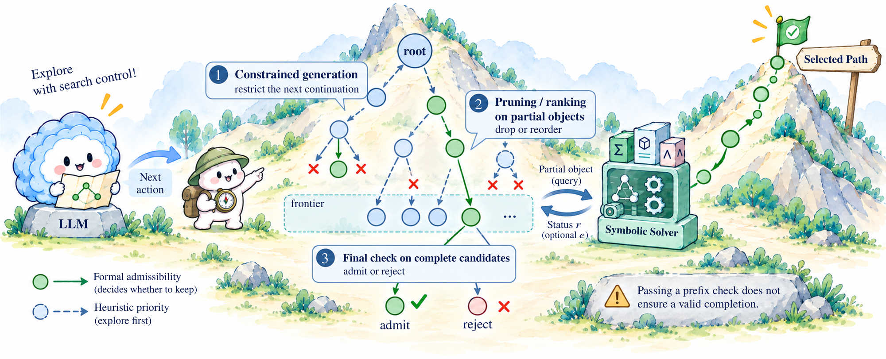

# R4 · Search Control

[All papers](../README.md) · [Taxonomy](../../docs/taxonomy.md)

Use solver signals to guide expansion, pruning, or selection during search.

275 studies in the confirmed corpus snapshot. Role assignments overlap; a diagnostic study carrying a role label is not thereby a deployed method.

| Year | Study | Authors | Roles / status | Class |
| --- | --- | --- | --- | --- |
| 2026 | [A Balanced Neuro-Symbolic Approach for Commonsense Abductive Logic](<https://arxiv.org/abs/2601.18595>) STUDY-8bb2b4e7256504a96fdefc34 | Joseph Cotnareanu;  Didier Chetelat;  Yingxue Zhang et al. | R1, R3, R4 | core_method |
| 2026 | [A Graph-Based Model for Automatic Test Case Generation from Textual Requirements with Hierarchical Coverage; \[Графова модель автоматичного генерування тестових випадкiв з тестових вимог з iєрархiчним покриттям\]](<https://doi.org/10.23939/mmc2026.01.311>) STUDY-2be742584361bcafac828b3e | Liubinskyi B.B.;  Zvarych M.M. | R1, R2, R4 | core_method |
| 2026 | [A Logic-Driven Workflow Based on LLM Agents for High-Fidelity SMT Code Generation](<https://doi.org/10.1145/3788731.3788734>) STUDY-64e0ccdefb5f543b4a5fe3c5 | Liu Z.;  Wang K. | R2, R3, R4 | core_method |
| 2026 | [A Solver-in-the-Loop Framework for Improving LLMs on Answer Set Programming for Logic Puzzle Solving](<https://doi.org/10.1609/aaai.v40i30.39714>) STUDY-08d05a53e4aca0137ed9bdaa | Schrader T.P.;  Lange L.;  Kaminski T. et al. | R1, R2, R4, R5 | core_method |
| 2026 | [A Structural Proof of the Lower Bound 21 for 3 × 3 Matrix Multiplication over F₂](<https://arxiv.org/abs/2609.18722>) STUDY-SEP26-2609.18722 | Shuxing Yang;  Rui Zhao;  Junyao Wu et al. | R2, R3, R4 | core_method |
| 2026 | [A Tale of 1001 LoC: Potential Runtime Error-Guided Specification Synthesis for Verifying Large-Scale Programs](<https://doi.org/10.1145/3798268>) STUDY-088012d175df9cc0109bf0c0 | Wang Z.;  Lin T.;  Chen M. et al. | R2, R3, R4 | core_method |
| 2026 | [Abstraction Generation for Generalized Planning with Pretrained Large Language Models.](<https://arxiv.org/abs/2602.10485>) STUDY-1766f429ae80d522a9ce5c9f | Zhenhe Cui;  Huaxiang Xia;  Hangjun Shen et al. | R1, R2, R3, R4, R5 | core_method |
| 2026 | [Agent Hunt: Bounty Based Collaborative Autoformalization With LLM Agents](<https://www.scopus.com/pages/publications/105048467247?origin=resultslist>) STUDY-f32a312cd462339232826ae0 | Brown C.E.;  Kaliszyk C.;  Urban J. | R2, R3, R4 | core_method |
| 2026 | [Agent-Driven Verification of Memory Safety for liblzma Decoder Components with VST](<https://arxiv.org/abs/2608.29716>) STUDY-SEP26-2608.29716 | Prokhor Shlyakhtun;  Alexander Gryzlov;  Vladimir Kukharenko et al. | R1, R2, R3, R4 | core_method |
| 2026 | [Agentic Concolic Execution](<https://doi.org/10.1109/sp63933.2026.00003>) STUDY-b69fec9753fa0bf32e2a576d | Luo Z.;  Zhao H.;  Wolff D. et al. | R1, R4 | core_method |
| 2026 | [Agentic Taxation Optimization via LLM SMT-Constraint Reasoning](<https://doi.org/10.1145/3786583.3786917>) STUDY-1b4d5c633cf355120f1dc3bb | Hwang T.-C.;  Yu F.;  Jiang J.-H.R. | R1, R2, R3, R4, R5 | core_method |
| 2026 | [Agentic-IC3: Enabling Semantic Proof Search in IC3 Model Checking](<https://arxiv.org/abs/2609.27162>) STUDY-SEP26-2609.27162 | Yu-Wei Fan;  SooHyuk Cho;  Aarti Gupta et al. | R1, R2, R3, R4 | core_method |
| 2026 | [An AI Approach to Verified Production Cryptographic Libraries](<https://arxiv.org/abs/2608.00965>) STUDY-c1f8e9a775ad85be1ff254c2 | Chuyue Sun;  Su Fong;  Zhiyi Kuang et al. | R2, R4 | core_method |
| 2026 | [An exponential lower bound for the bit pigeonhole principle in resolution over parities](<https://arxiv.org/abs/2609.23015>) STUDY-SEP26-2609.23015 | Kamil Braun | R2, R3, R4 | core_method |
| 2026 | [ASP-Bench: From Natural Language to Logic Programs.](<https://arxiv.org/abs/2602.01171>) STUDY-4215fd3b46e637e54c8c543a | Stefan Szeider | R2, R3, R4, R5 | evaluation_diagnostic |
| 2026 | [Autofy: Automated Synthesis of Formally Verified Code](<https://doi.org/10.1145/3793656.3793688>) STUDY-671cc8b859c8165a3b22a82a | Purschke N.;  Schamschurko A.;  Kirchner S. et al. | R2, R3, R4 | core_method |
| 2026 | [AutoLegal: Toward Universal Traffic Compliance for Autonomous Vehicles Through Knowledge-Enhanced Language Models and Signal Temporal Logic](<https://doi.org/10.1109/tits.2026.3688663>) STUDY-dcbaf83689a80266ad8b54b0 | Zhang S.;  Li H.;  Jiang Z. et al. | R1, R2, R3, R4, R5 | evaluation_diagnostic |
| 2026 | [Automating Formal Verification with Agent-Guided Tree Search](<https://arxiv.org/abs/2605.27485>) STUDY-d4ba66f0b260971364818571 | Leo Yao | R2, R4 | core_method |
| 2026 | [Automating Formal Verification with Reinforcement Learning and Recursive Inference](<https://arxiv.org/abs/2605.30914>) STUDY-d818289225a5157d82b8667e | Max Tan | R2, R3, R4, R5 | core_method |
| 2026 | [Bayesian Active Learning for Intent Disambiguation in Interactive Robot Planning](<https://arxiv.org/abs/2609.34270>) STUDY-SEP26-2609.34270 | Huao Li;  Carson Sobolewski;  Augustinos Saravanos et al. | R1, R2, R4 | core_method |
| 2026 | [BEHAVE: Functional Behavior Modeling Enables Self-Improving Agents for Hardware Design and Verification](<https://arxiv.org/abs/2609.34785>) STUDY-SEP26-2609.34785 | Yuheng Wu;  Berk Gokmen;  Sujeeth Jinesh et al. | R2, R3, R4, R5 | core_method |
| 2026 | [BELMA: Integrating Formal Verification and Large Language Models for Enhanced Smart Contract Security](<https://doi.org/10.1109/tdsc.2026.3725656>) STUDY-1b699e60ae4694638071095a | Sosu R.N.A.;  Chen J.;  Boahen E.K. et al. | R2, R3, R4 | core_method |
| 2026 | [BiFE: Search-Efficient Discovery of CPU-Only Branching Policies via LLM-based Bi-Fidelity Evolution](<https://arxiv.org/abs/2609.36735>) STUDY-SEP26-2609.36735 | Ce Zhang;  Bin Zhang;  Zhiwei Xu et al. | R4 | core_method |
| 2026 | [Bridging Values and Behavior: A Hierarchical Framework for Proactive Embodied Agents](<https://arxiv.org/abs/2604.27699>) STUDY-3805dddf25329ecd14de7fbb | Chunhui Zhang;  Yuxuan Wang;  Aoyang Qin et al. | R1, R2, R3, R4, R5 | core_method |
| 2026 | [Certified Program Synthesis with a Multi-Modal Verifier](<https://arxiv.org/abs/2604.16584>) STUDY-13638472f5dc070975fe9a0c | Yueyang Feng;  Dipesh Kafle;  Vladimir Gladshtein et al. | R2, R3, R4 | core_method |
| 2026 | [Choir: An Open Protocol for Distributed Multi-Agent Autoformalization](<https://arxiv.org/abs/2609.31903>) STUDY-SEP26-2609.31903 | Yidi Qi;  Melanie Weber | R2, R3, R4 | core_method |
| 2026 | [CompassPlay: Rewarding the Proposer for Where It Moves the Solver](<https://arxiv.org/abs/2609.32228>) STUDY-SEP26-2609.32228 | Sophia Xiao Pu;  Ximeng Sun;  Jiang Liu et al. | R2, R4, R5 | core_method |
| 2026 | [Compiler-Guided Adaptive Proof Search with Cross-Model Synergy on Context-Dependent Theorem Proving](<https://arxiv.org/abs/2608.18084>) STUDY-033e10d4efb51ec3fe4fe3aa | Zhuo Liu;  Ding Yu;  Hangfeng He | R2, R3, R4 | core_method |
| 2026 | [Conjecture Extraction for Proof Autoformalization](<https://doi.org/10.1007/978-3-032-20322-9_35>) STUDY-c046e4b8efcec5343834dcaa | Sorg S.;  Li W.;  Banerjee S. | R1, R2, R4, R5 | core_method |
| 2026 | [CounterMem: World-Model-Verified Counterfactual Memory for Language Agents](<https://arxiv.org/abs/2609.31874>) STUDY-SEP26-2609.31874 | Hongji Pu;  Ruixiang Tang;  Yongfeng Zhang | R2, R3, R4, R5 | core_method |
| 2026 | [CP-Agent: Agentic Constraint Programming.](<https://doi.org/10.1145/3786181.3788711>) STUDY-2a05d8189414fb22c1b30ed8 | Stefan Szeider | R1, R2, R4 | core_method |
| 2026 | [CPUNeSy: Controlling Model Writes for Reliable Neuro-Symbolic Reasoning](<https://arxiv.org/abs/2609.37490>) STUDY-SEP26-2609.37490 | Zeyan Li;  Siyuan Qiu;  Shuai Zhao et al. | R1, R2, R4 | core_method |
| 2026 | [Designability of RNA Targets with Up to Two Length-2 Helices](<https://arxiv.org/abs/2608.25194>) STUDY-SEP26-2608.25194 | Ashutosh S. Jogalekar | R2, R3, R4 | core_method |
| 2026 | [Direct Optimization of Generators for Search in Automated Theorem Proving](<https://arxiv.org/abs/2609.25575>) STUDY-SEP26-2609.25575 | Adam Ousherovitch;  Ambuj Tewari | R2, R4 | core_method |
| 2026 | [Does the Proof Prove It That Way? Faithful Formalization of Elements Proofs](<https://arxiv.org/abs/2608.15432>) STUDY-174479356fed9678b157c590 | Tadd Mao;  Tianjun Zhong;  Dhruva Arekar et al. | R2, R3, R4 | core_method |
| 2026 | [Draft-and-Prune: Improving the Reliability of Auto-formalization for Logical Reasoning](<https://arxiv.org/abs/2603.17233>) STUDY-2f64acf4553e451a1409e3dc | Zhiyu Ni;  Zheng Liang;  Liangcheng Song et al. | R1, R2, R4 | core_method |
| 2026 | [Draw2Think: Harnessing Geometry Reasoning through Constraint Engine Interaction](<https://arxiv.org/abs/2605.20743>) STUDY-a23c180a6f2b3f80f1afcb5d | Juncheng Hu;  Jiawei Du;  Xin Zhang et al. | R1, R2, R3, R4, R5 | evaluation_diagnostic |
| 2026 | [Enhancing Word-Level Property Directed Reachability with LLM-Driven Semantic Guidance](<https://arxiv.org/abs/2609.30131>) STUDY-SEP26-2609.30131 | Guangyu Hu;  Mingkai Miao;  Zhiyuan Yan et al. | R2, R3, R4 | core_method |
| 2026 | [Environment-Driven and LLM-Guided Multi-Robot Task Inference and Allocation Under Temporal Logic Specifications](<https://doi.org/10.1109/tase.2026.3659055>) STUDY-223f4692c15185960427a27a | Li L.;  Chen Z.;  Kan Z. | R1, R2, R3, R4, R5 | core_method |
| 2026 | [Euclid-Omni : A Unified Neuro-Symbolic Framework for Plane Geometry](<https://arxiv.org/abs/2608.14585>) STUDY-65349702024671dc9b9e1bf4 | Zhaoyu Li;  Hangrui Bi;  Youyuan Zhang et al. | R1, R4, R5 | core_method |
| 2026 | [EvoPlan: Evolutionary Neuro-Symbolic Robot Planning with Spatio-Temporal Guarantees](<https://arxiv.org/abs/2607.06724>) STUDY-f8b0bbdc37b0b36d2e7a1872 | Bhavya Sai Nukapotula;  Samin Moosavi;  Haoze Wang et al. | R2, R3, R4 | core_method |
| 2026 | [ExVerus: Verus Proof Repair via Counterexample Reasoning](<https://arxiv.org/abs/2603.25810>) STUDY-2e80161c6ca851ef92f6dd93 | Jun Yang;  Yuechun Sun;  Yi Wu et al. | R2, R3, R4 | core_method |
| 2026 | [FGeo-ISRL: A MCTS-Enhanced Deep Reinforcement Learning System for Plane Geometry Problem-Solving via Inverse Search](<https://doi.org/10.3390/sym18040628>) STUDY-60b03a7c7e7ee33472a99515 | Li Y.;  Zhang X.;  Qin C. et al. | R1, R4 | core_method |
| 2026 | [Fighting AI with AI: Leveraging Foundation Models for Assuring AI-Enabled Safety-Critical Systems](<https://doi.org/10.1145/3793656.3793697>) STUDY-9a9e5f76fd36b7b3c7bde9ea | Mavridou A.;  Gopinath D.;  Pasareanu C.S. | R1, R2, R3, R4, R5 | evaluation_diagnostic |
| 2026 | [Focusing Recursive LLM Descents with Plans Expressed as Logic Programs](<https://doi.org/10.1007/978-3-032-04848-6_13>) STUDY-5f9808e1a06f6fdbf392a24e | Tarau P. | R1, R4 | core_method |
| 2026 | [Formal Model Construction Guided by Model-Based Proof Sketches](<https://arxiv.org/abs/2609.29870>) STUDY-SEP26-2609.29870 | Hongshu Wang;  Xinyue Zuo;  Yufan Cai et al. | R2, R3, R4 | core_method |
| 2026 | [Formalize Once, Edit the Rest: Efficient Lean-Based Answer Selection for Math Reasoning](<https://arxiv.org/abs/2606.15972>) STUDY-bf27e467cdb81f03190d3164 | Ji Feng;  Zhouxing Shi | R2, R4 | core_method |
| 2026 | [Formally Verified Code Synthesis for Structured Data Translation in a Medical Internet of Things](<https://arxiv.org/abs/2606.20776>) STUDY-711488b54f6b595177326e73 | Colin Samplawski;  Adam D. Cobb | R2, R4 | core_method |
| 2026 | [FormalTCS: Benchmarking End-to-End Frontier Formal Theoretical Computer Science Research of Large Language Models](<https://arxiv.org/abs/2608.20153>) STUDY-c603712946371b74e0aa4e37 | Dingzirui Wang;  Xuanliang Zhang;  Keyan Xu et al. | R2, R3, R4 | core_method |
| 2026 | [Four-arm polyominoes in Golomb’s hierarchy: A complete classification with Lean verification](<https://arxiv.org/abs/2609.13641>) STUDY-SEP26-2609.13641 | Angel Ivanov Raychev | R1, R2, R4 | core_method |
| 2026 | [From LLM Suggestions to Lean Proofs: Verified Redundant Constraints for MiniZinc](<https://doi.org/10.4230/lipics.cp.2026.17>) STUDY-2b67bdc220105df43670c79d | Danzinger P.;  Musliu N. | R2, R3, R4 | core_method |
| 2026 | [From Policy Documents to Audit Logic: A LLMs-based Framework for Extracting Executable Audit Rules.](<https://dblp.org/rec/conf/hicss/TangZWLF26>) STUDY-f77603b1efcb05183723b006 | Bingxin Tang;  Jiajie Zhuang;  Zhiang Wu 0001 et al. | R1, R3, R4, R5 | evaluation_diagnostic |
| 2026 | [Generative AI-Enabled Mission-Aware Radio Orchestration for RIS-Assisted LEO Satellite ISAC Systems](<https://arxiv.org/abs/2608.25803>) STUDY-SEP26-2608.25803 | Fitsum Debebe Tilahun;  Chung G. Kang | R1, R2, R4 | core_method |
| 2026 | [GeoTree: A Dynamic Tree-Based Geometry Problem Solver Through LLM-Symbolic Reasoning](<https://doi.org/10.1109/tmm.2026.3651076>) STUDY-351e9c30a7b656e4951bb838 | Wang Y.;  Wei B.;  Ma Y. et al. | R1, R4 | core_method |
| 2026 | [Goedel-Code-Prover: Hierarchical Proof Search for Open State-of-the-Art Code Verification](<https://arxiv.org/abs/2603.19329>) STUDY-90c64eb88501ee5e326086cb | Zenan Li;  Ziran Yang;  Deyuan He et al. | R2, R4 | core_method |
| 2026 | [GPT-Based Automated Induction: Vulnerability Detection in Medical Software](<https://doi.org/10.1109/jbhi.2025.3544560>) STUDY-4f656fe4fc1fdc9174d55319 | Deng L.;  Lei H.;  Khan F. et al. | R1, R4 | core_method |
| 2026 | [HeurEvo: Agentic Evolution of Hybrid Solver-Augmented Heuristics for Time-Critical Mathematical Optimization](<https://arxiv.org/abs/2609.36303>) STUDY-SEP26-2609.36303 | Feijie Wu;  Hugo Barbalho;  Konstantina Mellou et al. | R1, R2, R4 | core_method |
| 2026 | [Heuristically motivating large language models for task planning](<https://doi.org/10.1016/j.knosys.2026.115725>) STUDY-37eea1ae4a167f1ddeef7316 | Wang C.;  Cao L.;  Qi J. et al. | R1, R2, R3, R4, R5 | core_method |
| 2026 | [Hierarchy Guided Extraction with Answer Set Programming and Large Language Models](<https://www.scopus.com/pages/publications/105048508148?origin=resultslist>) STUDY-d176d8536608ad6312617d88 | Alviano M.;  Busiello M.;  Grillo L. | R2, R4 | core_method |
| 2026 | [Imagine-TAMP: Imagination-Guided Task and Motion Planning in Partial Observability](<https://arxiv.org/abs/2609.20396>) STUDY-SEP26-2609.20396 | Antareep Singha;  Shivaram Kumar;  Yoonwoo Kim et al. | R1, R2, R4 | core_method |
| 2026 | [Imandra CodeLogician: Neuro-Symbolic Reasoning for Precise Analysis of Software Logic](<https://arxiv.org/abs/2601.11840>) STUDY-4b6356a21c8797c9b41347dc | Hongyu Lin;  Samer Abdallah;  Makar Valentinov et al. | R1, R2, R3, R4, R5 | core_method |
| 2026 | [Improving Dynamic Specification Inference with LLM-Generated Counterexamples](<https://doi.org/10.1109/icst69053.2026.00059>) STUDY-72cc058aae1634b7bda49032 | Balestra A.;  Nolasco A.;  Molina F. et al. | R1, R2, R3, R4, R5 | evaluation_diagnostic |
| 2026 | [Inductive Deductive Synthesis: Enabling AI to Generate Formally Verified Systems](<https://arxiv.org/abs/2605.23109>) STUDY-9c9fc72d4666cc86519a8114 | Shubham Agarwal;  Alexander Krentsel;  Shu Liu et al. | R2, R3, R4 | core_method |
| 2026 | [Inference-Time Diversity in RL-Trained Lean Theorem Provers: A Diagnostic Study](<https://arxiv.org/abs/2601.16172>) STUDY-aa8959c5bbdd8f9409f1e9c9 | Zachary Burton | R2, R4 | core_method |
| 2026 | [LAMP: Lean-based Agentic framework with MCP and Proof Repair](<https://arxiv.org/abs/2606.28841>) STUDY-51bba85e532fd55b06336198 | Santhana Srinivasan R;  Maithilee Patawar | R1, R2, R3, R4, R5 | core_method |
| 2026 | [Large Language Models as Falsifiers for Cyber-Physical Systems](<https://arxiv.org/abs/2609.20752>) STUDY-SEP26-2609.20752 | Ali ArjomandBigdeli;  Jiawei Zhou;  Stanley Bak | R2, R4 | core_method |
| 2026 | [LeanFlow: A Case Study in Workflow-Driven Lean Autoformalization](<https://arxiv.org/abs/2607.20503>) STUDY-6f834d1e4d235554621d373a | Lazar Milikic;  Simon Guilloud;  Khanh Nguyen et al. | R2, R4 | core_method |
| 2026 | [LeanPolish: Verified Supervision for Lean Proof Compression](<https://arxiv.org/abs/2609.38384>) STUDY-SEP26-2609.38384 | Pauline Bourigault | R2, R4, R5 | core_method |
| 2026 | [LeanTutor: Towards a Verified AI Mathematical Proof Tutor](<https://doi.org/10.1609/aaai.v40i47.41514>) STUDY-989dad25934889fec01909e4 | Patel M.;  Bhattacharyya R.;  Lu T. et al. | R2, R4 | core_method |
| 2026 | [Learning to Discover Interesting Mathematics](<https://arxiv.org/abs/2609.28603>) STUDY-SEP26-2609.28603 | Niket Patel;  Ahmad Rammal;  Amaury Hayat et al. | R2, R4, R5 | core_method |
| 2026 | [LGMT: Logic-Grounded Metamorphic Testing for evaluating the reasoning reliability of LLMs](<https://doi.org/10.1016/j.knosys.2026.116324>) STUDY-69ceca4f795072502fff9420 | Zhou Z.;  Li M.;  Fang X. et al. | R1, R2, R3, R4, R5 | evaluation_diagnostic |
| 2026 | [LLM-Based Grid-World Path Planning With Probabilistic Model Checking](<https://doi.org/10.1145/3803437.3806714>) STUDY-4c511cdd250bd05591cd7521 | Arya A.T.;  Babikian A.A.;  Jit S. et al. | R1, R2, R3, R4, R5 | core_method |
| 2026 | [LLM-Flax : Generalizable Robotic Task Planning via Neuro-Symbolic Approaches with Large Language Models](<https://arxiv.org/abs/2604.26569>) STUDY-c56dc94186950336992f2b8f | Seongmin Kim;  Daegyu Lee | R1, R3, R4 | core_method |
| 2026 | [LLM-Grounded Dynamic Task Planning with Hierarchical Temporal Logic for Human-Aware Multi-Robot Handover](<https://arxiv.org/abs/2602.09472>) STUDY-1c7d86097cbe78f333cece22 | Shuyuan Hu;  Tao Lin;  Kai Ye et al. | R1, R2, R3, R4, R5 | core_method |
| 2026 | [LLM-Guided Program Evolution for Circle Packing: Breaking 10 Packomania Records for $28](<https://arxiv.org/abs/2609.05093>) STUDY-SEP26-2609.05093 | Wes Sander | R2, R4 | core_method |
| 2026 | [LLM-SYM: Integrating Symbolic Methods and Large Language Models for Automated Theorem Proving](<https://doi.org/10.1007/978-981-95-4213-0_3>) STUDY-5fe600e2c42f831ac95455b3 | Wu Y.;  Huang Y.;  Shi J. | R2, R4 | core_method |
| 2026 | [LLMs as Adaptive Meta-Solvers: Strategy-Diverse RL for Industrial-Scale Optimization](<https://arxiv.org/abs/2609.34427>) STUDY-SEP26-2609.34427 | Shihao Zhang;  Weiting Liu;  Siyu Shao et al. | R1, R4, R5 | core_method |
| 2026 | [LLVM Translation Validation Automated with Large Language Models and Lean](<https://arxiv.org/abs/2609.19583>) STUDY-SEP26-2609.19583 | Chunhao Liao;  Hongxu Xu;  Xintong Zhou et al. | R2, R3, R4 | core_method |
| 2026 | [Logic-Guided Data Extraction with Answer Set Programming and Large Language Models](<https://doi.org/10.1017/s1471068426100635>) STUDY-75c88e6239d735c163f78b81 | Alviano M.;  Grillo L.;  Leone N. et al. | R1, R2, R4 | core_method |
| 2026 | [LogicTrack: Auditing Reasoning Trajectories of Large Language Models with Formal Logic Solvers](<https://arxiv.org/abs/2609.21492>) STUDY-SEP26-2609.21492 | Jingyu Hu;  Shu Yang;  Weiru Liu et al. | R2, R3, R4, R5 | core_method |
| 2026 | [Long-horizon autoformalization of a core theorem underlying MIP\*=RE](<https://arxiv.org/abs/2609.19814>) STUDY-SEP26-2609.19814 | Sirui Lu;  Ruixuan Deng;  David Zhu et al. | R2, R3, R4 | core_method |
| 2026 | [LusGen: Leveraging LLMs for Safety-Critical Lustre Design and Requirements Traceability](<https://doi.org/10.1007/978-3-032-22774-4_4>) STUDY-3d34db079c6804f415319450 | Jiang Y.;  Yan Z.;  Ge N. et al. | R1, R2, R3, R4, R5 | core_method |
| 2026 | [MAGENTA: Closing the Loop Between Mathematical Reasoning and Lean Verification](<https://arxiv.org/abs/2609.11319>) STUDY-SEP26-2609.11319 | Joshua Ong Jun Leang;  Haonan Li;  Zheng Zhao et al. | R2, R3, R4 | core_method |
| 2026 | [MAGS: Multi-agent Auto-formalization Guarantees Safety for Agentic Outputs](<https://arxiv.org/abs/2609.19391>) STUDY-SEP26-2609.19391 | Albert Wu;  Nicholas Roberts;  Tzu-Heng Huang et al. | R2, R3, R4, R5 | core_method |
| 2026 | [MAPLE: Memory-Augmented Planning with Language and Evolution](<https://arxiv.org/abs/2609.11636>) STUDY-SEP26-2609.11636 | Kesheng Chen;  Yamin Hu;  Wenjian Luo | R1, R2, R4 | core_method |
| 2026 | [MathlibLemma: Folklore Lemma Generation and Benchmark for Formal Mathematics](<https://arxiv.org/abs/2602.02561>) STUDY-2ae87ef8e4cdf933e03aeffa | Xinyu Liu;  Zixuan Xie;  Amir Moeini et al. | R2, R3, R4 | core_method |
| 2026 | [MechMath: Sorrifier-Driven Formal Decomposition Workflow for Automated Theorem Proving](<https://arxiv.org/abs/2603.24465>) STUDY-046e5f02e9c3c078f0126b2f | Ruichen Qiu;  Yichuan Cao;  Junqi Liu et al. | R2, R3, R4 | core_method |
| 2026 | [MisCC: Misinformation Detection on Counterfactual Claims](<https://doi.org/10.1007/978-3-032-09087-4_18>) STUDY-2f27baec85ac103a36218739 | Li X.;  Belle V.;  Ross B. | R1, R2, R4, R5 | core_method |
| 2026 | [Model Space Reasoning as Search in Feedback Space for Planning Domain Generation](<https://arxiv.org/abs/2604.08712>) STUDY-42f792e214c3205e994941be | James Oswald;  Daniel Obolensky;  Volodymyr Varha et al. | R2, R3, R4 | core_method |
| 2026 | [Monotonic Reference-Free Refinement for Autoformalization](<https://arxiv.org/abs/2601.23166>) STUDY-11806f9e11dbf6a4983ecb9e | Lan Zhang;  Marco Valentino;  André Freitas | R1, R2, R3, R4, R5 | core_method |
| 2026 | [Neuro-Symbolic Proof Generation for Scaling Systems Software Verification](<https://arxiv.org/abs/2603.19715>) STUDY-741f5a27afaa4ef2e78b663a | Baoding He;  Zenan Li;  Wei Sun et al. | R1, R2, R4 | core_method |
| 2026 | [NeuroSTAR: Automata-guided Neuro-symbolic Specification Formalization](<https://arxiv.org/abs/2609.03161>) STUDY-SEP26-2609.03161 | Joy Saha;  Trey Woodlief;  Sebastian Elbaum et al. | R2, R3, R4 | core_method |
| 2026 | [NL2SMT — A LLM based SMT-LIB generation framework](<https://doi.org/10.1016/j.infsof.2026.108229>) STUDY-b6e4e64a4d6a71b24b7a4f23 | Miao Z.;  Shi J.;  Huang Y. et al. | R1, R2, R3, R4, R5 | evaluation_diagnostic |
| 2026 | [Non-Parametric Structural Priors for Geometry Theorem Prediction](<https://arxiv.org/abs/2603.04852>) STUDY-1bf16a0ffef9e83412edad0d | Junbo Zhao;  Ting Zhang;  Can Li et al. | R1, R2, R3, R4, R5 | core_method |
| 2026 | [NSF-CoT: Neuro-Symbolic Formal Verification of Chain-of-Thought Faithfulness in Contextual Question Answering](<https://doi.org/10.18653/v1/2026.findings-acl.516>) STUDY-55b0bab62963265261dbfa87 | Pramanik, Vishal; Maliha, Maisha; Bastian, Nathaniel D. et al. | R2, R4 | core_method |
| 2026 | [Numina-Lean-Agent: An Open and General Agentic Reasoning System for Formal Mathematics](<https://arxiv.org/abs/2601.14027>) STUDY-37c6be200eb32a5a92966ae4 | Junqi Liu;  Zihao Zhou;  Zekai Zhu et al. | R2, R4, R5 | core_method |
| 2026 | [On Reasoning-Centric LLM-based Automated Theorem Proving](<https://arxiv.org/abs/2604.19558>) STUDY-29ee09f8511fff3be659617c | Yican Sun;  Chengwei Shi;  Hangzhou Lyu et al. | R2, R4, R5 | core_method |
| 2026 | [Open-World Task and Motion Planning via Vision-Language Model Generated Constraints.](<https://doi.org/10.1109/lra.2026.3656799>) STUDY-17275f58b91fef6845e072ee | Nishanth Kumar;  William Shen;  Fabio Ramos 0001 et al. | R1, R2, R3, R4, R5 | core_method |
| 2026 | [Optimizing the Cost-Quality Tradeoff of Agentic Theorem Provers in Lean](<https://arxiv.org/abs/2606.04883>) STUDY-a0314af41cf0061d5af5aae9 | Kári Rögnvaldsson;  Chenhao Sun;  Jasper Dekoninck et al. | R2, R4 | core_method |
| 2026 | [ORACLE: Optimizing Reasoning Abilities of Large Language Models via Constraint-Led Synthetic Data Elicitation](<https://doi.org/10.1609/aaai.v40i40.40735>) STUDY-eaa4d69dee727a86f145b9bf | Yang Z.;  Wan W.;  Wang K. | R2, R4, R5 | core_method |
| 2026 | [PathSymphony: Harmonizing symbolic planning and Large Language Models for curriculum-guided mathematical reasoning](<https://doi.org/10.1016/j.knosys.2026.116598>) STUDY-393d4510bfb4f6b9bfb68093 | Mo M.;  Zhang H.;  Tan Y. et al. | R2, R3, R4, R5 | core_method |
| 2026 | [PolicyAgent: A Multi-Agent Generative AI Framework for Automated Reasoning Checks and Policy-Constrained Compliance in Financial Services](<https://doi.org/10.1109/ecai69016.2026.11613679>) STUDY-fe999d508280c563b9e9760b | Goel S.;  Apuri H. | R2, R4 | core_method |
| 2026 | [Predicting the Next State Is Not Enough: JEPA Representations for Lean Theorem Proving](<https://arxiv.org/abs/2609.32908>) STUDY-SEP26-2609.32908 | Aarnav Choudhary | R2, R4, R5 | core_method |
| 2026 | [PRIMUS: Identity, Governance, and Verification for Multi-Agent Federations](<https://arxiv.org/abs/2609.07910>) STUDY-SEP26-2609.07910 | Sasank Annapureddy;  Anjaneya Prasad Thamatani | R2, R4 | core_method |
| 2026 | [Probabilistic Model Checking of Autoregressive Neural Sequence Models](<https://arxiv.org/abs/2609.00838>) STUDY-SEP26-2609.00838 | Helge Spieker;  Dennis Gross;  Arnaud Gotlieb | R2, R3, R4 | evaluation_diagnostic |
| 2026 | [Projectional Decoding: Towards Semantic-Aware LLM Generation](<https://doi.org/10.1145/3803437.3805571>) STUDY-169c72169ee41f4eb6769ddb | Chen B.;  López J.A.H.;  Babikian A.A. | R1, R2, R3, R4, R5 | core_method |
| 2026 | [Proof-Carrying Certificates for LLM Pipelines: A Trust-Boundary Architecture](<https://arxiv.org/abs/2605.16407>) STUDY-0cf307e20934bec592665a8f | George Koomullil | R1, R2, R3, R4 | core_method |
| 2026 | [ProofEvolve: Neuro-Symbolic Evolution for Formal Automated Theorem Proving](<https://arxiv.org/abs/2608.26334>) STUDY-SEP26-2608.26334 | Wenqian Ye;  Ziwei Guan;  Eric Xie et al. | R2, R3, R4 | core_method |
| 2026 | [ProofGap: Benchmarking Step-Level Formal Reasoning with Local Obligations Derived from Natural-Language Solutions](<https://arxiv.org/abs/2609.29296>) STUDY-SEP26-2609.29296 | Lihan Xie;  Zhicheng Hui;  Yingjun Lan et al. | R2, R3, R4 | core_method |
| 2026 | [ProofLoom: Proof-Obligation-Driven Theory Construction for Autoformalizing Research-Level Stochastic Optimization](<https://arxiv.org/abs/2609.34960>) STUDY-SEP26-2609.34960 | Feiming Wang;  Daibo Li;  Kun Yuan | R2, R3, R4 | core_method |
| 2026 | [Proposing and solving olympiad geometry with guided tree search](<https://doi.org/10.1038/s42256-025-01164-x>) STUDY-2ecc23c28ef0113a6e98aeea | Zhang C.;  Song J.;  Li S. et al. | R1, R4 | core_method |
| 2026 | [Reinforcement Learning Enhanced LLM Agents for Complex Vehicle Routing Problems](<https://arxiv.org/abs/2609.00859>) STUDY-SEP26-2609.00859 | Yi Chen;  Zikang Yu;  Jiahai Wang et al. | R1, R3, R4, R5 | core_method |
| 2026 | [Reward-Oracle MCTS for Formal Theorem Proving: Sample-Efficient Search and the Need for Kernel-Level Proof Auditing](<https://arxiv.org/abs/2608.28639>) STUDY-4d547808beab94fc29f7307a | Bodla Krishna Vamshi;  Haizhao Yang | R2, R4, R5 | core_method |
| 2026 | [RunbookFX: Type- and Effect-Safe LLM Synthesis for Executable Incident Diagnosis and Mitigation](<https://doi.org/10.1145/3828675>) STUDY-272072053cfac5b1eb0d0133 | Xiao Y.;  Li S.;  Ge Y. | R2, R3, R4 | core_method |
| 2026 | [SAILOR: Solver-Assisted Interactive LLM-based Optimization Recovery](<https://arxiv.org/abs/2609.13945>) STUDY-SEP26-2609.13945 | Shaghayegh Sadeghi;  Stephen L. Smith;  David C. Del Rey Fernández | R1, R4 | core_method |
| 2026 | [Schwarz: Solver-Aware Agentic Program Verification](<https://arxiv.org/abs/2608.30803>) STUDY-SEP26-2608.30803 | Jingyu Ke;  Ling-I Wu;  Guoqiang Li | R2, R3, R4 | core_method |
| 2026 | [SemOPT: Fixing Semantic Errors in LLM-based Optimization Modeling via Reward-Guided Search](<https://arxiv.org/abs/2609.37361>) STUDY-SEP26-2609.37361 | Zetong Zhou;  Wentao Zhang;  Jingyuan Wang et al. | R1, R2, R3, R4, R5 | core_method |
| 2026 | [Shift-Left Requirements Verification: Integrating LLMs and Formal Methods for Automotive Systems](<https://doi.org/10.1007/978-3-032-26220-2_31>) STUDY-46607e3093f3d9f7030d6d5d | Lim Z.;  Wu B.;  Teo Y.S. et al. | R1, R2, R3, R4, R5 | core_method |
| 2026 | [SKILLFORGE: Compositional Skill Synthesis with Verification-in-the-Loop for Generating Formally Verified Dafny Programs](<https://arxiv.org/abs/2608.29841>) STUDY-SEP26-2608.29841 | Yanming Liu;  Xinyue Peng;  Jiannan Cao et al. | R2, R3, R4 | core_method |
| 2026 | [SLED-IFV: Solver-Validated LLM-Guided Decomposition for Scalable Hardware Information-Flow Verification](<https://arxiv.org/abs/2609.25637>) STUDY-SEP26-2609.25637 | Liangtao Dai;  Yimin Gao;  Melika Morsali et al. | R2, R3, R4 | core_method |
| 2026 | [SorryDB: Can AI Provers Complete Real-World Lean Theorems?](<https://arxiv.org/abs/2603.02668>) STUDY-7f89611c55530769bfa59ba0 | Austin Letson;  Leopoldo Sarra;  Auguste Poiroux et al. | R2, R4 | core_method |
| 2026 | [Specula: Scaling formal specifications for autonomous model checking of system code](<https://arxiv.org/abs/2607.25333>) STUDY-099f40abf7b567fc210f5cb4 | Qian Cheng;  Saad Mohammad Rafid Pial;  Ruize Tang et al. | R2, R3, R4 | core_method |
| 2026 | [SPL: Orchestrating Workflows with Declarative Deterministic-Probabilistic Composition](<https://arxiv.org/abs/2607.07727>) STUDY-45441012aac97a9a0a817832 | Wen G. Gong | R2, R3, R4, R5 | core_method |
| 2026 | [Spurious or Genuine? Evaluating Large Language Models in Validating Counterexamples for Loop Invariant Inference](<https://doi.org/10.3390/electronics15061148>) STUDY-c0eea2308aeee4bb980c8773 | Fan G.;  Wei D.;  Yin B. | R1, R2, R3, R4, R5 | evaluation_diagnostic |
| 2026 | [StochBench: A Domain-Specific Benchmark for Stochastic Processes in Lean](<https://arxiv.org/abs/2609.09264>) STUDY-SEP26-2609.09264 | Idan Davidovich;  Debargha Ganguly;  Vikash Singh et al. | R2, R3, R4 | evaluation_diagnostic |
| 2026 | [SWE-Proof: Can Language Models Resolve Real-World Issues with Machine-Checked Proofs?](<https://arxiv.org/abs/2609.21190>) STUDY-SEP26-2609.21190 | George Ma;  Benjamin Mikek;  Haoyu Li et al. | R2, R3, R4 | core_method |
| 2026 | [Synthesizing Inductive Invariants for Distributed Protocols via IC3 and Large Language Models](<https://arxiv.org/abs/2605.24619>) STUDY-3ea3355bd8b30b44b77b0869 | Weining Cao;  Guangyuan Wu;  Yuan Yao et al. | R1, R2, R4 | core_method |
| 2026 | [Synthesizing Precise Protocol Specs from Natural Language for Effective Test Generation](<https://doi.org/10.1109/icst69053.2026.00067>) STUDY-7cbb3462ac1f6a22c82c6be9 | Liu K.;  Liggesmeyer A.;  Chakraborty D. et al. | R1, R2, R3, R4, R5 | evaluation_diagnostic |
| 2026 | [Temporal Reasoning Is Not the Bottleneck: A Probabilistic Inconsistency Framework for Neuro-Symbolic QA](<https://arxiv.org/abs/2605.04243>) STUDY-c61a38eaac0131126bdfaff8 | Tran Quang Liem | R2, R4 | core_method |
| 2026 | [Temporal Requirement Formalization Using Large Language Models](<https://doi.org/10.1109/saner67736.2026.00099>) STUDY-d471e8c6198628ac009fcf78 | Hu Z.;  Ma W.;  Wang Q. et al. | R1, R2, R3, R4, R5 | evaluation_diagnostic |
| 2026 | [The Case for Automated Hyperspecialization: Evidence from SAT](<https://arxiv.org/abs/2609.14836>) STUDY-SEP26-2609.14836 | Harrison Green;  Claire Le Goues;  Fraser Brown | R2, R3, R4 | core_method |
| 2026 | [The Faithfulness Gap: Certifying Semantic Equivalence Between Natural-Language and Formal Mathematical Statements](<https://arxiv.org/abs/2606.16541>) STUDY-25fceaf1105d6e4e2333a53f | Noor Islam S. Mohammad;  Tamim Sheikh | R2, R4, R5 | core_method |
| 2026 | [TLA-Prover: Verifiable TLA+ Specification Synthesis via Preference-Optimized Low-Rank Adaptation](<https://arxiv.org/abs/2606.06133>) STUDY-5f3faae2fae16832183e4e8c | Eric Spencer;  Arslan Bisharat;  Brian Ortiz et al. | R3, R4, R5 | core_method |
| 2026 | [Toward Secure and Reliable PDDL Formalization of Large Language Models with Planner-in-the-Loop Feedback](<https://arxiv.org/abs/2606.29700>) STUDY-29de4edeef80478aed689309 | Jiamei Jiang;  Jiajing Zhang;  Feifei Mo et al. | R1, R2, R3, R4, R5 | core_method |
| 2026 | [TreeThink: A Modular Tree Search Library for Mathematical Reasoning with LLMs](<https://arxiv.org/abs/2607.11258>) STUDY-10b621f25576358f188642fe | Burak S. Akbudak;  Zeynel A. Uluşan;  Can S. Erer et al. | R2, R4 | core_method |
| 2026 | [U-Define: Designing User Workflows for Hard and Soft Constraints in LLM-Based Planning](<https://arxiv.org/abs/2605.02765>) STUDY-507a6fe7eb2d6facc6015731 | Christine P Lee;  Xinyu Jessica Wang;  Aws Albarghouthi et al. | R2, R4 | core_method |
| 2026 | [Understanding Tool-Augmented Agents for Lean Formalization: A Factorial Analysis](<https://arxiv.org/abs/2604.16538>) STUDY-33ef7d1efdce2d7ad7b21825 | Ke Zhang;  Patricio Gallardo;  Maziar Raissi et al. | R1, R2, R3, R4 | core_method |
| 2026 | [Verifiable Checks for Business Rule Consistency](<https://arxiv.org/abs/2608.00396>) STUDY-345c891c3c552860c47d5de2 | Joseph Tafese;  Milad Hooshyar;  Sam Bayless et al. | R1, R2, R3, R4, R5 | core_method |
| 2026 | [Verified LLM-Driven Synthesis for Concept Design](<https://arxiv.org/abs/2607.15718>) STUDY-1f562b99a808f9aff9edd9e7 | Alcino Cunha | R1, R2, R3, R4, R5 | core_method |
| 2026 | [VERITAS: Verifier-Guided Proof Search for Zero-Shot Formal Theorem Proving](<https://arxiv.org/abs/2606.19399>) STUDY-6d7aaa077fe0590ba5bbd91d | Manish Acharya;  Zhenyu Liao;  Yueke Zhang et al. | R2, R3, R4 | core_method |
| 2026 | [What Is Worth Representing? Representational Empowerment for Continual Model Construction](<https://arxiv.org/abs/2609.02322>) STUDY-SEP26-2609.02322 | Fei Dai;  Hanqi Zhou;  Alison Gopnik et al. | R1, R3, R4 | core_method |
| 2026 | [When Many Answers Are Valid, Voting Fails: Symbolic Verification for Best-of-K Causal Reasoning in LLMs](<https://arxiv.org/abs/2608.03506>) STUDY-b7c2a675dea9804dbb0d2cdd | Omatharv Bharat Vaidya;  Connor Thomas Jerzak;  Zayne Rea Sprague et al. | R2, R4 | core_method |
| 2025 | [3D-Prover: Diversity Driven Theorem Proving With Determinantal Point Processes](<https://www.scopus.com/pages/publications/105048518474?origin=resultslist>) STUDY-e669f3ef36ff14c795af3b0f | Lamont S.;  Walder C.;  Dezfouli A. et al. | R1, R4 | core_method |
| 2025 | [A Combinatorial Identities Benchmark for Theorem Proving via Automated Theorem Generation](<https://arxiv.org/abs/2502.17840>) STUDY-4910aa6824831775319352dd | Beibei Xiong;  Hangyu Lv;  Haojia Shan et al. | R2, R4, R5 | core_method |
| 2025 | [A comparison of large language models and model-driven reverse engineering for reverse engineering](<https://doi.org/10.3389/fcomp.2025.1516410>) STUDY-9d9b9ba8eab80887790a7447 | Siala H.;  Lano K. | R1, R2, R3, R4, R5 | evaluation_diagnostic |
| 2025 | [A Framework for LLM-Based Conceptual Modeling: Application to BPMN Collaboration Diagrams](<https://www.webofscience.com/wos/woscc/full-record/WOS:001708920300015>) STUDY-158ade72c73126f9362c6360 | Safan, Aya;  Koepke, Julius | R1, R2, R3, R4, R5 | core_method |
| 2025 | [Accessible Smart Contracts Verification: Synthesizing Formal Models with Tamed LLMs](<https://doi.org/10.1109/icst62969.2025.10989026>) STUDY-0e08fb21c103549234820944 | Corazza J.;  Gavran I.;  Moreira G. et al. | R1, R2, R3, R4, R5 | core_method |
| 2025 | [Adaptive Proof Refinement with LLM-Guided Strategy Selection](<https://arxiv.org/abs/2510.25103>) STUDY-090cd2691d37a720fe070f32 | Minghai Lu;  Zhe Zhou;  Danning Xie et al. | R2, R3, R4 | core_method |
| 2025 | [Agentic Specification Generator for Move Programs](<https://arxiv.org/abs/2509.24515>) STUDY-2d929e826f183dee3ba7717f | Yu-Fu Fu;  Meng Xu;  Taesoo Kim | R2, R3, R4 | core_method |
| 2025 | [Agentic Verification of Software Systems](<https://arxiv.org/abs/2511.17330>) STUDY-edc514326e0674c9c8e8d0b3 | Haoxin Tu;  Huan Zhao;  Yahui Song et al. | R2, R3, R4 | core_method |
| 2025 | [AlphaVerus: Bootstrapping Formally Verified Code Generation through Self-Improving Translation and Treefinement](<https://www.webofscience.com/wos/woscc/full-record/WOS:001669603900023>) STUDY-cae6e18da3ef2295f6cbe09d | Aggarwal, Pranjal;  Parno, Bryan;  Welleck, Sean | R2, R3, R4, R5 | core_method |
| 2025 | [ATLAS: Autoformalizing Theorems through Lifting, Augmentation, and Synthesis of Data](<https://www.scopus.com/pages/publications/105048592223?origin=resultslist>) STUDY-83a2a889366e6d551bc576e9 | Liu X.;  Bao K.;  Zhang J. et al. | R1, R2, R3, R4, R5 | evaluation_diagnostic |
| 2025 | [Augmenting Smart Contract Decompiler Output Through Fine-Grained Dependency Analysis and LLM-Facilitated Semantic Recovery](<https://doi.org/10.1109/tse.2025.3623325>) STUDY-1a759258f0d085cbcc5203da | Liao Z.;  Nan Y.;  Gao Z. et al. | R1, R2, R3, R4 | core_method |
| 2025 | [AutoICE: Automatically Synthesizing Verifiable C Code via LLM-driven Evolution](<https://arxiv.org/abs/2512.07501>) STUDY-162683a0e438a4077b2084e1 | Weilin Luo;  Xueyi Liang;  Haotian Deng et al. | R2, R3, R4 | core_method |
| 2025 | [Automated Extraction of Conditional Causal Rules from Control Narratives Using Logic Programming and Large Language Models](<https://doi.org/10.1109/etfa65518.2025.11205764>) STUDY-b3366f83fef4048b7d0e00d5 | Kunze F.C.;  Manca G.;  Fay A. | R1, R3, R4, R5 | evaluation_diagnostic |
| 2025 | [Automated Program Refinement: Guide and Verify Code Large Language Model with Refinement Calculus](<https://doi.org/10.1145/3704905>) STUDY-0ff1f72abf62b009df470941 | Cai Y.;  Hou Z.;  Sanan D. et al. | R1, R2, R3, R4 | core_method |
| 2025 | [AutoVerus: Automated Proof Generation for Rust Code](<https://doi.org/10.1145/3763174>) STUDY-d01e4f8d849c19d31b877a5c | Yang C.;  Li X.;  Misu M.R.H. et al. | R2, R3, R4 | core_method |
| 2025 | [Bourbaki: Self-Generated and Goal-Conditioned MDPs for Theorem Proving](<https://arxiv.org/abs/2507.02726>) STUDY-2acce2ed49a760255fc1e87d | Matthieu Zimmer;  Xiaotong Ji;  Rasul Tutunov et al. | R2, R4 | core_method |
| 2025 | [Can Large Language Models Verify System Software? A Case Study Using FSCQ as a Benchmark](<https://doi.org/10.1145/3713082.3730382>) STUDY-31c819f90ed6ddf6847c3f6f | Qin J.;  Du A.;  Zhang D. et al. | R1, R2, R3, R4, R5 | evaluation_diagnostic |
| 2025 | [CARTS: ADVANCING NEURAL THEOREM PROVING WITH DIVERSIFIED TACTIC CALIBRATION AND BIAS-RESISTANT TREE SEARCH](<https://www.scopus.com/pages/publications/105010254965?origin=resultslist>) STUDY-b2e86e54e67e29cd0df9ca45 | Yang X.-W.;  Zhou Z.;  Wang H. et al. | R1, R4 | core_method |
| 2025 | [ChopChop: a Programmable Framework for Semantically Constraining the Output of Language Models](<https://arxiv.org/abs/2509.00360>) STUDY-48f22d29e0c871bce0ffd8ee | Shaan Nagy;  Timothy Zhou;  Nadia Polikarpova et al. | R1, R2, R3, R4, R5 | core_method |
| 2025 | [Combining Large Language Models and Symbolic Reasoning for Multi-Robot Temporal Planning through Explainable Knowledge Bases](<https://arxiv.org/abs/2502.19135>) STUDY-21d237c91c68cab98d94253e | Enrico Saccon;  Matteo Saveriano;  Edoardo Lamon et al. | R1, R2, R3, R4, R5 | core_method |
| 2025 | [Combining LLM, Non-Monotonic Logical Reasoning, and Human-In-the-loop Feedback in an Assistive AI Agent](<https://doi.org/10.1109/ro-man63969.2025.11217618>) STUDY-48e1244c952a112cc84c3357 | Fu T.;  Jauw B.;  Sridharan M. | R1, R2, R3, R4, R5 | core_method |
| 2025 | [Combining Logic and Large Language Models for Assisted Debugging and Repair of ASP Programs](<https://doi.org/10.1109/icst62969.2025.10988950>) STUDY-d60d22f00b451ce682b11c07 | Brancas R.;  Manquinho V.;  Martins R. | R1, R2, R3, R4, R5 | evaluation_diagnostic |
| 2025 | [Combining Reasoning Optimized LLMs and SMT Solvers for Automated Loop Invariant Synthesis](<https://doi.org/10.1109/aiware69974.2025.00028>) STUDY-1cddef69bbd2e7c7990b0cf1 | Bharti V.;  Jha S.;  Kumar D. et al. | R1, R2, R3, R4, R5 | core_method |
| 2025 | [Cross-Model Evaluation of LLMs for Generating Formal Specification of Distributed Industrial Control Systems](<https://doi.org/10.1016/j.procs.2025.10.053>) STUDY-f7738f32aaa7d638f63bb522 | Raptis G.E.;  Khan M.T.;  Koulamas C. et al. | R2, R3, R4, R5 | evaluation_diagnostic |
| 2025 | [CuDIP: Enhancing Theorem Proving in LLMs via Curriculum Learning-based Direct Preference Optimization](<https://arxiv.org/abs/2502.18532>) STUDY-eaa8a01a5eee5c28bfec4e06 | Shuming Shi;  Ruobing Zuo;  Gaolei He et al. | R4 | core_method |
| 2025 | [Decider: A Dual-System Rule-Controllable Decoding Framework for Language Generation](<https://doi.org/10.1109/tkde.2025.3554819>) STUDY-b1c242ae74a06f64dd5b8e2b | Xu C.;  Lan T.;  Ji Y. et al. | R4 | core_method |
| 2025 | [DEEPSEEK-PROVER-V1.5: HARNESSING PROOF ASSISTANT FEEDBACK FOR REINFORCEMENT LEARNING AND MONTE-CARLO TREE SEARCH](<https://www.scopus.com/pages/publications/105010181109?origin=resultslist>) STUDY-d82237413278827d94a24ee1 | Xin H.;  Ren Z.Z.;  Song J. et al. | R2, R3, R4, R5 | core_method |
| 2025 | [DIVIDE AND TRANSLATE: COMPOSITIONAL FIRST-ORDER LOGIC TRANSLATION AND VERIFICATION FOR COMPLEX LOGICAL REASONING](<https://www.scopus.com/pages/publications/105010227738?origin=resultslist>) STUDY-aa0ce6ea0ea616bdd81d045d | Ryu H.;  Kim G.;  Lee H.S. et al. | R1, R2, R4 | core_method |
| 2025 | [Enhancing the Geometric Problem-Solving Ability of Multimodal LLMs via Symbolic-Neural Integration](<https://doi.org/10.1145/3746027.3754571>) STUDY-37334995f694e3ca83c8c531 | Pan Y.;  Zhang Z.;  Hu P. et al. | R1, R2, R3, R4, R5 | core_method |
| 2025 | [Formal Theorem Generation via MCTS with LLM-Guided Process Optimization](<https://doi.org/10.1007/978-981-96-9849-3_5>) STUDY-fcf56161db6f58ed67dfa06f | Wang L.;  Yang Z. | R2, R4, R5 | core_method |
| 2025 | [GAR: Generative Adversarial Reinforcement Learning for Formal Theorem Proving](<https://arxiv.org/abs/2510.11769>) STUDY-1353f5c20234ca385d068b48 | Ruida Wang;  Jiarui Yao;  Rui Pan et al. | R1, R2, R3, R4, R5 | core_method |
| 2025 | [Generating Quality Assurance Constraints From Natural Language With LLMs.](<https://doi.org/10.1002/smr.70062>) STUDY-11f5dbae6773d154acfcb08f | Christoph Mayr-Dorn;  Anmol Bilal;  Cosmina-Cristina Ratiu et al. | R1, R2, R3, R4, R5 | core_method |
| 2025 | [Generative Agents for Multi-Agent Autoformalization of Interaction Scenarios](<https://doi.org/10.3233/faia251256>) STUDY-b84cdd2505ccc00624683b1d | Mensfelt A.;  Stathis K.;  Trencsenyi V. | R1, R2, R3, R4 | core_method |
| 2025 | [Gold-medalist Performance in Solving Olympiad Geometry with AlphaGeometry2](<https://www.scopus.com/pages/publications/105032500506?origin=resultslist>) STUDY-1ebbd5e44d7d5bf0f9a90296 | Chervonyi Y.;  Trinh T.H.;  Olšák M. et al. | R1, R2, R3, R4, R5 | core_method |
| 2025 | [Gödel's Poetry](<https://arxiv.org/abs/2512.14252>) STUDY-19bfcd0fbb8362d43783ee8c | Kelly J. Davis | R1, R2, R3, R4, R5 | core_method |
| 2025 | [Harmonizing Parameterized Verification and Invariant Synthesis for Safety Envelopes in Black-Box Autonomy](<https://doi.org/10.1002/cpe.70339>) STUDY-397829c9157377d674687ffa | Lu Y.;  Xiong Z.;  Huang H. et al. | R1, R2, R3, R4, R5 | core_method |
| 2025 | [HBTP: Heuristic Behavior Tree Planning with Large Language Model Reasoning.](<https://doi.org/10.1109/icra55743.2025.11127999>) STUDY-dfee0eadff134b69ca93094d | Yishuai Cai;  Xinglin Chen;  Yunxin Mao et al. | R1, R4 | core_method |
| 2025 | [Ineq-Comp: Benchmarking Human-Intuitive Compositional Reasoning in Automated Theorem Proving on Inequalities](<https://www.scopus.com/pages/publications/105048511620?origin=resultslist>) STUDY-d7f3e5b5c1fc74e4862ee65e | Zhao H.;  Geng Y.;  Tang S. et al. | R1, R2, R3, R4, R5 | evaluation_diagnostic |
| 2025 | [Integrating Answer Set Programming and Large Language Models for Enhanced Structured Representation of Complex Knowledge in Natural Language](<https://doi.org/10.24963/ijcai.2025/482>) STUDY-311fae418d96b36f8043a769 | Alviano M.;  Grillo L.;  Lo Scudo F. et al. | R1, R3, R4, R5 | core_method |
| 2025 | [Just-in-Time Logic Enforcement: A new paradigm of combining statistical and symbolic reasoning for network management](<https://doi.org/10.1145/3772356.3772406>) STUDY-901714c56e30d5e9ab957017 | Hè H.;  Apostolaki M. | R4 | core_method |
| 2025 | [KerSpecGen: Co-piloting formal Kernel specification synthesis with refined knowledge graphs and large language models](<https://doi.org/10.1371/journal.pone.0338821>) STUDY-592d98ecf4b4138240b2161f | Wang Z.;  Zhu X.;  Wang H. et al. | R1, R2, R3, R4, R5 | evaluation_diagnostic |
| 2025 | [Large Language Models Can Solve Real-World Planning Rigorously with Formal Verification Tools](<https://doi.org/10.18653/v1/2025.naacl-long.176>) STUDY-469a15f4a36d74f8f96d3ae1 | Hao Y.;  Chen Y.;  Zhang Y. et al. | R1, R2, R3, R4 | core_method |
| 2025 | [Lean Copilot: Large Language Models as Copilots for Theorem Proving in Lean](<https://www.scopus.com/pages/publications/105014749904?origin=resultslist>) STUDY-6295acd7b674bb27ac937370 | Song P.;  Yang K.;  Anandkumar A. | R1, R2, R4 | core_method |
| 2025 | [LeanProgress: Guiding Search for Neural Theorem Proving via Proof Progress Prediction](<https://www.scopus.com/pages/publications/105027119998?origin=resultslist>) STUDY-209c2a554adc7bb9a5baa9c5 | George R.J.;  Huang S.;  Song P. et al. | R2, R4 | core_method |
| 2025 | [LLM+AL: Bridging Large Language Models and Action Languages for Complex Reasoning About Actions](<https://doi.org/10.1609/aaai.v39i23.34597>) STUDY-29bb305bfa2abbec3162793d | Ishay A.;  Lee J. | R1, R2, R3, R4 | core_method |
| 2025 | [LLM-Aided Automatic Modeling for Security Protocol Verification](<https://doi.org/10.1109/icse55347.2025.00197>) STUDY-be9145c218c5896ddfd3a068 | Mao Z.;  Wang J.;  Sun J. et al. | R1, R2, R3, R4, R5 | evaluation_diagnostic |
| 2025 | [LLM-based Automated Theorem Proving Hinges on Scalable Synthetic Data Generation](<https://arxiv.org/abs/2505.12031>) STUDY-69133ebd423d88415b1c3eff | Junyu Lai;  Jiakun Zhang;  Shuo Xu et al. | R2, R4, R5 | core_method |
| 2025 | [LLM-based Generation of Formal Specification for Run-time Security Monitoring of ICS](<https://doi.org/10.1109/csr64739.2025.11130130>) STUDY-8b0bdeb0a97296c76e975f62 | Raptis G.E.;  Khan M.T.;  Koulamas C. et al. | R1, R2, R3, R4, R5 | evaluation_diagnostic |
| 2025 | [LLM-based Generation of Weakest Preconditions and Precise Array Invariants](<https://doi.org/10.1109/formalise66629.2025.00016>) STUDY-6f297b40b30268ebcf98e822 | King D.;  Koutavas V.;  Kovács L. | R1, R2, R3, R4, R5 | evaluation_diagnostic |
| 2025 | [LLM-Driven Automated Generation of Formal Specifications for C Programs](<https://doi.org/10.1109/icbctis66509.2025.11387183>) STUDY-c3d8ccba362764b793659577 | He L.;  Zhang Y.;  Guo W. et al. | R1, R2, R3, R4, R5 | evaluation_diagnostic |
| 2025 | [Local Look-Ahead Guidance via Verifier-in-the-Loop for Automated Theorem Proving](<https://doi.org/10.18653/v1/2025.findings-acl.825>) STUDY-d5c9de5c7e247e92c7b420a7 | Rajaee S.;  Pratik K.;  Cesa G. et al. | R2, R4, R5 | core_method |
| 2025 | [Logically Constrained Decoding](<https://doi.org/10.18653/v1/2025.mathnlp-main.11>) STUDY-8db44c9bd39ae9dd36af4c8d | Ma, Franklin; Hu, Alan J. | R4 | core_method |
| 2025 | [LTLCodeGen: Code Generation of Syntactically Correct Temporal Logic for Robot Task Planning](<https://doi.org/10.1109/iros60139.2025.11246351>) STUDY-36d082ff124aac91f69078ff | Rabiei B.;  Mahesh Kumar A.R.;  Dai Z. et al. | R1, R2, R3, R4 | core_method |
| 2025 | [Minimizing False Positives in Static Bug Detection via LLM-Enhanced Path Feasibility Analysis](<https://arxiv.org/abs/2506.10322>) STUDY-9755324478174154b04092d3 | Xueying Du;  Kai Yu;  Chong Wang et al. | R2, R4 | core_method |
| 2025 | [MPS-Prover: Advancing Stepwise Theorem Proving by Multi-Perspective Search and Data Curation](<https://www.scopus.com/pages/publications/105048582515?origin=resultslist>) STUDY-99e8c86d641f15dadbd16430 | Liang Z.;  Song L.;  Li Y. et al. | R1, R4 | core_method |
| 2025 | [Natural Language Translation of Formal Proofs through Informalization of Proof Steps and Recursive Summarization along Proof Structure](<https://www.webofscience.com/wos/woscc/full-record/WOS:001733642900023>) STUDY-f644f6f119eee59138d00385 | Hattrori, Seiji;  Matsuzaki, Takuya;  Fujiwara, Makoto | R1, R2, R3, R4, R5 | evaluation_diagnostic |
| 2025 | [NESYC: A NEURO-SYMBOLIC CONTINUAL LEARNER FOR COMPLEX EMBODIED TASKS IN OPEN DOMAINS](<https://www.scopus.com/pages/publications/105010273779?origin=resultslist>) STUDY-2e47e68aebbfd0a81497f329 | Choi W.;  Park J.;  Ahn S. et al. | R1, R2, R3, R4 | core_method |
| 2025 | [On the self-verification limitations of large language models on reasoning and planning tasks.](<https://dblp.org/rec/conf/iclr/StechlyVK25>) STUDY-896981b3f29399f8c3da6bfc | Kaya Stechly;  Karthik Valmeekam;  Subbarao Kambhampati | R1, R2, R3, R4, R5 | evaluation_diagnostic |
| 2025 | [Online Prompt Selection for Program Synthesis](<https://doi.org/10.1609/aaai.v39i11.33227>) STUDY-8936b2578f9812ee0547d8e0 | Li Y.;  Frampton L.;  Mora F. et al. | R1, R2, R4 | core_method |
| 2025 | [PatchPilot: A Cost-Efficient Software Engineering Agent with Early Attempts on Formal Verification](<https://www.scopus.com/pages/publications/105023828073?origin=resultslist>) STUDY-101a5da72ce9ec71489dc309 | Li H.;  Tang Y.;  Wang S. et al. | R2, R3, R4 | core_method |
| 2025 | [PIP-LLM: Integrating PDDL-Integer Programming with LLMs for Coordinating Multi-Robot Teams Using Natural Language](<https://arxiv.org/abs/2510.22784>) STUDY-3fde4123381f7bf9170de193 | Guangyao Shi;  Yuwei Wu;  Vijay Kumar et al. | R1, R2, R3, R4 | core_method |
| 2025 | [PREFACE - A Reinforcement Learning Framework for Code Verification via LLM Prompt Repair](<https://doi.org/10.1145/3716368.3735300>) STUDY-4a12cea38363bb19859e0899 | Jha M.;  Wan J.;  Zhang H. et al. | R2, R3, R4, R5 | core_method |
| 2025 | [Probabilistic Mission Design for Neuro-Symbolic Unmanned Aircraft Systems](<https://doi.org/10.1109/tits.2025.3609835>) STUDY-889d80c4fd409d411f20d36e | Kohaut S.;  Flade B.;  Ochs D. et al. | R1, R4 | core_method |
| 2025 | [ProofAug: Efficient Neural Theorem Proving via Fine-grained Proof Structure Analysis](<https://www.scopus.com/pages/publications/105023636062?origin=resultslist>) STUDY-7baf2f89c5b36d4a0308e6c2 | Liu H.;  Sun J.;  Li Z. et al. | R1, R4 | core_method |
| 2025 | [ProofSketch: Efficient Verified Reasoning for Large Language Models.](<https://arxiv.org/abs/2510.24811>) STUDY-0f3d17ca5d97ef75147ffba5 | Disha Sheshanarayana;  Tanishka Magar | R2, R4 | core_method |
| 2025 | [PROVING OLYMPIAD INEQUALITIES BY SYNERGIZING LLMS AND SYMBOLIC REASONING](<https://www.scopus.com/pages/publications/105010229081?origin=resultslist>) STUDY-cd5190f021f0e2a46326971e | Li Z.;  Li Z.;  Tang W. et al. | R2, R3, R4 | core_method |
| 2025 | [Rango: Adaptive Retrieval-Augmented Proving for Automated Software Verification](<https://doi.org/10.1109/icse55347.2025.00161>) STUDY-c23b6456a57e30a495571c56 | Thompson K.;  Saavedra N.;  Carrott P. et al. | R2, R4 | core_method |
| 2025 | [REAL-Prover: Retrieval Augmented Lean Prover for Mathematical Reasoning](<https://arxiv.org/abs/2505.20613>) STUDY-30c747aaa54c94797d166be0 | Ziju Shen;  Naohao Huang;  Fanyi Yang et al. | R2, R4 | core_method |
| 2025 | [ReasonAlign: A Prompt-Based Framework for Zero-Shot Schema Alignment Across Data Sources](<https://doi.org/10.1109/bigdata66926.2025.11401798>) STUDY-d0bcaf5b1eb2664110e93934 | Zhou J.;  Zhang C.;  Ma P. et al. | R1, R2, R4 | core_method |
| 2025 | [Reliable Evaluation and Benchmarks for Statement Autoformalization](<https://doi.org/10.18653/v1/2025.emnlp-main.907>) STUDY-ce11ce4d5d217fdd518100d2 | Auguste Poiroux;  Gail Weiss;  Viktor Kunčak et al. | R2, R4 | core_method |
| 2025 | [Retrieval-augmented Generative Intelligence Question Answering Technology Based on Knowledge Graph; \[基于知识图谱的检索增强生成智能问答技术\]](<https://doi.org/10.11896/jsjkx.240900064>) STUDY-9eab23f5c5f915bbcc6134b6 | Cheng Z.;  Chen X.;  Wang J. et al. | R1, R4 | core_method |
| 2025 | [Reviving DSP for Advanced Theorem Proving in the Era of Reasoning Models](<https://www.scopus.com/pages/publications/105048596827?origin=resultslist>) STUDY-5c24eb6d4be34e2b0d32d997 | Cao C.;  Song L.;  Li Z. et al. | R1, R4 | core_method |
| 2025 | [Rewarding the Unlikely: Lifting GRPO Beyond Distribution Sharpening](<https://doi.org/10.18653/v1/2025.emnlp-main.1298>) STUDY-aca8c5ce121356a2360fb398 | He A.;  Fried D.;  Welleck S. | R2, R4, R5 | core_method |
| 2025 | [RustAssure: Differential Symbolic Testing for LLM-Transpiled C-to-Rust Code](<https://doi.org/10.1109/ase63991.2025.00051>) STUDY-1b13b3c42b926ffd512c0594 | Bai Y.;  Palit T. | R2, R4 | core_method |
| 2025 | [Scaling up Multi-Turn Off-Policy RL and Multi-Agent Tree Search for LLM Step-Provers](<https://arxiv.org/abs/2509.06493>) STUDY-21170ae05e6ce68727d61820 | Ran Xin;  Zeyu Zheng;  Yanchen Nie et al. | R2, R4, R5 | core_method |
| 2025 | [SpecGen: Automated Generation of Formal Program Specifications via Large Language Models](<https://doi.org/10.1109/icse55347.2025.00129>) STUDY-9d0d88ee902bbf4049e2f9ef | Ma L.;  Liu S.;  Li Y. et al. | R2, R3, R4 | core_method |
| 2025 | [StepORLM: A Self-Evolving Framework With Generative Process Supervision For Operations Research Language Models](<https://arxiv.org/abs/2509.22558>) STUDY-3707c5aa79ca7d4c9624b73e | Chenyu Zhou;  Tianyi Xu;  Jianghao Lin et al. | R1, R2, R3, R4, R5 | core_method |
| 2025 | [SymBa: Symbolic Backward Chaining for Structured Natural Language Reasoning](<https://doi.org/10.18653/v1/2025.naacl-long.124>) STUDY-a7cb73da666d313c294b9c53 | Lee J.;  Hwang W. | R1, R4 | core_method |
| 2025 | [SymPlanner: Deliberate Planning in Language Models with Symbolic Representation.](<https://arxiv.org/abs/2505.01479>) STUDY-4d81eb1c2d7eb88da3a89459 | Siheng Xiong;  Jieyu Zhou;  Zhangding Liu et al. | R2, R3, R4 | core_method |
| 2025 | [Towards Formal Verification of LLM-Generated Code from Natural Language Prompts](<https://arxiv.org/abs/2507.13290>) STUDY-0f92475f4e953b8936eff497 | Aaron Councilman;  David Jiahao Fu;  Aryan Gupta et al. | R1, R2, R4 | core_method |
| 2025 | [Towards Solving More Challenging IMO Problems via Decoupled Reasoning and Proving](<https://arxiv.org/abs/2507.06804>) STUDY-98551c6b8137693a9d005d25 | Zhenwen Liang;  Linfeng Song;  Yang Li et al. | R1, R2, R3, R4, R5 | evaluation_diagnostic |
| 2025 | [Towards the LLM-Based Generation of Formal Specifications from Natural-Language Contracts: Early Experiments with Symboleo](<https://doi.org/10.1109/raise66696.2025.00006>) STUDY-cca74c8c22fdfe155e72b898 | Zitouni M.N.;  Anda A.A.;  Rajpal S. et al. | R1, R2, R3, R4, R5 | evaluation_diagnostic |
| 2025 | [VCSearch: Bridging the Gap Between Well-Defined and Ill-Defined Problems in Mathematical Reasoning](<https://doi.org/10.18653/v1/2025.emnlp-main.642>) STUDY-2f8043493ce674c1695f7987 | Shi-Yu Tian;  Zhi Zhou;  Kun-Yang Yu et al. | R1, R2, R4 | core_method |
| 2025 | [VerifiAgent: a Unified Verification Agent in Language Model Reasoning.](<https://doi.org/10.18653/v1/2025.findings-emnlp.891>) STUDY-130bc28f82f3c1be92a23399 | Jiuzhou Han;  Wray L. Buntine;  Ehsan Shareghi | R1, R2, R3, R4, R5 | core_method |
| 2025 | [You Take the High Road, and I'll Take the Low Road: Large Language Models Logical English and the Highway Code.](<https://doi.org/10.1145/3769126.3769254>) STUDY-90bd942d612fbde2245002c2 | Thiago Raulino Dal Pont;  Galileo Sartor;  Adam Z. Wyner et al. | R1, R2, R3, R4, R5 | evaluation_diagnostic |
| 2024 | [Autoformalizing Euclidean Geometry](<https://www.scopus.com/pages/publications/85203840785?origin=resultslist>) STUDY-3199a3cc7885f334652492dd | Murphy L.;  Yang K.;  Sun J. et al. | R1, R2, R3, R4, R5 | core_method |
| 2024 | [Autoformalizing Mathematical Statements by Symbolic Equivalence and Semantic Consistency](<https://www.scopus.com/pages/publications/105000510067?origin=resultslist>) STUDY-911ea21e535c51dc0c1151c9 | Li Z.;  Wu Y.;  Li Z. et al. | R2, R4 | core_method |
| 2024 | [BC-Prover: Backward Chaining Prover for Formal Theorem Proving](<https://doi.org/10.18653/v1/2024.emnlp-main.180>) STUDY-31d295e17e43e4a968914f37 | He Y.;  Zhang J.;  Bao J. et al. | R2, R4 | core_method |
| 2024 | [ChatGPT in the Loop: A Natural Language Extension for Domain-Specific Modeling Languages](<https://doi.org/10.1007/978-3-031-46002-9_24>) STUDY-0c028a0ec3d0bad494d6cf2f | Busch D.;  Nolte G.;  Bainczyk A. et al. | R2, R3, R4 | core_method |
| 2024 | [ChinaTravel: A Real-World Benchmark for Language Agents in Chinese Travel Planning.](<https://arxiv.org/abs/2412.13682>) STUDY-6481f4ddfe7ed3f7b101bc4f | Jie-Jing Shao;  Xiao-Wen Yang;  Bo-Wen Zhang et al. | R1, R4 | core_method |
| 2024 | [Clover: Closed-Loop Verifiable Code Generation](<https://doi.org/10.1007/978-3-031-65112-0_7>) STUDY-1ca3ab314b174df940bbcc87 | Sun C.;  Sheng Y.;  Padon O. et al. | R2, R4 | core_method |
| 2024 | [DKPROMPT: Domain Knowledge Prompting Vision-Language Models for Open-World Planning](<https://arxiv.org/abs/2406.17659>) STUDY-2957ef293342bb10c1a118e5 | Xiaohan Zhang;  Zainab Altaweel;  Yohei Hayamizu et al. | R1, R2, R4 | core_method |
| 2024 | [Enhancing GPT-Based Planning Policies by Model-Based Plan Validation](<https://doi.org/10.1007/978-3-031-71170-1_26>) STUDY-e7b3673b0f69db25a7d9537c | Rossetti N.;  Tummolo M.;  Gerevini A.E. et al. | R2, R4 | core_method |
| 2024 | [Experiments with LLMs for Converting Language to Logic](<https://doi.org/10.1007/978-3-031-71170-1_24>) STUDY-8b1d86b55a8c468cf0bce84b | Tammet T.;  Järv P.;  Verrev M. et al. | R1, R4, R5 | evaluation_diagnostic |
| 2024 | [FGeo-TP: A Language Model-Enhanced Solver for Euclidean Geometry Problems](<https://doi.org/10.3390/sym16040421>) STUDY-0fcb255325124c71dc229bba | He Y.;  Zou J.;  Zhang X. et al. | R1, R4 | core_method |
| 2024 | [Formal Trust and Threat Modeling Using Large Language Models](<https://doi.org/10.1109/acsacw65225.2024.00033>) STUDY-abf4d657e547b33601b131a2 | Yao Z. | R1, R2, R3, R4, R5 | evaluation_diagnostic |
| 2024 | [Guiding Enumerative Program Synthesis with Large Language Models](<https://doi.org/10.1007/978-3-031-65630-9_15>) STUDY-c116fed597d3ac3a643df93e | Li Y.;  Parsert J.;  Polgreen E. | R1, R2, R4 | core_method |
| 2024 | [HunyuanProver: A Scalable Data Synthesis Framework and Guided Tree Search for Automated Theorem Proving](<https://arxiv.org/abs/2412.20735>) STUDY-298a505b47ec6d18baf9d2cf | Yang Li;  Dong Du;  Linfeng Song et al. | R2, R4, R5 | core_method |
| 2024 | [LEAN-GitHub: Compiling GitHub LEAN repositories for a versatile LEAN prover](<https://arxiv.org/abs/2407.17227>) STUDY-8f8896f3fb4d7c4f585f5db4 | Zijian Wu;  Jiayu Wang;  Dahua Lin et al. | R2, R4 | core_method |
| 2024 | [LEGO-PROVER: NEURAL THEOREM PROVING WITH GROWING LIBRARIES](<https://www.scopus.com/pages/publications/85191726756?origin=resultslist>) STUDY-37168620c459aeac98139a1b | Wang H.;  Xin H.;  Zheng C. et al. | R2, R3, R4 | core_method |
| 2024 | [LLM Meets Bounded Model Checking: Neuro-symbolic Loop Invariant Inference](<https://doi.org/10.1145/3691620.3695014>) STUDY-5d38439a2d39a553a0a19872 | Wu G.;  Cao W.;  Yao Y. et al. | R2, R3, R4 | core_method |
| 2024 | [LLM-ARC: Enhancing LLMs with an Automated Reasoning Critic](<https://arxiv.org/abs/2406.17663>) STUDY-35c0386efa20b3d0a0a2701e | Aditya Kalyanpur;  Kailash Karthik Saravanakumar;  Victor Barres et al. | R1, R2, R3, R4, R5 | core_method |
| 2024 | [LLM-Generated Invariants for Bounded Model Checking Without Loop Unrolling](<https://doi.org/10.1145/3691620.3695512>) STUDY-7f3351004f8448bf43aebcbb | Pirzada M.A.A.;  Reger G.;  Bhayat A. et al. | R2, R4 | core_method |
| 2024 | [Plug in the Safety Chip: Enforcing Constraints for LLM-driven Robot Agents](<https://doi.org/10.1109/icra57147.2024.10611447>) STUDY-adca60971ad1c804b30888f9 | Yang Z.;  Raman S.S.;  Shah A. et al. | R2, R3, R4 | core_method |
| 2024 | [Poster Abstract: Assuring LLM-Enabled Cyber-Physical Systems](<https://doi.org/10.1109/iccps61052.2024.00039>) STUDY-282739ddba6f60503eeee918 | Xu W.;  Liu M.;  Drager S. et al. | R2, R3, R4 | core_method |
| 2024 | [Prompt-based automation of building code information transformation for compliance checking](<https://doi.org/10.1016/j.autcon.2024.105817>) STUDY-4876452ac9f9c4a9b8c51302 | Yang F.;  Zhang J. | R1, R2, R3, R4, R5 | core_method |
| 2024 | [Reliable Reasoning Beyond Natural Language](<https://arxiv.org/abs/2407.11373>) STUDY-71d52a1474bfb6361226bd09 | Nasim Borazjanizadeh;  Steven T. Piantadosi | R1, R2, R4 | core_method |
| 2024 | [RTPbench: A Natural Language to Temporal Logic Translation Benchmark for Multi Robot Heterogeneous Task Planning](<https://doi.org/10.1109/icus61736.2024.10839839>) STUDY-53e3d51c33916f047a400785 | Cao B.;  Wang Y.;  Zhang Y. et al. | R1, R4, R5 | evaluation_diagnostic |
| 2024 | [SELLM: An Integrated Tool Leveraging Symbolic Execution and LLMS for Smart Contract Vulnerability Detection](<https://doi.org/10.1109/iccwamtip64812.2024.10873603>) STUDY-c475944be98a846da5366537 | Sen Y.;  He J. | R1, R4 | core_method |
| 2024 | [Structured Event Reasoning with Large Language Models](<https://arxiv.org/abs/2408.16098>) STUDY-44267ddb3b0351eb81f90783 | Li Zhang | R1, R2, R3, R4, R5 | core_method |
| 2024 | [Subgoal-based Demonstration Learning for Formal Theorem Proving](<https://www.scopus.com/pages/publications/85203801126?origin=resultslist>) STUDY-344fcbf2c20272accad9c17f | Zhao X.;  Li W.;  Kong L. | R2, R4 | core_method |
| 2024 | [Towards Automated Functional Equation Proving: A Benchmark Dataset and A Domain-Specific In-Context Agent](<https://arxiv.org/abs/2407.14521>) STUDY-7b5c063fe8f8b25bd4837977 | Mahdi Buali;  Robert Hoehndorf | R2, R3, R4 | core_method |
| 2024 | [TRIP-PAL: Travel Planning with Guarantees by Combining Large Language Models and Automated Planners](<https://arxiv.org/abs/2406.10196>) STUDY-337c09faa074d62f9a0a8886 | Tomas de la Rosa;  Sriram Gopalakrishnan;  Alberto Pozanco et al. | R1, R2, R3, R4, R5 | core_method |
| 2024 | [Verification and Refinement of Natural Language Explanations through LLM-Symbolic Theorem Proving](<https://doi.org/10.18653/v1/2024.emnlp-main.172>) STUDY-17fa967a5fdf2af7f3cac0b0 | Quan X.;  Valentino M.;  Dennis L.A. et al. | R1, R2, R3, R4, R5 | core_method |
| 2024 | [VerMCTS: Synthesizing Multi-Step Programs using a Verifier, a Large Language Model, and Tree Search](<https://arxiv.org/abs/2402.08147>) STUDY-06e6423026efd467cd20c580 | David Brandfonbrener;  Simon Henniger;  Sibi Raja et al. | R2, R4 | core_method |
| 2024 | [Vision-Language Interpreter for Robot Task Planning](<https://doi.org/10.1109/icra57147.2024.10611112>) STUDY-18ee4a34c0d36edb45cf7064 | Shirai K.;  Beltran-Hernandez C.C.;  Hamaya M. et al. | R1, R2, R3, R4 | core_method |
| 2024 | [What's the Plan? Evaluating and Developing Planning-Aware Techniques for Language Models](<https://arxiv.org/abs/2402.11489>) STUDY-2960473b554dde5e3e080d93 | Eran Hirsch;  Guy Uziel;  Ateret Anaby-Tavor | R1, R4 | core_method |
| 2023 | [An In-Context Learning Agent for Formal Theorem-Proving](<https://arxiv.org/abs/2310.04353>) STUDY-d7ed79570ab73c116d97a420 | Amitayush Thakur;  George Tsoukalas;  Yeming Wen et al. | R2, R3, R4 | core_method |
| 2023 | [Boosting Robot Intelligence in Practice: Enhancing Robot Task Planning with Large Language Models](<https://doi.org/10.1109/icrae59816.2023.10458574>) STUDY-ed072251b48d7039a3bca081 | Zhang Y.;  Wang Z.;  Zhang S. et al. | R1, R4 | core_method |
| 2023 | [Dehallucinating Large Language Models Using Formal Methods Guided Iterative Prompting](<https://doi.org/10.1109/icaa58325.2023.00029>) STUDY-3e8a45d724d267a0fab6f83f | Jha S.;  Jha S.K.;  Lincoln P. et al. | R2, R3, R4 | core_method |
| 2023 | [DRAFT, SKETCH, AND PROVE: GUIDING FORMAL THEOREM PROVERS WITH INFORMAL PROOFS](<https://www.scopus.com/pages/publications/85199898470?origin=resultslist>) STUDY-042889d57b0399ec57d6a33f | Jiang A.Q.;  Welleck S.;  Zhou J.P. et al. | R2, R4 | core_method |
| 2023 | [From Word Models to World Models: Translating from Natural Language to the Probabilistic Language of Thought](<https://arxiv.org/abs/2306.12672>) STUDY-15d35383f54e7346b424bfd1 | Lionel Wong;  Gabriel Grand;  Alexander K. Lew et al. | R1, R3, R4, R5 | core_method |
| 2023 | [Language Models with Rationality](<https://doi.org/10.18653/v1/2023.emnlp-main.877>) STUDY-46bd4c75486051b2ed419b9d | Kassner N.;  Tafjord O.;  Sabharwal A. et al. | R2, R4, R5 | core_method |
| 2023 | [LeanDojo: Theorem Proving with Retrieval-Augmented Language Models](<https://www.scopus.com/pages/publications/85187392761?origin=resultslist>) STUDY-798714057f08ed73677859c8 | Yang K.;  Swope A.M.;  Gu A. et al. | R1, R2, R4 | core_method |
| 2023 | [Learning Proof Transformations and Its Applications in Interactive Theorem Proving](<https://doi.org/10.1007/978-3-031-43369-6_13>) STUDY-f7d0f085ba679230c418a505 | Zhang L.;  Blaauwbroek L.;  Kaliszyk C. et al. | R2, R4 | core_method |
| 2023 | [Neuro Symbolic Reasoning for Planning: Counterexample Guided Inductive Synthesis using Large Language Models and Satisfiability Solving](<https://arxiv.org/abs/2309.16436>) STUDY-4274bf5e0123522b14b0d921 | Sumit Kumar Jha;  Susmit Jha;  Patrick Lincoln et al. | R2, R3, R4 | core_method |
| 2023 | [On the Planning Abilities of Large Language Models - A Critical Investigation.](<https://dblp.org/rec/conf/nips/ValmeekamMSK23>) STUDY-13022070cb473c09554fd47d | Karthik Valmeekam;  Matthew Marquez;  Sarath Sreedharan et al. | R1, R2, R4 | evaluation_diagnostic |
| 2023 | [TRIGO: Benchmarking Formal Mathematical Proof Reduction for Generative Language Models](<https://doi.org/10.18653/v1/2023.emnlp-main.711>) STUDY-7f862d4a9edba35d79c71d84 | Xiong J.;  Shen J.;  Yuan Y. et al. | R2, R4 | core_method |
| 2022 | [Enhancing Self-Consistency and Performance of Pre-Trained Language Models through Natural Language Inference](<https://doi.org/10.18653/v1/2022.emnlp-main.115>) STUDY-4ac1e1ae2906a6ba6ff2f56d | Mitchell, Eric; Noh, Joseph; Li, Siyan et al. | R1, R2, R3, R4, R5 | core_method |
| 2022 | [HyperTree Proof Search for Neural Theorem Proving](<https://www.scopus.com/pages/publications/85163206460?origin=resultslist>) STUDY-523fa3c6299d61d3f96aece6 | Lample G.;  Lachaux M.-A.;  Lavril T. et al. | R2, R4, R5 | core_method |
| 2022 | [Thor: Wielding Hammers to Integrate Language Models and Automated Theorem Provers](<https://www.scopus.com/pages/publications/85163186428?origin=resultslist>) STUDY-17af4ef559d1b970eb9c95c9 | Jiang A.Q.;  Li W.;  Tworkowski S. et al. | R1, R4 | core_method |
| 2022 | [Towards a Mathematics Formalisation Assistant using Large Language Models](<https://arxiv.org/abs/2211.07524>) STUDY-ce1dadb52cefa4b4e34381f5 | Ayush Agrawal;  Siddhartha Gadgil;  Navin Goyal et al. | R2, R4 | core_method |
| 2022 | [Understanding Natural Language in Context](<https://arxiv.org/abs/2205.12691>) STUDY-33d204ccbbe68e8f3a1e2e87 | Avichai Levy;  Erez Karpas | R1, R2, R3, R4 | core_method |
