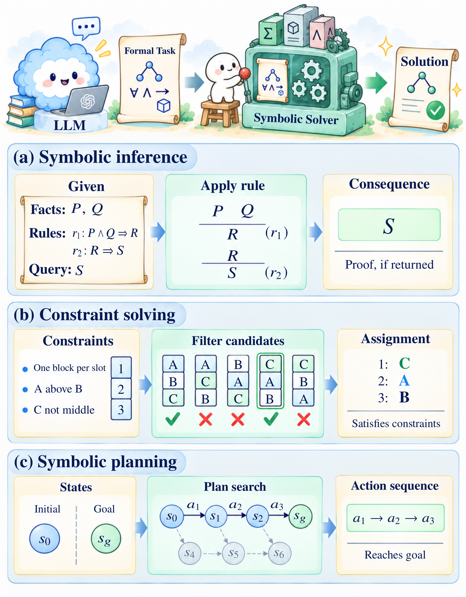

# R1 · Symbolic Solving

[All papers](../README.md) · [Taxonomy](../../docs/taxonomy.md) · [CSV metadata](../../data/papers.csv)

Use the returned consequence, model, plan, or proof to construct an answer.

606 studies in the confirmed corpus snapshot. Role assignments overlap; a diagnostic study carrying a role label is not thereby a deployed method.

## Core methods

- [A Balanced Neuro-Symbolic Approach for Commonsense Abductive Logic](<https://arxiv.org/abs/2601.18595>) (2026) — Joseph Cotnareanu;  Didier Chetelat;  Yingxue Zhang et al.
- [A Discourse-based Tool Series for Logical Validation of LLMs](<https://doi.org/10.63317/5fg7umsbz7m5>) (2026) — Galitsky, Boris; Ilvovsky, Dmitry.
- [A Graph-Based Model for Automatic Test Case Generation from Textual Requirements with Hierarchical Coverage; \[Графова модель автоматичного генерування тестових випадкiв з тестових вимог з iєрархiчним покриттям\]](<https://doi.org/10.23939/mmc2026.01.311>) (2026) — Liubinskyi B.B.;  Zvarych M.M.
- [A Multimodal AI System: Comparing LLMs and Theorem Proving Systems †](<https://doi.org/10.3390/electronics15040892>) (2026) — Bradford P.G.;  Orphys H.
- [A Neuro-Symbolic Framework for Legal Accountability in Public-Sector AI](<https://doi.org/10.1145/3805689.3812335>) (2026) — Sunny A.D.;  Sivan-Sevilla I.
- [A property-registry contract for retrieve-or-refuse thermal–mechanical lattice search](<https://arxiv.org/abs/2609.14741>) (2026) — Shaoliang Yang;  Henry Chu;  Zu Yashengjiang et al.
- [A Solver-in-the-Loop Framework for Improving LLMs on Answer Set Programming for Logic Puzzle Solving](<https://doi.org/10.1609/aaai.v40i30.39714>) (2026) — Schrader T.P.;  Lange L.;  Kaminski T. et al.
- [A Verifier-Guided Explainable Reasoning Framework with Gold-Anchored QLoRA, Task-Aware Mixture-of-Experts, and Group-Relative RLVR](<https://arxiv.org/abs/2609.05221>) (2026) — Thi Kim Trang Vo;  Nam Tien Le;  Thi Kim Nguyet Vo et al.
- [Abductive Reasoning with Probabilistic Commonsense](<https://arxiv.org/abs/2605.08011>) (2026) — Joseph Cotnareanu;  Chiara Roverato;  Han Zhou et al.
- [Abstraction Generation for Generalized Planning with Pretrained Large Language Models.](<https://arxiv.org/abs/2602.10485>) (2026) — Zhenhe Cui;  Huaxiang Xia;  Hangjun Shen et al.
- [Accountable AI with Grounded, Faithful, Consistent, Actionable Rationales: A Case Study in Clinical Trial Matching with VERDICT](<https://arxiv.org/abs/2609.03366>) (2026) — Zikai Zhou;  Yufei Jin;  Yilin Xu et al.
- [Adaptive LLM-Symbolic Reasoning via Dynamic Logical Solver Composition](<https://doi.org/10.18653/v1/2026.eacl-long.54>) (2026) — Xu, Lei; Beckmann, Pierre; Valentino, Marco et al.
- [Agent-Driven Verification of Memory Safety for liblzma Decoder Components with VST](<https://arxiv.org/abs/2608.29716>) (2026) — Prokhor Shlyakhtun;  Alexander Gryzlov;  Vladimir Kukharenko et al.
- [Agentic Concolic Execution](<https://doi.org/10.1109/sp63933.2026.00003>) (2026) — Luo Z.;  Zhao H.;  Wolff D. et al.
- [Agentic Proof Automation: A Case Study](<https://arxiv.org/abs/2601.03768>) (2026) — Yichen Xu;  Martin Odersky.
- [Agentic Taxation Optimization via LLM SMT-Constraint Reasoning](<https://doi.org/10.1145/3786583.3786917>) (2026) — Hwang T.-C.;  Yu F.;  Jiang J.-H.R.
- [Agentic-IC3: Enabling Semantic Proof Search in IC3 Model Checking](<https://arxiv.org/abs/2609.27162>) (2026) — Yu-Wei Fan;  SooHyuk Cho;  Aarti Gupta et al.
- [ALEXChat: a Generative - Symbolic Approach to Legal eXplainability](<https://doi.org/10.1145/3769126.3769234>) (2026) — Billi M.;  Parenti A.;  Pisano G. et al.
- [An LLM-Based Assistance System for Intuitive and Flexible Capability-Based Planning](<https://arxiv.org/abs/2605.28666>) (2026) — Luis Miguel Vieira da Silva;  Nicolas König;  Felix Gehlhoff.
- [Any House Any Task: Scalable Long-Horizon Planning for Abstract Human Tasks](<https://arxiv.org/abs/2602.12244>) (2026) — Zhihong Liu;  Yang Li;  Rengming Huang et al.
- [Are LLMs Stable Formal Logic Translators in Logical Reasoning Across Linguistically Diversified Texts?](<https://doi.org/10.1145/3774904.3792161>) (2026) — Li Q.;  Li J.;  Liu Z. et al.
- [Aurora: Neuro-Symbolic AI Driven Advising Agent](<https://doi.org/10.1145/3748522.3779850>) (2026) — Quincoso Lugones L.A.;  Kverne C.L.;  Bhimani N.S. et al.
- [Autoformalizing Argumentative Material Inferences](<https://arxiv.org/abs/2609.16991>) (2026) — Xin Quan;  Reto Gubelmann;  André Freitas.
- [Automated Lemma Discovery in Agentic Program Verification](<https://arxiv.org/abs/2603.22114>) (2026) — Huan Zhao;  Haoxin Tu;  Zhengyao Liu et al.
- [Automating Attack Graph Construction for Agentic Pentesting. Towards Neuro-Symbolic Vulnerability Hunting.](<https://arxiv.org/abs/2609.15523>) (2026) — Oliver Stevanovic;  Jasmin Wachter.
- [Autonomous Business System via Neuro-symbolic AI](<https://doi.org/10.1109/syscon66367.2026.11503621>) (2026) — Pang C.;  Sayama H.
- [AutoOR: Scalably Post-training LLMs to Autoformulate Operations Research Problems](<https://arxiv.org/abs/2604.16804>) (2026) — Sumeet Ramesh Motwani;  Chuan Du;  Aleksander Petrov et al.
- [Ax-Prover: a deep reasoning agentic framework for theorem proving in mathematics and quantum physics](<https://doi.org/10.1088/2632-2153/ae9452>) (2026) — Breen, Benjamin;  Del Tredici, Marco;  McCarran, Jacob et al.
- [Bayesian Active Learning for Intent Disambiguation in Interactive Robot Planning](<https://arxiv.org/abs/2609.34270>) (2026) — Huao Li;  Carson Sobolewski;  Augustinos Saravanos et al.
- [Beyond Correctness: Toward Automated Novelty Verification with Lean 4](<https://arxiv.org/abs/2608.14669>) (2026) — Ayrton Porto.
- [Breaking the Dependency Chaos: A Constraint-Driven Python Dependency Resolution Strategy with Selective LLM Imputation](<https://doi.org/10.1145/3803437.3808241>) (2026) — Chowdhury K.;  Banik D.;  Shamim S.I.
- [Bridging Learned Visual Perception and Symbolic Belief-Space Planning via Probabilistic Grounding](<https://arxiv.org/abs/2609.16884>) (2026) — Guy Azran;  Michael Navat;  Sarah Keren.
- [Bridging Natural Language and ASP: A Hybrid Approach Using LLMs and AMR Parsing](<https://doi.org/10.1109/cogsima68896.2026.11481224>) (2026) — Hite C.;  Saud S.;  Taha R. et al.
- [Bridging the semantic gap: Trajectory-guided domain repair for reliable planning](<https://doi.org/10.1016/j.rcim.2026.103290>) (2026) — Liu R.;  Li R.;  Dong Q. et al.
- [Bridging Values and Behavior: A Hierarchical Framework for Proactive Embodied Agents](<https://arxiv.org/abs/2604.27699>) (2026) — Chunhui Zhang;  Yuxuan Wang;  Aoyang Qin et al.
- [Business Compromise Detection with Agentic AI and LLM-driven Knowledge Discovery](<https://arxiv.org/abs/2609.32643>) (2026) — Diego Palma;  Kyu Bin Kim;  Zhen Han et al.
- [By Their Fruits You Will Know Them: Comparing Formalizations of Law by the Decisions They Encode](<https://arxiv.org/abs/2605.25186>) (2026) — Julius Vernie;  Matthias Grabmair.
- [Can Formal Specifications Be Synthesized from Tests Alone?](<https://arxiv.org/abs/2608.13240>) (2026) — Tianhai Liu;  Maximilian Müller;  Tobias Hey et al.
- [Can LLM Aid in Solving Constraints with Inductive Definitions?](<https://doi.org/10.1007/978-3-032-26220-2_6>) (2026) — Feng W.;  Shen S.;  Liu J. et al.
- [Collaborate and explain on-the-fly: knowledge-based reasoning and learning in ad hoc teamwork](<https://doi.org/10.3389/frai.2026.1765191>) (2026) — Dodampegama H.;  Sridharan M.
- [Comparative Evaluation of Prompting Strategies for LLM-Based Combinatorial Optimization](<https://doi.org/10.1109/iraset68627.2026.11538595>) (2026) — Chadli T.;  Mourhir A.
- [Confidently Wrong: Exception Chain Collapse in Frontier LLM Rule Evaluation](<https://arxiv.org/abs/2607.23386>) (2026) — Paul Simpson;  John Kozak;  Lisa Doake.
- [Conjecture Extraction for Proof Autoformalization](<https://doi.org/10.1007/978-3-032-20322-9_35>) (2026) — Sorg S.;  Li W.;  Banerjee S.
- [Constraint-aware labware layout generation from natural language for heterogeneous laboratory robots](<https://doi.org/10.1039/d6dd00026f>) (2026) — Tahara-Arai Y.;  Inagaki T.;  Kato A. et al.
- [Containment Verification: AI Safety Guarantees Independent of Alignment](<https://arxiv.org/abs/2605.09045>) (2026) — Royce Moon;  Lav R. Varshney.
- [CoTu at EXACT 2026: Neuro-Symbolic Reasoning for Transparent Educational QA](<https://arxiv.org/abs/2607.14735>) (2026) — Quoc-Khang Tran;  Minh-Thien Nguyen;  Phu-An Thai et al.
- [CP-Agent: Agentic Constraint Programming.](<https://doi.org/10.1145/3786181.3788711>) (2026) — Stefan Szeider.
- [CPUNeSy: Controlling Model Writes for Reliable Neuro-Symbolic Reasoning](<https://arxiv.org/abs/2609.37490>) (2026) — Zeyan Li;  Siyuan Qiu;  Shuai Zhao et al.
- [DafnyPro: LLM-Assisted Automated Verification for Dafny Programs](<https://arxiv.org/abs/2601.05385>) (2026) — Debangshu Banerjee;  Olivier Bouissou;  Stefan Zetzsche.
- [Deep Interaction Timing: FOL-based Complexity Differentiation for Legal Queries](<https://doi.org/10.1145/3769126.3769248>) (2026) — Zhang T.;  Wu Y.;  Yao R. et al.
- [DeepConfig: A verifiable configuration generation framework for MAN overlays using LLMs](<https://doi.org/10.1016/j.comnet.2026.112177>) (2026) — Lin C.;  Zhu L.;  Liu H. et al.
- [Discourse Based Argumentation Analysis for LLM Verification](<https://www.scopus.com/pages/publications/105040258940?origin=resultslist>) (2026) — Galitsky B.
- [Distilling Answer Set Programming Theories from Large Language Models](<https://arxiv.org/abs/2607.28086>) (2026) — Nelson Higuera Ruiz;  Markus Hofmarcher;  Claudiu Leoveanu-Condrei.
- [Distilling Answer-Set Programming Rules from LLMs for Neurosymbolic Visual Question Answering](<https://doi.org/10.1017/s1471068426100684>) (2026) — Higuera Ruiz N.;  Oetsch J.;  Eiter T.
- [Do LLMs Understand Constraint Programming? Zero-Shot Constraint Programming Model Generation Using LLMs](<https://doi.org/10.1007/978-3-032-09156-7_2>) (2026) — Song Y.;  Cohen E.
- [Doubly Saturated Ramsey Graphs: A Case Study in Computer-Assisted Mathematical Discovery](<https://arxiv.org/abs/2604.21187>) (2026) — Benjamin Przybocki;  John Mackey;  Marijn J. H. Heule et al.
- [Draft-and-Prune: Improving the Reliability of Auto-formalization for Logical Reasoning](<https://arxiv.org/abs/2603.17233>) (2026) — Zhiyu Ni;  Zheng Liang;  Liangcheng Song et al.
- [DSPy-based neural-symbolic pipeline to enhance spatial reasoning in LLMs](<https://doi.org/10.1016/j.neunet.2025.108022>) (2026) — Wang R.;  Sun K.
- [DUPLEX: Agentic Dual-System Planning via LLM-Driven Information Extraction](<https://arxiv.org/abs/2603.23909>) (2026) — Keru Hua;  Ding Wang;  Yaoying Gu et al.
- [Embedding Safe AI Assistants into Web Apps with LLMASP](<https://www.scopus.com/pages/publications/105048497986?origin=resultslist>) (2026) — Alviano M.;  Capalbo M.;  Gottlob G. et al.
- [End-to-End Abstraction-Based Control with LLM-Enhanced NL-to-LTL Translation](<https://arxiv.org/abs/2606.30163>) (2026) — Amir Bayat;  Necmiye Ozay;  Alessandro Abate et al.
- [EnigmaForge: The Question Is Hidden in the Story](<https://arxiv.org/abs/2609.30144>) (2026) — Daniel Eisner.
- [Environment-Driven and LLM-Guided Multi-Robot Task Inference and Allocation Under Temporal Logic Specifications](<https://doi.org/10.1109/tase.2026.3659055>) (2026) — Li L.;  Chen Z.;  Kan Z.
- [Euclid-MCP: A Model Context Protocol Server for Deterministic Logical Reasoning via Prolog](<https://arxiv.org/abs/2607.21412>) (2026) — Bartolomeo Bogliolo.
- [Euclid-Omni : A Unified Neuro-Symbolic Framework for Plane Geometry](<https://arxiv.org/abs/2608.14585>) (2026) — Zhaoyu Li;  Hangrui Bi;  Youyuan Zhang et al.
- [Explaining Textual Entailment with Lexical Entailments: Using LLMs to Supply Lexical Relations for Formal Proofs](<https://arxiv.org/abs/2609.32491>) (2026) — Jorryt de Jong;  Stefan Morača;  Ettore Cesari et al.
- [Explorable Theorems: Making Written Theorems Explorable by Grounding Them in Formal Representations](<https://arxiv.org/abs/2604.02598>) (2026) — Hita Kambhamettu;  Will Crichton;  Sean Welleck et al.
- [Feedback & Synthesis in LLM-Assisted Termination Proofs](<https://doi.org/10.4230/lipics.itp.2026.22>) (2026) — Medley Z.;  Manolios P.
- [Feedback Granularity in Bounded Repair of LLM-Generated PDDL Domains](<https://doi.org/10.1109/caibda70336.2026.11621110>) (2026) — Zhang Y.;  Li N.;  Zhou Z. et al.
- [FGeo-ISRL: A MCTS-Enhanced Deep Reinforcement Learning System for Plane Geometry Problem-Solving via Inverse Search](<https://doi.org/10.3390/sym18040628>) (2026) — Li Y.;  Zhang X.;  Qin C. et al.
- [FIDES: A Neuro-Symbolic Conversational Tool for Faithful Production Process Intelligence](<https://doi.org/10.1007/978-3-032-27997-2_22>) (2026) — Casciani A.;  Italia F.;  Lestingi L. et al.
- [Finding Missing Input Validation in TEEs via LLM-Assisted Symbolic Execution](<https://doi.org/10.1145/3793655.3793740>) (2026) — Ma C.;  Shi J.;  Han R. et al.
- [Focusing Recursive LLM Descents with Plans Expressed as Logic Programs](<https://doi.org/10.1007/978-3-032-04848-6_13>) (2026) — Tarau P.
- [Formalizing Numerical Analysis: An Agent Pipeline and Quality Audit Beyond Kernel Acceptance](<https://arxiv.org/abs/2606.14000>) (2026) — Theodore Meek;  Siyuan Ge;  Di Qiu Xiang et al.
- [Four-arm polyominoes in Golomb’s hierarchy: A complete classification with Lean verification](<https://arxiv.org/abs/2609.13641>) (2026) — Angel Ivanov Raychev.
- [FregeLogic at SemEval 2026 Task 11: A Hybrid Neuro-Symbolic Architecture for Content-Robust Syllogistic Validity Prediction](<https://doi.org/10.18653/v1/2026.semeval-1.329>) (2026) — Akinfaderin, Adewale; Diallo, Nafi.
- [From Errors to Proofs: Minimal-Core-Guided Repair for Neuro-Symbolic Constraint Solving](<https://arxiv.org/abs/2608.14771>) (2026) — Dipankar Sarkar.
- [From Sands to Mansions: Actionable, Customizable and Causality-Preserving Cyberattack Emulation with LLM-Powered Symbolic Planning.](<https://doi.org/10.1007/978-3-032-32578-5_3>) (2026) — Lingzhi Wang 0002;  Zhenyuan Li;  Yi Jiang et al.
- [From Semantic Decisions to Feasible Trajectories: Self-Evolving LLM-Guided Optimal Control for Narrow-Space Parking](<https://arxiv.org/abs/2609.24631>) (2026) — Zhengbao Yao;  Yuanfu Luo;  Kehan Xue.
- [From Symbolic Perception to Logical Deduction: A Framework for Guiding Language Models in Geometric Reasoning](<https://arxiv.org/abs/2609.10335>) (2026) — Weichen Dai;  Rafael Medeiros Cabral;  Ziyi Shou et al.
- [Fun2spec: Code Contract Synthesis At Scale](<https://doi.org/10.1145/3803437.3805262>) (2026) — Ugare S.;  Suresh T.;  Misailovic S. et al.
- [Generation of Ethical Rules Using Large Language Models](<https://doi.org/10.1007/978-981-95-4969-6_6>) (2026) — Zhong T.;  Song Y.;  Pagnucco M.
- [Generative AI-Enabled Mission-Aware Radio Orchestration for RIS-Assisted LEO Satellite ISAC Systems](<https://arxiv.org/abs/2608.25803>) (2026) — Fitsum Debebe Tilahun;  Chung G. Kang.
- [GenOR-Twin: A Semantic Middleware for Integrating Operational Discourse with Mathematical Optimization](<https://arxiv.org/abs/2609.12863>) (2026) — Rahimeh Neamatian Monemi;  Shahin Gelareh;  Lubin Cui et al.
- [GeoTree: A Dynamic Tree-Based Geometry Problem Solver Through LLM-Symbolic Reasoning](<https://doi.org/10.1109/tmm.2026.3651076>) (2026) — Wang Y.;  Wei B.;  Ma Y. et al.
- [GheGheGhe at SemEval-2026 Task 11: Decoupling Logic from Belief with Bias-Targeted Fine-Tuning and Neuro-Symbolic Syllogistic Reasoning](<https://doi.org/10.18653/v1/2026.semeval-1.390>) (2026) — Gogu, Razvan; Placintescu, Stefan; Vultur, Sofia.
- [GIL-Zaragoza at SemEval 2026 Task 11: Comparing Classification, Autoformalization, and Ontologies for Formal Reasoning Capabilities](<https://doi.org/10.18653/v1/2026.semeval-1.308>) (2026) — Lopez-Ponce, Francisco; Pitarch, Lucia; Saavedra Martínez, Iván et al.
- [Git-Assistant: Planning-Based Support for Updating Git Repositories](<https://arxiv.org/abs/2607.09224>) (2026) — Alfredo Garrachón Ruiz;  Tomás de la Rosa;  Daniel Borrajo.
- [Goedel-Architect: Streamlining Formal Theorem Proving with Blueprint Generation and Refinement](<https://arxiv.org/abs/2606.06468>) (2026) — Jui-Hui Chung;  Ziyang Cai;  Zihao Li et al.
- [GOFAI meets generative AI: Development of expert systems by means of large language models](<https://doi.org/10.1016/j.knosys.2026.116657>) (2026) — Garrido-Merchán E.C.;  Puente C.
- [GPT-Based Automated Induction: Vulnerability Detection in Medical Software](<https://doi.org/10.1109/jbhi.2025.3544560>) (2026) — Deng L.;  Lei H.;  Khan F. et al.
- [Grounded Evaluation and Repair for NL-to-PDDL Problem Generation](<https://arxiv.org/abs/2609.09898>) (2026) — Joana Rosa;  Pedro Santos;  Valdemar Oliveira et al.
- [Hard Constraints Meet Soft Generation: Guaranteed Feasibility for LLM-based Combinatorial Optimization](<https://arxiv.org/abs/2602.01090>) (2026) — Yang Liu;  Chuan Zhou;  Yancheng Chen et al.
- [HarnessLLM: Rust Verification Harness Generation with Large Language Models](<https://arxiv.org/abs/2607.22161>) (2026) — Minghua Wang;  Yuwei Liu;  Lin Huang.
- [HeurEvo: Agentic Evolution of Hybrid Solver-Augmented Heuristics for Time-Critical Mathematical Optimization](<https://arxiv.org/abs/2609.36303>) (2026) — Feijie Wu;  Hugo Barbalho;  Konstantina Mellou et al.
- [Heuristically motivating large language models for task planning](<https://doi.org/10.1016/j.knosys.2026.115725>) (2026) — Wang C.;  Cao L.;  Qi J. et al.
- [HHU-SyLo at SemEval-2026 Task 11: Logic in the Loop – Hybridizing LLMs and Theorem Provers for Robust Formal Reasoning](<https://doi.org/10.18653/v1/2026.semeval-1.400>) (2026) — Petersen, Wiebke; Jaziri, Cherine; Tran, Diem.
- [Hierarchical LLM-Based Multi-Agent Framework with Prompt Optimization for Multi-Robot Task Planning](<https://arxiv.org/abs/2602.21670>) (2026) — Tomoya Kawabe;  Rin Takano.
- [HiP-CL: High-Level Planning Based on Common Language for Multi-Robot Teaming.](<https://doi.org/10.1007/s44230-025-00130-5>) (2026) — Dang Tran;  Minhazul Arefin;  Bineet Ghosh et al.
- [Hybrid Models for Natural Language Reasoning: The Case of Syllogistic Logic.](<https://doi.org/10.24963/kr.2026/107>) (2026) — Manuel Vargas Guzmán 0001;  Jakub Szymanik;  Maciej Malicki.
- [Hybrid task planning and scheduling in heterogeneous multi-agent systems based on LLMs and constraint programming](<https://doi.org/10.1016/j.robot.2026.105480>) (2026) — Palmieri J.;  Lippi M.;  Marino A.
- [Hypothesis Frontier: Verifier Guided LLM and Symbolic Search for First-Order Induction](<https://arxiv.org/abs/2608.10843>) (2026) — Serafim Batzoglou.
- [Hypothesis-driven Model Expansion under Uncertainty for Open-World Robot Planning](<https://arxiv.org/abs/2607.06501>) (2026) — Anxing Xiao;  Hanbo Zhang;  Tianrun Hu et al.
- [i-EXAM: Instructable and Explainable Attack Connectivity Graph Modeler](<https://arxiv.org/abs/2607.05888>) (2026) — Rakesh Podder;  Wadia Ganim;  Sarath Sreedharan et al.
- [Identifying Implicit Premises for Logical Reconstruction of Argument Graphs](<https://arxiv.org/abs/2608.18821>) (2026) — Xuyao Feng;  Anthony Hunter.
- [Imagine-TAMP: Imagination-Guided Task and Motion Planning in Partial Observability](<https://arxiv.org/abs/2609.20396>) (2026) — Antareep Singha;  Shivaram Kumar;  Yoonwoo Kim et al.
- [Imandra CodeLogician: Neuro-Symbolic Reasoning for Precise Analysis of Software Logic](<https://arxiv.org/abs/2601.11840>) (2026) — Hongyu Lin;  Samer Abdallah;  Makar Valentinov et al.
- [Implicit to Explicit: A Pipeline for Inter-Policy Conflict Detection in Data Ecosystems Governance](<https://doi.org/10.1109/icdew71238.2026.00025>) (2026) — Hmimou A.;  Jovanovic P.;  Romero O.
- [Improving Symbolic Translation of Language Models for Logical Reasoning](<https://arxiv.org/abs/2601.09446>) (2026) — Ramya Keerthy Thatikonda;  Jiuzhou Han;  Wray Buntine et al.
- [Improving the Robustness of Scene-Aware Neuro-Symbolic Solving for Arithmetic Word Problems Under Input Perturbations](<https://doi.org/10.3390/sym18061007>) (2026) — Peng R.;  Huang L.;  Zhu L. et al.
- [Inferring Latent Intentions: Attributional Natural Language Inference in LLM Agents](<https://arxiv.org/abs/2601.08742>) (2026) — Xin Quan;  Jiafeng Xiong;  Marco Valentino et al.
- [Instruct, Not Answer: Using Instruction Privileges in On-Policy Context Distillation](<https://arxiv.org/abs/2609.32201>) (2026) — Hantao Yu;  Xiaoxue Han;  Udaya Ghai et al.
- [Integrating ensemble learning and Large Language Models for efficient formal verification of IP-based aerospace systems](<https://doi.org/10.1016/j.inffus.2025.103466>) (2026) — Ma Z.;  Wen C.;  Yu B. et al.
- [IsabeLLM: Automated Theorem Proving Applied to Formally Verifying Consensus](<https://arxiv.org/abs/2606.18098>) (2026) — Elliot Jones;  William Knottenbelt.
- [Iterative Formalization and Planning in Partially Observable Environments](<https://doi.org/10.18653/v1/2026.findings-acl.620>) (2026) — Gong, Liancheng; Zhu, Wang Bill; Thomason, Jesse et al.
- [KGLAMP: Knowledge Graph-guided Language model for Adaptive Multi-robot Planning and Replanning](<https://arxiv.org/abs/2602.04129>) (2026) — Chak Lam Shek;  Faizan M. Tariq;  Sangjae Bae et al.
- [Know Your Limits : On the Faithfulness of LLMs as Solvers and Autoformalizers in Legal Reasoning](<https://arxiv.org/abs/2606.16118>) (2026) — Olivia Peiyu Wang;  Sanna Wong-Toropainen;  Daneshvar Amrollahi et al.
- [KVerus: Scalable and Resilient Formal Verification Proof Generation for Rust Code](<https://arxiv.org/abs/2605.03822>) (2026) — Yuwei Liu;  Xinyi Wan;  Yanhao Wang et al.
- [LAMP: Lean-based Agentic framework with MCP and Proof Repair](<https://arxiv.org/abs/2606.28841>) (2026) — Santhana Srinivasan R;  Maithilee Patawar.
- [Language Models and Logic Programs for Trustworthy Tax Reasoning](<https://doi.org/10.1609/aaai.v40i45.41212>) (2026) — Jurayj, William;  Holzenberger, Nils;  Van Durme, Benjamin.
- [Language Models as Higher-Order Planning Formalizers](<https://arxiv.org/abs/2603.23844>) (2026) — Owen Jiang;  Cassie Huang;  Ashish Sabharwal et al.
- [Large Language Models Imitate Logical Reasoning, but at What Cost?](<https://doi.org/10.1007/978-981-95-4969-6_7>) (2026) — McGinness L.;  Baumgartner P.
- [Learning Abstractions for Hierarchical Planning in Program-Synthesis Agents](<https://arxiv.org/abs/2602.00929>) (2026) — Zergham Ahmed;  Kazuki Irie;  Joshua B. Tenenbaum et al.
- [Learning to Optimize through Solver-Grounded Self-Play](<https://arxiv.org/abs/2609.34205>) (2026) — Xia Jiang;  Yaoxin Wu;  Chenyu Zhou et al.
- [Leveraging pre-trained large language models with refined prompting for online task and motion planning](<https://doi.org/10.1016/j.neucom.2026.132873>) (2026) — Guo H.;  Pi H.;  Qin Y. et al.
- [LLM-assisted formalization for deterministic detection of statutory inconsistency in tax law](<https://doi.org/10.1007/s10506-026-09525-6>) (2026) — Yadamsuren B.;  Platt S.K.;  Diaz M.
- [LLM-Assisted PDDL Modeling for Reliable Network Configuration Synthesis](<https://doi.org/10.1109/icc59461.2026.11587622>) (2026) — Fukuda N.;  Ito Y.;  Nozue H.
- [LLM-Assisted Plan Execution for Robots in Dynamic Environments](<https://doi.org/10.3390/robotics15040080>) (2026) — Peña-Narvaez J.D.;  Pérez-Rodríguez R.;  Manzanares J.C. et al.
- [LLM-based Framework for Generating and Verifying Parallel DEVS Statecharts](<https://arxiv.org/abs/2608.14956>) (2026) — Vamsi Krishna Vasa;  Hessam S. Sarjoughian;  Edward J. Yellig.
- [LLM-Based Grid-World Path Planning With Probabilistic Model Checking](<https://doi.org/10.1145/3803437.3806714>) (2026) — Arya A.T.;  Babikian A.A.;  Jit S. et al.
- [LLM-Enabled Low-Altitude UAV Natural Language Navigation via Signal Temporal Logic Specification Translation and Repair](<https://doi.org/10.1109/tccn.2026.3717937>) (2026) — Ping Y.;  Ding H.;  Liang T. et al.
- [LLM-Flax : Generalizable Robotic Task Planning via Neuro-Symbolic Approaches with Large Language Models](<https://arxiv.org/abs/2604.26569>) (2026) — Seongmin Kim;  Daegyu Lee.
- [LLM-Grounded Dynamic Task Planning with Hierarchical Temporal Logic for Human-Aware Multi-Robot Handover](<https://arxiv.org/abs/2602.09472>) (2026) — Shuyuan Hu;  Tao Lin;  Kai Ye et al.
- [LLM-Guided Evolutionary Search for Constraint Model Reformulation to Improve Solver Efficiency](<https://arxiv.org/abs/2607.28268>) (2026) — Kostis Michailidis;  Dimos Tsouros;  Nguyen Dang et al.
- [LLM-Guided Quantified SMT Solving over Uninterpreted Functions](<https://doi.org/10.1609/aaai.v40i17.38445>) (2026) — Lv K.;  Dong Y.;  Han R. et al.
- [LLM-Integrated Declarative Program Analysis.](<https://doi.org/10.1145/3814987.3814993>) (2026) — Sara Baradaran;  Amirmohammad Nazari;  Mukund Raghothaman.
- [LLMs as Adaptive Meta-Solvers: Strategy-Diverse RL for Industrial-Scale Optimization](<https://arxiv.org/abs/2609.34427>) (2026) — Shihao Zhang;  Weiting Liu;  Siyu Shao et al.
- [LLMs as ASP Programmers: Self-Correction Enables Task-Agnostic Nonmonotonic Reasoning](<https://doi.org/10.18653/v1/2026.findings-acl.1151>) (2026) — Ishay, Adam; Lee, Joohyung.
- [LLMs for Executable Multi-Agent System Specification Generation](<https://arxiv.org/abs/2609.34619>) (2026) — Andreas Kouvaras;  Periklis Mantenoglou;  Alexander Artikis.
- [LLMTest: Combining Symbolic Execution and LLM Capabilities for Commutativity Test of Reduce Functions](<https://doi.org/10.1007/978-981-95-4990-0_9>) (2026) — Zhang X.;  Zhang P.;  Liu Q. et al.
- [Logic-Guided Data Extraction with Answer Set Programming and Large Language Models](<https://doi.org/10.1017/s1471068426100635>) (2026) — Alviano M.;  Grillo L.;  Leone N. et al.
- [Logic-Parametric Neuro-Symbolic NLI: Controlling Logical Formalisms for Verifiable LLM Reasoning](<https://arxiv.org/abs/2601.05705>) (2026) — Ali Farjami;  Luca Redondi;  Marco Valentino.
- [LusGen: Leveraging LLMs for Safety-Critical Lustre Design and Requirements Traceability](<https://doi.org/10.1007/978-3-032-22774-4_4>) (2026) — Jiang Y.;  Yan Z.;  Ge N. et al.
- [M3P-R1: Reinforcement Learning for Large Language Model Guided Multi-Modal Motion Planning via MIP Code Generation](<https://arxiv.org/abs/2609.18669>) (2026) — Xingpeng Sun;  Zherong Pan;  Kai Cheng et al.
- [Making Implicit Premises Explicit in Logical Understanding of Enthymemes](<https://arxiv.org/abs/2603.06114>) (2026) — Xuyao Feng;  Anthony Hunter.
- [MAPLE: Memory-Augmented Planning with Language and Evolution](<https://arxiv.org/abs/2609.11636>) (2026) — Kesheng Chen;  Yamin Hu;  Wenjian Luo.
- [MisCC: Misinformation Detection on Counterfactual Claims](<https://doi.org/10.1007/978-3-032-09087-4_18>) (2026) — Li X.;  Belle V.;  Ross B.
- [MoCS: Modular configuration synthesis via large language models and graph neural network-augmented recommendation](<https://doi.org/10.1016/j.comcom.2026.108428>) (2026) — Dai Y.;  Zhang H.;  Wang J. et al.
- [Monotonic Reference-Free Refinement for Autoformalization](<https://arxiv.org/abs/2601.23166>) (2026) — Lan Zhang;  Marco Valentino;  André Freitas.
- [More than 83.69% of the zeros of the Riemann zeta function are distinct](<https://arxiv.org/abs/2609.33043>) (2026) — Kristian Muri Knausgård.
- [Munkres' General Topology Autoformalized in Isabelle/HOL](<https://arxiv.org/abs/2604.07455>) (2026) — Dustin Bryant;  Jonathan Julián Huerta y Munive;  Cezary Kaliszyk et al.
- [Natural-Language to Geometry Diagrams: A Constraint-Based Pipeline for Precise Visual Reasoning.](<https://doi.org/10.1145/3799825.3818747>) (2026) — Kavi Wilson;  Philip H. Todd.
- [NeSy-RAG: Neuro-Symbolic RAG for Explainable Question Answering](<https://arxiv.org/abs/2608.06292>) (2026) — Jonas Gann;  Michael Gertz.
- [Neuro Symbolic Planning Algorithms For Complex Industrial Automation Sequences](<https://doi.org/10.51483/ijaiml.6.4s.2026.730-735>) (2026) — Saravanan T.;  Vairavan S.;  Reshma G.V. et al.
- [Neuro-symbolic Hierarchical Learning for Long-Horizon Robotic Tasks](<https://doi.org/10.1145/3808338>) (2026) — Huang Y.;  Wu Z.;  Ma Z. et al.
- [Neuro-Symbolic Proof Generation for Scaling Systems Software Verification](<https://arxiv.org/abs/2603.19715>) (2026) — Baoding He;  Zenan Li;  Wei Sun et al.
- [NeuroNL2LTL: A Neurosymbolic Framework for Natural Language Translation of Linear Temporal Logic.](<https://doi.org/10.1007/978-3-032-28187-6_4>) (2026) — Paapa Kwesi Quansah;  Ernest Bonnah.
- [NeuroProlog: Multi-Task Fine-Tuning for Neurosymbolic Mathematical Reasoning via the Cocktail Effect](<https://arxiv.org/abs/2603.02504>) (2026) — Pratibha Zunjare;  Michael Hsiao.
- [Neurosymbolic Clinical Trial Matching via LLM-Driven Abduction and Logical Verification](<https://arxiv.org/abs/2606.20895>) (2026) — Baiyang Qu;  Leonardo Ranaldi;  Xi Wang et al.
- [Neurosymbolic Embodied Agents](<https://arxiv.org/abs/2608.16794>) (2026) — Mohammad Albinhassan;  Yuming Feng;  Alessandra Russo et al.
- [Neurosymbolic Inference On Foundation Models For Remote Sensing Text-to-image Retrieval With Complex Queries](<https://doi.org/10.1145/3786350>) (2026) — Mezzi E.;  Burghouts G.;  Kruithof M.
- [Neurosymbolic Language Reasoning as Satisfiability Modulo Theory](<https://arxiv.org/abs/2602.18095>) (2026) — Hyunseok Oh;  Sam Stern;  Youngki Lee et al.
- [NeuroSymbolic Robustness Analysis for Discrete Systems with Respect to Transition Deviations](<https://doi.org/10.1109/wodes69290.2026.11598211>) (2026) — Shih S.-J.;  Lim J.;  Kovalenko I. et al.
- [Neurosymbolic Routing for Reliable Reasoning on Resource-Constrained Edge Devices](<https://arxiv.org/abs/2609.35833>) (2026) — Avyay Sadhu;  Alvaro Velasquez;  Lekai Chen.
- [NeuroTestGen: Neuro-Symbolic Guided Test Generation with Large Language Models](<https://arxiv.org/abs/2609.30178>) (2026) — Ruixin Zhang;  Jiho Shin;  Hung Viet Pham et al.
- [NL2LOGIC: AST-Guided Translation of Natural Language into First-Order Logic with Large Language Models](<https://doi.org/10.18653/v1/2026.findings-eacl.317>) (2026) — Putra R.R.;  Basuki R.S.P.;  Cheng Y. et al.
- [Non-Parametric Structural Priors for Geometry Theorem Prediction](<https://arxiv.org/abs/2603.04852>) (2026) — Junbo Zhao;  Ting Zhang;  Can Li et al.
- [Novelty Adaptation Through Hybrid Large Language Model (LLM)-Symbolic Planning and LLM-guided Reinforcement Learning](<https://arxiv.org/abs/2603.11351>) (2026) — Hong Lu;  Pierrick Lorang;  Timothy R. Duggan et al.
- [NSEV: A neuro-symbolic framework for automated equivalent mutant detection](<https://doi.org/10.1016/j.array.2026.100939>) (2026) — Tanhaei M.
- [Open-World Task and Motion Planning via Vision-Language Model Generated Constraints.](<https://doi.org/10.1109/lra.2026.3656799>) (2026) — Nishanth Kumar;  William Shen;  Fabio Ramos 0001 et al.
- [OptiSkill: A Hierarchical and Evolving SkillBank for LLM-Based Optimization Modeling](<https://arxiv.org/abs/2609.22987>) (2026) — Ruiqing Zhao;  Rui Liu;  Yuan Zuo et al.
- [P$^{3}$: Joint Program-and-Proof Planning for Verified Code Generation](<https://arxiv.org/abs/2608.09277>) (2026) — Zenan Li;  Ziran Yang;  Peiyang Song et al.
- [PA-LLMNeSy: Preference-Aware Neuro-Symbolic LLMs for robust Multi-Modal travel planning in MaaS](<https://doi.org/10.1016/j.trc.2026.105754>) (2026) — Tu W.;  Li J.;  Xiao F. et al.
- [PDDL-ART: Autonomous Symbolic Abstraction From Demonstration For Long-Horizon Robotic Manipulation Using Vision-Language Models](<https://arxiv.org/abs/2608.17146>) (2026) — Disha Kamale;  Dmitry Berenson.
- [PDDLCoder: Agentic PDDL Generation for LLM-Assisted Symbolic Planning](<https://arxiv.org/abs/2608.16637>) (2026) — Veit Laule;  Jiangtao Shuai;  Manfred Hauswirth et al.
- [PL-Guard: Probabilistic Logic Reasoning for LLM Guardrails](<https://arxiv.org/abs/2608.15673>) (2026) — Satchit Chatterji;  Shihan Wang;  Giovanni Sileno et al.
- [Planner-Independent Extraction of Goals and Constraints from Natural Language for Open-World Mobile Robot Missions](<https://doi.org/10.1007/978-981-95-4972-6_35>) (2026) — Döschl B.;  Kiam J.J.
- [Policy-as-logic for robust reasoning over rules](<https://arxiv.org/abs/2608.11905>) (2026) — Rahul Nair;  Bastian Lipka;  Elizabeth Daly.
- [Precise LLM-based Semantic Slicing for Deadlock Detection in Concurrent Java Programs](<https://doi.org/10.1145/3794763.3794793>) (2026) — Martin T.G.;  Podorozhny R.;  Ahmed S.
- [Principles2Plan: LLM-Guided System for Operationalising Ethical Principles into Plans](<https://doi.org/10.1609/aaai.v40i48.42402>) (2026) — Zhong T.;  Song Y.;  Pagnucco M.
- [Procedural Refinement by LLM-driven Algorithmic Debugging for ARC-AGI-2](<https://arxiv.org/abs/2603.20334>) (2026) — Yu-Ning Qiu;  Lin-Feng Zou;  Jiong-Da Wang et al.
- [Projectional Decoding: Towards Semantic-Aware LLM Generation](<https://doi.org/10.1145/3803437.3805571>) (2026) — Chen B.;  López J.A.H.;  Babikian A.A.
- [Prolog-Driven Rule-Based Diagnostics with Large Language Models for Precise Clinical Decision Support](<https://doi.org/10.1007/978-3-032-05127-1_40>) (2026) — Tan X.;  Li B.;  Xu W. et al.
- [PrologMCP: A Standardized Prolog Tool Interface for LLM Agents](<https://www.scopus.com/pages/publications/105045919020?origin=resultslist>) (2026) — Mensfelt A.;  Prabhakaran A.;  Haret A. et al.
- [Proof-Carrying Certificates for LLM Pipelines: A Trust-Boundary Architecture](<https://arxiv.org/abs/2605.16407>) (2026) — George Koomullil.
- [Proposing and solving olympiad geometry with guided tree search](<https://doi.org/10.1038/s42256-025-01164-x>) (2026) — Zhang C.;  Song J.;  Li S. et al.
- [Provably Complete Generalized Planning with LLMs](<https://arxiv.org/abs/2609.27105>) (2026) — Katharina Stein;  Chaahat Jain;  Jörg Hoffmann et al.
- [Quantifying Cross-Query Contradictions in Multi-Query LLM Reasoning](<https://arxiv.org/abs/2604.14525>) (2026) — Rohit Kumar Salla;  Ramya Manasa Amancherla;  Manoj Saravanan.
- [Reasoners or Translators? Contamination-aware Evaluation and Neuro-Symbolic Robustness in Tax Law](<https://arxiv.org/abs/2605.16052>) (2026) — Parisa Kordjamshidi;  Samer Aslan;  Madhavan Seshadri et al.
- [Reasoners or Translators? Contamination-aware Evaluation and Neuro-Symbolic Robustness on Tax Law](<https://doi.org/10.18653/v1/2026.surgellm-1.23>) (2026) — Kordjamshidi, Parisa; Aslan, Samer; Seshadri, Madhavan et al.
- [REGAL: Extracting Implicit Rules in Text Using LLMs with Logic Program Feedback](<https://doi.org/10.1007/978-3-032-15981-6_10>) (2026) — Rajasekharan A.;  Gupta G.
- [Reinforcement Learning Enhanced LLM Agents for Complex Vehicle Routing Problems](<https://arxiv.org/abs/2609.00859>) (2026) — Yi Chen;  Zikang Yu;  Jiahai Wang et al.
- [Reliable Reasoning with Large Language Models via Preference-Based Maximum Satisfiability](<https://arxiv.org/abs/2605.29687>) (2026) — Pedro Orvalho;  Marta Kwiatkowska;  Guillem Alenyà et al.
- [Resource-Aware Neuro-Symbolic Reasoning for Local Small Language Models](<https://arxiv.org/abs/2606.27281>) (2026) — Carlos Ramírez Ovalle;  Abel Alvarez.
- [Robot Planning via LLM Proposals and Symbolic Verification](<https://doi.org/10.3390/make8010022>) (2026) — Pesjak D.;  Žabkar J.
- [Robust Asynchronous Planning via Auto-Formalization](<https://arxiv.org/abs/2606.00981>) (2026) — Jiayi Zhang;  Jianing Yin;  Ben Zhou et al.
- [Safety Guardrails for LLM-Enabled Robots](<https://doi.org/10.1109/lra.2026.3667488>) (2026) — Ravichandran Z.;  Robey A.;  Kumar V. et al.
- [SAILOR: Solver-Assisted Interactive LLM-based Optimization Recovery](<https://arxiv.org/abs/2609.13945>) (2026) — Shaghayegh Sadeghi;  Stephen L. Smith;  David C. Del Rey Fernández.
- [SCALAR: Learning and Composing Skills through LLM Guided Symbolic Planning and Deep RL Grounding](<https://arxiv.org/abs/2603.09036>) (2026) — Renos Zabounidis;  Yue Wu;  Simon Stepputtis et al.
- [Scaling Verification of Cryptographic Software with Aeneas, Rust, and Lean](<https://arxiv.org/abs/2609.15648>) (2026) — Son Ho;  Cédric Fournet;  Jonathan Protzenko et al.
- [Semi-Autonomous Formalization of the Vlasov-Maxwell-Landau Equilibrium](<https://arxiv.org/abs/2603.15929>) (2026) — Vasily Ilin.
- [SemOPT: Fixing Semantic Errors in LLM-based Optimization Modeling via Reward-Guided Search](<https://arxiv.org/abs/2609.37361>) (2026) — Zetong Zhou;  Wentao Zhang;  Jingyuan Wang et al.
- [Shift-Left Requirements Verification: Integrating LLMs and Formal Methods for Automotive Systems](<https://doi.org/10.1007/978-3-032-26220-2_31>) (2026) — Lim Z.;  Wu B.;  Teo Y.S. et al.
- [Show Me The Money: An Exercise in Proof-Driven Software Understanding](<https://doi.org/10.1007/978-3-032-32537-2_11>) (2026) — Tafese J.;  Nukala K.;  Saïdi H. et al.
- [SokoBench: Evaluating Long-Horizon Planning and Reasoning in Large Language Models](<https://www.scopus.com/pages/publications/105037206085?origin=resultslist>) (2026) — Monti S.;  Nicolini C.;  Pellegrini G. et al.
- [SR-RAG: Verifiable Multi-Hop Reasoning via On-the-fly Symbolic Graph Construction](<https://doi.org/10.18653/v1/2026.findings-acl.1922>) (2026) — Wang, Zehua; Zhang, Zhaojin; Qiu, Boyu et al.
- [Symbolic Attack Chain Generation from Atomic Red Team Techniques: An Empirical Study of Predicate Representation Granularity](<https://arxiv.org/abs/2608.00143>) (2026) — Ramya Varunsegar.
- [Symbolic-Neural Soft-Logic Reasoning: Towards Robust and Verifiable Thinking Chains via Cooperative Evolution](<https://arxiv.org/abs/2605.25618>) (2026) — Rui Wang;  Zeming Wei;  Yihao Zhang et al.
- [Synergizing LLM-Driven Semantic Reasoning with Assertion-Guided Analysis for Enhanced Vulnerability Detection](<https://doi.org/10.1109/saner67736.2026.00075>) (2026) — Wang Y.;  Su J.;  Wen C. et al.
- [Synthesizing Inductive Invariants for Distributed Protocols via IC3 and Large Language Models](<https://arxiv.org/abs/2605.24619>) (2026) — Weining Cao;  Guangyuan Wu;  Yuan Yao et al.
- [TACIT: Optimization Models that Learn from Their Mistakes](<https://arxiv.org/abs/2609.38434>) (2026) — Maxime Bouscary;  Marco Molinaro;  Sirui Li et al.
- [TANDEM: Task and Motion Planning with As-Needed Demonstrations for Efficient Vision-Language-Action Model Fine-tuning](<https://arxiv.org/abs/2609.28314>) (2026) — Samrat Sahoo;  Liang Ji;  Tom Silver et al.
- [TAPE: Tool-Guided Adaptive Planning and Constrained Execution in Language Model Agents](<https://arxiv.org/abs/2602.19633>) (2026) — Jongwon Jeong;  Jungtaek Kim;  Kangwook Lee.
- [Task-Aware Symbolic Reasoning for Automated Repository Reconstruction: A Prolog and Database Study in ACCRa](<https://doi.org/10.1109/icbase70763.2026.11619461>) (2026) — Evangelista D.;  Linty M.;  Mikriukov A. et al.
- [The Canonical Parallel Form as a Substrate for Parallelizing Compilers and Agentic Optimizers](<https://arxiv.org/abs/2609.28724>) (2026) — Yakup Koray Budanaz;  Pratyai Mazumder;  Alexandru Calotoiu et al.
- [The Interpreter as Teacher: GRPO with Execution Feedback for Prolog Code Generation](<https://www.scopus.com/pages/publications/105048495062?origin=resultslist>) (2026) — Pennino F.;  Raimondi B.;  Rondelli M. et al.
- [Toward Secure and Reliable PDDL Formalization of Large Language Models with Planner-in-the-Loop Feedback](<https://arxiv.org/abs/2606.29700>) (2026) — Jiamei Jiang;  Jiajing Zhang;  Feifei Mo et al.
- [Towards Tackling Application Logic Flaws through Autonomous Formal-Logic Modeling and Automated Reasoning](<https://arxiv.org/abs/2609.10537>) (2026) — Yiwei Fang;  Yichen Liu;  Ze Jin et al.
- [Training Language Models to Use Prolog as a Tool](<https://doi.org/10.18653/v1/2026.findings-acl.1644>) (2026) — Mellgren, Niklas; Schneider-Kamp, Peter; Galke Poech, Lukas.
- [Trustworthy Software Project Generation : a Case Study with an Interactive Theorem Prover](<https://arxiv.org/abs/2605.26017>) (2026) — Jian Fang;  Yingfei Xiong.
- [TUCNLP at SemEval-2026 Task 11: Neuro-Symbolic Content Stripping for Debiased Syllogistic Reasoning](<https://doi.org/10.18653/v1/2026.semeval-1.423>) (2026) — Butas, Rafael; Lapusan, Alex; Lemnaru, Camelia et al.
- [UFAL-CUNI at SemEval-2026 Task 11: An Efficient Modular Neuro-symbolic Method for Syllogistic Reasoning](<https://doi.org/10.18653/v1/2026.semeval-1.418>) (2026) — Kartac, Ivan; Onderkova, Kristyna; Bronec, Jan et al.
- [Understanding Tool-Augmented Agents for Lean Formalization: A Factorial Analysis](<https://arxiv.org/abs/2604.16538>) (2026) — Ke Zhang;  Patricio Gallardo;  Maziar Raissi et al.
- [Unifying Inference-Time Planning Language Generation](<https://doi.org/10.18653/v1/2026.findings-acl.415>) (2026) — Kagitha, Prabhu Prakash; Sun, Bo; Desai, Ishan et al.
- [UniPlan: Vision-Language Task Planning for Mobile Manipulation with Unified PDDL Formulation](<https://arxiv.org/abs/2602.08537>) (2026) — Haoming Ye;  Yunxiao Xiao;  Cewu Lu et al.
- [Untrusted Authors, Trusted Answers: A Calculus of Fidelity-Graded Translations](<https://arxiv.org/abs/2607.14137>) (2026) — Christoph Kirsch.
- [VADAOrchestra: Neurosymbolic Orchestration of Adaptive Reasoning Workflows](<https://arxiv.org/abs/2606.22485>) (2026) — Teodoro Baldazzi;  Luigi Bellomarini;  Andrea Coletta et al.
- [VASO: Formally Verifiable Self-Evolving Skills for Physical AI Agents](<https://arxiv.org/abs/2606.05395>) (2026) — Yunhao Yang;  Neel P. Bhatt;  Kevin Wang et al.
- [Verifiable Auto-Formalization of Mathematics Using a Relaxed Natural Formal Language](<https://arxiv.org/abs/2606.24443>) (2026) — Zhicheng Hui;  Lihan Xie;  Xingzhi Qi et al.
- [Verifiable Checks for Business Rule Consistency](<https://arxiv.org/abs/2608.00396>) (2026) — Joseph Tafese;  Milad Hooshyar;  Sam Bayless et al.
- [Verifiable Language-Guided Task Planning for Service Robots via Hierarchical Reasoning and Structured Memory](<https://doi.org/10.1109/arso68304.2026.11536129>) (2026) — You K.-X.;  Wei C.-R.;  Lee W.-P.
- [Verified LLM-Driven Synthesis for Concept Design](<https://arxiv.org/abs/2607.15718>) (2026) — Alcino Cunha.
- [VeriSoftBench: Repository-Scale Formal Verification Benchmarks for Lean](<https://arxiv.org/abs/2602.18307>) (2026) — Yutong Xin;  Qiaochu Chen;  Greg Durrett et al.
- [Veritas: Structuring and verifying LLM knowledge for logically consistent behavior tree generation in LLM-based agents.](<https://doi.org/10.1016/j.ipm.2026.104830>) (2026) — Hao Tang;  Feng Zhang;  Kejia Wan et al.
- [VeriTrans: Fine-Tuned LLM-Assisted NL→PL Translation via a Deterministic Neuro-symbolic Pipeline](<https://doi.org/10.1145/3805760.3814906>) (2026) — Liu X.;  Kodakandla D.;  Srivastva K. et al.
- [Visored: A Controlled-Natural-Language Prover for LLM-Generated Mathematics](<https://arxiv.org/abs/2606.17581>) (2026) — Xiyu Zhai;  Xinyi Chen;  Yiping Wang et al.
- [Visual Task Modeling and Automated Planning for Humanoid Robots in Education of Individuals with Autism Spectrum Disorder](<https://doi.org/10.1109/aicconf69182.2026.11600719>) (2026) — Kudláčková L.
- [What Is Worth Representing? Representational Empowerment for Continual Model Construction](<https://arxiv.org/abs/2609.02322>) (2026) — Fei Dai;  Hanqi Zhou;  Alison Gopnik et al.
- [Where the LLM Ends and Reliable Decisions Begin](<https://arxiv.org/abs/2609.19545>) (2026) — Priyadarshan Patil;  Abhishek Basu;  Vikas Reddy et al.
- [Which Changes Matter? Towards Trustworthy Legal AI via Relevance-Sensitive Evaluation and Solver-Grounded Reasoning](<https://arxiv.org/abs/2605.26530>) (2026) — Chen Linze;  Cai Yufan;  Hou Zhe et al.
- [WybeCoder: Verified Imperative Code Generation](<https://arxiv.org/abs/2603.29088>) (2026) — Fabian Gloeckle;  Mantas Baksys;  Darius Feher et al.
- [$π$-CoT: Prolog-Initialized Chain-of-Thought Prompting for Multi-Hop Question-Answering](<https://arxiv.org/abs/2506.20642>) (2025) — Chao Wan;  Albert Gong;  Mihir Mishra et al.
- [3D-Prover: Diversity Driven Theorem Proving With Determinantal Point Processes](<https://www.scopus.com/pages/publications/105048518474?origin=resultslist>) (2025) — Lamont S.;  Walder C.;  Dezfouli A. et al.
- [A Conversational Framework for Faithful Multi-perspective Analysis of Production Systems](<https://doi.org/10.1007/978-3-031-94569-4_10>) (2025) — Casciani A.;  Lestingi L.;  Marrella A. et al.
- [A Framework for LLM-Based Conceptual Modeling: Application to BPMN Collaboration Diagrams](<https://www.webofscience.com/wos/woscc/full-record/WOS:001708920300015>) (2025) — Safan, Aya;  Koepke, Julius.
- [A Multi-Modal Robot Task Planning Framework Based on Environmental Feedback](<https://doi.org/10.1109/iccwamtip68645.2025.11352627>) (2025) — Ao Y.
- [A Question-and-Answer Scheme of Clinical Practice Guidelines Based on SDA](<https://doi.org/10.1145/3706890.3706906>) (2025) — Zhang Z.;  Yang Q.;  Du Y.
- [A Reality Check of Language Models as Formalizers on Constraint Satisfaction Problems](<https://arxiv.org/abs/2505.13252>) (2025) — Rikhil Amonkar;  Ceyhun Efe Kayan;  Qimei Lai et al.
- [Abductive Logical Rule Induction by Bridging Inductive Logic Programming and Multimodal Large Language Models](<https://arxiv.org/abs/2509.21874>) (2025) — Yifei Peng;  Yaoli Liu;  Enbo Xia et al.
- [Accessible Smart Contracts Verification: Synthesizing Formal Models with Tamed LLMs](<https://doi.org/10.1109/icst62969.2025.10989026>) (2025) — Corazza J.;  Gavran I.;  Moreira G. et al.
- [Adaptive Domain Modeling with Language Models: A Multi-Agent Approach to Task Planning](<https://doi.org/10.1109/case58245.2025.11164110>) (2025) — Babu H.;  Schillinger P.;  Asfour T.
- [Adaptive Selection of Symbolic Languages for Improving LLM Logical Reasoning](<https://arxiv.org/abs/2510.10703>) (2025) — Xiangyu Wang;  Haocheng Yang;  Fengxiang Cheng et al.
- [Agent+P: Guiding UI Agents via Symbolic Planning](<https://arxiv.org/abs/2510.06042>) (2025) — Shang Ma;  Xusheng Xiao;  Yanfang Ye.
- [Aligning LLM+PDDL Symbolic Plans with Human Objective Specifications through Evolutionary Algorithm Guidance](<https://doi.org/10.1109/case58245.2025.11163939>) (2025) — Burns O.;  Hughes D.;  Sycara K.
- [An efficient formal verification method for concurrent programs](<https://doi.org/10.1117/12.3052016>) (2025) — Zhang J.;  Zhang L.;  Zhang J. et al.
- [An Empirical Study of Conformal Prediction in LLM with ASP Scaffolds for Robust Reasoning](<https://arxiv.org/abs/2503.05439>) (2025) — Navdeep Kaur;  Lachlan McPheat;  Alessandra Russo et al.
- [APOLLO: Automated LLM and Lean Collaboration for Advanced Formal Reasoning](<https://www.scopus.com/pages/publications/105048583222?origin=resultslist>) (2025) — Ospanov A.;  Farnia F.;  Yousefzadeh R.
- [Argumentative Large Language Models for Explainable and Contestable Claim Verification](<https://doi.org/10.1609/aaai.v39i14.33637>) (2025) — Freedman, Gabriel;  Dejl, Adam;  Gorur, Deniz et al.
- [ATA: A Neuro-Symbolic Approach to Implement Autonomous and Trustworthy Agents](<https://arxiv.org/abs/2510.16381>) (2025) — David Peer;  Sebastian Stabinger.
- [Augmenting Smart Contract Decompiler Output Through Fine-Grained Dependency Analysis and LLM-Facilitated Semantic Recovery](<https://doi.org/10.1109/tse.2025.3623325>) (2025) — Liao Z.;  Nan Y.;  Gao Z. et al.
- [Automated Program Refinement: Guide and Verify Code Large Language Model with Refinement Calculus](<https://doi.org/10.1145/3704905>) (2025) — Cai Y.;  Hou Z.;  Sanan D. et al.
- [AUTOMATED PROOF GENERATION FOR RUST CODE VIA SELF-EVOLUTION](<https://www.scopus.com/pages/publications/105010213814?origin=resultslist>) (2025) — Chen T.;  Lu S.;  Lu S. et al.
- [Automatic Fault Tree Modeling and Minimum Cut Sets Computation Leveraging Large Language Models](<https://doi.org/10.1109/aivrv67401.2025.11350558>) (2025) — Tang Y.;  Lv H.;  Chang Y.
- [Automating Component-Based Embedded Software Construction via Formal Synthesis and LLMs](<https://doi.org/10.1007/978-981-96-4656-2_7>) (2025) — Liu S.;  Dong W.;  Ma T. et al.
- [Automaton-Based Representations of Task Knowledge from Generative Language Models](<https://www.scopus.com/pages/publications/105014758691?origin=resultslist>) (2025) — Yang Y.;  Neary C.;  Topcu U.
- [Beyond LLM-Guided Common-Sense Reasoning for Natural Language Understanding](<https://www.scopus.com/pages/publications/105019316628?origin=resultslist>) (2025) — Bayerkuhnlein M.;  Britz J.;  Wolter D.
- [Bootstrapping Object-Level Planning with Large Language Models](<https://doi.org/10.1109/icra55743.2025.11127365>) (2025) — Paulius D.;  Agostini A.;  Quartey B. et al.
- [Breaking the Self-Evaluation Barrier: Reinforced Neuro-Symbolic Planning with Large Language Models](<https://doi.org/10.24963/ijcai.2025/682>) (2025) — Shao J.-J.;  You H.-J.;  Cai G. et al.
- [Bridging Language Models and Formal Methods for Intent-Driven Optical Network Design](<https://doi.org/10.1109/aiccsa66935.2025.11315283>) (2025) — Bekri A.;  Abane A.;  Battou A. et al.
- [Bridging Large Language Models and Logic Programming](<https://doi.org/10.1109/metroxraine66377.2025.11340308>) (2025) — Crocetti V.;  Dragoni A.F.
- [Building Trustworthy AI: Transparent AI Systems via Language Models, Ontologies, and Logical Reasoning (TranspNet)](<https://doi.org/10.1007/978-3-031-89274-5_3>) (2025) — Al Machot F.;  Horsch M.T.;  Ullah H.
- [CARTS: ADVANCING NEURAL THEOREM PROVING WITH DIVERSIFIED TACTIC CALIBRATION AND BIAS-RESISTANT TREE SEARCH](<https://www.scopus.com/pages/publications/105010254965?origin=resultslist>) (2025) — Yang X.-W.;  Zhou Z.;  Wang H. et al.
- [CaStL: Constraints as Specifications Through Llm Translation for Long-Horizon Task and Motion Planning](<https://doi.org/10.1109/icra55743.2025.11127555>) (2025) — Guo W.;  Kingston Z.;  Kavraki L.E.
- [ChatHTN: Interleaving Approximate (LLM) and Symbolic HTN Planning.](<https://dblp.org/rec/conf/neus/MunozAvilaAR25>) (2025) — Héctor Muñoz-Avila;  David W. Aha;  Paola Rizzo.
- [ChopChop: a Programmable Framework for Semantically Constraining the Output of Language Models](<https://arxiv.org/abs/2509.00360>) (2025) — Shaan Nagy;  Timothy Zhou;  Nadia Polikarpova et al.
- [CLIMB: Language-Guided Continual Learning for Task Planning with Iterative Model Building.](<https://doi.org/10.1109/icra55743.2025.11127439>) (2025) — Walker Byrnes;  Miroslav Bogdanovic;  Avi Balakirsky et al.
- [Combining Large Language Models and Symbolic Reasoning for Multi-Robot Temporal Planning through Explainable Knowledge Bases](<https://arxiv.org/abs/2502.19135>) (2025) — Enrico Saccon;  Matteo Saveriano;  Edoardo Lamon et al.
- [Combining LLM, Non-Monotonic Logical Reasoning, and Human-In-the-loop Feedback in an Assistive AI Agent](<https://doi.org/10.1109/ro-man63969.2025.11217618>) (2025) — Fu T.;  Jauw B.;  Sridharan M.
- [Combining Reasoning Optimized LLMs and SMT Solvers for Automated Loop Invariant Synthesis](<https://doi.org/10.1109/aiware69974.2025.00028>) (2025) — Bharti V.;  Jha S.;  Kumar D. et al.
- [Constrained Natural Language Action Planning for Resilient Embodied Systems](<https://arxiv.org/abs/2510.06357>) (2025) — Grayson Byrd;  Corban Rivera;  Bethany Kemp et al.
- [Constraint Discovery for Structured Generation via LLM-Guided SMT Inference](<https://doi.org/10.1109/icsme64153.2025.00059>) (2025) — Karmarkar H.;  Agrawal S.;  Pagar S. et al.
- [ConstraintLLM: A Neuro-Symbolic Framework for Industrial-Level Constraint Programming](<https://doi.org/10.18653/v1/2025.emnlp-main.809>) (2025) — Shi W.;  Liu M.;  Zhang W. et al.
- [Context Matters! Relaxing Goals with LLMs for Feasible 3D Scene Planning](<https://arxiv.org/abs/2506.15828>) (2025) — Emanuele Musumeci;  Michele Brienza;  Francesco Argenziano et al.
- [Defining and Monitoring Complex Robot Activities via LLMs and Symbolic Reasoning](<https://doi.org/10.1109/ictai66417.2025.00152>) (2025) — Argenziano F.;  Umili E.;  Leotta F. et al.
- [DELTA: Decomposed Efficient Long-Term Robot Task Planning Using Large Language Models.](<https://doi.org/10.1109/icra55743.2025.11127838>) (2025) — Yuchen Liu;  Luigi Palmieri;  Sebastian Koch et al.
- [Dependability Assurance with Symbolic Reasoning in LLM-enabled Systems](<https://doi.org/10.1109/dsn-w65791.2025.00038>) (2025) — Dee-Lukacs, Andras Gergely;  Foldvari, Andras.
- [Detecting Misleading Information with LLMs and Explainable ASP](<https://doi.org/10.5220/0013357400003890>) (2025) — Nguyen Q.-A.;  Pham T.-T.;  Vuong T.-H.-Y. et al.
- [DIVIDE AND TRANSLATE: COMPOSITIONAL FIRST-ORDER LOGIC TRANSLATION AND VERIFICATION FOR COMPLEX LOGICAL REASONING](<https://www.scopus.com/pages/publications/105010227738?origin=resultslist>) (2025) — Ryu H.;  Kim G.;  Lee H.S. et al.
- [Domain-Conditioned Scene Graphs for State-Grounded Task Planning](<https://doi.org/10.1109/iros60139.2025.11247213>) (2025) — Herzog J.;  Liu J.;  Wang Y.
- [End-to-end PDDL Planning with Hardcoded and Dynamic Agents](<https://arxiv.org/abs/2512.09629>) (2025) — Emanuele La Malfa;  Ping Zhu;  Samuele Marro et al.
- [Enhancing Autonomous Vehicle Test Scenario Reasoning in Language Models](<https://doi.org/10.1109/itsc60802.2025.11423810>) (2025) — Ataei D.;  Paranjape I.;  Whitehead J.
- [Enhancing Cognitive Robotics with Commonsense through LLM-Generated Preconditions and Subgoals](<https://arxiv.org/abs/2512.00069>) (2025) — Ohad Bachner;  Bar Gamliel.
- [Enhancing the Geometric Problem-Solving Ability of Multimodal LLMs via Symbolic-Neural Integration](<https://doi.org/10.1145/3746027.3754571>) (2025) — Pan Y.;  Zhang Z.;  Hu P. et al.
- [Entailment-Preserving First-order Logic Representations in Natural Language Entailment.](<https://doi.org/10.18653/v1/2025.acl-long.286>) (2025) — Jinu Lee 0001;  Qi Liu;  Runzhi Ma et al.
- [Explainable Rule Application via Structured Prompting: A Neural-Symbolic Approach](<https://doi.org/10.1016/j.procs.2025.09.337>) (2025) — Sadowski A.;  Chudziak J.A.
- [Explaining Hitori Puzzles: Neurosymbolic Proof Staging for Sequential Decisions](<https://arxiv.org/abs/2508.14294>) (2025) — Maria Leonor Pacheco;  Fabio Somenzi;  Dananjay Srinivas et al.
- [Exploring Neurosymbolic Systems in Answer Set Programming with an Application to Waste Water Monitoring](<https://www.scopus.com/pages/publications/105034220416?origin=resultslist>) (2025) — Rodriguez Reiners L.A.
- [Extremal descendant integrals on moduli spaces of curves: An inequality discovered and proved in collaboration with AI](<https://arxiv.org/abs/2512.14575>) (2025) — Johannes Schmitt.
- [Fast and Accurate Task Planning using Neuro-Symbolic Language Models and Multi-Level Goal Decomposition](<https://doi.org/10.1109/icra55743.2025.11127617>) (2025) — Kwon M.;  Kim Y.;  Kim Y.J.
- [Formal Reasoning for Intelligent QA Systems: A Case Study in the Educational Domain](<https://doi.org/10.1145/3746274.3760392>) (2025) — Bui T.;  Nguyen A.;  Thai P. et al.
- [Formalizing Simple Natural Language Arguments Using Abstract Meaning Representation and Approximate Propositional Reasoning](<https://doi.org/10.1109/ictai66417.2025.00038>) (2025) — Feng X.;  Hunter A.
- [FROM AN LLM SWARM TO A PDDL-EMPOWERED HIVE: PLANNING SELF-EXECUTED INSTRUCTIONS IN A MULTI-MODAL JUNGLE](<https://www.scopus.com/pages/publications/105010244573?origin=resultslist>) (2025) — Vyas K.;  Graux D.;  Yang Y. et al.
- [GAR: Generative Adversarial Reinforcement Learning for Formal Theorem Proving](<https://arxiv.org/abs/2510.11769>) (2025) — Ruida Wang;  Jiarui Yao;  Rui Pan et al.
- [Generating Quality Assurance Constraints From Natural Language With LLMs.](<https://doi.org/10.1002/smr.70062>) (2025) — Christoph Mayr-Dorn;  Anmol Bilal;  Cosmina-Cristina Ratiu et al.
- [Generating Symbolic World Models via Test-time Scaling of Large Language Models](<https://www.scopus.com/pages/publications/105005892488?origin=resultslist>) (2025) — Yu Z.;  Yuan Y.;  Xiao T.Z. et al.
- [Generative Agents for Multi-Agent Autoformalization of Interaction Scenarios](<https://doi.org/10.3233/faia251256>) (2025) — Mensfelt A.;  Stathis K.;  Trencsenyi V.
- [GenesisGeo: Technical Report](<https://arxiv.org/abs/2509.21896>) (2025) — Minfeng Zhu;  Zi Wang;  Sizhe Ji et al.
- [GMATP-LLM: A General Multi-Agent Task Dynamic Planning Method using Large Language Models](<https://doi.org/10.23919/ccc64809.2025.11179615>) (2025) — Deng X.;  Tao G.;  Wen C. et al.
- [Goedel-Prover: A Frontier Model for Open-Source Automated Theorem Proving](<https://arxiv.org/abs/2502.07640>) (2025) — Yong Lin;  Shange Tang;  Bohan Lyu et al.
- [Gold-medalist Performance in Solving Olympiad Geometry with AlphaGeometry2](<https://www.scopus.com/pages/publications/105032500506?origin=resultslist>) (2025) — Chervonyi Y.;  Trinh T.H.;  Olšák M. et al.
- [Grammar-Constrained Decoding Makes Large Language Models Better Logical Parsers](<https://doi.org/10.18653/v1/2025.acl-industry.34>) (2025) — Raspanti F.;  Ozcelebi T.;  Holenderski M.
- [Grammars of Formal Uncertainty: When to Trust LLMs in Automated Reasoning Tasks](<https://www.scopus.com/pages/publications/105048543381?origin=resultslist>) (2025) — Ganguly D.;  Singh V.;  Sankar S. et al.
- [Guiding Long-Horizon Task and Motion Planning with Vision Language Models.](<https://doi.org/10.1109/icra55743.2025.11128705>) (2025) — Zhutian Yang;  Caelan Reed Garrett;  Dieter Fox et al.
- [Gödel's Poetry](<https://arxiv.org/abs/2512.14252>) (2025) — Kelly J. Davis.
- [Harmonizing Parameterized Verification and Invariant Synthesis for Safety Envelopes in Black-Box Autonomy](<https://doi.org/10.1002/cpe.70339>) (2025) — Lu Y.;  Xiong Z.;  Huang H. et al.
- [HBTP: Heuristic Behavior Tree Planning with Large Language Model Reasoning.](<https://doi.org/10.1109/icra55743.2025.11127999>) (2025) — Yishuai Cai;  Xinglin Chen;  Yunxin Mao et al.
- [Here's your PDDL Problem File! on Using VLMs for Generating Symbolic PDDL Problem Files](<https://doi.org/10.1109/icra55743.2025.11127832>) (2025) — Aregbede V.;  Forte P.;  Gupta H. et al.
- [HERMES: Towards Efficient and Verifiable Mathematical Reasoning in LLMs](<https://arxiv.org/abs/2511.18760>) (2025) — Azim Ospanov;  Zijin Feng;  Jiacheng Sun et al.
- [How Far Are LLMs from Symbolic Planners? An NLP-Based Perspective](<https://arxiv.org/abs/2508.01300>) (2025) — Ma'ayan Armony;  Albert Meroño-Peñuela;  Gerard Canal.
- [Human-like Semantic Navigation for Autonomous Driving using Knowledge Representation and Large Language Models](<https://arxiv.org/abs/2505.16498>) (2025) — Augusto Luis Ballardini;  Miguel Ángel Sotelo.
- [HybridProver: Augmenting Theorem Proving with LLM-Driven Proof Synthesis and Refinement](<https://arxiv.org/abs/2505.15740>) (2025) — Jilin Hu;  Jianyu Zhang;  Yongwang Zhao et al.
- [Hypothesis Generation via LLM-Automated Language Bias for ILP](<https://arxiv.org/abs/2505.21486>) (2025) — Yang Yang;  Jiemin Wu;  Yutao Yue.
- [Improving Efficiency of Answer Set Planning with Rough Solutions from Large Language Models for Robotic Task Planning](<https://doi.org/10.24963/ijcai.2025/509>) (2025) — Lin X.;  Wu Y.;  Yang H. et al.
- [Inductive Learning of Logical Theories with LLMs: A Expressivity-graded Analysis.](<https://doi.org/10.1609/aaai.v39i22.34546>) (2025) — João Pedro Gandarela de Souza;  Danilo S. Carvalho;  André Freitas.
- [IneqSearch: Hybrid Reasoning for Olympiad Inequality Proofs](<https://www.scopus.com/pages/publications/105048511752?origin=resultslist>) (2025) — Li Z.;  Liao B.;  Ye Q.
- [Inferring multiple helper Dafny assertions with LLMs](<https://arxiv.org/abs/2511.00125>) (2025) — Álvaro Silva;  Alexandra Mendes;  Ruben Martins.
- [Instantiation-based Formalization of Logical Reasoning Tasks using Language Models and Logical Solvers](<https://doi.org/10.24963/ijcai.2025/516>) (2025) — Raza M.;  Milic-Frayling N.
- [Integrating Answer Set Programming and Large Language Models for Enhanced Structured Representation of Complex Knowledge in Natural Language](<https://doi.org/10.24963/ijcai.2025/482>) (2025) — Alviano M.;  Grillo L.;  Lo Scudo F. et al.
- [Integrating Large Language Models with Formal Planning to Automate the Design and Validation of Biosignal Processing Pipelines](<https://doi.org/10.1109/ictai66417.2025.00117>) (2025) — Saraiva J.A.;  Dyrba M.;  Kirste T.
- [Integrating LLMs and Classical Planning for Pallet Logistics: A Case Study](<https://doi.org/10.1016/j.ifacol.2025.10.237>) (2025) — Goebel, Kai;  Lorang, Pierrick;  Staderini, Vanessa et al.
- [Intermediate Languages Matter: Formal Choice Drives Neurosymbolic LLM Reasoning](<https://arxiv.org/abs/2502.17216>) (2025) — Alexander Beiser;  David Penz;  Nysret Musliu.
- [Intermediate Languages Matter: Formal Languages and LLMs affect Neurosymbolic Reasoning](<https://www.scopus.com/pages/publications/105019643205?origin=resultslist>) (2025) — Beiser A.;  Penz D.;  Musliu N.
- [Investigating Neurosymbolic AI for Intent-based Service Management](<https://doi.org/10.23919/cnsm67658.2025.11297547>) (2025) — Colombi L.;  Cavicchi S.;  Poltronieri F. et al.
- [Investigating the Robustness of Deductive Reasoning with Large Language Models](<https://doi.org/10.3233/faia251007>) (2025) — Hoppe F.;  Ilievski F.;  Kalo J.-C.
- [IRIS: LLM-ASSISTED STATIC ANALYSIS FOR DETECTING SECURITY VULNERABILITIES](<https://www.scopus.com/pages/publications/105010193422?origin=resultslist>) (2025) — Li Z.;  Dutta S.;  Naik M.
- [KELPS: A Framework for Verified Multi-Language Autoformalization via Semantic-Syntactic Alignment](<https://arxiv.org/abs/2507.08665>) (2025) — Jiyao Zhang;  Chengli Zhong;  Hui Xu et al.
- [L3M+P: Lifelong Planning with Large Language Models](<https://doi.org/10.1109/iros60139.2025.11247529>) (2025) — Agarwal K.;  Jiang Y.;  Hu J. et al.
- [LAMeD: LLM-generated Annotations for Memory Leak Detection](<https://doi.org/10.1145/3756681.3756999>) (2025) — Shemetova E.;  Smirnov I.;  Alekseev A. et al.
- [LaMMA-P: Generalizable Multi-Agent Long-Horizon Task Allocation and Planning with LM-Driven PDDL Planner](<https://doi.org/10.1109/icra55743.2025.11127951>) (2025) — Zhang X.;  Qin H.;  Wang F. et al.
- [Language Models Can Infer Action Semantics for Symbolic Planners from Environment Feedback](<https://doi.org/10.18653/v1/2025.naacl-long.440>) (2025) — Zhu W.B.;  Singh I.;  Jia R. et al.
- [Language-Grounded Hierarchical Planning and Execution with Multi-Robot 3D Scene Graphs](<https://arxiv.org/abs/2506.07454>) (2025) — Jared Strader;  Aaron Ray;  Jacob Arkin et al.
- [Large Language Models as Narrative Planning Search Guides](<https://doi.org/10.1109/tg.2024.3487416>) (2025) — Farrell R.;  Ware S.G.
- [Large Language Models Can Solve Real-World Planning Rigorously with Formal Verification Tools](<https://doi.org/10.18653/v1/2025.naacl-long.176>) (2025) — Hao Y.;  Chen Y.;  Zhang Y. et al.
- [LARGE LANGUAGE MODELS MEET SYMBOLIC PROVERS FOR LOGICAL REASONING EVALUATION](<https://www.scopus.com/pages/publications/105010197628?origin=resultslist>) (2025) — Qi C.;  Ma R.;  Li B. et al.
- [Lean Copilot: Large Language Models as Copilots for Theorem Proving in Lean](<https://www.scopus.com/pages/publications/105014749904?origin=resultslist>) (2025) — Song P.;  Yang K.;  Anandkumar A.
- [LeanCat: A Benchmark Suite for Formal Category Theory in Lean (Part I: 1-Categories)](<https://arxiv.org/abs/2512.24796>) (2025) — Rongge Xu;  Hui Dai;  Yiming Fu et al.
- [Leveraging LLM Reasoning with Dual Horn Programs](<https://doi.org/10.1007/978-3-031-84924-4_11>) (2025) — Tarau P.
- [LiP-LLM: Integrating Linear Programming and Dependency Graph With Large Language Models for Multi-Robot Task Planning.](<https://doi.org/10.1109/lra.2024.3518105>) (2025) — Kazuma Obata;  Tatsuya Aoki;  Takato Horii et al.
- [LLM plus Reasoning plus Planning for Supporting Incomplete User Queries in Presence of APIs](<https://doi.org/10.4204/eptcs.416.3>) (2025) — Agarwal, Sudhir;  Sreepathy, Anu;  Alonso, David H. et al.
- [LLM+AL: Bridging Large Language Models and Action Languages for Complex Reasoning About Actions](<https://doi.org/10.1609/aaai.v39i23.34597>) (2025) — Ishay A.;  Lee J.
- [LLM+MAP: Bimanual Robot Task Planning using Large Language Models and Planning Domain Definition Language](<https://arxiv.org/abs/2503.17309>) (2025) — Kun Chu;  Xufeng Zhao;  Cornelius Weber et al.
- [LLM-Assisted Formalization Enables Deterministic Detection of Statutory Inconsistency in the Internal Revenue Code](<https://arxiv.org/abs/2511.11954>) (2025) — Borchuluun Yadamsuren;  Steven Keith Platt;  Miguel Diaz.
- [LLM-Assisted Synthesis of High-Assurance C Programs](<https://doi.org/10.1109/ase63991.2025.00255>) (2025) — Mukherjee P.;  Lu M.;  Delaware B.
- [LLM-based Satisfiability Checking of String Requirements by Consistent Data and Checker Generation](<https://doi.org/10.1109/re63999.2025.00030>) (2025) — Chen B.;  Babikian A.A.;  Feng S. et al.
- [LLM-BASED TYPED HYPERRESOLUTION FOR COMMONSENSE REASONING WITH KNOWLEDGE BASES](<https://www.scopus.com/pages/publications/105010254310?origin=resultslist>) (2025) — Toroghi A.;  Pesaranghader A.;  Sadhu T. et al.
- [LLM-Enhanced Symbolic Control for Safety-Critical Applications](<https://doi.org/10.1016/j.ifacol.2025.12.008>) (2025) — Bayat A.;  Abate A.;  Ozay N. et al.
- [LLM-powered Datalog Code Translation and Incremental Program Analysis Framework.](<https://doi.org/10.21655/ijsi.1673-7288.00367>) (2025) — Xizao Wang;  Tianqi Shen;  Xiangrong Bin et al.
- [LLMASP: A Framework for Mitigating Hallucinations and Supporting Symbolic Reasoning in Large Language Models](<https://www.scopus.com/pages/publications/105034222789?origin=resultslist>) (2025) — Grillo L.
- [LLMSR@XLLM25: SWRV: Empowering Self-Verification of Small Language Models through Step-wise Reasoning and Verification](<https://doi.org/10.18653/v1/2025.xllm-1.29>) (2025) — Chen, Danchun.
- [Logic-of-Thought: Empowering Large Language Models with Logic Programs for Solving Puzzles in Natural Language](<https://arxiv.org/abs/2505.16114>) (2025) — Naiqi Li;  Peiyuan Liu;  Zheng Liu et al.
- [Logic-RAG: Augmenting Large Multimodal Models with Visual-Spatial Knowledge for Road Scene Understanding](<https://doi.org/10.1109/icra55743.2025.11128818>) (2025) — Kabir I.;  Reza M.A.;  Billah S.
- [Logic-Thinker: Teaching Large Language Models to Think more Logically](<https://doi.org/10.18653/v1/2025.findings-emnlp.696>) (2025) — Wen C.;  Cheng Q.;  Wang S. et al.
- [Logic.py: Bridging the Gap between LLMs and Constraint Solvers](<https://www.scopus.com/pages/publications/105048569947?origin=resultslist>) (2025) — Kesseli P.;  O'Hearn P.;  Cabral R.S.
- [LOGicalThought: Logic-Based Ontological Grounding of LLMs for High-Assurance Reasoning](<https://arxiv.org/abs/2510.01530>) (2025) — Navapat Nananukul;  Yue Zhang;  Ryan Lee et al.
- [LogicGuard: Improving Embodied LLM agents through Temporal Logic based Critics](<https://arxiv.org/abs/2507.03293>) (2025) — Anand Gokhale;  Vaibhav Srivastava;  Francesco Bullo.
- [LOGICPO: Efficient Translation of NL-based Logical Problems to FOL using LLMs and Preference Optimization](<https://arxiv.org/abs/2506.18383>) (2025) — Koushik Viswanadha;  Deepanway Ghosal;  Somak Aditya.
- [LOOP: A Plug-and-Play Neuro-Symbolic Framework for Enhancing Planning in Autonomous Systems](<https://arxiv.org/abs/2508.13371>) (2025) — Ronit Virwani;  Ruchika Suryawanshi.
- [LoRP: LLM-based Logical Reasoning via Prolog](<https://doi.org/10.1016/j.knosys.2025.114140>) (2025) — Di Z.;  Zhang C.;  Lv H. et al.
- [LTLCodeGen: Code Generation of Syntactically Correct Temporal Logic for Robot Task Planning](<https://doi.org/10.1109/iros60139.2025.11246351>) (2025) — Rabiei B.;  Mahesh Kumar A.R.;  Dai Z. et al.
- [LTRAG: Enhancing Autoformalization and Self-refinement for Logical Reasoning with Thought-Guided RAG](<https://doi.org/10.18653/v1/2025.findings-acl.126>) (2025) — Hu R.;  Lin S.;  Xiu Y. et al.
- [Mathematical exploration and discovery at scale](<https://arxiv.org/abs/2511.02864>) (2025) — Bogdan Georgiev;  Javier Gómez-Serrano;  Terence Tao et al.
- [Memory-Safety Verification of Open Programs with Angelic Assumptions](<https://doi.org/10.1145/3763090>) (2025) — Takhar G.;  Bijlani B.;  Chatterjee P. et al.
- [MiniF2F in Rocq: Automatic Translation Between Proof Assistants -- A Case Study](<https://arxiv.org/abs/2503.04763>) (2025) — Jules Viennot;  Guillaume Baudart;  Emilio Jesùs Gallego Arias et al.
- [MINIF2F-DAFNY: LLM-Guided Mathematical Theorem Proving via Auto-Active Verification](<https://arxiv.org/abs/2512.10187>) (2025) — Mantas Baksys;  Stefan Zetzsche;  Olivier Bouissou et al.
- [MPS-Prover: Advancing Stepwise Theorem Proving by Multi-Perspective Search and Data Curation](<https://www.scopus.com/pages/publications/105048582515?origin=resultslist>) (2025) — Liang Z.;  Song L.;  Li Y. et al.
- [NESYC: A NEURO-SYMBOLIC CONTINUAL LEARNER FOR COMPLEX EMBODIED TASKS IN OPEN DOMAINS](<https://www.scopus.com/pages/publications/105010273779?origin=resultslist>) (2025) — Choi W.;  Park J.;  Ahn S. et al.
- [NeSyPr: Neurosymbolic Proceduralization For Efficient Embodied Reasoning](<https://www.scopus.com/pages/publications/105048578266?origin=resultslist>) (2025) — Choi W.;  Kim J.;  Woo H.
- [Neuro-Symbolic Integration Brings Causal and Reliable Reasoning Proofs](<https://doi.org/10.18653/v1/2025.findings-naacl.317>) (2025) — Yang, Sen; Li, Xin; Cui, Leyang et al.
- [Neurosymbolic AI for Natural Language Inference in French : combining LLMs and theorem provers for semantic parsing and natural language reasoning](<https://aclanthology.org/2025.iwcs-main.21/>) (2025) — Skandalis, Maximos; Abzianidze, Lasha; Moot, Richard et al.
- [Nl2Hltl2Plan: Scaling Up Natural Language Understanding for Multi-Robots Through Hierarchical Temporal Logic Task Specifications](<https://doi.org/10.1109/lra.2025.3598648>) (2025) — Xu S.;  Luo X.;  Huang Y. et al.
- [NL2Lean: Translating Natural Language into Lean 4 through Multi-Aspect Reinforcement Learning](<https://doi.org/10.18653/v1/2025.emnlp-main.1586>) (2025) — Fang Y.;  Huang S.;  Yu X. et al.
- [On LLM-generated Logic Programs and their Inference Execution Methods](<https://doi.org/10.4204/eptcs.416.1>) (2025) — Tarau P.
- [On the Limit of Language Models as Planning Formalizers](<https://doi.org/10.18653/v1/2025.acl-long.242>) (2025) — Huang C.;  Zhang L.
- [One Demo Is All It Takes: Planning Domain Derivation with LLMs from A Single Demonstration](<https://arxiv.org/abs/2505.18382>) (2025) — Jinbang Huang;  Yixin Xiao;  Zhanguang Zhang et al.
- [Online Prompt Selection for Program Synthesis](<https://doi.org/10.1609/aaai.v39i11.33227>) (2025) — Li Y.;  Frampton L.;  Mora F. et al.
- [Open-World Planning via Lifted Regression with LLM-Inferred Affordances for Embodied Agents](<https://doi.org/10.18653/v1/2025.acl-long.1018>) (2025) — Liu X.;  Pesaranghader A.;  Li H. et al.
- [Personal Travel Solver: A Preference-Driven LLM-Solver System for Travel Planning.](<https://doi.org/10.18653/v1/2025.acl-long.1339>) (2025) — Zijian Shao;  Jiancan Wu;  Weijian Chen 0001 et al.
- [PIP-LLM: Integrating PDDL-Integer Programming with LLMs for Coordinating Multi-Robot Teams Using Natural Language](<https://arxiv.org/abs/2510.22784>) (2025) — Guangyao Shi;  Yuwei Wu;  Vijay Kumar et al.
- [Planning in the Dark: LLM-Symbolic Planning Pipeline Without Experts](<https://doi.org/10.1609/aaai.v39i25.34855>) (2025) — Huang S.;  Lipovetzky N.;  Cohn T.
- [Predicate-Guided Generation for Mathematical Reasoning](<https://doi.org/10.18653/v1/2025.emnlp-main.462>) (2025) — Chen J.;  Tam Y.-C.
- [Probabilistic Mission Design for Neuro-Symbolic Unmanned Aircraft Systems](<https://doi.org/10.1109/tits.2025.3609835>) (2025) — Kohaut S.;  Flade B.;  Ochs D. et al.
- [Prolog-RAG: A Symbolic Reasoning Approach to Retrieval-Augmented Generation](<https://doi.org/10.1109/iccea65460.2025.11103126>) (2025) — Zhang B.;  Li J.;  Peng K. et al.
- [ProofAug: Efficient Neural Theorem Proving via Fine-grained Proof Structure Analysis](<https://www.scopus.com/pages/publications/105023636062?origin=resultslist>) (2025) — Liu H.;  Sun J.;  Li Z. et al.
- [Prover Agent: An Agent-Based Framework for Formal Mathematical Proofs](<https://arxiv.org/abs/2506.19923>) (2025) — Kaito Baba;  Chaoran Liu;  Shuhei Kurita et al.
- [PSALM-V: Automating Symbolic Planning in Interactive Visual Environments with Large Language Models](<https://arxiv.org/abs/2506.20097>) (2025) — Wang Bill Zhu;  Miaosen Chai;  Ishika Singh et al.
- [Question Answering with LLMs and Learning from Answer Sets](<https://doi.org/10.1017/s1471068425100343>) (2025) — Borroto Santana M.A.;  Gallagher K.;  Ielo A. et al.
- [ReasonAlign: A Prompt-Based Framework for Zero-Shot Schema Alignment Across Data Sources](<https://doi.org/10.1109/bigdata66926.2025.11401798>) (2025) — Zhou J.;  Zhang C.;  Ma P. et al.
- [Reasoning over Uncertain Text by Generative Large Language Models.](<https://doi.org/10.1609/aaai.v39i23.34674>) (2025) — Aliakbar Nafar;  Kristen Brent Venable;  Parisa Kordjamshidi.
- [Reliable Collaborative Conversational Agent System Based on LLMs and Answer Set Programming](<https://arxiv.org/abs/2505.06438>) (2025) — Yankai Zeng;  Gopal Gupta.
- [Retrieval-augmented Generative Intelligence Question Answering Technology Based on Knowledge Graph; \[基于知识图谱的检索增强生成智能问答技术\]](<https://doi.org/10.11896/jsjkx.240900064>) (2025) — Cheng Z.;  Chen X.;  Wang J. et al.
- [Retrieval-Augmented TLAPS Proof Generation with Large Language Models](<https://arxiv.org/abs/2501.03073>) (2025) — Yuhao Zhou.
- [Reviving DSP for Advanced Theorem Proving in the Era of Reasoning Models](<https://www.scopus.com/pages/publications/105048596827?origin=resultslist>) (2025) — Cao C.;  Song L.;  Li Z. et al.
- [Robot Situation and Task Awareness Using Large Language Models and Ontologies](<https://doi.org/10.1109/dsn-w65791.2025.00045>) (2025) — Molina V.;  Ruiz-Celada O.;  Suarez R. et al.
- [Scalable, Context-Aware NLP Moderation for Child Safety: A Multi-Agent Ethical and Legal Compliance Framework](<https://www.scopus.com/pages/publications/105022261639?origin=resultslist>) (2025) — Fillies J.;  Mitsikas T.;  Schäfermeier R. et al.
- [Seeing, Saying, Solving: An LLM-to-TL Framework for Cooperative Robots](<https://arxiv.org/abs/2505.13376>) (2025) — Dan BW Choe;  Sundhar Vinodh Sangeetha;  Steven Emanuel et al.
- [Self-CriTeach: LLM Self-Teaching and Self-Critiquing for Improving Robotic Planning via Automated Domain Generation](<https://arxiv.org/abs/2509.21543>) (2025) — Jinbang Huang;  Zhiyuan Li;  Yuanzhao Hu et al.
- [Simulation to Rules: A Dual-VLM Framework for Formal Visual Planning](<https://arxiv.org/abs/2510.03182>) (2025) — Yilun Hao;  Yongchao Chen;  Chuchu Fan et al.
- [SkillWrapper: Generative Predicate Invention for Task-level Robot Planning](<https://arxiv.org/abs/2511.18203>) (2025) — Ziyi Yang;  Benned Hedegaard;  Ahmed Jaafar et al.
- [StepORLM: A Self-Evolving Framework With Generative Process Supervision For Operations Research Language Models](<https://arxiv.org/abs/2509.22558>) (2025) — Chenyu Zhou;  Tianyi Xu;  Jianghao Lin et al.
- [SymBa: Symbolic Backward Chaining for Structured Natural Language Reasoning](<https://doi.org/10.18653/v1/2025.naacl-long.124>) (2025) — Lee J.;  Hwang W.
- [SYSTEM-1.x: LEARNING TO BALANCE FAST AND SLOW PLANNING WITH LANGUAGE MODELS](<https://www.scopus.com/pages/publications/105010273439?origin=resultslist>) (2025) — Saha S.;  Hase P.;  Prasad A. et al.
- [Test-driven Generation of Constraint Satisfaction Problems Using Large Language Models](<https://www.scopus.com/pages/publications/105037310176?origin=resultslist>) (2025) — Bähnisch C.;  Hotz L.;  Felfernig A. et al.
- [The Privacy Quagmire: Where Computer Scientists and Lawyers May Disagree](<https://doi.org/10.1145/3772356.3772422>) (2025) — Zhao Y.;  Chandrasekaran V.;  Wies T. et al.
- [Theorem Prover as a Judge for Synthetic Data Generation](<https://doi.org/10.18653/v1/2025.acl-long.1448>) (2025) — Leang, Joshua Ong Jun; Hong, Giwon; Li, Wenda et al.
- [Toward PDDL Planning Copilot](<https://arxiv.org/abs/2509.12987>) (2025) — Yarin Benyamin;  Argaman Mordoch;  Shahaf S. Shperberg et al.
- [Towards a General Framework for HTN Modeling with LLMs](<https://arxiv.org/abs/2511.18165>) (2025) — Israel Puerta-Merino;  Carlos Núñez-Molina;  Pablo Mesejo et al.
- [Towards a Neurosymbolic Reasoning System Grounded in Schematic Representations](<https://www.webofscience.com/wos/woscc/full-record/WOS:001669525800022>) (2025) — Olivier, Francois;  Bouraoui, Zied.
- [Towards Formal Verification of LLM-Generated Code from Natural Language Prompts](<https://arxiv.org/abs/2507.13290>) (2025) — Aaron Councilman;  David Jiahao Fu;  Aryan Gupta et al.
- [Towards Robust Legal Reasoning: Harnessing Logical LLMs in Law](<https://arxiv.org/abs/2502.17638>) (2025) — Manuj Kant;  Sareh Nabi;  Manav Kant et al.
- [Translating Informal Proofs into Formal Proofs Using a Chain of States](<https://arxiv.org/abs/2512.10317>) (2025) — Ziyu Wang;  Bowen Yang;  Chenyi Li et al.
- [UniDomain: Pretraining a Unified PDDL Domain from Real-World Demonstrations for Generalizable Robot Task Planning](<https://www.scopus.com/pages/publications/105048585623?origin=resultslist>) (2025) — Ye H.;  Xiao Y.;  Lu C. et al.
- [Unreasonable effectiveness of LLM reasoning: a doubly cautionary tale of temporal question-answering](<https://www.scopus.com/pages/publications/105028789181?origin=resultslist>) (2025) — Panas D.;  Payani A.;  Belle V.
- [Using Learning from Answer Sets for Robust Question Answering with LLM](<https://doi.org/10.1007/978-3-031-74209-5_9>) (2025) — Kareem I.;  Gallagher K.;  Borroto M. et al.
- [VCSearch: Bridging the Gap Between Well-Defined and Ill-Defined Problems in Mathematical Reasoning](<https://doi.org/10.18653/v1/2025.emnlp-main.642>) (2025) — Shi-Yu Tian;  Zhi Zhou;  Kun-Yang Yu et al.
- [VerifiAgent: a Unified Verification Agent in Language Model Reasoning.](<https://doi.org/10.18653/v1/2025.findings-emnlp.891>) (2025) — Jiuzhou Han;  Wray L. Buntine;  Ehsan Shareghi.
- [Verifying the Steps of Deductive Reasoning Chains](<https://doi.org/10.18653/v1/2025.findings-acl.25>) (2025) — Sadeddine Z.;  Suchanek F.M.
- [ViPlan: A Benchmark for Visual Planning with Symbolic Predicates and Vision-Language Models](<https://arxiv.org/abs/2505.13180>) (2025) — Matteo Merler;  Nicola Dainese;  Minttu Alakuijala et al.
- [Vision Language Models Cannot Plan, but Can They Formalize?](<https://arxiv.org/abs/2509.21576>) (2025) — Muyu He;  Yuxi Zheng;  Yuchen Liu et al.
- [“My Grade is Wrong!”: A Contestable AI Framework for Interactive Feedback in Evaluating Student Essays](<https://doi.org/10.1007/978-3-031-98462-4_4>) (2025) — Hong S.;  Cai C.;  Du S. et al.
- [5G Specifications Formal Verification with Over-the-Air Validation: Prompting is All You Need](<https://doi.org/10.1109/milcom61039.2024.10773849>) (2024) — Wray T.;  Wang Y.
- [A Closer Look at Logical Reasoning with LLMs: The Choice of Tool Matters](<https://arxiv.org/abs/2406.00284>) (2024) — Long Hei Matthew Lam;  Ramya Keerthy Thatikonda;  Ehsan Shareghi.
- [A Closer Look at Tool-based Logical Reasoning with LLMs: The Choice of Tool Matters](<https://www.scopus.com/pages/publications/105003176957?origin=resultslist>) (2024) — Lam L.H.M.;  Thatikonda R.K.;  Shareghi E.
- [A framework for neurosymbolic robot action planning using large language models](<https://doi.org/10.3389/fnbot.2024.1342786>) (2024) — Capitanelli A.;  Mastrogiovanni F.
- [A Reliable Common-Sense Reasoning Socialbot Built Using LLMs and Goal-Directed ASP](<https://doi.org/10.1017/s147106842400022x>) (2024) — Zeng, Yankai;  Rajasekharan, Abhiramon;  Basu, Kinjal et al.
- [Answer Set Programming and Large Language Models interaction with YAML: Preliminary Report](<https://www.scopus.com/pages/publications/85200151035?origin=resultslist>) (2024) — Alviano M.;  Grillo L.
- [Answer Set Programming and Large Language Models interaction with YAML: Second Report](<https://www.scopus.com/pages/publications/85214204950?origin=resultslist>) (2024) — Alviano M.;  Grillo L.;  Lo Scudo F. et al.
- [Anticipate & Act: Integrating LLMs and Classical Planning for Efficient Task Execution in Household Environments†](<https://doi.org/10.1109/icra57147.2024.10611164>) (2024) — Arora R.;  Singh S.;  Swaminathan K. et al.
- [Anticipate & Collab: Data-driven Task Anticipation and Knowledge-driven Planning for Human-robot Collaboration](<https://arxiv.org/abs/2404.03587>) (2024) — Shivam Singh;  Karthik Swaminathan;  Raghav Arora et al.
- [ArgMed-Agents: Explainable Clinical Decision Reasoning with LLM Disscusion via Argumentation Schemes](<https://doi.org/10.1109/bibm62325.2024.10822109>) (2024) — Hong S.;  Xiao L.;  Zhang X. et al.
- [Arithmetic Reasoning with LLM: Prolog Generation & Permutation](<https://doi.org/10.18653/v1/2024.naacl-short.61>) (2024) — Yang X.;  Chen B.;  Tam Y.-C.
- [Autoformalizing Euclidean Geometry](<https://www.scopus.com/pages/publications/85203840785?origin=resultslist>) (2024) — Murphy L.;  Yang K.;  Sun J. et al.
- [AutoGPT+P: Affordance-based Task Planning using Large Language Models.](<https://doi.org/10.15607/rss.2024.xx.112>) (2024) — Timo Birr;  Christoph Pohl;  Abdelrahman Younes et al.
- [Automated Theorem Provers Help Improve Large Language Model Reasoning](<https://doi.org/10.29007/2n9m>) (2024) — McGinness L.;  Baumgartner P.
- [AutoTAMP: Autoregressive Task and Motion Planning with LLMs as Translators and Checkers](<https://doi.org/10.1109/icra57147.2024.10611163>) (2024) — Chen, Yongchao;  Arkin, Jacob;  Dawson, Charles et al.
- [Benchmarking Automated Theorem Proving with Large Language Models](<https://doi.org/10.18653/v1/2024.nlp4science-1.18>) (2024) — Lama V.;  Ma C.;  Ghosal T.
- [Can formal argumentative reasoning enhance LLMs performances?](<https://arxiv.org/abs/2405.13036>) (2024) — Federico Castagna;  Isabel Sassoon;  Simon Parsons.
- [Can LLMs plan paths with extra hints from solvers?](<https://arxiv.org/abs/2410.05045>) (2024) — Erik Wu;  Sayan Mitra.
- [Can-Do! A Dataset and Neuro-Symbolic Grounded Framework for Embodied Planning with Large Multimodal Models](<https://arxiv.org/abs/2409.14277>) (2024) — Yew Ken Chia;  Qi Sun;  Lidong Bing et al.
- [Certified Deductive Reasoning with Language Models](<https://www.scopus.com/pages/publications/85214721943?origin=resultslist>) (2024) — Poesia G.;  Gandhi K.;  Zelikman E. et al.
- [ChatLogic: Integrating Logic Programming with Large Language Models for Multi-Step Reasoning](<https://doi.org/10.1109/ijcnn60899.2024.10650138>) (2024) — Wang Z.;  Liu J.;  Bao Q. et al.
- [ChinaTravel: A Real-World Benchmark for Language Agents in Chinese Travel Planning.](<https://arxiv.org/abs/2412.13682>) (2024) — Jie-Jing Shao;  Xiao-Wen Yang;  Bo-Wen Zhang et al.
- [CLEVR-POC: Reasoning-Intensive Visual Question Answering in Partially Observable Environments](<https://www.scopus.com/pages/publications/85195916891?origin=resultslist>) (2024) — Abraham S.S.;  Alirezaie M.;  De Raedt L.
- [CLMASP: Coupling Large Language Models with Answer Set Programming for Robotic Task Planning](<https://arxiv.org/abs/2406.03367>) (2024) — Xinrui Lin;  Yangfan Wu;  Huanyu Yang et al.
- [Configuration Copilot: Towards Integrating Large Language Models and Constraints](<https://www.scopus.com/pages/publications/85209376539?origin=resultslist>) (2024) — Kogler P.;  Chen W.;  Falkner A. et al.
- [Consolidating Trees of Robotic Plans Generated Using Large Language Models to Improve Reliability](<https://arxiv.org/abs/2401.07868>) (2024) — Md Sadman Sakib;  Yu Sun.
- [Context-Specific Selection of Commonsense Knowledge Using Large Language Models](<https://doi.org/10.1007/978-3-031-70893-0_16>) (2024) — Jakobs, Oliver;  Schon, Claudia.
- [DKPROMPT: Domain Knowledge Prompting Vision-Language Models for Open-World Planning](<https://arxiv.org/abs/2406.17659>) (2024) — Xiaohan Zhang;  Zainab Altaweel;  Yohei Hayamizu et al.
- [Does Robin Hood Use a Lightsaber?: Automated Planning for Storytelling](<https://www.webofscience.com/wos/woscc/full-record/WOS:001239989100107>) (2024) — Simon, Nisha.
- [Enhancing Large Language Models through Transforming Reasoning Problems into Classification Tasks](<https://www.scopus.com/pages/publications/85195902458?origin=resultslist>) (2024) — Raheja T.;  Sinha R.;  Deepak A. et al.
- [Enhancing Mathematical Reasoning in LLMs with Background Operators](<https://arxiv.org/abs/2412.04110>) (2024) — Jiajun Chen;  Yik-Cheung Tam.
- [Equitable Access to Justice: Logical LLMs Show Promise](<https://arxiv.org/abs/2410.09904>) (2024) — Manuj Kant;  Manav Kant;  Marzieh Nabi et al.
- [FCoReBench: Can Large Language Models Solve Challenging First-Order Combinatorial Reasoning Problems?](<https://arxiv.org/abs/2402.02611>) (2024) — Chinmay Mittal;  Krishna Kartik;  Mausam et al.
- [FGeo-TP: A Language Model-Enhanced Solver for Euclidean Geometry Problems](<https://doi.org/10.3390/sym16040421>) (2024) — He Y.;  Zou J.;  Zhang X. et al.
- [FGeo-TP: A Language Model-Enhanced Solver for Geometry Problems](<https://arxiv.org/abs/2402.09047>) (2024) — Yiming He;  Jia Zou;  Xiaokai Zhang et al.
- [Formal Verification of Business Constraints in Workflow-Based Applications](<https://doi.org/10.3390/info15120778>) (2024) — Stoica F.;  Stoica L.F.
- [Generative Pre-Trained Transformers (GPT)-Based Automated Building Regulatory Information Transformation](<https://doi.org/10.1061/9780784486115.055>) (2024) — Yang F.;  Zhang J.;  Duong L.K.
- [Guiding Enumerative Program Synthesis with Large Language Models](<https://doi.org/10.1007/978-3-031-65630-9_15>) (2024) — Li Y.;  Parsert J.;  Polgreen E.
- [Improving the Diproche CNL through Autoformalization via Large Language Models](<https://doi.org/10.4204/eptcs.400.4>) (2024) — Carl M.
- [Instruction-Following Long-Horizon Manipulation by LLM-Empowered Symbolic Planner](<https://doi.org/10.1109/robio64047.2024.10907585>) (2024) — Li Z.;  Liu J.;  Li Z. et al.
- [Integrating Disambiguation and User Preferences into Large Language Models for Robot Motion Planning](<https://arxiv.org/abs/2404.14547>) (2024) — Mohammed Abugurain;  Shinkyu Park.
- [Integrating Explanations in Learning LTL Specifications from Demonstrations](<https://arxiv.org/abs/2404.02872>) (2024) — Ashutosh Gupta;  John Komp;  Abhay Singh Rajput et al.
- [Integrating Intent Understanding and Optimal Behavior Planning for Behavior Tree Generation from Human Instructions](<https://www.scopus.com/pages/publications/85197659763?origin=resultslist>) (2024) — Chen X.;  Cai Y.;  Mao Y. et al.
- [InternLM-Math: Open Math Large Language Models Toward Verifiable Reasoning](<https://arxiv.org/abs/2402.06332>) (2024) — Huaiyuan Ying;  Shuo Zhang;  Linyang Li et al.
- [InternLM2.5-StepProver: Advancing Automated Theorem Proving via Critic-Guided Search](<https://arxiv.org/abs/2410.15700>) (2024) — Zijian Wu;  Suozhi Huang;  Zhejian Zhou et al.
- [INTERPRET: Interactive Predicate Learning from Language Feedback for Generalizable Task Planning.](<https://doi.org/10.15607/rss.2024.xx.034>) (2024) — Muzhi Han;  Yifeng Zhu;  Song-Chun Zhu et al.
- [Language-Augmented Symbolic Planner for Open-World Task Planning.](<https://doi.org/10.15607/rss.2024.xx.037>) (2024) — Guanqi Chen;  Lei Yang 0048;  Ruixing Jia et al.
- [LeanReasoner: Boosting Complex Logical Reasoning with Lean](<https://doi.org/10.18653/v1/2024.naacl-long.416>) (2024) — Jiang D.;  Fonseca M.;  Cohen S.B.
- [Learn from Failure: Fine-Tuning LLMs with Trial-and-Error Data for Intuitionistic Propositional Logic Proving](<https://doi.org/10.18653/v1/2024.acl-long.45>) (2024) — An C.;  Chen Z.;  Ye Q. et al.
- [Legally-Guided Automated Decision-Making System Using Language Model Agents for Autonomous Driving](<https://doi.org/10.1007/978-3-031-72407-7_17>) (2024) — Wang Y.;  Barta D.;  Hesse J. et al.
- [Leveraging LLMs for Program Verification](<https://doi.org/10.34727/2024/isbn.978-3-85448-065-5_16>) (2024) — Kamath A.;  Mohammed N.;  Senthilnathan A. et al.
- [LLM Reasoner and Automated Planner: A New NPC Approach.](<https://doi.org/10.3233/faia240443>) (2024) — Israel Puerta Merino;  Jordi Sabater-Mir.
- [LLM-ARC: Enhancing LLMs with an Automated Reasoning Critic](<https://arxiv.org/abs/2406.17663>) (2024) — Aditya Kalyanpur;  Kailash Karthik Saravanakumar;  Victor Barres et al.
- [LOGIC-LM++: Multi-Step Refinement for Symbolic Formulations](<https://www.scopus.com/pages/publications/85205108527?origin=resultslist>) (2024) — Kirtania S.;  Gupta P.;  Radhakrishna A.
- [Lucy: Think and Reason to Solve Text-to-SQL](<https://arxiv.org/abs/2407.05153>) (2024) — Nina Narodytska;  Shay Vargaftik.
- [MCP-Solver: Integrating Language Models with Constraint Programming Systems](<https://arxiv.org/abs/2501.00539>) (2024) — Stefan Szeider.
- [Modeling Patterns for Neural-Symbolic Reasoning Using Energy-based Models](<https://doi.org/10.1609/aaaiss.v3i1.31187>) (2024) — Dickens C.;  Pryor C.;  Getoor L.
- [Multi-step Inference over Unstructured Data](<https://arxiv.org/abs/2406.17987>) (2024) — Aditya Kalyanpur;  Kailash Karthik Saravanakumar;  Victor Barres et al.
- [NL2Plan: Robust LLM-Driven Planning from Minimal Text Descriptions](<https://arxiv.org/abs/2405.04215>) (2024) — Elliot Gestrin;  Marco Kuhlmann;  Jendrik Seipp.
- [Optimal Scene Graph Planning with Large Language Model Guidance](<https://doi.org/10.1109/icra57147.2024.10610599>) (2024) — Dai Z.;  Asgharivaskasi A.;  Duong T. et al.
- [PDDLEGO: Iterative Planning in Textual Environments](<https://doi.org/10.18653/v1/2024.starsem-1.17>) (2024) — Zhang L.;  Jansen P.;  Zhang T. et al.
- [PlanCollabNL: Leveraging Large Language Models for Adaptive Plan Generation in Human-Robot Collaboration.](<https://doi.org/10.1109/icra57147.2024.10610055>) (2024) — Silvia Izquierdo-Badiola;  Gerard Canal;  Carlos Rizzo et al.
- [Preference Elicitation and Incorporation for Human-Robot Task Scheduling](<https://doi.org/10.1109/case59546.2024.10711695>) (2024) — Dhanaraj N.;  Jeon M.;  Kang J.H. et al.
- [Prompt-based automation of building code information transformation for compliance checking](<https://doi.org/10.1016/j.autcon.2024.105817>) (2024) — Yang F.;  Zhang J.
- [ProSLM: A Prolog Synergized Language Model for explainable Domain Specific Knowledge Based Question Answering](<https://doi.org/10.1007/978-3-031-71170-1_23>) (2024) — Vakharia P.;  Kufeldt A.;  Meyers M. et al.
- [QUITE: Quantifying Uncertainty in Natural Language Text in Bayesian Reasoning Scenarios](<https://doi.org/10.18653/v1/2024.emnlp-main.153>) (2024) — Schrader T.P.;  Lange L.;  Razniewski S. et al.
- [Real-world cooking robot system from recipes based on food state recognition using foundation models and PDDL](<https://doi.org/10.1080/01691864.2024.2407136>) (2024) — Kanazawa N.;  Kawaharazuka K.;  Obinata Y. et al.
- [Reliable Reasoning Beyond Natural Language](<https://arxiv.org/abs/2407.11373>) (2024) — Nasim Borazjanizadeh;  Steven T. Piantadosi.
- [Selene: Pioneering Automated Proof in Software Verification](<https://doi.org/10.18653/v1/2024.acl-long.98>) (2024) — Zhang L.;  Lu S.;  Duan N.
- [SELLM: An Integrated Tool Leveraging Symbolic Execution and LLMS for Smart Contract Vulnerability Detection](<https://doi.org/10.1109/iccwamtip64812.2024.10873603>) (2024) — Sen Y.;  He J.
- [SmartInv: Multimodal Learning for Smart Contract Invariant Inference](<https://doi.org/10.1109/sp54263.2024.00126>) (2024) — Wang S.J.;  Pei K.;  Yang J.
- [Strategies for Improving NL-to-FOL Translation with LLMs: Data Generation, Incremental Fine-Tuning, and Verification](<https://arxiv.org/abs/2409.16461>) (2024) — Ramya Keerthy Thatikonda;  Jiuzhou Han;  Wray Buntine et al.
- [Structured Event Reasoning with Large Language Models](<https://arxiv.org/abs/2408.16098>) (2024) — Li Zhang.
- [SYMBOLICAI: A FRAMEWORK FOR LOGIC-BASED APPROACHES COMBINING GENERATIVE MODELS AND SOLVERS](<https://www.webofscience.com/wos/woscc/full-record/WOS:001479803200044>) (2024) — Dinu, Marius-Constantin;  Leoveanu-Condrei, Claudiu;  Holzleitner, Markus et al.
- [Synthetic Programming Elicitation for Text-to-Code in Very Low-Resource Programming and Formal Languages](<https://www.scopus.com/pages/publications/105000461148?origin=resultslist>) (2024) — Mora F.;  Wong J.;  Lepe H. et al.
- [System Description: DeepLLM, Casting Dialog Threads into Logic Programs](<https://doi.org/10.1007/978-981-97-2300-3_7>) (2024) — Tarau P.
- [Testing and Understanding Erroneous Planning in LLM Agents through Synthesized User Inputs](<https://arxiv.org/abs/2404.17833>) (2024) — Zhenlan Ji;  Daoyuan Wu;  Pingchuan Ma et al.
- [The Role of Foundation Models in Neuro-Symbolic Learning and Reasoning](<https://doi.org/10.1007/978-3-031-71167-1_5>) (2024) — Cunnington D.;  Law M.;  Lobo J. et al.
- [Think before You Simulate: Symbolic Reasoning to Orchestrate Neural Computation for Counterfactual Question Answering](<https://doi.org/10.1109/wacv57701.2024.00656>) (2024) — Ishay A.;  Yang Z.;  Lee J. et al.
- [Thought-Like-Pro: Enhancing Reasoning of Large Language Models through Self-Driven Prolog-based Chain-of-Thought](<https://arxiv.org/abs/2407.14562>) (2024) — Xiaoyu Tan;  Yongxin Deng;  Xihe Qiu et al.
- [TIC: Translate-Infer-Compile for Accurate “Text to Plan” Using LLMs and Logical Representations](<https://doi.org/10.1007/978-3-031-71170-1_19>) (2024) — Agarwal S.;  Sreepathy A.
- [ToM-LM: Delegating Theory of Mind Reasoning to External Symbolic Executors in Large Language Models](<https://doi.org/10.1007/978-3-031-71170-1_20>) (2024) — Tang W.;  Belle V.
- [Towards Automated Verification of LLM-Synthesized C Programs](<https://arxiv.org/abs/2410.14835>) (2024) — Prasita Mukherjee;  Benjamin Delaware.
- [Towards Practical Requirement Analysis and Verification: A Case Study on Software IP Components in Aerospace Embedded Systems](<https://arxiv.org/abs/2404.00795>) (2024) — Zhi Ma;  Cheng Wen;  Jie Su et al.
- [TR2MTL: LLM based framework for Metric Temporal Logic Formalization of Traffic Rules](<https://doi.org/10.1109/iv55156.2024.10588650>) (2024) — Manas K.;  Zwicklbauer S.;  Paschke A.
- [TRIP-PAL: Travel Planning with Guarantees by Combining Large Language Models and Automated Planners](<https://arxiv.org/abs/2406.10196>) (2024) — Tomas de la Rosa;  Sriram Gopalakrishnan;  Alberto Pozanco et al.
- [TwoStep: Multi-agent Task Planning using Classical Planners and Large Language Models.](<https://arxiv.org/abs/2403.17246>) (2024) — Ishika Singh;  David Traum;  Jesse Thomason.
- [Verification and Refinement of Natural Language Explanations through LLM-Symbolic Theorem Proving](<https://doi.org/10.18653/v1/2024.emnlp-main.172>) (2024) — Quan X.;  Valentino M.;  Dennis L.A. et al.
- [Vision Paper: Proof-Carrying Code Completions](<https://doi.org/10.1145/3691621.3694932>) (2024) — Kamran P.;  Devanbu P.;  Stanford C.
- [Vision-Language Interpreter for Robot Task Planning](<https://doi.org/10.1109/icra57147.2024.10611112>) (2024) — Shirai K.;  Beltran-Hernandez C.C.;  Hamaya M. et al.
- [What's the Plan? Evaluating and Developing Planning-Aware Techniques for Language Models](<https://arxiv.org/abs/2402.11489>) (2024) — Eran Hirsch;  Guy Uziel;  Ateret Anaby-Tavor.
- [When Prolog Meets Generative Models: A New Approach for Managing Knowledge and Planning in Robotic Applications](<https://doi.org/10.1109/icra57147.2024.10610800>) (2024) — Saccon E.;  Tikna A.;  De Martini D. et al.
- [Argument analysis using Answer Set Programming and Semantics-guided Large Language Models](<https://www.scopus.com/pages/publications/85166987177?origin=resultslist>) (2023) — Rajasekharan A.;  Zeng Y.;  Gupta G.
- [Automated Interactive Domain-Specific Conversational Agents that Understand Human Dialogs](<https://doi.org/10.1007/978-3-031-52038-9_13>) (2023) — Zeng Y.;  Rajasekharan A.;  Padalkar P. et al.
- [Boosting Robot Intelligence in Practice: Enhancing Robot Task Planning with Large Language Models](<https://doi.org/10.1109/icrae59816.2023.10458574>) (2023) — Zhang Y.;  Wang Z.;  Zhang S. et al.
- [Coupling Large Language Models with Logic Programming for Robust and General Reasoning from Text](<https://doi.org/10.18653/v1/2023.findings-acl.321>) (2023) — Yang Z.;  Ishay A.;  Lee J.
- [Do language models have coherent mental models of everyday things?](<https://doi.org/10.18653/v1/2023.acl-long.106>) (2023) — Gu Y.;  Mishra B.D.;  Clark P.
- [Dynamic Planning with a LLM](<https://arxiv.org/abs/2308.06391>) (2023) — Gautier Dagan;  Frank Keller;  Alex Lascarides.
- [Enhancing Neural Theorem Proving through Data Augmentation and Dynamic Sampling Method](<https://arxiv.org/abs/2312.14188>) (2023) — Rahul Vishwakarma;  Subhankar Mishra.
- [Faithful Chain-of-Thought Reasoning](<https://doi.org/10.18653/v1/2023.ijcnlp-main.20>) (2023) — Lyu Q.;  Havaldar S.;  Stein A. et al.
- [FORMAL MATHEMATICS STATEMENT CURRICULUM LEARNING](<https://www.scopus.com/pages/publications/85199897126?origin=resultslist>) (2023) — Polu S.;  Han J.M.;  Zheng K. et al.
- [From Word Models to World Models: Translating from Natural Language to the Probabilistic Language of Thought](<https://arxiv.org/abs/2306.12672>) (2023) — Lionel Wong;  Gabriel Grand;  Alexander K. Lew et al.
- [Human-Centered Planning](<https://arxiv.org/abs/2311.04403>) (2023) — Yuliang Li;  Nitin Kamra;  Ruta Desai et al.
- [Integrating action knowledge and LLMs for task planning and situation handling in open worlds](<https://doi.org/10.1007/s10514-023-10133-5>) (2023) — Ding Y.;  Zhang X.;  Amiri S. et al.
- [Integrating Automated Knowledge Extraction with Large Language Models for Explainable Medical Decision-Making](<https://doi.org/10.1109/bibm58861.2023.10385557>) (2023) — Zhang H.;  Li J.;  Wang Y. et al.
- [LeanDojo: Theorem Proving with Retrieval-Augmented Language Models](<https://www.scopus.com/pages/publications/85187392761?origin=resultslist>) (2023) — Yang K.;  Swope A.M.;  Gu A. et al.
- [Learning adaptive planning representations with natural language guidance.](<https://arxiv.org/abs/2312.08566>) (2023) — Lionel Wong;  Jiayuan Mao;  Pratyusha Sharma et al.
- [Learning to reason over scene graphs: a case study of finetuning GPT-2 into a robot language model for grounded task planning](<https://doi.org/10.3389/frobt.2023.1221739>) (2023) — Chalvatzaki G.;  Younes A.;  Nandha D. et al.
- [Leveraging Natural Language Processing for a Consistency Checking Toolchain of Automotive Requirements](<https://doi.org/10.1109/re57278.2023.00029>) (2023) — Bertram V.;  Kausch H.;  Kusmenko E. et al.
- [LINC: A Neurosymbolic Approach for Logical Reasoning by Combining Language Models with First-Order Logic Provers](<https://doi.org/10.18653/v1/2023.emnlp-main.313>) (2023) — Olausson T.X.;  Gu A.;  Lipkin B. et al.
- [LLM+P: Empowering Large Language Models with Optimal Planning Proficiency](<https://arxiv.org/abs/2304.11477>) (2023) — Bo Liu;  Yuqian Jiang;  Xiaohan Zhang et al.
- [LOGIC-LM: Empowering Large Language Models with Symbolic Solvers for Faithful Logical Reasoning](<https://doi.org/10.18653/v1/2023.findings-emnlp.248>) (2023) — Pan L.;  Albalak A.;  Wang X. et al.
- [On the Planning Abilities of Large Language Models (A Critical Investigation with a Proposed Benchmark)](<https://arxiv.org/abs/2302.06706>) (2023) — Karthik Valmeekam;  Sarath Sreedharan;  Matthew Marquez et al.
- [Reliable Natural Language Understanding with Large Language Models and Answer Set Programming](<https://doi.org/10.4204/eptcs.385.27>) (2023) — Rajasekharan A.;  Zeng Y.;  Padalkar P. et al.
- [SATLM: Satisfiability-Aided Language Models Using Declarative Prompting](<https://www.scopus.com/pages/publications/85198925738?origin=resultslist>) (2023) — Ye X.;  Chen Q.;  Dillig I. et al.
- [The Neuro-Symbolic Inverse Planning Engine (NIPE): Modeling Probabilistic Social Inferences from Linguistic Inputs](<https://arxiv.org/abs/2306.14325>) (2023) — Lance Ying;  Katherine M. Collins;  Megan Wei et al.
- [Autoformalization with Large Language Models](<https://www.scopus.com/pages/publications/85144992805?origin=resultslist>) (2022) — Wu Y.;  Jiang A.Q.;  Li W. et al.
- [Enhancing Self-Consistency and Performance of Pre-Trained Language Models through Natural Language Inference](<https://doi.org/10.18653/v1/2022.emnlp-main.115>) (2022) — Mitchell, Eric; Noh, Joseph; Li, Siyan et al.
- [Maieutic Prompting: Logically Consistent Reasoning with Recursive Explanations](<https://doi.org/10.18653/v1/2022.emnlp-main.82>) (2022) — Jung J.;  Qin L.;  Welleck S. et al.
- [PROOF ARTIFACT CO-TRAINING FOR THEOREM PROVING WITH LANGUAGE MODELS](<https://www.scopus.com/pages/publications/85131513069?origin=resultslist>) (2022) — Han J.M.;  Rute J.;  Wu Y. et al.
- [Thor: Wielding Hammers to Integrate Language Models and Automated Theorem Provers](<https://www.scopus.com/pages/publications/85163186428?origin=resultslist>) (2022) — Jiang A.Q.;  Li W.;  Tworkowski S. et al.
- [Understanding Natural Language in Context](<https://arxiv.org/abs/2205.12691>) (2022) — Avichai Levy;  Erez Karpas.
- [BeliefBank: Adding Memory to a Pre-Trained Language Model for a Systematic Notion of Belief](<https://doi.org/10.18653/v1/2021.emnlp-main.697>) (2021) — Kassner N.;  Tafjord O.;  Schütze H. et al.

## Evaluation and diagnostic studies

- [Agentic LLM Planning via Step-Wise PDDL Simulation: An Empirical Characterisation](<https://arxiv.org/abs/2603.06064>) (2026) — Kai Göbel;  Pierrick Lorang;  Patrik Zips et al.
- [Analysis of Strategies for Interacting with Large Language Models in Meeting Time Optimization](<https://doi.org/10.1007/978-3-032-15632-7_14>) (2026) — Agafonov A.;  Ponomarev A.
- [Analyzing the Narration Gap in LLM-Solver Loops](<https://arxiv.org/abs/2606.19588>) (2026) — Zunchen Huang;  Songgaojun Deng.
- [AutoLegal: Toward Universal Traffic Compliance for Autonomous Vehicles Through Knowledge-Enhanced Language Models and Signal Temporal Logic](<https://doi.org/10.1109/tits.2026.3688663>) (2026) — Zhang S.;  Li H.;  Jiang Z. et al.
- [Codoku: Renewable Program-Reasoning Challenges for Frontier Coding Agents](<https://arxiv.org/abs/2609.34661>) (2026) — Cong Li;  Hao Sun;  Zenan Li et al.
- [Diagnosing Sampled LLM Reasoning in Formal Geometry: Coverage, Realization, and Validity Evidence](<https://arxiv.org/abs/2609.32924>) (2026) — Xiao Yue;  Guangzhi Qu.
- [Draw2Think: Harnessing Geometry Reasoning through Constraint Engine Interaction](<https://arxiv.org/abs/2605.20743>) (2026) — Juncheng Hu;  Jiawei Du;  Xin Zhang et al.
- [Fighting AI with AI: Leveraging Foundation Models for Assuring AI-Enabled Safety-Critical Systems](<https://doi.org/10.1145/3793656.3793697>) (2026) — Mavridou A.;  Gopinath D.;  Pasareanu C.S.
- [Formalize, Don't Optimize: The Heuristic Trap in LLM-Generated Combinatorial Solvers](<https://arxiv.org/abs/2605.12421>) (2026) — Haoyu Wang;  Yuliang Song;  Tao Li et al.
- [From Policy Documents to Audit Logic: A LLMs-based Framework for Extracting Executable Audit Rules.](<https://dblp.org/rec/conf/hicss/TangZWLF26>) (2026) — Bingxin Tang;  Jiajie Zhuang;  Zhiang Wu 0001 et al.
- [Improving Dynamic Specification Inference with LLM-Generated Counterexamples](<https://doi.org/10.1109/icst69053.2026.00059>) (2026) — Balestra A.;  Nolasco A.;  Molina F. et al.
- [Language Model as Planner and Formalizer under Constraints](<https://doi.org/10.18653/v1/2026.acl-long.624>) (2026) — Cassie Huang;  Stuti Mohan;  Ziyi Yang et al.
- [LGMT: Logic-Grounded Metamorphic Testing for evaluating the reasoning reliability of LLMs](<https://doi.org/10.1016/j.knosys.2026.116324>) (2026) — Zhou Z.;  Li M.;  Fang X. et al.
- [Neuro-Symbolic Verification on Instruction Following of LLMs](<https://arxiv.org/abs/2601.17789>) (2026) — Yiming Su;  Kunzhao Xu;  Yanjie Gao et al.
- [NL2SMT — A LLM based SMT-LIB generation framework](<https://doi.org/10.1016/j.infsof.2026.108229>) (2026) — Miao Z.;  Shi J.;  Huang Y. et al.
- [Not What You Meant: Can LLMs Follow a Specified Negation Semantics?](<https://arxiv.org/abs/2609.27517>) (2026) — Qiming Bao;  Agnieszka Mensfelt;  Michael J. Witbrock et al.
- [On the Reliability of LLM Orchestration Under Horizontal Knowledge Partitioning](<https://www.scopus.com/pages/publications/105045936504?origin=resultslist>) (2026) — Osama M.;  Ehab N.;  AbuElkheir M.
- [OSVBENCH: Benchmarking LLMs on Specification Generation Tasks for Operating System Verification](<https://www.webofscience.com/wos/woscc/full-record/WOS:001769433900094>) (2026) — Li, Shangyu;  Jiang, Juyong;  Zhao, Tiancheng et al.
- [Representation Alignment as a Bottleneck in LLM-Based Retrosynthesis Planning](<https://arxiv.org/abs/2609.35571>) (2026) — Hyunwoo Yoo;  Cassie Huang;  Haebin Shin et al.
- [Right Answers, Costly Models: The Efficiency Gap in LLM-based Optimization Modeling](<https://arxiv.org/abs/2609.38884>) (2026) — Zhong Li;  Xin Huang;  Jinhui Wan et al.
- [Spurious or Genuine? Evaluating Large Language Models in Validating Counterexamples for Loop Invariant Inference](<https://doi.org/10.3390/electronics15061148>) (2026) — Fan G.;  Wei D.;  Yin B.
- [Synthesizing Precise Protocol Specs from Natural Language for Effective Test Generation](<https://doi.org/10.1109/icst69053.2026.00067>) (2026) — Liu K.;  Liggesmeyer A.;  Chakraborty D. et al.
- [Temporal Requirement Formalization Using Large Language Models](<https://doi.org/10.1109/saner67736.2026.00099>) (2026) — Hu Z.;  Ma W.;  Wang Q. et al.
- [Which Decisions Live in the Provable Layer? Formally Verified Safety Constraints for Agentic Clinical AI, with a Whole-Person Longitudinal Benchmark](<https://doi.org/10.3390/ai7070267>) (2026) — Basu S.;  Sheth P.;  Muralidharan B. et al.
- [A Comparative Study of Neuro symbolic AI Approaches to Interpretable Logical Reasoning](<https://www.scopus.com/pages/publications/105020238105?origin=resultslist>) (2025) — Chen M.K.
- [A comparison of large language models and model-driven reverse engineering for reverse engineering](<https://doi.org/10.3389/fcomp.2025.1516410>) (2025) — Siala H.;  Lano K.
- [ATLAS: Autoformalizing Theorems through Lifting, Augmentation, and Synthesis of Data](<https://www.scopus.com/pages/publications/105048592223?origin=resultslist>) (2025) — Liu X.;  Bao K.;  Zhang J. et al.
- [Automated Extraction of Conditional Causal Rules from Control Narratives Using Logic Programming and Large Language Models](<https://doi.org/10.1109/etfa65518.2025.11205764>) (2025) — Kunze F.C.;  Manca G.;  Fay A.
- [Can Large Language Models Verify System Software? A Case Study Using FSCQ as a Benchmark](<https://doi.org/10.1145/3713082.3730382>) (2025) — Qin J.;  Du A.;  Zhang D. et al.
- [Combining Logic and Large Language Models for Assisted Debugging and Repair of ASP Programs](<https://doi.org/10.1109/icst62969.2025.10988950>) (2025) — Brancas R.;  Manquinho V.;  Martins R.
- [Ineq-Comp: Benchmarking Human-Intuitive Compositional Reasoning in Automated Theorem Proving on Inequalities](<https://www.scopus.com/pages/publications/105048511620?origin=resultslist>) (2025) — Zhao H.;  Geng Y.;  Tang S. et al.
- [KerSpecGen: Co-piloting formal Kernel specification synthesis with refined knowledge graphs and large language models](<https://doi.org/10.1371/journal.pone.0338821>) (2025) — Wang Z.;  Zhu X.;  Wang H. et al.
- [LLM-Aided Automatic Modeling for Security Protocol Verification](<https://doi.org/10.1109/icse55347.2025.00197>) (2025) — Mao Z.;  Wang J.;  Sun J. et al.
- [LLM-based Generation of Formal Specification for Run-time Security Monitoring of ICS](<https://doi.org/10.1109/csr64739.2025.11130130>) (2025) — Raptis G.E.;  Khan M.T.;  Koulamas C. et al.
- [LLM-based Generation of Weakest Preconditions and Precise Array Invariants](<https://doi.org/10.1109/formalise66629.2025.00016>) (2025) — King D.;  Koutavas V.;  Kovács L.
- [LLM-Driven Automated Generation of Formal Specifications for C Programs](<https://doi.org/10.1109/icbctis66509.2025.11387183>) (2025) — He L.;  Zhang Y.;  Guo W. et al.
- [Natural Language Translation of Formal Proofs through Informalization of Proof Steps and Recursive Summarization along Proof Structure](<https://www.webofscience.com/wos/woscc/full-record/WOS:001733642900023>) (2025) — Hattrori, Seiji;  Matsuzaki, Takuya;  Fujiwara, Makoto.
- [On the self-verification limitations of large language models on reasoning and planning tasks.](<https://dblp.org/rec/conf/iclr/StechlyVK25>) (2025) — Kaya Stechly;  Karthik Valmeekam;  Subbarao Kambhampati.
- [Robustness of Neurosymbolic Reasoners on First-Order Logic Problems](<https://aclanthology.org/2025.alta-main.1/>) (2025) — Bansal, Hannah; Kurniawan, Kemal; Frermann, Lea.
- [Speaking in Words, Thinking in Logic: A Dual-Process Framework in QA Systems](<https://doi.org/10.1109/ijcnn64981.2025.11229117>) (2025) — Bui T.;  Le T.;  Thai P. et al.
- [Towards Solving More Challenging IMO Problems via Decoupled Reasoning and Proving](<https://arxiv.org/abs/2507.06804>) (2025) — Zhenwen Liang;  Linfeng Song;  Yang Li et al.
- [Towards the LLM-Based Generation of Formal Specifications from Natural-Language Contracts: Early Experiments with Symboleo](<https://doi.org/10.1109/raise66696.2025.00006>) (2025) — Zitouni M.N.;  Anda A.A.;  Rajpal S. et al.
- [Utilizing Large Language Models for Building and Solving Production and Transportation Optimization Models](<https://doi.org/10.1007/978-3-031-82334-3_83>) (2025) — Parra E.
- [You Take the High Road, and I'll Take the Low Road: Large Language Models Logical English and the Highway Code.](<https://doi.org/10.1145/3769126.3769254>) (2025) — Thiago Raulino Dal Pont;  Galileo Sartor;  Adam Z. Wyner et al.
- [Can Large Language Models Reason? A Characterization via 3-SAT](<https://arxiv.org/abs/2408.07215>) (2024) — Rishi Hazra;  Gabriele Venturato;  Pedro Zuidberg Dos Martires et al.
- [Deductive Verification of LLM generated SPARQL queries](<https://www.scopus.com/pages/publications/85195168521?origin=resultslist>) (2024) — Rademaker A.;  Lima G.;  Fiorini S.R. et al.
- [Experiments with LLMs for Converting Language to Logic](<https://doi.org/10.1007/978-3-031-71170-1_24>) (2024) — Tammet T.;  Järv P.;  Verrev M. et al.
- [Formal Trust and Threat Modeling Using Large Language Models](<https://doi.org/10.1109/acsacw65225.2024.00033>) (2024) — Yao Z.
- [Identification of Entailment and Contradiction Relations between Natural Language Sentences: A Neurosymbolic Approach.](<https://arxiv.org/abs/2405.01259>) (2024) — Xuyao Feng;  Anthony Hunter.
- [NL2STL: Transformation from Logic Natural Language to Signal Temporal Logics using Llama2](<https://doi.org/10.1109/cis-ram61939.2024.10672997>) (2024) — Mao Y.;  Zhang T.;  Cao X. et al.
- [PROC2PDDL: Open-Domain Planning Representations from Texts](<https://www.scopus.com/pages/publications/85205089676?origin=resultslist>) (2024) — Zhang T.;  Zhang L.;  Hou Z. et al.
- [RTPbench: A Natural Language to Temporal Logic Translation Benchmark for Multi Robot Heterogeneous Task Planning](<https://doi.org/10.1109/icus61736.2024.10839839>) (2024) — Cao B.;  Wang Y.;  Zhang Y. et al.
- [Exploring an LM to generate Prolog Predicates from Mathematics Questions](<https://arxiv.org/abs/2309.03667>) (2023) — Xiaocheng Yang;  Yik-Cheung Tam.
- [On the Planning Abilities of Large Language Models - A Critical Investigation.](<https://dblp.org/rec/conf/nips/ValmeekamMSK23>) (2023) — Karthik Valmeekam;  Matthew Marquez;  Sarath Sreedharan et al.
