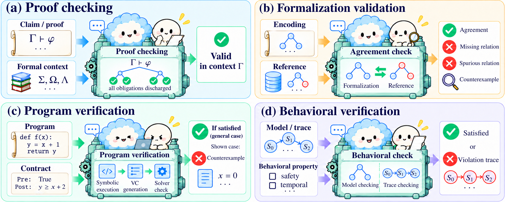

# R2 · Verification

[All papers](../catalogue.md) · [Taxonomy](../../docs/taxonomy.md) · [CSV metadata](../../data/papers.csv)

Use the verdict to accept, reject, or qualify a candidate relative to an encoded obligation.

1,043 studies in the confirmed corpus snapshot. Role assignments overlap; a diagnostic study carrying a role label is not thereby a deployed method.

## Core methods

- [(Auto)formalization is supposed to be easy: Trellis process semantics for spelling out rigorous proofs](<https://arxiv.org/abs/2606.09674>) (2026) — Wesley Pegden.
- [130k Lines of Formal Topology in Two Weeks: Simple and Cheap Autoformalization for Everyone?](<https://arxiv.org/abs/2601.03298>) (2026) — Josef Urban.
- [A Discourse-based Tool Series for Logical Validation of LLMs](<https://doi.org/10.63317/5fg7umsbz7m5>) (2026) — Galitsky, Boris; Ilvovsky, Dmitry.
- [A Domain-Specific Harness for End-to-End Automation of Optimization Research](<https://arxiv.org/abs/2608.07407>) (2026) — Heechang Kim;  Ernest K. Ryu;  Shuvomoy Das Gupta.
- [A Formal Lens on Android Permissions System: Modeling, Verification, and Exploitation Using LLMs and Model Checking](<https://doi.org/10.1145/3799897>) (2026) — Sayyadabdi A.;  Tork Ladani B.;  Zamani B.
- [A Graph-Based Model for Automatic Test Case Generation from Textual Requirements with Hierarchical Coverage; \[Графова модель автоматичного генерування тестових випадкiв з тестових вимог з iєрархiчним покриттям\]](<https://doi.org/10.23939/mmc2026.01.311>) (2026) — Liubinskyi B.B.;  Zvarych M.M.
- [A Learning Method for Symbolic Systems Using Large Language Models](<https://arxiv.org/abs/2605.08694>) (2026) — Jian Fang;  Yixun Yao;  Yingfei Xiong.
- [A Logic-Driven Workflow Based on LLM Agents for High-Fidelity SMT Code Generation](<https://doi.org/10.1145/3788731.3788734>) (2026) — Liu Z.;  Wang K.
- [A machine-checked proof of the Dong–Yang classification of optimal (n, 4) binary codes for BSCs](<https://arxiv.org/abs/2609.10579>) (2026) — Shenghao Yang;  Yanyan Dong.
- [A Machine-Verified Proof of a Quantum-Optimization Conjecture](<https://arxiv.org/abs/2606.29687>) (2026) — Uri Kol;  Maor Ben-Shahar;  Kfir Sulimany et al.
- [A Minimal Agent for Automated Theorem Proving](<https://arxiv.org/abs/2602.24273>) (2026) — Borja Requena;  Austin Letson;  Krystian Nowakowski et al.
- [A Minimalist Proof Language for Neural Theorem Proving over Isabelle/HOL](<https://doi.org/10.1145/3798275>) (2026) — Xu Q.;  Wang R.;  Wang P. et al.
- [A Neuro-Symbolic Approach to Strategy Synthesis for Strategic Logics](<https://arxiv.org/abs/2606.17962>) (2026) — Marco Aruta;  Vadim Malvone;  Aniello Murano et al.
- [A Neuro-Symbolic Framework for Legal Accountability in Public-Sector AI](<https://doi.org/10.1145/3805689.3812335>) (2026) — Sunny A.D.;  Sivan-Sevilla I.
- [A Neurosymbolic Approach to Natural Language Formalization and Verification](<https://doi.org/10.1007/978-3-032-32526-6_28>) (2026) — An C.;  Bayless S.;  Buliani S. et al.
- [A Petri Net-Based Framework for Automated Regulatory Compliance in Autonomous Systems Using Large Language Models](<https://doi.org/10.1109/codit70676.2026.11630744>) (2026) — Amari A.
- [A Solver-in-the-Loop Framework for Improving LLMs on Answer Set Programming for Logic Puzzle Solving](<https://doi.org/10.1609/aaai.v40i30.39714>) (2026) — Schrader T.P.;  Lange L.;  Kaminski T. et al.
- [A Spectral Proof of Khachiyan’s Ellipsoid Conjecture](<https://arxiv.org/abs/2609.28447>) (2026) — Zhou Longfei;  Haijun Zou;  Tianhao Liu.
- [A Structural Proof of the Lower Bound 21 for 3 × 3 Matrix Multiplication over F₂](<https://arxiv.org/abs/2609.18722>) (2026) — Shuxing Yang;  Rui Zhao;  Junyao Wu et al.
- [A Tale of 1001 LoC: Potential Runtime Error-Guided Specification Synthesis for Verifying Large-Scale Programs](<https://doi.org/10.1145/3798268>) (2026) — Wang Z.;  Lin T.;  Chen M. et al.
- [A Verifier-Guided Explainable Reasoning Framework with Gold-Anchored QLoRA, Task-Aware Mixture-of-Experts, and Group-Relative RLVR](<https://arxiv.org/abs/2609.05221>) (2026) — Thi Kim Trang Vo;  Nam Tien Le;  Thi Kim Nguyet Vo et al.
- [Abductive Reasoning with Probabilistic Commonsense](<https://arxiv.org/abs/2605.08011>) (2026) — Joseph Cotnareanu;  Chiara Roverato;  Han Zhou et al.
- [Abstraction Generation for Generalized Planning with Pretrained Large Language Models.](<https://arxiv.org/abs/2602.10485>) (2026) — Zhenhe Cui;  Huaxiang Xia;  Hangjun Shen et al.
- [ActGov: Governing LLM Agent Actions via Policy-Constrained Validation](<https://arxiv.org/abs/2609.24446>) (2026) — Kaiyuan Zhang;  Yuke Peng;  Ke Jiang et al.
- [Advancing Mathematics Research with AI-Driven Formal Proof Search](<https://arxiv.org/abs/2605.22763>) (2026) — George Tsoukalas;  Anton Kovsharov;  Sergey Shirobokov et al.
- [ADVENT: LLM-Driven Automatic Predicate Invention for ILP](<https://arxiv.org/abs/2607.01585>) (2026) — Tingting Yu;  Pei-Cing Huang;  Chan Hsu et al.
- [Agent Hunt: Bounty Based Collaborative Autoformalization With LLM Agents](<https://www.scopus.com/pages/publications/105048467247?origin=resultslist>) (2026) — Brown C.E.;  Kaliszyk C.;  Urban J.
- [Agent-Aided Design for Dynamic CAD Models](<https://doi.org/10.1145/3786335.3813198>) (2026) — Adler M.;  Russo M.;  Cafarella M.
- [Agent-Driven Verification of Memory Safety for liblzma Decoder Components with VST](<https://arxiv.org/abs/2608.29716>) (2026) — Prokhor Shlyakhtun;  Alexander Gryzlov;  Vladimir Kukharenko et al.
- [Agentic Model Checking](<https://arxiv.org/abs/2605.21434>) (2026) — Youcheng Sun;  Jiawen Liu;  Daniel Kroening et al.
- [Agentic Neurosymbolic Collaboration for Mathematical Discovery: A Case Study in Combinatorial Design](<https://arxiv.org/abs/2603.08322>) (2026) — Hai Xia;  Carla P. Gomes;  Bart Selman et al.
- [Agentic Proof and Property-Based Testing via Property-Templates in Data-Intensive Computing](<https://arxiv.org/abs/2607.09072>) (2026) — Seongmin Lee;  Yaoxuan Wu;  Miryung Kim.
- [Agentic Proof Automation: A Case Study](<https://arxiv.org/abs/2601.03768>) (2026) — Yichen Xu;  Martin Odersky.
- [Agentic Proving for Program Verification](<https://arxiv.org/abs/2605.23772>) (2026) — Alessandro Sosso;  Akhil Arora;  Bas Spitters.
- [Agentic Taxation Optimization via LLM SMT-Constraint Reasoning](<https://doi.org/10.1145/3786583.3786917>) (2026) — Hwang T.-C.;  Yu F.;  Jiang J.-H.R.
- [Agentic-IC3: Enabling Semantic Proof Search in IC3 Model Checking](<https://arxiv.org/abs/2609.27162>) (2026) — Yu-Wei Fan;  SooHyuk Cho;  Aarti Gupta et al.
- [AGREE-Dog Copilot: A Neuro-Symbolic Approach to Enhanced Model-Based Systems Engineering](<https://doi.org/10.1007/978-3-032-07132-3_8>) (2026) — Tahat A.;  Amundson I.;  Hardin D. et al.
- [AI-Assisted Completion of CertiGC Proofs: An Experience Report](<https://arxiv.org/abs/2606.21167>) (2026) — Shengyi Wang.
- [ALEXChat: a Generative - Symbolic Approach to Legal eXplainability](<https://doi.org/10.1145/3769126.3769234>) (2026) — Billi M.;  Parenti A.;  Pisano G. et al.
- [AlgoVeri: An Aligned Benchmark for Verified Code Generation on Classical Algorithms](<https://arxiv.org/abs/2602.09464>) (2026) — Haoyu Zhao;  Ziran Yang;  Jiawei Li et al.
- [An AI Approach to Verified Production Cryptographic Libraries](<https://arxiv.org/abs/2608.00965>) (2026) — Chuyue Sun;  Su Fong;  Zhiyi Kuang et al.
- [An Environment-Aware Verification Framework for LLM-Generated Robot Control Programs.](<https://doi.org/10.23919/date69613.2026.11539304>) (2026) — ZhanShang Nie;  Wenbo Wang;  Xuanming Liu et al.
- [An exponential lower bound for the bit pigeonhole principle in resolution over parities](<https://arxiv.org/abs/2609.23015>) (2026) — Kamil Braun.
- [An Integrated Framework for Smart Contract Vulnerability Management using Tri-Modal Active Learning and Explainable AI](<https://doi.org/10.1109/ecai69016.2026.11613694>) (2026) — Hanthanapitiya K.M.H.D.D.;  Rathnayaka R.D.D.H.;  Rajapakse P.S.S. et al.
- [AoA: Theorem Proving Agent over Abstract Syntax Tree of Redesigned Language](<https://arxiv.org/abs/2607.16372>) (2026) — Qiyuan Xu;  Joshua Ong Jun Leang;  Renxi Wang et al.
- [As You Wish: Mission Planning with Formal Verification using LLMs in Precision Agriculture](<https://arxiv.org/abs/2606.18519>) (2026) — Marcos Abel Zuzuárregui;  Stefano Carpin.
- [Aurora: Neuro-Symbolic AI Driven Advising Agent](<https://doi.org/10.1145/3748522.3779850>) (2026) — Quincoso Lugones L.A.;  Kverne C.L.;  Bhimani N.S. et al.
- [Auto formalisation of Chaitin and of the surprise incompleteness Theorem](<https://arxiv.org/abs/2606.12462>) (2026) — Thierry Coquand.
- [Auto formalisation of Goedel's Second Incompleteness Theorem in Binary Recursive Arithmetic](<https://arxiv.org/abs/2606.01898>) (2026) — Thierry Coquand.
- [AutoACSL: Synthesizing ACSL Specifications by Integrating LLMs with CPG-Based Static Analysis](<https://arxiv.org/abs/2606.20969>) (2026) — Han Zhou;  Yu Luo;  Dianxiang Xu.
- [AutoCedar: An Agentic Framework for Verifier-Guided Access Control Policy Synthesis](<https://arxiv.org/abs/2607.03656>) (2026) — Adarsh Vatsa;  Sachi Shome;  Yingming Zhou et al.
- [Autoformalization of Agent Instructions into Policy-as-Code](<https://arxiv.org/abs/2606.26649>) (2026) — Adam Mondl;  Matthew Maisel;  John H. Brock.
- [Autoformalizing Argumentative Material Inferences](<https://arxiv.org/abs/2609.16991>) (2026) — Xin Quan;  Reto Gubelmann;  André Freitas.
- [Autofy: Automated Synthesis of Formally Verified Code](<https://doi.org/10.1145/3793656.3793688>) (2026) — Purschke N.;  Schamschurko A.;  Kirchner S. et al.
- [AutoGraphForge: Towards Automated Graph Theory Discovery](<https://arxiv.org/abs/2609.03478>) (2026) — Ján Pastorek.
- [AutoJML: Generation and Verification of JML Specifications Using LLM Agents](<https://doi.org/10.1109/mpuls.2026.3659250>) (2026) — Shahariar Ayon R.;  Ahmed S.
- [Automated Conjecture Resolution with Formal Verification](<https://arxiv.org/abs/2604.03789>) (2026) — Haocheng Ju;  Guoxiong Gao;  Jiedong Jiang et al.
- [Automated Derivation of Formal Properties from Requirements](<https://doi.org/10.1109/syscon66367.2026.11503633>) (2026) — Sultan B.;  Apvrille L.;  De Saqui-Sannes P.
- [Automated Formal Proofs of Combinatorial Identities via Wilf-Zeilberger Guidance and LLMs](<https://arxiv.org/abs/2605.04472>) (2026) — Beibei Xiong;  Hangyu Lv;  Junqi Liu et al.
- [Automated formalisation of informal specifications by combining LLMs and grammar-based language processing](<https://doi.org/10.1007/s10664-026-10914-3>) (2026) — Leong I.T.;  Barbosa R.
- [Automated Lemma Discovery in Agentic Program Verification](<https://arxiv.org/abs/2603.22114>) (2026) — Huan Zhao;  Haoxin Tu;  Zhengyao Liu et al.
- [Automated Repair of Alloy Specifications in the Era of Large Language Models](<https://doi.org/10.1109/tse.2026.3682711>) (2026) — Hasan M.R.;  Li J.;  Ahmed I. et al.
- [Automated Repair of Totally-Ordered Hierarchical Task Network Domains via Context-Free Grammars with Large Language Model Support](<https://doi.org/10.1609/aaai.v40i43.40951>) (2026) — Lutalo D.;  Bercher P.
- [Automatic assertion generation with LLM for ICS program verification](<https://doi.org/10.1016/j.jss.2025.112659>) (2026) — Yang K.;  Li F.;  Li T. et al.
- [Automatic Generation of Formal Specification and Verification Annotations Using LLMs and Test Oracles](<https://arxiv.org/abs/2601.12845>) (2026) — João Pascoal Faria;  Emanuel Trigo;  Vinicius Honorato et al.
- [Automatic Textbook Formalization](<https://arxiv.org/abs/2604.03071>) (2026) — Fabian Gloeckle;  Ahmad Rammal;  Charles Arnal et al.
- [Automatic Theorem Proving Based on Pre-trained Language Models and Unification; \[基于预训练语言模型和合一算法的自动定理证明\]](<https://doi.org/10.11896/jsjkx.251000066>) (2026) — Chen H.;  Zeng X.;  Liu Z. et al.
- [Automating Attack Graph Construction for Agentic Pentesting. Towards Neuro-Symbolic Vulnerability Hunting.](<https://arxiv.org/abs/2609.15523>) (2026) — Oliver Stevanovic;  Jasmin Wachter.
- [Automating Formal Verification with Agent-Guided Tree Search](<https://arxiv.org/abs/2605.27485>) (2026) — Leo Yao.
- [Automating Formal Verification with Reinforcement Learning and Recursive Inference](<https://arxiv.org/abs/2605.30914>) (2026) — Max Tan.
- [AutoOR: Scalably Post-training LLMs to Autoformulate Operations Research Problems](<https://arxiv.org/abs/2604.16804>) (2026) — Sumeet Ramesh Motwani;  Chuan Du;  Aleksander Petrov et al.
- [AutoQL: Retrieval-Augmented CodeQL Query Generation with Compiler Feedback](<https://doi.org/10.1109/asens69964.2026.11605289>) (2026) — Chen X.;  Wen W.;  Xu J. et al.
- [AutoReSpec: A Framework for Generating Specification using Large Language Models](<https://doi.org/10.1145/3793655.3793731>) (2026) — Ayon R.S.;  Ahmed S.
- [AutoSOUP: Safety-Oriented Unit Proof Generation for Component-level Memory-Safety Verification](<https://arxiv.org/abs/2605.10712>) (2026) — Paschal C. Amusuo;  Ricardo Calvo;  Dharun Anandayuvaraj et al.
- [AutoTrans: AI-Assisted Automatic Translation of Security Assertions for RISC-V Processors](<https://arxiv.org/abs/2609.10057>) (2026) — Sharjeel Imtiaz;  Uljana Reinsalu;  Tara Ghasempouri.
- [Ax-Prover: a deep reasoning agentic framework for theorem proving in mathematics and quantum physics](<https://doi.org/10.1088/2632-2153/ae9452>) (2026) — Breen, Benjamin;  Del Tredici, Marco;  McCarran, Jacob et al.
- [AxDafny: Agentic Verified Code Generation in Dafny](<https://arxiv.org/abs/2606.32007>) (2026) — Benjamin Breen;  Austin Letson;  Borja Requena Pozo et al.
- [BALI: Branch-Aware Loop Invariant Inference with Large Language Models.](<https://arxiv.org/abs/2601.00882>) (2026) — Mingxiu Wang;  Jiawei Wang;  Xiao Cheng.
- [BarrierBench: Evaluating Large Language Models for Safety Verification in Dynamical Systems](<https://www.scopus.com/pages/publications/105046074992?origin=resultslist>) (2026) — Taheri A.;  Taban A.;  Soudjani S. et al.
- [Bayesian Active Learning for Intent Disambiguation in Interactive Robot Planning](<https://arxiv.org/abs/2609.34270>) (2026) — Huao Li;  Carson Sobolewski;  Augustinos Saravanos et al.
- [BEHAVE: Functional Behavior Modeling Enables Self-Improving Agents for Hardware Design and Verification](<https://arxiv.org/abs/2609.34785>) (2026) — Yuheng Wu;  Berk Gokmen;  Sujeeth Jinesh et al.
- [BELMA: Integrating Formal Verification and Large Language Models for Enhanced Smart Contract Security](<https://doi.org/10.1109/tdsc.2026.3725656>) (2026) — Sosu R.N.A.;  Chen J.;  Boahen E.K. et al.
- [Benchmarking Agents for Proving Theorems in Quantum Algorithms and Quantum Information](<https://arxiv.org/abs/2607.21533>) (2026) — Lei Zhang;  Yusheng Zhao;  Yimeng Cao et al.
- [Benchmarking Large Language Models on Power System Logic: The "Five Preventions"Challenge for Safety-Critical Physical Reasoning](<https://doi.org/10.1109/psesg69490.2026.11544817>) (2026) — Li Y.;  Zhang Z.
- [Beyond Basic Specifications? A Systematic Study of Logical Constructs in LLM-based Specification Generation](<https://arxiv.org/abs/2602.00715>) (2026) — Zehan Chen;  Long Zhang;  Zhiwei Zhang et al.
- [Beyond Solver Verdicts: Generative Reward Models for Autoformalization](<https://arxiv.org/abs/2609.11085>) (2026) — Vikash Singh;  Debargha Ganguly;  Aman Goel et al.
- [Beyond the Library: An Agentic Framework for Autoformalizing Research Mathematics](<https://arxiv.org/abs/2606.31134>) (2026) — Arshia Soltani Moakhar;  Iman Gholami;  Max Springer et al.
- [Beyond Verified Answers: Solver-Informed Self-Distillation for Bootstrapping Operations Research Language Models](<https://arxiv.org/abs/2609.09957>) (2026) — Rui Zhu;  Minglong Cao;  Chenyu Zhou et al.
- [BlueprintRepair: Typed Local Edits for Failed Lean Proof Blueprints](<https://arxiv.org/abs/2607.28110>) (2026) — Ruslan Khrulev.
- [Breaking the Dependency Chaos: A Constraint-Driven Python Dependency Resolution Strategy with Selective LLM Imputation](<https://doi.org/10.1145/3803437.3808241>) (2026) — Chowdhury K.;  Banik D.;  Shamim S.I.
- [Breaking the Illusion: Automated Reasoning of GDPR Consent Violations](<https://doi.org/10.1109/sp63933.2026.00040>) (2026) — Li Y.;  Qiu W.;  Shezan F.H. et al.
- [Bridging Generative AI and Formal Methods for High-Assurance Test Generation in Safety-Critical Embedded Systems](<https://doi.org/10.1117/12.3109487>) (2026) — Zheng J.;  Lu J.
- [Bridging Learned Visual Perception and Symbolic Belief-Space Planning via Probabilistic Grounding](<https://arxiv.org/abs/2609.16884>) (2026) — Guy Azran;  Michael Navat;  Sarah Keren.
- [Bridging the semantic gap: Trajectory-guided domain repair for reliable planning](<https://doi.org/10.1016/j.rcim.2026.103290>) (2026) — Liu R.;  Li R.;  Dong Q. et al.
- [Bridging Values and Behavior: A Hierarchical Framework for Proactive Embodied Agents](<https://arxiv.org/abs/2604.27699>) (2026) — Chunhui Zhang;  Yuxuan Wang;  Aoyang Qin et al.
- [Brief Announcement: 2-Coloring Cycles in One Round](<https://doi.org/10.1145/3796701.3815937>) (2026) — Flin M.;  Raevskaya A.;  Stimpert R. et al.
- [Building Shor's Algorithm in Lean: An Agentic Formalization of Quantum Attacks on RSA-2048 and P-256](<https://arxiv.org/abs/2607.14082>) (2026) — Lei Zhang;  Yusheng Zhao;  Hongshun Yao et al.
- [Business Compromise Detection with Agentic AI and LLM-driven Knowledge Discovery](<https://arxiv.org/abs/2609.32643>) (2026) — Diego Palma;  Kyu Bin Kim;  Zhen Han et al.
- [Can Formal Specifications Be Synthesized from Tests Alone?](<https://arxiv.org/abs/2608.13240>) (2026) — Tianhai Liu;  Maximilian Müller;  Tobias Hey et al.
- [Can Large Language Models Model Programs Formally?](<https://arxiv.org/abs/2604.01851>) (2026) — Zhiyong Chen;  Jialun Cao;  Jiarong Wu et al.
- [Can Legislation Be Made Machine-Readable in PROLEG?](<https://arxiv.org/abs/2601.01477>) (2026) — May-Myo Zin;  Sabine Wehnert;  Yuntao Kong et al.
- [Can LLM Aid in Solving Constraints with Inductive Definitions?](<https://doi.org/10.1007/978-3-032-26220-2_6>) (2026) — Feng W.;  Shen S.;  Liu J. et al.
- [Can LLMs Perform Synthesis?](<https://arxiv.org/abs/2603.20264>) (2026) — Derek Egolf;  Yuhao Zhou;  Stavros Tripakis.
- [CAPRI: Contract-Aware Proof Repair for Isabelle](<https://arxiv.org/abs/2608.13459>) (2026) — Jim Woodcock;  Gabriel Leite;  Augusto Sampaio et al.
- [Case study: proving 2 irrational with LPTP and an LLM](<https://doi.org/10.4204/eptcs.450.5>) (2026) — Mesnard F.;  Payet É.;  Vanhoof W.
- [Case study: solving P-99 with LPTP and an LLM](<https://doi.org/10.4204/eptcs.450.17>) (2026) — Mesnard F.;  Marianne T.;  Payet É. et al.
- [CausalSmith: A Formally Grounded, Self-Improving Agentic Framework for Automated Research in Causal Inference](<https://arxiv.org/abs/2607.22511>) (2026) — Jiyuan Tan;  Vasilis Syrgkanis.
- [Certified Program Synthesis with a Multi-Modal Verifier](<https://arxiv.org/abs/2604.16584>) (2026) — Yueyang Feng;  Dipesh Kafle;  Vladimir Gladshtein et al.
- [Choir: An Open Protocol for Distributed Multi-Agent Autoformalization](<https://arxiv.org/abs/2609.31903>) (2026) — Yidi Qi;  Melanie Weber.
- [CIR+CVN: Bridging LLM Semantic Understanding and Petri-Net Verification for Concurrent Programs.](<https://arxiv.org/abs/2604.09318>) (2026) — Kaiwen Zhang 0010;  Guanjun Liu.
- [CloudFix: Automated Policy Repair for Cloud Access Control Policies Using Large Language Models](<https://doi.org/10.1109/saner67736.2026.00042>) (2026) — Hall B.;  Ungaro O.;  Eiers W.
- [COBALT-TLA: A Neuro-Symbolic Verification Loop for Cross-Chain Bridge Vulnerability Discovery](<https://arxiv.org/abs/2604.12172>) (2026) — Dominik Blain.
- [CompassPlay: Rewarding the Proposer for Where It Moves the Solver](<https://arxiv.org/abs/2609.32228>) (2026) — Sophia Xiao Pu;  Ximeng Sun;  Jiang Liu et al.
- [Compile to Compress: Boosting Formal Theorem Provers by Compiler Outputs](<https://arxiv.org/abs/2604.18587>) (2026) — Guchan Li;  Rui Tian;  Hongning Wang.
- [Compiler-Guided Adaptive Proof Search with Cross-Model Synergy on Context-Dependent Theorem Proving](<https://arxiv.org/abs/2608.18084>) (2026) — Zhuo Liu;  Ding Yu;  Hangfeng He.
- [Conjecture Extraction for Proof Autoformalization](<https://doi.org/10.1007/978-3-032-20322-9_35>) (2026) — Sorg S.;  Li W.;  Banerjee S.
- [Constraint-aware labware layout generation from natural language for heterogeneous laboratory robots](<https://doi.org/10.1039/d6dd00026f>) (2026) — Tahara-Arai Y.;  Inagaki T.;  Kato A. et al.
- [Construction-Verification: A Benchmark for Applied Mathematics in Lean 4](<https://arxiv.org/abs/2602.01291>) (2026) — Bowen Yang;  Yi Yuan;  Chenyi Li et al.
- [Containment Verification: AI Safety Guarantees Independent of Alignment](<https://arxiv.org/abs/2605.09045>) (2026) — Royce Moon;  Lav R. Varshney.
- [Contract-Aware Rescue of a Drifted Isabelle Development: The Double-Tank Case Study](<https://arxiv.org/abs/2608.18822>) (2026) — Jim Woodcock;  Gabriel Leite;  Augusto Sampaio et al.
- [ConVer: Using Contracts and Loop Invariant Synthesis for Scalable Formal Software Verification](<https://arxiv.org/abs/2605.27051>) (2026) — Muhammad A. A. Pirzada;  Weiqi Wang;  Yiannis Charalambous et al.
- [CoTu at EXACT 2026: Neuro-Symbolic Reasoning for Transparent Educational QA](<https://arxiv.org/abs/2607.14735>) (2026) — Quoc-Khang Tran;  Minh-Thien Nguyen;  Phu-An Thai et al.
- [CounterMem: World-Model-Verified Counterfactual Memory for Language Agents](<https://arxiv.org/abs/2609.31874>) (2026) — Hongji Pu;  Ruixiang Tang;  Yongfeng Zhang.
- [CP-Agent: Agentic Constraint Programming.](<https://doi.org/10.1145/3786181.3788711>) (2026) — Stefan Szeider.
- [CP-SynC: Multi-Agent Zero-Shot Constraint Modeling in MiniZinc with Synthesized Checkers](<https://arxiv.org/abs/2605.01675>) (2026) — Yuliang Song;  Eldan Cohen.
- [CPUNeSy: Controlling Model Writes for Reliable Neuro-Symbolic Reasoning](<https://arxiv.org/abs/2609.37490>) (2026) — Zeyan Li;  Siyuan Qiu;  Shuai Zhao et al.
- [DafnyPro: LLM-Assisted Automated Verification for Dafny Programs](<https://arxiv.org/abs/2601.05385>) (2026) — Debangshu Banerjee;  Olivier Bouissou;  Stefan Zetzsche.
- [Decompose, Structure, and Repair: A Neuro-Symbolic Framework for Autoformalization via Operator Trees](<https://arxiv.org/abs/2604.19000>) (2026) — Xiaoyang Liu;  Zineng Dong;  Yifan Bai et al.
- [Decompose-and-Formalise: Recursively Verifiable Natural Language Inference](<https://arxiv.org/abs/2601.19605>) (2026) — Xin Quan;  Marco Valentino;  Louise A. Dennis et al.
- [DeepConfig: A verifiable configuration generation framework for MAN overlays using LLMs](<https://doi.org/10.1016/j.comnet.2026.112177>) (2026) — Lin C.;  Zhu L.;  Liu H. et al.
- [DeonticBench: A Benchmark for Reasoning over Rules](<https://arxiv.org/abs/2604.04443>) (2026) — Guangyao Dou;  Luis Brena;  Akhil Deo et al.
- [Designability of RNA Targets with Up to Two Length-2 Helices](<https://arxiv.org/abs/2608.25194>) (2026) — Ashutosh S. Jogalekar.
- [Diffusion-Proof: Recipe for Formal Theorem Proving Beyond Auto-Regressive Generation](<https://arxiv.org/abs/2606.19315>) (2026) — Ruida Wang;  Rui Pan;  Pengcheng Wang et al.
- [Direct Optimization of Generators for Search in Automated Theorem Proving](<https://arxiv.org/abs/2609.25575>) (2026) — Adam Ousherovitch;  Ambuj Tewari.
- [Directed Neuro-Symbolic Stochastic Execution for Verification of Distributed Parallel AI Programs](<https://arxiv.org/abs/2608.07947>) (2026) — Gautham Koorma;  Vikas Sharma;  George Edwards et al.
- [Discourse Based Argumentation Analysis for LLM Verification](<https://www.scopus.com/pages/publications/105040258940?origin=resultslist>) (2026) — Galitsky B.
- [Discover and Prove: An Open-source Agentic Framework for Hard Mode Automated Theorem Proving in Lean 4](<https://doi.org/10.18653/v1/2026.acl-long.3>) (2026) — Liu, Chengwu; Yin, Yichun; Yuan, Ye et al.
- [Discovering New Theorems via LLMs with In-Context Proof Learning in Lean](<https://aclanthology.org/2026.naloma-1.5/>) (2026) — Kasaura, Kazumi; Onda, Naoto; Oriike, Yuta et al.
- [Distilling Answer-Set Programming Rules from LLMs for Neurosymbolic Visual Question Answering](<https://doi.org/10.1017/s1471068426100684>) (2026) — Higuera Ruiz N.;  Oetsch J.;  Eiter T.
- [Distilling LLM Feedback for Lean Theorem Proving](<https://arxiv.org/abs/2605.30861>) (2026) — Gaetan Narozniak;  Gérard Biau;  Rémi Munos et al.
- [Diversifying to Verify: When Task-Equivalent Programs Differ in Verifiability](<https://arxiv.org/abs/2607.09366>) (2026) — Shirley Yu;  Ruben Martins.
- [Djinnlang: Higher-Level Programming by Unambiguous Specification with an LLM in the Compiler](<https://arxiv.org/abs/2609.23954>) (2026) — Simon Henniger;  Stephen Chong;  Nada Amin.
- [Does the Proof Prove It That Way? Faithful Formalization of Elements Proofs](<https://arxiv.org/abs/2608.15432>) (2026) — Tadd Mao;  Tianjun Zhong;  Dhruva Arekar et al.
- [Doubly Saturated Ramsey Graphs: A Case Study in Computer-Assisted Mathematical Discovery](<https://arxiv.org/abs/2604.21187>) (2026) — Benjamin Przybocki;  John Mackey;  Marijn J. H. Heule et al.
- [Draft-and-Prune: Improving the Reliability of Auto-formalization for Logical Reasoning](<https://arxiv.org/abs/2603.17233>) (2026) — Zhiyu Ni;  Zheng Liang;  Liangcheng Song et al.
- [DSPy-based neural-symbolic pipeline to enhance spatial reasoning in LLMs](<https://doi.org/10.1016/j.neunet.2025.108022>) (2026) — Wang R.;  Sun K.
- [DualGuard: Dual-Mode Quality Control for Logic-Preserving Data Augmentation](<https://arxiv.org/abs/2609.32431>) (2026) — Shenghao Li;  Lin Zhao.
- [DUPLEX: Agentic Dual-System Planning via LLM-Driven Information Extraction](<https://arxiv.org/abs/2603.23909>) (2026) — Keru Hua;  Ding Wang;  Yaoying Gu et al.
- [EconCSLib: AI-Assisted Lean Formalization for Economics & Computation research](<https://arxiv.org/abs/2606.13306>) (2026) — Nikhil Garg.
- [EconProver: Towards More Economical Test-Time Scaling for Automated Theorem Proving](<https://doi.org/10.18653/v1/2026.acl-long.2121>) (2026) — Li, Mukai; Song, Linfeng; Liang, Zhenwen et al.
- [Efficient PRM Training Data Synthesis via Formal Verification](<https://doi.org/10.18653/v1/2026.findings-acl.403>) (2026) — Kamoi, Ryo; Zhang, Yusen; Zhang, Nan et al.
- [Embedding Safe AI Assistants into Web Apps with LLMASP](<https://www.scopus.com/pages/publications/105048497986?origin=resultslist>) (2026) — Alviano M.;  Capalbo M.;  Gottlob G. et al.
- [EmboTeam: Grounding LLM Reasoning into Reactive Behavior Trees via PDDL for Embodied Multi-Robot Collaboration](<https://arxiv.org/abs/2601.11063>) (2026) — Haishan Zeng;  Mengna Wang;  Peng Li.
- [End-to-End Abstraction-Based Control with LLM-Enhanced NL-to-LTL Translation](<https://arxiv.org/abs/2606.30163>) (2026) — Amir Bayat;  Necmiye Ozay;  Alessandro Abate et al.
- [Enhancing automated loop invariant generation for complex programs with large language models](<https://doi.org/10.1016/j.scico.2025.103387>) (2026) — Liu R.;  Chen M.;  Wu L.-I. et al.
- [Enhancing Word-Level Property Directed Reachability with LLM-Driven Semantic Guidance](<https://arxiv.org/abs/2609.30131>) (2026) — Guangyu Hu;  Mingkai Miao;  Zhiyuan Yan et al.
- [EnigmaForge: The Question Is Hidden in the Story](<https://arxiv.org/abs/2609.30144>) (2026) — Daniel Eisner.
- [Environment-Driven and LLM-Guided Multi-Robot Task Inference and Allocation Under Temporal Logic Specifications](<https://doi.org/10.1109/tase.2026.3659055>) (2026) — Li L.;  Chen Z.;  Kan Z.
- [Evaluating Theory of Mind and Internal Beliefs in LLM-Based Multi-agent Systems](<https://doi.org/10.1007/978-3-032-09318-9_2>) (2026) — Kostka A.;  Chudziak J.A.
- [Evaluation of LLMs for Mathematical Formalization in Lean](<https://arxiv.org/abs/2606.05632>) (2026) — Tyson Klingner;  Drew Bladek;  Escher Crawford et al.
- [Event-B Agent: Towards LLM Agent for Formal Model Synthesis and Repair.](<https://doi.org/10.1145/3808218>) (2026) — Hongshu Wang;  Xinyue Zuo;  Yuhan Sun et al.
- [Evidence-Grounded Verified Agentic Reasoning: A Path Toward Eliminating LLM Hallucination in Empirical Inference via Tool-Attested Kernel Proofs](<https://arxiv.org/abs/2607.12650>) (2026) — Junyu Ren.
- [EvoPlan: Evolutionary Neuro-Symbolic Robot Planning with Spatio-Temporal Guarantees](<https://arxiv.org/abs/2607.06724>) (2026) — Bhavya Sai Nukapotula;  Samin Moosavi;  Haoze Wang et al.
- [Explaining Textual Entailment with Lexical Entailments: Using LLMs to Supply Lexical Relations for Formal Proofs](<https://arxiv.org/abs/2609.32491>) (2026) — Jorryt de Jong;  Stefan Morača;  Ettore Cesari et al.
- [Explorable Theorems: Making Written Theorems Explorable by Grounding Them in Formal Representations](<https://arxiv.org/abs/2604.02598>) (2026) — Hita Kambhamettu;  Will Crichton;  Sean Welleck et al.
- [ExVerus: Verus Proof Repair via Counterexample Reasoning](<https://arxiv.org/abs/2603.25810>) (2026) — Jun Yang;  Yuechun Sun;  Yi Wu et al.
- [Faithful Autoformalization via Roundtrip Verification and Repair](<https://arxiv.org/abs/2604.25031>) (2026) — Daneshvar Amrollahi;  Jerry Lopez;  Clark Barrett.
- [Feedback Granularity in Bounded Repair of LLM-Generated PDDL Domains](<https://doi.org/10.1109/caibda70336.2026.11621110>) (2026) — Zhang Y.;  Li N.;  Zhou Z. et al.
- [Fewer Assumptions by Design: A Reusable Skill for LLM-Assisted Verus Verification](<https://arxiv.org/abs/2609.34886>) (2026) — Andrada-Livia Antoneac;  Dorel Lucanu;  Dragoş Teodor Gavriluţ.
- [FIDES: A Neuro-Symbolic Conversational Tool for Faithful Production Process Intelligence](<https://doi.org/10.1007/978-3-032-27997-2_22>) (2026) — Casciani A.;  Italia F.;  Lestingi L. et al.
- [Finding Missing Input Validation in TEEs via LLM-Assisted Symbolic Execution](<https://doi.org/10.1145/3793655.3793740>) (2026) — Ma C.;  Shi J.;  Han R. et al.
- [FLARE: Verifying MILP Reformulations with LLM-Based Theorem Proving](<https://arxiv.org/abs/2608.25220>) (2026) — Henry Robbins;  Connor Lawless;  Madeleine Udell et al.
- [Forbidden Sidon subsets of perfect difference sets, featuring a human-assisted proof](<https://doi.org/10.1073/pnas.2531760123>) (2026) — Alexeev B.;  Mixon D.G.
- [Formal Disco: Scalable Open-Ended Generation of Formally Verified Programs](<https://arxiv.org/abs/2607.04631>) (2026) — Gabriel Poesia;  Simon Henniger;  Tzu-Han Hsu et al.
- [Formal Methods Meet LLMs: Auditing, Monitoring, and Intervention for Compliance of Advanced AI Systems](<https://doi.org/10.1145/3805689.3812339>) (2026) — Alamdari P.A.;  Klassen T.Q.;  McIlraith S.A.
- [Formal Model Construction Guided by Model-Based Proof Sketches](<https://arxiv.org/abs/2609.29870>) (2026) — Hongshu Wang;  Xinyue Zuo;  Yufan Cai et al.
- [Formal Verification of Agentic Systems over Operational Data](<https://arxiv.org/abs/2608.03609>) (2026) — Alejandro J. Mercado;  Alessio Lomuscio.
- [Formal-Method-Guided Vibe Coding: Closing the Verification Loop on AI-Generated Safety-Critical Software Through Model-Driven Engineering](<https://arxiv.org/abs/2606.22413>) (2026) — Ran Wei;  Le Zhu;  Haochi Wang et al.
- [Formalization of Sullivan's No Wandering Domains Theorem in Lean](<https://arxiv.org/abs/2609.16027>) (2026) — Ziang Li;  Yusheng Luo.
- [Formalize Once, Edit the Rest: Efficient Lean-Based Answer Selection for Math Reasoning](<https://arxiv.org/abs/2606.15972>) (2026) — Ji Feng;  Zhouxing Shi.
- [Formalizing Mathematics at Scale](<https://arxiv.org/abs/2605.29955>) (2026) — Ahmad Rammal;  Niket Patel;  Fabian Gloeckle et al.
- [Formalizing Numerical Analysis: An Agent Pipeline and Quality Audit Beyond Kernel Acceptance](<https://arxiv.org/abs/2606.14000>) (2026) — Theodore Meek;  Siyuan Ge;  Di Qiu Xiang et al.
- [FormalJudge: A Neuro-Symbolic Paradigm for Agentic Oversight](<https://arxiv.org/abs/2602.11136>) (2026) — Jiayi Zhou;  Yang Sheng;  Hantao Lou et al.
- [Formally Specifying the Intended Behavior of the Program: LLM-Driven Neuro-Symbolic Program Specification Synthesis](<https://doi.org/10.18653/v1/2026.acl-demo.66>) (2026) — Wen, Cheng; Junjie, Hu; Hu, YiKun et al.
- [Formally Verified Code Synthesis for Structured Data Translation in a Medical Internet of Things](<https://arxiv.org/abs/2606.20776>) (2026) — Colin Samplawski;  Adam D. Cobb.
- [FormalScience: Scalable Human-in-the-Loop Autoformalisation of Science with Agentic Code Generation in Lean](<https://doi.org/10.18653/v1/2026.acl-long.1057>) (2026) — Meadows, Jordan; Zhang, Lan; Freitas, Andre.
- [FormalTCS: Benchmarking End-to-End Frontier Formal Theoretical Computer Science Research of Large Language Models](<https://arxiv.org/abs/2608.20153>) (2026) — Dingzirui Wang;  Xuanliang Zhang;  Keyan Xu et al.
- [FormaTheoria: Constructing Large-Scale Lean Theories from Mathematical Literature $-$ Toward the Formalization of the Classification of Finite Simple Groups](<https://arxiv.org/abs/2608.10894>) (2026) — Tianjiao Nie;  Ao Zhang;  Yusen Tang et al.
- [Foundational Refinement Proofs for Deployed Bytecode, at the Price of Tokens](<https://arxiv.org/abs/2607.26306>) (2026) — Lefteris Lazaropoulos;  Zoe Paraskevopoulou.
- [Four-arm polyominoes in Golomb’s hierarchy: A complete classification with Lean verification](<https://arxiv.org/abs/2609.13641>) (2026) — Angel Ivanov Raychev.
- [From Argumentation to Labeled Logic Program for LLM Verification](<https://doi.org/10.1609/aaaiss.v8i1.42572>) (2026) — Galitsky B.
- [From LLM Suggestions to Lean Proofs: Verified Redundant Constraints for MiniZinc](<https://doi.org/10.4230/lipics.cp.2026.17>) (2026) — Danzinger P.;  Musliu N.
- [From LLM-Generated Conjectures to Lean Formalizations: Automated Polynomial Inequality Proving via Sum-of-Squares Certificates](<https://arxiv.org/abs/2605.15445>) (2026) — Ruobing Zuo;  Hanrui Zhao;  Gaolei He et al.
- [From LLM-Generated Specifications to Learned Quadruped Locomotion](<https://arxiv.org/abs/2609.07111>) (2026) — Merve Atasever;  Keyan Azbijari;  Cagan Bakirci et al.
- [From Natural Language to Executable Narsese: A Neuro-Symbolic Benchmark and Pipeline for Reasoning with NARS](<https://arxiv.org/abs/2604.18873>) (2026) — Mina Gabriel;  Pei Wang.
- [From Natural Language to Verified Code: Toward AI Assisted Problem-to-Code Generation with Dafny-Based Formal Verification](<https://arxiv.org/abs/2604.22601>) (2026) — Md Erfan;  Md Kamal Hossain Chowdhury;  Ahmed Ryan et al.
- [From Semantic Decisions to Feasible Trajectories: Self-Evolving LLM-Guided Optimal Control for Narrow-Space Parking](<https://arxiv.org/abs/2609.24631>) (2026) — Zhengbao Yao;  Yuanfu Luo;  Kehan Xue.
- [From Solver Feedback to Faithful Plans: Multi-Role Reinforcement Learning for Symbolic Planning](<https://arxiv.org/abs/2608.21897>) (2026) — Chenghao Zhang;  Yikai Mao;  Shanqi Liu et al.
- [Fun2spec: Code Contract Synthesis At Scale](<https://doi.org/10.1145/3803437.3805262>) (2026) — Ugare S.;  Suresh T.;  Misailovic S. et al.
- [galápagos: Automated N-Version Programming with LLMs](<https://doi.org/10.1145/3785363>) (2026) — Ron J.;  Gaspar D.;  Cabrera-Arteaga J. et al.
- [GEM-LLM: Identifying contextual equivalent mutants via large language models; A global invariant-based approach](<https://doi.org/10.1016/j.iswa.2026.200640>) (2026) — Tanhaei M.;  Alizadehsani R.
- [Generating formal smart-contract specifications: comparing few-shot learning and fine-tuned LLMs](<https://doi.org/10.1016/j.scico.2026.103464>) (2026) — Leite G.;  Arruda F.;  Antonino P. et al.
- [Generating Instance Generators in PDDL Planning](<https://arxiv.org/abs/2609.06071>) (2026) — Nicola J. Müller;  Naya Rudolph;  Katharina Stein et al.
- [Generative AI-Enabled Mission-Aware Radio Orchestration for RIS-Assisted LEO Satellite ISAC Systems](<https://arxiv.org/abs/2608.25803>) (2026) — Fitsum Debebe Tilahun;  Chung G. Kang.
- [GenLimitLib: A Formal Library for Language Generation in the Limit and AI-Assisted Mathematical Research](<https://arxiv.org/abs/2609.36663>) (2026) — Shuangping Li;  Peng Zhang.
- [GenOR-Twin: A Semantic Middleware for Integrating Operational Discourse with Mathematical Optimization](<https://arxiv.org/abs/2609.12863>) (2026) — Rahimeh Neamatian Monemi;  Shahin Gelareh;  Lubin Cui et al.
- [Goedel-Architect: Streamlining Formal Theorem Proving with Blueprint Generation and Refinement](<https://arxiv.org/abs/2606.06468>) (2026) — Jui-Hui Chung;  Ziyang Cai;  Zihao Li et al.
- [Goedel-Code-Prover: Hierarchical Proof Search for Open State-of-the-Art Code Verification](<https://arxiv.org/abs/2603.19329>) (2026) — Zenan Li;  Ziran Yang;  Deyuan He et al.
- [Golden-ratio growth of Conway’s subprime closure](<https://arxiv.org/abs/2609.14188>) (2026) — Romain Popescu.
- [Grammar-Constrained Refinement of Safety Operational Rules Using Language in the Loop: What Could Go Wrong](<https://arxiv.org/abs/2604.23523>) (2026) — Khouloud Gaaloul;  Zaid Ghazal;  Madhu Latha Pulimi et al.
- [Grounded Continuation: A Linear-Time Runtime Verifier for LLM Conversations](<https://arxiv.org/abs/2605.14175>) (2026) — Qisong He;  Yi Dong;  Xiaowei Huang.
- [Grounded Evaluation and Repair for NL-to-PDDL Problem Generation](<https://arxiv.org/abs/2609.09898>) (2026) — Joana Rosa;  Pedro Santos;  Valdemar Oliveira et al.
- [Guiding LLM-Based Loop Invariant Synthesis via Feedback on Local Reasoning Errors](<https://doi.org/10.1145/3806652>) (2026) — Li T.;  Yan Z.;  Liu J. et al.
- [Hard Constraints Meet Soft Generation: Guaranteed Feasibility for LLM-based Combinatorial Optimization](<https://arxiv.org/abs/2602.01090>) (2026) — Yang Liu;  Chuan Zhou;  Yancheng Chen et al.
- [Harnessing Code Agents for Automatic Software Verification](<https://arxiv.org/abs/2607.06341>) (2026) — Shuangxiang Kan;  Shuanglong Kan;  Sebastian Ertel.
- [HarnessLLM: Rust Verification Harness Generation with Large Language Models](<https://arxiv.org/abs/2607.22161>) (2026) — Minghua Wang;  Yuwei Liu;  Lin Huang.
- [Heimdall: Formally Verified Automated Migration of Legacy eBPF Programs to Rust](<https://arxiv.org/abs/2605.25411>) (2026) — Vishnu Asutosh Dasu;  Monika Santra;  Md Rafi Ur Rashid et al.
- [HeurEvo: Agentic Evolution of Hybrid Solver-Augmented Heuristics for Time-Critical Mathematical Optimization](<https://arxiv.org/abs/2609.36303>) (2026) — Feijie Wu;  Hugo Barbalho;  Konstantina Mellou et al.
- [Heuristically motivating large language models for task planning](<https://doi.org/10.1016/j.knosys.2026.115725>) (2026) — Wang C.;  Cao L.;  Qi J. et al.
- [HHU-SyLo at SemEval-2026 Task 11: Logic in the Loop – Hybridizing LLMs and Theorem Provers for Robust Formal Reasoning](<https://doi.org/10.18653/v1/2026.semeval-1.400>) (2026) — Petersen, Wiebke; Jaziri, Cherine; Tran, Diem.
- [Hierarchy Guided Extraction with Answer Set Programming and Large Language Models](<https://www.scopus.com/pages/publications/105048508148?origin=resultslist>) (2026) — Alviano M.;  Busiello M.;  Grillo L.
- [How Well Does Knowledge Injection Enhance LLM-Aided Formal Protocol Modeling?](<https://doi.org/10.1109/saner67736.2026.00103>) (2026) — Yajia Lin;  Jie Su 0002;  Cheng Wen 0002 et al.
- [Hypothesis Frontier: Verifier Guided LLM and Symbolic Search for First-Order Induction](<https://arxiv.org/abs/2608.10843>) (2026) — Serafim Batzoglou.
- [Imagine-TAMP: Imagination-Guided Task and Motion Planning in Partial Observability](<https://arxiv.org/abs/2609.20396>) (2026) — Antareep Singha;  Shivaram Kumar;  Yoonwoo Kim et al.
- [Imandra CodeLogician: Neuro-Symbolic Reasoning for Precise Analysis of Software Logic](<https://arxiv.org/abs/2601.11840>) (2026) — Hongyu Lin;  Samer Abdallah;  Makar Valentinov et al.
- [Imbuing Large Language Models with Bidirectional Logic for Robust Chain Repair](<https://arxiv.org/abs/2606.05030>) (2026) — Zehua Cheng;  Wei Dai;  Jiahao Sun et al.
- [Implicit to Explicit: A Pipeline for Inter-Policy Conflict Detection in Data Ecosystems Governance](<https://doi.org/10.1109/icdew71238.2026.00025>) (2026) — Hmimou A.;  Jovanovic P.;  Romero O.
- [Improved Generalized Planning with LLMs Through Strategy Refinement and Reflection](<https://doi.org/10.1609/icaps.v36i1.42886>) (2026) — Stein K.;  Hodel N.;  Fišer D. et al.
- [Improving LLM Code Reasoning via Semantic Equivalence Self-Play with Formal Verification](<https://doi.org/10.18653/v1/2026.findings-acl.1615>) (2026) — Nok, Poon Tsz; Barone, Antonio Valerio Miceli.
- [Improving the Robustness of Scene-Aware Neuro-Symbolic Solving for Arithmetic Word Problems Under Input Perturbations](<https://doi.org/10.3390/sym18061007>) (2026) — Peng R.;  Huang L.;  Zhu L. et al.
- [Inductive Deductive Synthesis: Enabling AI to Generate Formally Verified Systems](<https://arxiv.org/abs/2605.23109>) (2026) — Shubham Agarwal;  Alexander Krentsel;  Shu Liu et al.
- [Industrial-grade trustworthy embodied system for power battery disassembly based on the disassembly NeuroSymbolic World Model](<https://doi.org/10.1016/j.jmsy.2026.03.008>) (2026) — Peng Y.;  Wang Z.;  Zhang Y. et al.
- [Inference-Time Diversity in RL-Trained Lean Theorem Provers: A Diagnostic Study](<https://arxiv.org/abs/2601.16172>) (2026) — Zachary Burton.
- [Inferring Latent Intentions: Attributional Natural Language Inference in LLM Agents](<https://arxiv.org/abs/2601.08742>) (2026) — Xin Quan;  Jiafeng Xiong;  Marco Valentino et al.
- [Instruct, Not Answer: Using Instruction Privileges in On-Policy Context Distillation](<https://arxiv.org/abs/2609.32201>) (2026) — Hantao Yu;  Xiaoxue Han;  Udaya Ghai et al.
- [Integrating ensemble learning and Large Language Models for efficient formal verification of IP-based aerospace systems](<https://doi.org/10.1016/j.inffus.2025.103466>) (2026) — Ma Z.;  Wen C.;  Yu B. et al.
- [Intent-aligned Formal Specification Synthesis via Traceable Refinement](<https://arxiv.org/abs/2604.10392>) (2026) — Zhe Ye;  Aidan Z. H. Yang;  Huangyuan Su et al.
- [InvWeaver: Deductive Feedback for Invariant Synthesis in Interacting-Loop Programs](<https://arxiv.org/abs/2607.05478>) (2026) — Guangyuan Wu;  Weining Cao;  Zehui Tan et al.
- [IsabeLLM: Automated Theorem Proving Applied to Formally Verifying Consensus](<https://arxiv.org/abs/2606.18098>) (2026) — Elliot Jones;  William Knottenbelt.
- [Iterative Requirements-Driven Business Process Modeling and Verification with Large Language Models](<https://doi.org/10.3390/app16010518>) (2026) — Xie H.;  Ni F.;  Liu J. et al.
- [JURY-RL: Votes Propose, Proofs Dispose for Label-Free RLVR](<https://arxiv.org/abs/2604.25419>) (2026) — Xinjie Chen;  Biao Fu;  Jing Wu et al.
- [Just Type It in Isabelle! AI Agents Drafting, Mechanizing, and Generalizing from Human Hints](<https://arxiv.org/abs/2604.15713>) (2026) — Kevin Kappelmann;  Maximilian Schäffeler;  Lukas Stevens et al.
- [KaPilot: LLM-Assisted Generation of Kani Specifications for Unsafe Rust Verification](<https://arxiv.org/abs/2607.21957>) (2026) — Minghua Wang;  Yuxi Ling;  Mingzhi Gao et al.
- [KBSpec: LLM-driven Formal Specification Generation with Evolving Domain Knowledge Base](<https://arxiv.org/abs/2606.21339>) (2026) — Wenhan Wang;  Zeyu Sun.
- [Knowledge-Driven Hypothesis Generation for Burn Diagnosis from Ultrasound with Vision-Language Model](<https://doi.org/10.1007/978-3-031-98688-8_19>) (2026) — Rahman M.M.;  El Masry M.;  Gordillo G. et al.
- [KVerus: Scalable and Resilient Formal Verification Proof Generation for Rust Code](<https://arxiv.org/abs/2605.03822>) (2026) — Yuwei Liu;  Xinyi Wan;  Yanhao Wang et al.
- [LAMP: Lean-based Agentic framework with MCP and Proof Repair](<https://arxiv.org/abs/2606.28841>) (2026) — Santhana Srinivasan R;  Maithilee Patawar.
- [Language Models as Higher-Order Planning Formalizers](<https://arxiv.org/abs/2603.23844>) (2026) — Owen Jiang;  Cassie Huang;  Ashish Sabharwal et al.
- [Large Language Models as Falsifiers for Cyber-Physical Systems](<https://arxiv.org/abs/2609.20752>) (2026) — Ali ArjomandBigdeli;  Jiawei Zhou;  Stanley Bak.
- [Lazy Validation and Self-Healing for Agentic Programs](<https://doi.org/10.1145/3819802.3820582>) (2026) — Tsampouris T.;  Ioannidis E.;  Symeonidis A.
- [LCR-RAG: Enhancing Logical Consistency in Retrieval-Augmented Generation via Neuro-symbolic Reinforcement Learning](<https://doi.org/10.18653/v1/2026.acl-long.814>) (2026) — Zheng, Wenxiang; Tang, Guo; Jiang, Shixin et al.
- [Lean Pool: An AI-Maintained Archive of Formalized Mathematics](<https://arxiv.org/abs/2609.25199>) (2026) — Vasily Ilin.
- [Lean4Agent: Formal Modeling and Verification for Agent Workflow and Trajectory](<https://arxiv.org/abs/2606.06523>) (2026) — Ruida Wang;  Jerry Huang;  Pengcheng Wang et al.
- [LeanFlow: A Case Study in Workflow-Driven Lean Autoformalization](<https://arxiv.org/abs/2607.20503>) (2026) — Lazar Milikic;  Simon Guilloud;  Khanh Nguyen et al.
- [LeanPolish: Verified Supervision for Lean Proof Compression](<https://arxiv.org/abs/2609.38384>) (2026) — Pauline Bourigault.
- [LeanTutor: Towards a Verified AI Mathematical Proof Tutor](<https://doi.org/10.1609/aaai.v40i47.41514>) (2026) — Patel M.;  Bhattacharyya R.;  Lu T. et al.
- [LEAP: Supercharging LLMs for Formal Mathematics with Agentic Frameworks](<https://arxiv.org/abs/2606.03303>) (2026) — Po-Nien Kung;  Linfeng Song;  Dawsen Hwang et al.
- [Learning to Discover Interesting Mathematics](<https://arxiv.org/abs/2609.28603>) (2026) — Niket Patel;  Ahmad Rammal;  Amaury Hayat et al.
- [Learning to Disprove: Formal Counterexample Generation with Large Language Models](<https://arxiv.org/abs/2603.19514>) (2026) — Zenan Li;  Zhaoyu Li;  Kaiyu Yang et al.
- [Learning to Generate Formally Verifiable Step-by-Step Logic Reasoning via Structured Formal Intermediaries](<https://arxiv.org/abs/2603.29500>) (2026) — Luoxin Chen;  Yichi Zhou;  Huishuai Zhang.
- [Learning to Optimize through Solver-Grounded Self-Play](<https://arxiv.org/abs/2609.34205>) (2026) — Xia Jiang;  Yaoxin Wu;  Chenyu Zhou et al.
- [Learning to Prove, Not Just to Answer: Reinforcement Learning from Formal Verification for Natural-Language Logical Reasoning](<https://arxiv.org/abs/2609.37203>) (2026) — Qili Zhang;  Qianren Mao;  Hanze Cai et al.
- [Leveraging Large Language Models for Model Generation and Verification in Autonomous Emergency Braking Systems](<https://doi.org/10.22105/bdcv.2026.557980.1331>) (2026) — Samimi-Dehkordi L.
- [Lexical-Prior-Free Planning: A Symbol-Agnostic Pipeline that Enables LLMs and LRMs to Plan under Obfuscated Interfaces](<https://doi.org/10.32604/cmc.2025.074520>) (2026) — Du Z.;  Wang H.;  Hashimoto K.
- [LiveFMBench: Unveiling the Power and Limits of Agentic Workflows in Specification Generation](<https://arxiv.org/abs/2605.01394>) (2026) — Dong Xu;  Jialun Cao;  Guozhao Mo et al.
- [LLM Framework for Discovering Major Mathematical Conjectures: AI's Quest for the Next Riemann Hypothesis](<https://arxiv.org/abs/2607.28632>) (2026) — Alizer Wong;  Zixin Zeng;  Yi Tan et al.
- [LLM-assisted Verification of Protocol Implementations for Logic Flaws Using TLA+](<https://doi.org/10.1109/cscwd68734.2026.11582755>) (2026) — Tian K.;  Chen X.;  Wei F. et al.
- [LLM-based Framework for Generating and Verifying Parallel DEVS Statecharts](<https://arxiv.org/abs/2608.14956>) (2026) — Vamsi Krishna Vasa;  Hessam S. Sarjoughian;  Edward J. Yellig.
- [LLM-Based Grid-World Path Planning With Probabilistic Model Checking](<https://doi.org/10.1145/3803437.3806714>) (2026) — Arya A.T.;  Babikian A.A.;  Jit S. et al.
- [LLM-enabled Behavior Driven Development Workflow for Formally Verified Hardware Designs](<https://arxiv.org/abs/2609.15318>) (2026) — Luca Müller;  Qian Liu;  Rolf Drechsler.
- [LLM-generated Schema Matching with Formally Verifiable Explanations](<https://doi.org/10.1109/icdew71238.2026.00023>) (2026) — Pinto D.;  Feremans L.;  Neven F. et al.
- [LLM-Grounded Dynamic Task Planning with Hierarchical Temporal Logic for Human-Aware Multi-Robot Handover](<https://arxiv.org/abs/2602.09472>) (2026) — Shuyuan Hu;  Tao Lin;  Kai Ye et al.
- [LLM-Guided Evolutionary Search for Constraint Model Reformulation to Improve Solver Efficiency](<https://arxiv.org/abs/2607.28268>) (2026) — Kostis Michailidis;  Dimos Tsouros;  Nguyen Dang et al.
- [LLM-Guided Program Evolution for Circle Packing: Breaking 10 Packomania Records for $28](<https://arxiv.org/abs/2609.05093>) (2026) — Wes Sander.
- [LLM-Powered Automatic Theorem Proving and Synthesis for Hybrid Systems and Game](<https://arxiv.org/abs/2603.00737>) (2026) — Aditi Kabra;  Jonathan Laurent;  Ruben Martins et al.
- [LLM-SYM: Integrating Symbolic Methods and Large Language Models for Automated Theorem Proving](<https://doi.org/10.1007/978-981-95-4213-0_3>) (2026) — Wu Y.;  Huang Y.;  Shi J.
- [LLM-VeriOpt: Verification-Guided Reinforcement Learning for LLM-Based Compiler Optimization](<https://doi.org/10.1109/cgo68049.2026.11395239>) (2026) — Fang X.;  Kang J.;  Rocha R. et al.
- [LLVM Translation Validation Automated with Large Language Models and Lean](<https://arxiv.org/abs/2609.19583>) (2026) — Chunhao Liao;  Hongxu Xu;  Xintong Zhou et al.
- [Logic-Based Verification of Task Allocation for LLM-Enabled Multi-Agent Manufacturing Systems](<https://doi.org/10.1109/wodes69290.2026.11598152>) (2026) — Lim J.;  Anbarani M.T.;  Meira-Goes R. et al.
- [Logic-Guided Data Extraction with Answer Set Programming and Large Language Models](<https://doi.org/10.1017/s1471068426100635>) (2026) — Alviano M.;  Grillo L.;  Leone N. et al.
- [LogicGraph : Benchmarking Multi-Path Logical Reasoning via Neuro-Symbolic Generation and Verification](<https://arxiv.org/abs/2602.21044>) (2026) — Yanrui Wu;  Lingling Zhang;  Xinyu Zhang et al.
- [LogicTrack: Auditing Reasoning Trajectories of Large Language Models with Formal Logic Solvers](<https://arxiv.org/abs/2609.21492>) (2026) — Jingyu Hu;  Shu Yang;  Weiru Liu et al.
- [LogiEx: Integrating Formal Logic and LLMs for Explainable Transit Planning.](<https://doi.org/10.1109/iccps68698.2026.00016>) (2026) — Ziyan An;  Xia Wang;  Hendrik Baier et al.
- [Logos: Certified Order-Sensitive SQL Rewrites with Mechanized Semantics and LLM Guidance](<https://arxiv.org/abs/2608.15709>) (2026) — Jingyu Ke;  Jingyang Li;  Guoqiang Li.
- [Long-horizon autoformalization of a core theorem underlying MIP\*=RE](<https://arxiv.org/abs/2609.19814>) (2026) — Sirui Lu;  Ruixuan Deng;  David Zhu et al.
- [LPO: Discovering Missed Peephole Optimizations with Large Language Models](<https://doi.org/10.1145/3779212.3790184>) (2026) — Xu, Zhenyang;  Xu, Hongxu;  Tian, Yongqiang et al.
- [LTLGuard: Formalizing LTL Specifications with Compact Language Models and Lightweight Symbolic Reasoning](<https://arxiv.org/abs/2603.05728>) (2026) — Medina Andresel;  Cristinel Mateis;  Dejan Nickovic et al.
- [LusGen: Leveraging LLMs for Safety-Critical Lustre Design and Requirements Traceability](<https://doi.org/10.1007/978-3-032-22774-4_4>) (2026) — Jiang Y.;  Yan Z.;  Ge N. et al.
- [M3P-R1: Reinforcement Learning for Large Language Model Guided Multi-Modal Motion Planning via MIP Code Generation](<https://arxiv.org/abs/2609.18669>) (2026) — Xingpeng Sun;  Zherong Pan;  Kai Cheng et al.
- [MAC-Reasoner: A Multi-Agent Collaborative Framework for Enhancing Logical Reasoning in Large Language Models](<https://doi.org/10.18653/v1/2026.findings-acl.233>) (2026) — Lin, Yehua; Zheng, Liping; Chen, Yin.
- [Machine-Generated, Machine-Checked Proofs for a Verified Compiler (Experience Report)](<https://doi.org/10.1145/3828700>) (2026) — Paraskevopoulou Z.
- [MAFOAuth: A multi-party automated framework for revealing protocol logic vulnerabilities in OAuth 2.0 implementations](<https://doi.org/10.1016/j.compeleceng.2026.111458>) (2026) — Zhang G.;  Wei F.;  Zhang L. et al.
- [MAGENTA: Closing the Loop Between Mathematical Reasoning and Lean Verification](<https://arxiv.org/abs/2609.11319>) (2026) — Joshua Ong Jun Leang;  Haonan Li;  Zheng Zhao et al.
- [MAGS: Multi-agent Auto-formalization Guarantees Safety for Agentic Outputs](<https://arxiv.org/abs/2609.19391>) (2026) — Albert Wu;  Nicholas Roberts;  Tzu-Heng Huang et al.
- [Making Implicit Premises Explicit in Logical Understanding of Enthymemes](<https://arxiv.org/abs/2603.06114>) (2026) — Xuyao Feng;  Anthony Hunter.
- [MAPLE: Memory-Augmented Planning with Language and Evolution](<https://arxiv.org/abs/2609.11636>) (2026) — Kesheng Chen;  Yamin Hu;  Wenjian Luo.
- [MathCoPilot: An Interactive System for Human-AI Symbiotic Paradigm of Mathematical Research](<https://arxiv.org/abs/2607.14582>) (2026) — Junjie Zhang;  Jiayu Liu;  Wenbin Liu et al.
- [MathlibLemma: Folklore Lemma Generation and Benchmark for Formal Mathematics](<https://arxiv.org/abs/2602.02561>) (2026) — Xinyu Liu;  Zixuan Xie;  Amir Moeini et al.
- [MaxSAT-Based Feedback for Guiding Vision-Language Models in Sudoku](<https://arxiv.org/abs/2607.12711>) (2026) — Pedro Orvalho;  Guillem Alenyà;  Felip Manyà.
- [MechGeo: Autoformalizing and Proving Euclidean Geometry in Lean 4](<https://arxiv.org/abs/2608.02295>) (2026) — Hao Shen;  Junyu Guo;  Tian Cui et al.
- [MechMath: Sorrifier-Driven Formal Decomposition Workflow for Automated Theorem Proving](<https://arxiv.org/abs/2603.24465>) (2026) — Ruichen Qiu;  Yichuan Cao;  Junqi Liu et al.
- [Medvedev logic is undecidable](<https://arxiv.org/abs/2609.13359>) (2026) — Rodrigo Nicolau Almeida;  Søren Brinck Knudstorp.
- [MIPA: Multi-Agent Interval Analysis via Value-Flow and LLM-Solver Co-Reasoning](<https://doi.org/10.1109/isctis70043.2026.11571895>) (2026) — Yang X.;  Yue G.;  Liu G.
- [MisCC: Misinformation Detection on Counterfactual Claims](<https://doi.org/10.1007/978-3-032-09087-4_18>) (2026) — Li X.;  Belle V.;  Ross B.
- [Mizzle: A Complete Concurrent Incorrectness Logic for Preventing False Alarms in Agentic Bug Finding](<https://arxiv.org/abs/2607.11611>) (2026) — Alexandre Moine;  Sam Westrick;  Joseph Tassarotti.
- [MMFormalizer: Multimodal Autoformalization in the Wild](<https://arxiv.org/abs/2601.03017>) (2026) — Jing Xiong;  Qi Han;  Yunta Hsieh et al.
- [Model Space Reasoning as Search in Feedback Space for Planning Domain Generation](<https://arxiv.org/abs/2604.08712>) (2026) — James Oswald;  Daniel Obolensky;  Volodymyr Varha et al.
- [Model-Driven Discipline for Multi-Agent LLMs: Requirement-to-Verification Generation of Traceable System Models](<https://arxiv.org/abs/2607.16708>) (2026) — Ran Wei;  Le Zhu;  Haochi Wang et al.
- [ModelWisdom: An Integrated Toolkit for TLA+ Model Visualization, Digest and Repair (Short Tool Paper)](<https://doi.org/10.1007/978-3-032-26204-2_11>) (2026) — Chen Z.;  Cao J.;  Xu C. et al.
- [Monotonic Reference-Free Refinement for Autoformalization](<https://arxiv.org/abs/2601.23166>) (2026) — Lan Zhang;  Marco Valentino;  André Freitas.
- [More than 83.69% of the zeros of the Riemann zeta function are distinct](<https://arxiv.org/abs/2609.33043>) (2026) — Kristian Muri Knausgård.
- [Moxia: A Trust-First Neuro-Symbolic Execution Architecture for Self-Explaining Mathematical Reasoning](<https://arxiv.org/abs/2606.00671>) (2026) — Alessio Bruno.
- [MPC-Coder: A Dual-Knowledge Enhanced Multi-Agent System with Closed-Loop Verification for PLC Code Generation](<https://doi.org/10.3390/sym18020248>) (2026) — Zhang Y.;  Xia W.;  Zhao B. et al.
- [Multi-agent Autoformalization of Tensor Network Theory](<https://arxiv.org/abs/2607.07857>) (2026) — Sirui Lu;  Erickson Tjoa;  J. Ignacio Cirac.
- [NeSy-RAG: Neuro-Symbolic RAG for Explainable Question Answering](<https://arxiv.org/abs/2608.06292>) (2026) — Jonas Gann;  Michael Gertz.
- [Neural-Symbolic Verification of Blockchain-Enabled IoT Systems via Refinement Mapping in TLA+](<https://doi.org/10.1109/smartnets69662.2026.11604597>) (2026) — Lu T.
- [Neuro-Symbolic Generation and Validation of Memory-Aware Formal Function Specifications](<https://arxiv.org/abs/2603.13414>) (2026) — Liao Zhang;  Tong Chen;  Xiwei Wu et al.
- [Neuro-symbolic Hierarchical Learning for Long-Horizon Robotic Tasks](<https://doi.org/10.1145/3808338>) (2026) — Huang Y.;  Wu Z.;  Ma Z. et al.
- [Neuro-Symbolic Proof Generation for Scaling Systems Software Verification](<https://arxiv.org/abs/2603.19715>) (2026) — Baoding He;  Zenan Li;  Wei Sun et al.
- [Neuro-Symbolic Reasoning for Vulnerability Detection](<https://arxiv.org/abs/2607.03963>) (2026) — Yanjie Zhao;  Hongjie Chen;  Li Lu et al.
- [Neuro-Symbolic Software Verification: Hyper-charging Local Language Models with Symbolic Reasoning at Scale](<https://arxiv.org/abs/2606.16886>) (2026) — Muhammad A. A. Pirzada;  Julian Parsert;  Weiqi Wang et al.
- [Neuro-Symbolic Verification for Preventing LLM Hallucinations in Process Control](<https://doi.org/10.3390/pr14020322>) (2026) — Galitsky B.;  Rybalov A.
- [NeuroSTAR: Automata-guided Neuro-symbolic Specification Formalization](<https://arxiv.org/abs/2609.03161>) (2026) — Joy Saha;  Trey Woodlief;  Sebastian Elbaum et al.
- [Neurosymbolic Auditing of Natural-Language Software Requirements](<https://arxiv.org/abs/2605.13817>) (2026) — Bethel Hall;  William Eiers.
- [Neurosymbolic Embodied Agents](<https://arxiv.org/abs/2608.16794>) (2026) — Mohammad Albinhassan;  Yuming Feng;  Alessandra Russo et al.
- [Neurosymbolic Language Reasoning as Satisfiability Modulo Theory](<https://arxiv.org/abs/2602.18095>) (2026) — Hyunseok Oh;  Sam Stern;  Youngki Lee et al.
- [NeuroSymbolic Robustness Analysis for Discrete Systems with Respect to Transition Deviations](<https://doi.org/10.1109/wodes69290.2026.11598211>) (2026) — Shih S.-J.;  Lim J.;  Kovalenko I. et al.
- [NL2ACSL: Interactively translating natural language to ANSI C specification language with large language models](<https://doi.org/10.1016/j.knosys.2025.115177>) (2026) — Su W.;  Wu X.;  Zhao Y.
- [Non-Parametric Structural Priors for Geometry Theorem Prediction](<https://arxiv.org/abs/2603.04852>) (2026) — Junbo Zhao;  Ting Zhang;  Can Li et al.
- [NormWorlds-CF: Solver-Verified Counterfactual Normative Reasoning with Metamorphic-Relation GRPO](<https://arxiv.org/abs/2607.03957>) (2026) — Xinqi Zhang.
- [Not All Invariants Are Equal: Curating Training Data to Accelerate Program Verification with SLMs](<https://arxiv.org/abs/2603.15510>) (2026) — Ido Pinto;  Yizhak Yisrael Elboher;  Haoze Wu et al.
- [NSEV: A neuro-symbolic framework for automated equivalent mutant detection](<https://doi.org/10.1016/j.array.2026.100939>) (2026) — Tanhaei M.
- [NSF-CoT: Neuro-Symbolic Formal Verification of Chain-of-Thought Faithfulness in Contextual Question Answering](<https://doi.org/10.18653/v1/2026.findings-acl.516>) (2026) — Pramanik, Vishal; Maliha, Maisha; Bastian, Nathaniel D. et al.
- [Numina-Lean-Agent: An Open and General Agentic Reasoning System for Formal Mathematics](<https://arxiv.org/abs/2601.14027>) (2026) — Junqi Liu;  Zihao Zhou;  Zekai Zhu et al.
- [OEIS Open: How many conjectures can language models turn into theorems?](<https://arxiv.org/abs/2608.11941>) (2026) — Tom Adamczewski.
- [Olympiad-level formal mathematical reasoning with reinforcement learning](<https://doi.org/10.1038/s41586-025-09833-y>) (2026) — Hubert T.;  Mehta R.;  Sartran L. et al.
- [On Integrating Large Language Models and Scenario-Based Modeling for Improving Software Reliability](<https://doi.org/10.5220/0014211100004058>) (2026) — Berzack A.;  Katz G.
- [On Reasoning-Centric LLM-based Automated Theorem Proving](<https://arxiv.org/abs/2604.19558>) (2026) — Yican Sun;  Chengwei Shi;  Hangzhou Lyu et al.
- [Open-World Task and Motion Planning via Vision-Language Model Generated Constraints.](<https://doi.org/10.1109/lra.2026.3656799>) (2026) — Nishanth Kumar;  William Shen;  Fabio Ramos 0001 et al.
- [OpenProver: Agentic and Interactive Theorem Proving with Lean 4](<https://arxiv.org/abs/2607.09217>) (2026) — Matěj Kripner;  Milan Straka.
- [Optimizing the Cost-Quality Tradeoff of Agentic Theorem Provers in Lean](<https://arxiv.org/abs/2606.04883>) (2026) — Kári Rögnvaldsson;  Chenhao Sun;  Jasper Dekoninck et al.
- [OptiSkill: A Hierarchical and Evolving SkillBank for LLM-Based Optimization Modeling](<https://arxiv.org/abs/2609.22987>) (2026) — Ruiqing Zhao;  Rui Liu;  Yuan Zuo et al.
- [ORACLE: Optimizing Reasoning Abilities of Large Language Models via Constraint-Led Synthetic Data Elicitation](<https://doi.org/10.1609/aaai.v40i40.40735>) (2026) — Yang Z.;  Wan W.;  Wang K.
- [ORLoopBench: Solver-in-the-Loop Benchmarks for Self-Correction and Behavioral Rationality in Operations Research](<https://arxiv.org/abs/2601.21008>) (2026) — Ruicheng Ao;  David Simchi-Levi;  Xinshang Wang.
- [P$^{3}$: Joint Program-and-Proof Planning for Verified Code Generation](<https://arxiv.org/abs/2608.09277>) (2026) — Zenan Li;  Ziran Yang;  Peiyang Song et al.
- [PanelShield: Verifiable Closed-Loop Safe Planning for Robotic Industrial Panel Operation](<https://arxiv.org/abs/2608.28305>) (2026) — Guipeng Xin;  Jiahe Xu;  Chenhui Wan et al.
- [Partial Contracts Suffice: Sound, LLM-Inferred Regression Verification](<https://arxiv.org/abs/2607.10291>) (2026) — Yiannis Charalambous;  Rafael Menezes;  Youcheng Sun et al.
- [Path2Spec: Path-Aware Specification Generation via Large Language Models](<https://arxiv.org/abs/2609.33438>) (2026) — Dan Huang;  Zhensu Sun;  Huihui Huang et al.
- [Paths maximize the expected range of graph-indexed random walks](<https://arxiv.org/abs/2609.19728>) (2026) — Yinfeng Zhu.
- [PathSymphony: Harmonizing symbolic planning and Large Language Models for curriculum-guided mathematical reasoning](<https://doi.org/10.1016/j.knosys.2026.116598>) (2026) — Mo M.;  Zhang H.;  Tan Y. et al.
- [PhysProver: Advancing Automatic Theorem Proving for Physics](<https://arxiv.org/abs/2601.15737>) (2026) — Hanning Zhang;  Ruida Wang;  Rui Pan et al.
- [Pipeline for Verifying LLM-Generated Mathematical Solutions](<https://arxiv.org/abs/2602.20770>) (2026) — Varvara Sazonova;  Dmitri Shmelkin;  Stanislav Kikot et al.
- [Plan Right, Then Plan Tight: Symbolic RL for Efficient Embodied Reasoning](<https://arxiv.org/abs/2606.31260>) (2026) — Xiangli Shi;  Xiaomeng Zhu;  Ye Tian et al.
- [Planning to Hammer: Difficulty-Aware Decomposition for Automating Rocq Proofs](<https://arxiv.org/abs/2606.17981>) (2026) — Ning Zhang;  Nongyu Di;  Zenan Li et al.
- [PolicyAgent: A Multi-Agent Generative AI Framework for Automated Reasoning Checks and Policy-Constrained Compliance in Financial Services](<https://doi.org/10.1109/ecai69016.2026.11613679>) (2026) — Goel S.;  Apuri H.
- [PolicyGuard: From Organizational Policies to Neuro-SymbolicCompliance Review Engines](<https://arxiv.org/abs/2606.32004>) (2026) — Sameer Malik;  Ayush Singh;  Amar Prakash Azad.
- [POSTER: A Verifiable Framework for Translating Natural Language Network Policies to P4 Code](<https://doi.org/10.1145/3779208.3804886>) (2026) — Kavin R.G.;  Micheal B.M.;  Shahul H.H.
- [PPDL: LLM-Based Flows as Probabilistic Programs](<https://arxiv.org/abs/2608.05234>) (2026) — Louis Mandel;  Guillaume Baudart;  Mandana Vaziri et al.
- [Precise LLM-based Semantic Slicing for Deadlock Detection in Concurrent Java Programs](<https://doi.org/10.1145/3794763.3794793>) (2026) — Martin T.G.;  Podorozhny R.;  Ahmed S.
- [Predicting the Next State Is Not Enough: JEPA Representations for Lean Theorem Proving](<https://arxiv.org/abs/2609.32908>) (2026) — Aarnav Choudhary.
- [PrefRAG: Correcting Semantic Errors in Auto-Formalization for Logical Reasoning with Program Preference RAG](<https://doi.org/10.18653/v1/2026.findings-acl.795>) (2026) — Zhou, Yuyin; Liu, Yongmei.
- [PRIMUS: Identity, Governance, and Verification for Multi-Agent Federations](<https://arxiv.org/abs/2609.07910>) (2026) — Sasank Annapureddy;  Anjaneya Prasad Thamatani.
- [Private communication via zero-private-capacity quantum channels](<https://arxiv.org/abs/2609.10520>) (2026) — Chengkai Zhu;  Xin Wang.
- [Process-Verified Reinforcement Learning for Theorem Proving via Lean](<https://arxiv.org/abs/2606.20068>) (2026) — Minsu Kim;  Se-Young Yun.
- [Projectional Decoding: Towards Semantic-Aware LLM Generation](<https://doi.org/10.1145/3803437.3805571>) (2026) — Chen B.;  López J.A.H.;  Babikian A.A.
- [PrologMCP: A Standardized Prolog Tool Interface for LLM Agents](<https://www.scopus.com/pages/publications/105045919020?origin=resultslist>) (2026) — Mensfelt A.;  Prabhakaran A.;  Haret A. et al.
- [PROMISE: Proof Automation as Structural Imitation of Human Reasoning](<https://arxiv.org/abs/2604.05399>) (2026) — Youngjoo Ahn;  Sangyeop Yeo;  Gijung Im et al.
- [Proof-Carrying Certificates for LLM Pipelines: A Trust-Boundary Architecture](<https://arxiv.org/abs/2605.16407>) (2026) — George Koomullil.
- [Proof-Refactor: Refactoring Generated Formal Proofs into Modular Artifacts](<https://arxiv.org/abs/2606.03743>) (2026) — Yiming Fu;  Peixuan Liu;  Zichen Wang et al.
- [ProofEvolve: Neuro-Symbolic Evolution for Formal Automated Theorem Proving](<https://arxiv.org/abs/2608.26334>) (2026) — Wenqian Ye;  Ziwei Guan;  Eric Xie et al.
- [ProofGap: Benchmarking Step-Level Formal Reasoning with Local Obligations Derived from Natural-Language Solutions](<https://arxiv.org/abs/2609.29296>) (2026) — Lihan Xie;  Zhicheng Hui;  Yingjun Lan et al.
- [ProofLoom: Proof-Obligation-Driven Theory Construction for Autoformalizing Research-Level Stochastic Optimization](<https://arxiv.org/abs/2609.34960>) (2026) — Feiming Wang;  Daibo Li;  Kun Yuan.
- [Provably Complete Generalized Planning with LLMs](<https://arxiv.org/abs/2609.27105>) (2026) — Katharina Stein;  Chaahat Jain;  Jörg Hoffmann et al.
- [PROVE-RT: Generating Mechanized Theorem Prover Scripts for Real-Time Systems using LLMs](<https://arxiv.org/abs/2608.12762>) (2026) — Sadat Shahriyar;  Shareef Ahmed;  Abdullah Al Arafat.
- [Prove2Me: An Open Collaborative Platform for Scaling Math Formalization](<https://arxiv.org/abs/2608.28433>) (2026) — Shuze Chen;  Kunal Marwaha;  Xiaoyang Lu et al.
- [Putnam 2025 Problems in Rocq using Opus 4.6 and Rocq-MCP](<https://arxiv.org/abs/2603.20405>) (2026) — Guillaume Baudart;  Marc Lelarge;  Tristan Stérin et al.
- [Pythagoras-Prover: Advancing Efficient Formal Proving via Augmented Lean Formalisation](<https://arxiv.org/abs/2606.12594>) (2026) — Joshua Ong Jun Leang;  Zheng Zhao;  Mihaela Cătălina Stoian et al.
- [Quantifying Cross-Query Contradictions in Multi-Query LLM Reasoning](<https://arxiv.org/abs/2604.14525>) (2026) — Rohit Kumar Salla;  Ramya Manasa Amancherla;  Manoj Saravanan.
- [RAISE: Reinforcing Access Control Policy Synthesis in LLMs via Symbolic Evaluation](<https://arxiv.org/abs/2609.33796>) (2026) — Yingming Zhou;  Adarsh Vatsa;  William Eiers.
- [Re:Form — Reducing Human Annotations in Scalable Formal Software Verification with RL in LLMs: A Preliminary Study on Dafny](<https://www.scopus.com/pages/publications/105038385477?origin=resultslist>) (2026) — Yan C.;  Che F.;  Huang X. et al.
- [Reachability-based Temporal Logic Verification for Reliable LLM-guided Human-Autonomy Teaming](<https://arxiv.org/abs/2603.08633>) (2026) — Joonwon Choi;  Kartik Anand Pant;  Karthik Nune et al.
- [Reducing the Costs of Proof Synthesis on Rust Systems by Scaling Up a Seed Training Set](<https://arxiv.org/abs/2602.04910>) (2026) — Nongyu Di;  Tianyu Chen;  Shan Lu et al.
- [Research on Formal Specification Generation Methods forAirborne Software Testing](<https://doi.org/10.1145/3803633.3803662>) (2026) — Wen J.;  Wu L.;  Chen X. et al.
- [Research on network configuration analysis technology empowered by large language models; \[大语言模型赋能的网络配置分析技术研究\]](<https://doi.org/10.11959/j.issn.1000-436x.2026014>) (2026) — Li P.;  Liu Y.;  Su J. et al.
- [Resource-Aware Neuro-Symbolic Reasoning for Local Small Language Models](<https://arxiv.org/abs/2606.27281>) (2026) — Carlos Ramírez Ovalle;  Abel Alvarez.
- [Rethinking Supervision Granularity: Segment-Level Learning for LLM-Based Theorem Proving](<https://arxiv.org/abs/2605.11905>) (2026) — Shuo Xu;  Jiakun Zhang;  Junyu Lai et al.
- [Reward-Oracle MCTS for Formal Theorem Proving: Sample-Efficient Search and the Need for Kernel-Level Proof Auditing](<https://arxiv.org/abs/2608.28639>) (2026) — Bodla Krishna Vamshi;  Haizhao Yang.
- [Reward-Weighted On-Policy Distillation with an Open Property-Equivalence Verifier for NL-to-SVA Generation](<https://arxiv.org/abs/2605.13501>) (2026) — Qingyun Zou;  Yingze Li;  Tianen Liu et al.
- [Rewarding Novel Deductions: Solver-guided Process Rewards for Logical Reasoning](<https://arxiv.org/abs/2609.34660>) (2026) — Muhammad Asif Ali;  Wenqing Wang;  Huan Wang et al.
- [RunbookFX: Type- and Effect-Safe LLM Synthesis for Executable Incident Diagnosis and Mitigation](<https://doi.org/10.1145/3828675>) (2026) — Xiao Y.;  Li S.;  Ge Y.
- [SafePilot: A Framework for Assuring LLM-enabled Cyber-Physical Systems](<https://arxiv.org/abs/2603.21523>) (2026) — Weizhe Xu;  Mengyu Liu;  Fanxin Kong.
- [Sage: Formalization with Semantic Correction](<https://arxiv.org/abs/2609.35790>) (2026) — Thomas Hirtz;  Farzad Jafarrahmani;  Abdelmouksit Sagueni et al.
- [SAIL: Sound Abstract Interpreters with LLMs](<https://doi.org/10.1145/3808308>) (2026) — Gu Q.;  Singh A.;  Singh G.
- [SAIR-Comb : A Structure-Aware Iterative Refinement Framework for Combinatorics Autoformalization](<https://doi.org/10.18653/v1/2026.acl-long.1075>) (2026) — Jiang, Weijie; He, Gaolei; Xiong, Beibei et al.
- [SAPSE-Synergy: Balancing Formal Soundness and Empirical Coverage in Neural Theorem Proving](<https://doi.org/10.1007/978-3-032-26204-2_8>) (2026) — Chen M.;  Jiang H.;  Saigo H.
- [SATQuest: A Verifier for Logical Reasoning Evaluation and Reinforcement Fine-Tuning of LLMs](<https://doi.org/10.18653/v1/2026.acl-long.96>) (2026) — Zhao, Yanxiao; Li, Yaqian; Bo, Zihao et al.
- [SCALAR: Learning and Composing Skills through LLM Guided Symbolic Planning and Deep RL Grounding](<https://arxiv.org/abs/2603.09036>) (2026) — Renos Zabounidis;  Yue Wu;  Simon Stepputtis et al.
- [Scaling Self-Play with Self-Guidance](<https://arxiv.org/abs/2604.20209>) (2026) — Luke Bailey;  Kaiyue Wen;  Kefan Dong et al.
- [Scaling Verification of Cryptographic Software with Aeneas, Rust, and Lean](<https://arxiv.org/abs/2609.15648>) (2026) — Son Ho;  Cédric Fournet;  Jonathan Protzenko et al.
- [Schwarz: Solver-Aware Agentic Program Verification](<https://arxiv.org/abs/2608.30803>) (2026) — Jingyu Ke;  Ling-I Wu;  Guoqiang Li.
- [SCOPE: Evolving Symbolic World for Planning in Open-Ended Environments](<https://arxiv.org/abs/2606.22488>) (2026) — Yundaichuan Zhan;  Minghe Gao;  Zhongqi Yue et al.
- [Scratchy: Visual-Scratchpad Multimodal Reasoning for Cryptographic Proof Generation in EasyCrypt](<https://arxiv.org/abs/2609.06226>) (2026) — Yupeng Ren;  Zhaoxuan Li;  Rui Zhang.
- [Semi-Autonomous Formalization of the Vlasov-Maxwell-Landau Equilibrium](<https://arxiv.org/abs/2603.15929>) (2026) — Vasily Ilin.
- [SemOPT: Fixing Semantic Errors in LLM-based Optimization Modeling via Reward-Guided Search](<https://arxiv.org/abs/2609.37361>) (2026) — Zetong Zhou;  Wentao Zhang;  Jingyuan Wang et al.
- [SEVerA: Verified Synthesis of Self-Evolving Agents](<https://arxiv.org/abs/2603.25111>) (2026) — Debangshu Banerjee;  Changming Xu;  Eugene Ie et al.
- [SFT-GRPO Data Overlap as a Post-Training Hyperparameter for Autoformalization](<https://arxiv.org/abs/2604.13515>) (2026) — Xiaole Su;  Kasey Zhang;  Andy Lyu.
- [Shift-Left Requirements Verification: Integrating LLMs and Formal Methods for Automotive Systems](<https://doi.org/10.1007/978-3-032-26220-2_31>) (2026) — Lim Z.;  Wu B.;  Teo Y.S. et al.
- [Show Me The Money: An Exercise in Proof-Driven Software Understanding](<https://doi.org/10.1007/978-3-032-32537-2_11>) (2026) — Tafese J.;  Nukala K.;  Saïdi H. et al.
- [ShZZaM: An LLM+ATP Natural Language to Logic Translator](<https://doi.org/10.32473/flairs.39.1.141689>) (2026) — Sutcliffe G.;  Haroon D.
- [SITA: A Framework for Structure-to-Instance Theorem Autoformalization](<https://doi.org/10.1609/aaai.v40i23.38997>) (2026) — Li C.;  Ma W.;  Wang Z. et al.
- [SKILLFORGE: Compositional Skill Synthesis with Verification-in-the-Loop for Generating Formally Verified Dafny Programs](<https://arxiv.org/abs/2608.29841>) (2026) — Yanming Liu;  Xinyue Peng;  Jiannan Cao et al.
- [SLED-IFV: Solver-Validated LLM-Guided Decomposition for Scalable Hardware Information-Flow Verification](<https://arxiv.org/abs/2609.25637>) (2026) — Liangtao Dai;  Yimin Gao;  Melika Morsali et al.
- [SmartAudiTor: A hybrid smart contract vulnerability auditing framework based on LLM-guided and symbolic execution verification](<https://doi.org/10.1117/12.3103304>) (2026) — Wu R.;  Qiu Y.
- [Solver-Aided Verification of Policy Compliance in Tool-Augmented LLM Agents](<https://arxiv.org/abs/2603.20449>) (2026) — Cailin Winston;  Claris Winston;  René Just.
- [Sorries Are Not the Hard Part: An Expert-Review Case Study of a Semi-Autonomous Formalization](<https://arxiv.org/abs/2606.13925>) (2026) — Vasily Ilin;  Brian Nugent.
- [SorryDB: Can AI Provers Complete Real-World Lean Theorems?](<https://arxiv.org/abs/2603.02668>) (2026) — Austin Letson;  Leopoldo Sarra;  Auguste Poiroux et al.
- [SOVER: Formal Certification of Optimization Reformulations via LLM-Assisted SMT Verification](<https://arxiv.org/abs/2609.00728>) (2026) — Swapnil Bhattacharyya;  Mayank Baranwal.
- [Specification-Guided Repair of Arithmetic Errors in Dafny Programs Using LLMs](<https://doi.org/10.1007/978-3-032-10444-1_16>) (2026) — Wu V.;  Mendes A.;  Abreu A.
- [Specification-Guided Synthesis of Deadlock-Free Communication Protocol Refinements with Large Language Models](<https://arxiv.org/abs/2607.27964>) (2026) — Yang Li;  Ping Hou;  Nobuko Yoshida.
- [SpecPylot: Python Specification Generation with Large Language Models](<https://doi.org/10.1145/3803437.3806427>) (2026) — Ayon R.S.;  Ahmed S.
- [SpecSyn: LLM-based Synthesis and Refinement of Formal Specifications for Real-world Program Verification](<https://arxiv.org/abs/2604.21570>) (2026) — Lezhi Ma;  Shangqing Liu;  Yi Li et al.
- [Specula: Scaling formal specifications for autonomous model checking of system code](<https://arxiv.org/abs/2607.25333>) (2026) — Qian Cheng;  Saad Mohammad Rafid Pial;  Ruize Tang et al.
- [SPL: Orchestrating Workflows with Declarative Deterministic-Probabilistic Composition](<https://arxiv.org/abs/2607.07727>) (2026) — Wen G. Gong.
- [SR-RAG: Verifiable Multi-Hop Reasoning via On-the-fly Symbolic Graph Construction](<https://doi.org/10.18653/v1/2026.findings-acl.1922>) (2026) — Wang, Zehua; Zhang, Zhaojin; Qiu, Boyu et al.
- [Statistical Theory in the Age of Machine-Assisted Mathematics: Rethinking How Theory Is Made and Taught](<https://arxiv.org/abs/2609.04481>) (2026) — Pietro Coretto.
- [StepFun-Formalizer: Unlocking the Autoformalization Potential of LLMs Through Knowledge-Reasoning Fusion](<https://doi.org/10.1609/aaai.v40i40.40691>) (2026) — Wu, Yutong;  Huang, Di;  Wan, Ruosi et al.
- [Stratified Consistency Distillation for Natural Language Formalization](<https://arxiv.org/abs/2608.30258>) (2026) — Zhichao Hou;  Ferhat Erata;  Joe Lilien et al.
- [SWE-Proof: Can Language Models Resolve Real-World Issues with Machine-Checked Proofs?](<https://arxiv.org/abs/2609.21190>) (2026) — George Ma;  Benjamin Mikek;  Haoyu Li et al.
- [SymbolicAnalysis and LLM-Guided Debugging of Digital Twin Models with ASP Chef and DTDL †](<https://doi.org/10.3390/info17050506>) (2026) — Alviano M.;  Guarasci P.
- [SymboUQ: Symbolic Uncertainty Quantification for Spatial Reasoning in LLMs](<https://arxiv.org/abs/2608.00417>) (2026) — Dahai Yu;  Lin Jiang;  Rongchao Xu et al.
- [SymDiag: Explainable Diagnosis for LLM Reasoning via Neuro-Symbolic Verification](<https://arxiv.org/abs/2608.08786>) (2026) — Wenyao Cui;  Huaping Zhang;  Yongyi Huang et al.
- [SymGPT: Auditing Smart Contracts via Combining Symbolic Execution with Large Language Models](<https://doi.org/10.1145/3798217>) (2026) — Xia S.;  He M.;  Shao S. et al.
- [SymStep: Symbolic Step Verification for Logical Reasoning](<https://arxiv.org/abs/2607.23055>) (2026) — Aida Usmanova;  Rui Gao;  Dilshod Azizov et al.
- [Synergizing LLM-Driven Semantic Reasoning with Assertion-Guided Analysis for Enhanced Vulnerability Detection](<https://doi.org/10.1109/saner67736.2026.00075>) (2026) — Wang Y.;  Su J.;  Wen C. et al.
- [Synthesizing Inductive Invariants for Distributed Protocols via IC3 and Large Language Models](<https://arxiv.org/abs/2605.24619>) (2026) — Weining Cao;  Guangyuan Wu;  Yuan Yao et al.
- [TACIT: Optimization Models that Learn from Their Mistakes](<https://arxiv.org/abs/2609.38434>) (2026) — Maxime Bouscary;  Marco Molinaro;  Sirui Li et al.
- [TaoBench: Do Automated Theorem Prover LLMs Generalize Beyond MathLib?](<https://arxiv.org/abs/2603.12744>) (2026) — Alexander K Taylor;  Junyi Zhang;  Ethan Ji et al.
- [Temporal Reasoning Is Not the Bottleneck: A Probabilistic Inconsistency Framework for Neuro-Symbolic QA](<https://arxiv.org/abs/2605.04243>) (2026) — Tran Quang Liem.
- [TerraFormer: Automated Infrastructure-as-Code with LLMs Fine-Tuned via Policy-Guided Verifier Feedback](<https://doi.org/10.1145/3786583.3786898>) (2026) — Jana P.;  Davidson S.;  Bhasker B. et al.
- [Testing, Credible Compilation, and Verification in the Axon Verified Compiler in Lean and Claude Code](<https://arxiv.org/abs/2605.01660>) (2026) — Martin Rinard.
- [Text2Model: Modeling Copilots for Text-to-Model Translation](<https://arxiv.org/abs/2604.12955>) (2026) — Serdar Kadioglu;  Karthik Uppuluri;  Akash Singirikonda.
- [The AGI-Powered Metaverse: A Decentralized Task-Based Cognitive Architecture](<https://doi.org/10.1109/access.2026.3697396>) (2026) — Nechesov A.;  Ruponen J.
- [The Bicameral Model: Bidirectional Hidden-State Coupling Between Parallel Language Models](<https://arxiv.org/abs/2605.11167>) (2026) — Cedric Flamant;  Udaya Ghai;  Kanna Shimizu.
- [The Canonical Parallel Form as a Substrate for Parallelizing Compilers and Agentic Optimizers](<https://arxiv.org/abs/2609.28724>) (2026) — Yakup Koray Budanaz;  Pratyai Mazumder;  Alexandru Calotoiu et al.
- [The Case for Automated Hyperspecialization: Evidence from SAT](<https://arxiv.org/abs/2609.14836>) (2026) — Harrison Green;  Claire Le Goues;  Fraser Brown.
- [The Faithfulness Gap: Certifying Semantic Equivalence Between Natural-Language and Formal Mathematical Statements](<https://arxiv.org/abs/2606.16541>) (2026) — Noor Islam S. Mohammad;  Tamim Sheikh.
- [The Next Frontier for AI-Generated Kernels: Correctness](<https://doi.org/10.1145/3819802.3820580>) (2026) — Martínez G.;  Sorensen T.
- [TheoremForge: Scaling up Formal Data Synthesis with Low-Budget Agentic Workflow](<https://arxiv.org/abs/2601.17332>) (2026) — Yicheng Tao;  Hongteng Xu.
- [Three Conjectures on Binary Channels for the Doubly Symmetric Binary Source](<https://arxiv.org/abs/2609.27991>) (2026) — Georg Pichler.
- [Toward Secure and Reliable PDDL Formalization of Large Language Models with Planner-in-the-Loop Feedback](<https://arxiv.org/abs/2606.29700>) (2026) — Jiamei Jiang;  Jiajing Zhang;  Feifei Mo et al.
- [Towards a Trustworthy Co-pilot for IEC 61499 Function Block Composition](<https://doi.org/10.1007/978-3-032-18786-4_35>) (2026) — Ovsiannikova P.;  Wiesmayr B.;  Liakh T. et al.
- [Towards auto-shot learning of Temporal Constraints in LLMs](<https://doi.org/10.1109/cai68641.2026.11536381>) (2026) — Rajput S.N.;  Sala P.
- [Towards Automated Formal Verification of zkEVMs Using LLM-Guided Constraint Synthesis](<https://arxiv.org/abs/2607.19795>) (2026) — Shichen Huang;  Zhenghe Jiang;  Yi Jiang et al.
- [Towards Automating Blockchain Consensus Verification with IsabeLLM](<https://doi.org/10.1007/978-3-032-12335-0_1>) (2026) — Jones E.;  Knottenbelt W.
- [Towards Real-World Industrial-Scale Verification: LLM-Driven Theorem Proving on seL4](<https://arxiv.org/abs/2602.08384>) (2026) — Jianyu Zhang;  Fuyuan Zhang;  Jiayi Lu et al.
- [Towards Reliable and Robust LLM Planning: Symbolic Feedback-Driven Iterative Self-Refinement Framework.](<https://arxiv.org/abs/2606.27757>) (2026) — Jiajing Zhang;  Jiamei Jiang;  Chenyang Zhang 0003 et al.
- [Towards Tackling Application Logic Flaws through Autonomous Formal-Logic Modeling and Automated Reasoning](<https://arxiv.org/abs/2609.10537>) (2026) — Yiwei Fang;  Yichen Liu;  Ze Jin et al.
- [Towards Trustworthy Smart Contract Synthesis: A Multi-Agent Framework with Lean-Based Verification](<https://doi.org/10.18653/v1/2026.acl-long.1836>) (2026) — Zhang, Bowei; Liu, Hanbing; Tian, Qixin et al.
- [Towards Verified Code Reasoning by LLMs](<https://doi.org/10.1145/3819802.3820578>) (2026) — Sistla M.;  Balakrishnan G.;  Rondon P. et al.
- [Towards Verified Security: Formal Methods for LLM-Based Defenses](<https://doi.org/10.1109/icc59461.2026.11587351>) (2026) — Daukševič D.;  Magán-Carrión R.;  Laibinis L.
- [TraceFix: Repairing Agent Coordination Protocols with TLA+ Counterexamples](<https://doi.org/10.1145/3786335.3813159>) (2026) — Xia S.;  Li Q.;  Ehsan T. et al.
- [Training Language Models to Use Prolog as a Tool](<https://doi.org/10.18653/v1/2026.findings-acl.1644>) (2026) — Mellgren, Niklas; Schneider-Kamp, Peter; Galke Poech, Lukas.
- [Training the Orchestrator: A Supervised Approach to End-to-End PDDL Planning with LLM Agents](<https://arxiv.org/abs/2606.21740>) (2026) — Rajesh Mangannavar;  Zachary Coalson;  Pranay Dugar et al.
- [TreeThink: A Modular Tree Search Library for Mathematical Reasoning with LLMs](<https://arxiv.org/abs/2607.11258>) (2026) — Burak S. Akbudak;  Zeynel A. Uluşan;  Can S. Erer et al.
- [TrustTable: A Neuro-Symbolic Auditing Framework for Faithful Table QA](<https://doi.org/10.18653/v1/2026.acl-long.1612>) (2026) — Zhao, Guangzhen; Kong, Dechang; Wu, Tongyu et al.
- [Trustworthy Software Project Generation : a Case Study with an Interactive Theorem Prover](<https://arxiv.org/abs/2605.26017>) (2026) — Jian Fang;  Yingfei Xiong.
- [U-Define: Designing User Workflows for Hard and Soft Constraints in LLM-Based Planning](<https://arxiv.org/abs/2605.02765>) (2026) — Christine P Lee;  Xinyu Jessica Wang;  Aws Albarghouthi et al.
- [Uncovering Hidden Correctness in LLM Causal Reasoning via Symbolic Verification](<https://doi.org/10.18653/v1/2026.eacl-long.56>) (2026) — He P.;  Huang Y.;  Sachan M. et al.
- [Understanding Tool-Augmented Agents for Lean Formalization: A Factorial Analysis](<https://arxiv.org/abs/2604.16538>) (2026) — Ke Zhang;  Patricio Gallardo;  Maziar Raissi et al.
- [Unifying Inference-Time Planning Language Generation](<https://doi.org/10.18653/v1/2026.findings-acl.415>) (2026) — Kagitha, Prabhu Prakash; Sun, Bo; Desai, Ishan et al.
- [Untrusted Authors, Trusted Answers: A Calculus of Fidelity-Graded Translations](<https://arxiv.org/abs/2607.14137>) (2026) — Christoph Kirsch.
- [Validating Formal Specifications with LLM-Generated Test Cases](<https://doi.org/10.1007/978-3-032-26204-2_15>) (2026) — Cunha A.;  Macedo N.
- [VASO: Formally Verifiable Self-Evolving Skills for Physical AI Agents](<https://arxiv.org/abs/2606.05395>) (2026) — Yunhao Yang;  Neel P. Bhatt;  Kevin Wang et al.
- [VERGE: Formal Refinement and Guidance Engine for Verifiable LLM Reasoning](<https://arxiv.org/abs/2601.20055>) (2026) — Vikash Singh;  Darion Cassel;  Nathaniel Weir et al.
- [VeriAct: Beyond Verifiability -- Agentic Synthesis of Correct and Complete Formal Specifications](<https://arxiv.org/abs/2604.00280>) (2026) — Md Rakib Hossain Misu;  Iris Ma;  Cristina V. Lopes.
- [Verifiable Auto-Formalization of Mathematics Using a Relaxed Natural Formal Language](<https://arxiv.org/abs/2606.24443>) (2026) — Zhicheng Hui;  Lihan Xie;  Xingzhi Qi et al.
- [Verifiable Checks for Business Rule Consistency](<https://arxiv.org/abs/2608.00396>) (2026) — Joseph Tafese;  Milad Hooshyar;  Sam Bayless et al.
- [Verifiable Language-Guided Task Planning for Service Robots via Hierarchical Reasoning and Structured Memory](<https://doi.org/10.1109/arso68304.2026.11536129>) (2026) — You K.-X.;  Wei C.-R.;  Lee W.-P.
- [Verified LLM-Driven Synthesis for Concept Design](<https://arxiv.org/abs/2607.15718>) (2026) — Alcino Cunha.
- [VeriSkill: A Self-Evolution Framework for Program Verification Skills](<https://arxiv.org/abs/2607.27733>) (2026) — Changguo Jia;  Tianqi Zhao;  Zhiyou Xiao et al.
- [VeriSoftBench: Repository-Scale Formal Verification Benchmarks for Lean](<https://arxiv.org/abs/2602.18307>) (2026) — Yutong Xin;  Qiaochu Chen;  Greg Durrett et al.
- [VeriStruct: AI-assisted Automated Verification of Data-Structure Modules in Verus](<https://doi.org/10.1007/978-3-032-22749-2_6>) (2026) — Sun C.;  Sun Y.;  Amrollahi D. et al.
- [Veritas: Structuring and verifying LLM knowledge for logically consistent behavior tree generation in LLM-based agents.](<https://doi.org/10.1016/j.ipm.2026.104830>) (2026) — Hao Tang;  Feng Zhang;  Kejia Wan et al.
- [VERITAS: Verifier-Guided Proof Search for Zero-Shot Formal Theorem Proving](<https://arxiv.org/abs/2606.19399>) (2026) — Manish Acharya;  Zhenyu Liao;  Yueke Zhang et al.
- [VeriTrans: Fine-Tuned LLM-Assisted NL→PL Translation via a Deterministic Neuro-symbolic Pipeline](<https://doi.org/10.1145/3805760.3814906>) (2026) — Liu X.;  Kodakandla D.;  Srivastva K. et al.
- [Verus-SpecGym: An Agentic Environment for Evaluating Specification Autoformalization](<https://arxiv.org/abs/2605.26457>) (2026) — Anmol Agarwal;  Natalie Neamtu;  Pranjal Aggarwal et al.
- [Vibe Coding an LLM-powered Theorem Prover](<https://arxiv.org/abs/2601.04653>) (2026) — Zhe Hou.
- [Visored: A Controlled-Natural-Language Prover for LLM-Generated Mathematics](<https://arxiv.org/abs/2606.17581>) (2026) — Xiyu Zhai;  Xinyi Chen;  Yiping Wang et al.
- [Visual Task Modeling and Automated Planning for Humanoid Robots in Education of Individuals with Autism Spectrum Disorder](<https://doi.org/10.1109/aicconf69182.2026.11600719>) (2026) — Kudláčková L.
- [Viverra: Text-to-Code with Guarantees](<https://arxiv.org/abs/2605.14972>) (2026) — Haoze Wu;  Rocky Klopfenstein;  Keith Farkas et al.
- [VLM Fine-Tuning for End-to-End Combinatorial Optimization](<https://arxiv.org/abs/2609.37175>) (2026) — Qingsong Yan;  Xia Jiang;  Yaoxin Wu et al.
- [What are the Right Symmetries for Formal Theorem Proving?](<https://arxiv.org/abs/2605.22257>) (2026) — Krzysztof Olejniczak;  Radoslav Dimitrov;  Xingyue Huang et al.
- [When Does Structured Knowledge Help Neural Theorem Proving?](<https://arxiv.org/abs/2609.34460>) (2026) — Sareh Nabi;  Roland Vogl;  Marzieh Nabi.
- [When Many Answers Are Valid, Voting Fails: Symbolic Verification for Best-of-K Causal Reasoning in LLMs](<https://arxiv.org/abs/2608.03506>) (2026) — Omatharv Bharat Vaidya;  Connor Thomas Jerzak;  Zayne Rea Sprague et al.
- [Where the LLM Ends and Reliable Decisions Begin](<https://arxiv.org/abs/2609.19545>) (2026) — Priyadarshan Patil;  Abhishek Basu;  Vikas Reddy et al.
- [Which Changes Matter? Towards Trustworthy Legal AI via Relevance-Sensitive Evaluation and Solver-Grounded Reasoning](<https://arxiv.org/abs/2605.26530>) (2026) — Chen Linze;  Cai Yufan;  Hou Zhe et al.
- [WybeCoder: Verified Imperative Code Generation](<https://arxiv.org/abs/2603.29088>) (2026) — Fabian Gloeckle;  Mantas Baksys;  Darius Feher et al.
- [YNU-NLP at SemEval-2026 Task 11: A Neuro-Symbolic Approach with Reflexion Mechanism Disentangling Content and Formal Reasoning in Language Models](<https://doi.org/10.18653/v1/2026.semeval-1.126>) (2026) — Wang, Yu; Zhang, You; Zhang, Hao et al.
- [A Combinatorial Identities Benchmark for Theorem Proving via Automated Theorem Generation](<https://arxiv.org/abs/2502.17840>) (2025) — Beibei Xiong;  Hangyu Lv;  Haojia Shan et al.
- [A Conversational Framework for Faithful Multi-perspective Analysis of Production Systems](<https://doi.org/10.1007/978-3-031-94569-4_10>) (2025) — Casciani A.;  Lestingi L.;  Marrella A. et al.
- [A Dependency Parser LLM Prolog Pipeline for Story Understanding](<https://doi.org/10.1109/gcwcn66157.2025.11448316>) (2025) — Panchal V.;  Kumar R.;  Motghare M. et al.
- [A Framework for LLM-Based Conceptual Modeling: Application to BPMN Collaboration Diagrams](<https://www.webofscience.com/wos/woscc/full-record/WOS:001708920300015>) (2025) — Safan, Aya;  Koepke, Julius.
- [A gray box approach for Large Language Model-guided Natural Language to Temporal Logic Automatic Translation](<https://doi.org/10.1145/3716550.3725163>) (2025) — Shukla E.;  Thibeault Q.;  Pedrielli G.
- [A Hierarchical Hybrid-Intelligence Architecture with Consensus, Debate, and Reflection for High-Fidelity NL-to-PPTL Conversion](<https://doi.org/10.1109/apsec66846.2025.00018>) (2025) — Zhang T.;  Lyu J.;  Cai Y.
- [A Neurosymbolic Approach to Loop Invariant Generation via Weakest Precondition Reasoning](<https://arxiv.org/abs/2512.15816>) (2025) — Daragh King;  Vasileios Koutavas;  Laura Kovacs.
- [A New Era in Software Security: Towards Self-Healing Software via Large Language Models and Formal Verification](<https://doi.org/10.1109/ast66626.2025.00020>) (2025) — Tihanyi N.;  Charalambous Y.;  Jain R. et al.
- [A Systematic Study of Large Language Models for Task and Motion Planning With PDDLStream](<https://arxiv.org/abs/2510.00182>) (2025) — Jorge Mendez-Mendez.
- [Accessible Smart Contracts Verification: Synthesizing Formal Models with Tamed LLMs](<https://doi.org/10.1109/icst62969.2025.10989026>) (2025) — Corazza J.;  Gavran I.;  Moreira G. et al.
- [Adaptive Proof Refinement with LLM-Guided Strategy Selection](<https://arxiv.org/abs/2510.25103>) (2025) — Minghai Lu;  Zhe Zhou;  Danning Xie et al.
- [Adaptive Selection of Symbolic Languages for Improving LLM Logical Reasoning](<https://arxiv.org/abs/2510.10703>) (2025) — Xiangyu Wang;  Haocheng Yang;  Fengxiang Cheng et al.
- [Agentic Specification Generator for Move Programs](<https://arxiv.org/abs/2509.24515>) (2025) — Yu-Fu Fu;  Meng Xu;  Taesoo Kim.
- [Agentic Verification of Software Systems](<https://arxiv.org/abs/2511.17330>) (2025) — Haoxin Tu;  Huan Zhao;  Yahui Song et al.
- [AI-Assisted Autoformalization of Combinatorics Problems in Proof Assistants](<https://doi.org/10.1109/icse-nier66352.2025.00006>) (2025) — Doan L.;  Nguyen T.
- [ALCHEMY: AMPLIFYING THEOREM-PROVING CAPABILITY THROUGH SYMBOLIC MUTATION](<https://www.scopus.com/pages/publications/105010204516?origin=resultslist>) (2025) — Wu S.;  Lu S.;  Gong Y. et al.
- [AlphaVerus: Bootstrapping Formally Verified Code Generation through Self-Improving Translation and Treefinement](<https://www.webofscience.com/wos/woscc/full-record/WOS:001669603900023>) (2025) — Aggarwal, Pranjal;  Parno, Bryan;  Welleck, Sean.
- [An efficient formal verification method for concurrent programs](<https://doi.org/10.1117/12.3052016>) (2025) — Zhang J.;  Zhang L.;  Zhang J. et al.
- [An empirical evaluation of pre-trained large language models for repairing declarative formal specifications](<https://doi.org/10.1007/s10664-025-10687-1>) (2025) — Alhanahnah M.;  Rashedul Hasan M.;  Xu L. et al.
- [An Empirical Study of Conformal Prediction in LLM with ASP Scaffolds for Robust Reasoning](<https://arxiv.org/abs/2503.05439>) (2025) — Navdeep Kaur;  Lachlan McPheat;  Alessandra Russo et al.
- [APOLLO: Automated LLM and Lean Collaboration for Advanced Formal Reasoning](<https://www.scopus.com/pages/publications/105048583222?origin=resultslist>) (2025) — Ospanov A.;  Farnia F.;  Yousefzadeh R.
- [Are Large Language Models Fluent in Declarative Process Mining?](<https://doi.org/10.24963/ijcai.2025/501>) (2025) — Fionda V.;  Ielo A.;  Ricca F.
- [Aria: An Agent For Retrieval and Iterative Auto-Formalization via Dependency Graph](<https://arxiv.org/abs/2510.04520>) (2025) — Hanyu Wang;  Ruohan Xie;  Yutong Wang et al.
- [ATLAS: Automated Toolkit for Large-Scale Verified Code Synthesis](<https://arxiv.org/abs/2512.10173>) (2025) — Mantas Baksys;  Stefan Zetzsche;  Olivier Bouissou et al.
- [Augmenting Smart Contract Decompiler Output Through Fine-Grained Dependency Analysis and LLM-Facilitated Semantic Recovery](<https://doi.org/10.1109/tse.2025.3623325>) (2025) — Liao Z.;  Nan Y.;  Gao Z. et al.
- [Autoformalization in the Wild: Assessing LLMs on Real-World Mathematical Definitions](<https://doi.org/10.18653/v1/2025.emnlp-main.90>) (2025) — Zhang L.;  Valentino M.;  Freitas A.
- [Autoformalizer with Tool Feedback](<https://arxiv.org/abs/2510.06857>) (2025) — Qi Guo;  Jianing Wang;  Jianfei Zhang et al.
- [Autoformalizing Natural Language to First-Order Logic: A Case Study in Logical Fallacy Detection](<https://doi.org/10.18653/v1/2025.findings-ijcnlp.8>) (2025) — Lalwani, Abhinav; Kim, Tasha; Chopra, Lovish et al.
- [AutoICE: Automatically Synthesizing Verifiable C Code via LLM-driven Evolution](<https://arxiv.org/abs/2512.07501>) (2025) — Weilin Luo;  Xueyi Liang;  Haotian Deng et al.
- [AutoIoT: Automated IoT Platform Using Large Language Models](<https://doi.org/10.1109/jiot.2024.3523907>) (2025) — Cheng Y.;  Xu M.;  Zhang Y. et al.
- [Automated Program Refinement: Guide and Verify Code Large Language Model with Refinement Calculus](<https://doi.org/10.1145/3704905>) (2025) — Cai Y.;  Hou Z.;  Sanan D. et al.
- [AUTOMATED PROOF GENERATION FOR RUST CODE VIA SELF-EVOLUTION](<https://www.scopus.com/pages/publications/105010213814?origin=resultslist>) (2025) — Chen T.;  Lu S.;  Lu S. et al.
- [Automated Repair of OpenID Connect Programs](<https://doi.org/10.1109/ase63991.2025.00187>) (2025) — Al Rahat T.;  Chen Y.;  Feng Y. et al.
- [Automatic Generation of Loop Invariants in Dafny with Large Language Models](<https://doi.org/10.1007/978-3-031-87054-5_10>) (2025) — Pascoal Faria J.;  Trigo E.;  Abreu R.
- [Automatic Generation of Safety-compliant Linear Temporal Logic via Large Language Model: A Self-supervised Framework](<https://arxiv.org/abs/2503.15840>) (2025) — Junle Li;  Siqi Chen;  Jiakai Li et al.
- [Automaton-Based Representations of Task Knowledge from Generative Language Models](<https://www.scopus.com/pages/publications/105014758691?origin=resultslist>) (2025) — Yang Y.;  Neary C.;  Topcu U.
- [AutoVerus: Automated Proof Generation for Rust Code](<https://doi.org/10.1145/3763174>) (2025) — Yang C.;  Li X.;  Misu M.R.H. et al.
- [Beyond Correctness: Exposing LLM-generated Logical Flaws in Reasoning via Multi-step Automated Theorem Proving](<https://arxiv.org/abs/2512.23511>) (2025) — Xinyi Zheng;  Ningke Li;  Xiaokun Luan et al.
- [Beyond LLM-Guided Common-Sense Reasoning for Natural Language Understanding](<https://www.scopus.com/pages/publications/105019316628?origin=resultslist>) (2025) — Bayerkuhnlein M.;  Britz J.;  Wolter D.
- [Beyond Postconditions: Can Large Language Models infer Formal Contracts for Automatic Software Verification?](<https://arxiv.org/abs/2510.12702>) (2025) — Cedric Richter;  Heike Wehrheim.
- [Beyond Test Cases: Multi-Agent Collaboration for Detecting Defects in Full-Score Code Implementations](<https://doi.org/10.18293/seke2025-053>) (2025) — Li Y.;  Liu J.;  Hu Y. et al.
- [BFS-Prover: Scalable Best-First Tree Search for LLM-based Automatic Theorem Proving](<https://doi.org/10.18653/v1/2025.acl-long.1565>) (2025) — Xin R.;  Xi C.;  Yang J. et al.
- [Bounded PCTL Model Checking of Large Language Model Outputs](<https://doi.org/10.1109/ictai66417.2025.00022>) (2025) — Gross D.;  Spieker H.;  Gotlieb A.
- [Bourbaki: Self-Generated and Goal-Conditioned MDPs for Theorem Proving](<https://arxiv.org/abs/2507.02726>) (2025) — Matthieu Zimmer;  Xiaotong Ji;  Rasul Tutunov et al.
- [BPMN-Chatbot++: LLM-Based Modeling of Collaboration Diagrams with Data](<https://www.scopus.com/pages/publications/105017763204?origin=resultslist>) (2025) — Safan A.;  Köpke J.
- [BRIDGE: Building Representations In Domain Guided Program Synthesis](<https://arxiv.org/abs/2511.21104>) (2025) — Robert Joseph George;  Carson Eisenach;  Udaya Ghai et al.
- [Bridging Language Models and Formal Methods for Intent-Driven Optical Network Design](<https://doi.org/10.1109/aiccsa66935.2025.11315283>) (2025) — Bekri A.;  Abane A.;  Battou A. et al.
- [Bridging LLM Planning Agents and Formal Methods: A Case Study in Plan Verification](<https://doi.org/10.1109/asew67777.2025.00018>) (2025) — Ramani K.;  Tawosi V.;  Alamir S. et al.
- [Building A Proof-Oriented Programmer That Is 64% Better Than GPT-4o Under Data Scarcity](<https://doi.org/10.18653/v1/2025.findings-acl.1186>) (2025) — Zhang D.;  Wang J.;  Sun T.
- [Building A Proof-Oriented Programmer That Is 64% Better Than GPT-4o Under Data Scarsity.](<https://arxiv.org/abs/2502.11901>) (2025) — Dylan Zhang;  Justin Wang;  Tianran Sun.
- [Building Trustworthy AI: Transparent AI Systems via Language Models, Ontologies, and Logical Reasoning (TranspNet)](<https://doi.org/10.1007/978-3-031-89274-5_3>) (2025) — Al Machot F.;  Horsch M.T.;  Ullah H.
- [Can Large Language Models Autoformalize Kinematics?](<https://doi.org/10.34727/2025/isbn.978-3-85448-084-6_13>) (2025) — Aditi Kabra;  Jonathan Laurent;  Sagar Bharadwaj et al.
- [Can large language models correctly interpret equations with errors?](<https://doi.org/10.1103/v8f8-s11v>) (2025) — McGinness L.;  Baumgartner P.
- [Can LLMs Enable Verification in Mainstream Programming?](<https://arxiv.org/abs/2503.14183>) (2025) — Aleksandr Shefer;  Igor Engel;  Stanislav Alekseev et al.
- [ChatHTN: Interleaving Approximate (LLM) and Symbolic HTN Planning.](<https://dblp.org/rec/conf/neus/MunozAvilaAR25>) (2025) — Héctor Muñoz-Avila;  David W. Aha;  Paola Rizzo.
- [ChopChop: a Programmable Framework for Semantically Constraining the Output of Language Models](<https://arxiv.org/abs/2509.00360>) (2025) — Shaan Nagy;  Timothy Zhou;  Nadia Polikarpova et al.
- [Clarifying Before Reasoning: A Coq Prover with Structural Context](<https://arxiv.org/abs/2507.02541>) (2025) — Yanzhen Lu;  Hanbin Yang;  Xiaodie Wang et al.
- [CLEVER: A Curated Benchmark for Formally Verified Code Generation](<https://www.scopus.com/pages/publications/105048516568?origin=resultslist>) (2025) — Thakur A.;  Lee J.;  Tsoukalas G. et al.
- [Combining Large Language Models and Symbolic Reasoning for Multi-Robot Temporal Planning through Explainable Knowledge Bases](<https://arxiv.org/abs/2502.19135>) (2025) — Enrico Saccon;  Matteo Saveriano;  Edoardo Lamon et al.
- [Combining LLM, Non-Monotonic Logical Reasoning, and Human-In-the-loop Feedback in an Assistive AI Agent](<https://doi.org/10.1109/ro-man63969.2025.11217618>) (2025) — Fu T.;  Jauw B.;  Sridharan M.
- [Combining Reasoning Optimized LLMs and SMT Solvers for Automated Loop Invariant Synthesis](<https://doi.org/10.1109/aiware69974.2025.00028>) (2025) — Bharti V.;  Jha S.;  Kumar D. et al.
- [Concurrency Bug Detection via Static Analysis and Large Language Models](<https://doi.org/10.3390/fi17120578>) (2025) — Feng Z.;  Chen Y.;  Zhang K. et al.
- [Conflict-Aware Fusion: Mitigating Logic Inertia in Large Language Models via Structured Cognitive Priors](<https://arxiv.org/abs/2512.06393>) (2025) — Qiming Bao;  Xiaoxuan Fu;  Michael Witbrock.
- [Context Matters! Relaxing Goals with LLMs for Feasible 3D Scene Planning](<https://arxiv.org/abs/2506.15828>) (2025) — Emanuele Musumeci;  Michele Brienza;  Francesco Argenziano et al.
- [Dafny as Verification-Aware Intermediate Language for Code Generation](<https://arxiv.org/abs/2501.06283>) (2025) — Yue Chen Li;  Stefan Zetzsche;  Siva Somayyajula.
- [DEEPSEEK-PROVER-V1.5: HARNESSING PROOF ASSISTANT FEEDBACK FOR REINFORCEMENT LEARNING AND MONTE-CARLO TREE SEARCH](<https://www.scopus.com/pages/publications/105010181109?origin=resultslist>) (2025) — Xin H.;  Ren Z.Z.;  Song J. et al.
- [DeepSeek-Prover-V2: Advancing Formal Mathematical Reasoning via Reinforcement Learning for Subgoal Decomposition](<https://arxiv.org/abs/2504.21801>) (2025) — Z. Z. Ren;  Zhihong Shao;  Junxiao Song et al.
- [Detecting Misleading Information with LLMs and Explainable ASP](<https://doi.org/10.5220/0013357400003890>) (2025) — Nguyen Q.-A.;  Pham T.-T.;  Vuong T.-H.-Y. et al.
- [Diverse Inference and Verification for Advanced Reasoning](<https://arxiv.org/abs/2502.09955>) (2025) — Iddo Drori;  Gaston Longhitano;  Mao Mao et al.
- [DIVIDE AND TRANSLATE: COMPOSITIONAL FIRST-ORDER LOGIC TRANSLATION AND VERIFICATION FOR COMPLEX LOGICAL REASONING](<https://www.scopus.com/pages/publications/105010227738?origin=resultslist>) (2025) — Ryu H.;  Kim G.;  Lee H.S. et al.
- [Domain-Conditioned Scene Graphs for State-Grounded Task Planning](<https://doi.org/10.1109/iros60139.2025.11247213>) (2025) — Herzog J.;  Liu J.;  Wang Y.
- [End-to-end PDDL Planning with Hardcoded and Dynamic Agents](<https://arxiv.org/abs/2512.09629>) (2025) — Emanuele La Malfa;  Ping Zhu;  Samuele Marro et al.
- [Enforcing Temporal Constraints for LLM Agents](<https://arxiv.org/abs/2512.23738>) (2025) — Adharsh Kamath;  Sishen Zhang;  Calvin Xu et al.
- [Enhancing Autonomous Vehicle Test Scenario Reasoning in Language Models](<https://doi.org/10.1109/itsc60802.2025.11423810>) (2025) — Ataei D.;  Paranjape I.;  Whitehead J.
- [Enhancing LLM-based Specification Generation via Program Slicing and Logical Deletion](<https://arxiv.org/abs/2509.09917>) (2025) — Zehan Chen;  Long Zhang;  Zhiwei Zhang et al.
- [Enhancing the Geometric Problem-Solving Ability of Multimodal LLMs via Symbolic-Neural Integration](<https://doi.org/10.1145/3746027.3754571>) (2025) — Pan Y.;  Zhang Z.;  Hu P. et al.
- [Enhancing Translation Validation of Compiler Transformations with Large Language Models](<https://doi.org/10.1142/s0218194024500475>) (2025) — Wang Y.;  Xie F.
- [Enhancing Transparency and Compliance in Automated Decision-Making: A Multi-Agent System Approach Using Language Models](<https://www.scopus.com/pages/publications/105019645202?origin=resultslist>) (2025) — Wang Y.;  Seggoju R.H.;  Paschke A.
- [Evaluating the Ability of GPT-4o to Generate Verifiable Specifications in VeriFast](<https://doi.org/10.1109/forge66646.2025.00035>) (2025) — Rego M.;  Fan W.;  Hu X. et al.
- [Explainable Rule Application via Structured Prompting: A Neural-Symbolic Approach](<https://doi.org/10.1016/j.procs.2025.09.337>) (2025) — Sadowski A.;  Chudziak J.A.
- [Exploring formal defeasible reasoning of large language models: A Chain-of-Thought approach](<https://doi.org/10.1016/j.knosys.2025.113564>) (2025) — Li Z.;  Chen C.;  Li M. et al.
- [Extremal descendant integrals on moduli spaces of curves: An inequality discovered and proved in collaboration with AI](<https://arxiv.org/abs/2512.14575>) (2025) — Johannes Schmitt.
- [Faithful and Robust LLM-Driven Theorem Proving for NLI Explanations](<https://doi.org/10.18653/v1/2025.acl-long.867>) (2025) — Quan X.;  Valentino M.;  Dennis L.A. et al.
- [FANS -- Formal Answer Selection for Natural Language Math Reasoning Using Lean4](<https://arxiv.org/abs/2503.03238>) (2025) — Jiarui Yao;  Ruida Wang;  Tong Zhang.
- [FANS: Formal Answer Selection for LLM Natural Language Math Reasoning Using Lean4](<https://doi.org/10.18653/v1/2025.emnlp-main.158>) (2025) — Yao J.;  Wang R.;  Zhang T.
- [FMC: Formalization of Natural Language Mathematical Competition Problems](<https://arxiv.org/abs/2507.11275>) (2025) — Jiaxuan Xie;  Chengwu Liu;  Ye Yuan et al.
- [Formal Reasoning for Intelligent QA Systems: A Case Study in the Educational Domain](<https://doi.org/10.1145/3746274.3760392>) (2025) — Bui T.;  Nguyen A.;  Thai P. et al.
- [Formal Theorem Generation via MCTS with LLM-Guided Process Optimization](<https://doi.org/10.1007/978-981-96-9849-3_5>) (2025) — Wang L.;  Yang Z.
- [Formally Solving Answer-Construction Problems in Lean](<https://arxiv.org/abs/2505.18492>) (2025) — Jialiang Sun;  Yuzhi Tang;  Ao Li et al.
- [FoVer: First-Order Logic Verification for Natural Language Reasoning](<https://doi.org/10.1162/tacl.a.41>) (2025) — Pei Y.;  Du Y.;  Jin X.
- [GAR: Generative Adversarial Reinforcement Learning for Formal Theorem Proving](<https://arxiv.org/abs/2510.11769>) (2025) — Ruida Wang;  Jiarui Yao;  Rui Pan et al.
- [Generating Quality Assurance Constraints From Natural Language With LLMs.](<https://doi.org/10.1002/smr.70062>) (2025) — Christoph Mayr-Dorn;  Anmol Bilal;  Cosmina-Cristina Ratiu et al.
- [Generating Structured Plan Representation of Procedures with LLMs](<https://arxiv.org/abs/2504.00029>) (2025) — Deepeka Garg;  Sihan Zeng;  Sumitra Ganesh et al.
- [Generative Agents for Multi-Agent Autoformalization of Interaction Scenarios](<https://doi.org/10.3233/faia251256>) (2025) — Mensfelt A.;  Stathis K.;  Trencsenyi V.
- [GenesisGeo: Technical Report](<https://arxiv.org/abs/2509.21896>) (2025) — Minfeng Zhu;  Zi Wang;  Sizhe Ji et al.
- [GIVUP: Automated Generation and Verification of Textual Process Descriptions](<https://doi.org/10.1145/3696630.3728593>) (2025) — Nivon Q.;  Salaün G.;  Lang F.
- [Goedel-Prover-V2: Scaling Formal Theorem Proving with Scaffolded Data Synthesis and Self-Correction](<https://arxiv.org/abs/2508.03613>) (2025) — Yong Lin;  Shange Tang;  Bohan Lyu et al.
- [Goedel-Prover: A Frontier Model for Open-Source Automated Theorem Proving](<https://arxiv.org/abs/2502.07640>) (2025) — Yong Lin;  Shange Tang;  Bohan Lyu et al.
- [Gold-medalist Performance in Solving Olympiad Geometry with AlphaGeometry2](<https://www.scopus.com/pages/publications/105032500506?origin=resultslist>) (2025) — Chervonyi Y.;  Trinh T.H.;  Olšák M. et al.
- [Graph Rewriting for Testing Domain-specific Models: Dynamic Role-Based Access Control](<https://doi.org/10.5381/jot.2025.24.2.a4>) (2025) — Al-Azzoni I.;  Heckel R.;  Erum Z.
- [Grounded Vision-Language Interpreter for Long-Horizon Bimanual Task and Motion Planning](<https://arxiv.org/abs/2506.03270>) (2025) — Jeremy Siburian;  Keisuke Shirai;  Cristian C. Beltran-Hernandez et al.
- [Guiding Likely Invariant Synthesis on Distributed Systems with Large Language Models](<https://doi.org/10.34727/2025/isbn.978-3-85448-084-6-29>) (2025) — Xia Y.;  Pingle A.S.;  Sur D. et al.
- [Guiding Long-Horizon Task and Motion Planning with Vision Language Models.](<https://doi.org/10.1109/icra55743.2025.11128705>) (2025) — Zhutian Yang;  Caelan Reed Garrett;  Dieter Fox et al.
- [Gödel's Poetry](<https://arxiv.org/abs/2512.14252>) (2025) — Kelly J. Davis.
- [Harmonizing Parameterized Verification and Invariant Synthesis for Safety Envelopes in Black-Box Autonomy](<https://doi.org/10.1002/cpe.70339>) (2025) — Lu Y.;  Xiong Z.;  Huang H. et al.
- [Harnessing ChatGPT for Model Transformation in Software Architecture: From UML State Diagrams to Rebeca Models for Formal Verification](<https://doi.org/10.1109/icsa-c65153.2025.00061>) (2025) — Moezkarimi Z.;  Eriksson K.;  Johansson A.A. et al.
- [HERALD: A NATURAL LANGUAGE ANNOTATED LEAN 4 DATASET](<https://www.scopus.com/pages/publications/105010281745?origin=resultslist>) (2025) — Gao G.;  Wang Y.;  Jiang J. et al.
- [HERMES: Towards Efficient and Verifiable Mathematical Reasoning in LLMs](<https://arxiv.org/abs/2511.18760>) (2025) — Azim Ospanov;  Zijin Feng;  Jiacheng Sun et al.
- [Hierarchical Planning for Complex Tasks with Knowledge Graph-RAG and Symbolic Verification](<https://www.scopus.com/pages/publications/105023640696?origin=resultslist>) (2025) — Petruzzellis F.;  Cornelio C.;  Liò P.
- [Hilbert: Recursively Building Formal Proofs with Informal Reasoning](<https://arxiv.org/abs/2509.22819>) (2025) — Sumanth Varambally;  Thomas Voice;  Yanchao Sun et al.
- [Human-like Semantic Navigation for Autonomous Driving using Knowledge Representation and Large Language Models](<https://arxiv.org/abs/2505.16498>) (2025) — Augusto Luis Ballardini;  Miguel Ángel Sotelo.
- [HybridProver: Augmenting Theorem Proving with LLM-Driven Proof Synthesis and Refinement](<https://arxiv.org/abs/2505.15740>) (2025) — Jilin Hu;  Jianyu Zhang;  Yongwang Zhao et al.
- [IMPROVER: AGENT-BASED AUTOMATED PROOF OPTIMIZATION](<https://www.scopus.com/pages/publications/105010186016?origin=resultslist>) (2025) — Ahuja R.;  Avigad J.;  Tetali P. et al.
- [IndiMathBench: Autoformalizing Mathematical Reasoning Problems with a Human Touch](<https://arxiv.org/abs/2512.00997>) (2025) — Param Biyani;  Shashank Kirtania;  Yasharth Bajpai et al.
- [Inductive Learning of Logical Theories with LLMs: A Expressivity-graded Analysis.](<https://doi.org/10.1609/aaai.v39i22.34546>) (2025) — João Pedro Gandarela de Souza;  Danilo S. Carvalho;  André Freitas.
- [IneqSearch: Hybrid Reasoning for Olympiad Inequality Proofs](<https://www.scopus.com/pages/publications/105048511752?origin=resultslist>) (2025) — Li Z.;  Liao B.;  Ye Q.
- [Inferring multiple helper Dafny assertions with LLMs](<https://arxiv.org/abs/2511.00125>) (2025) — Álvaro Silva;  Alexandra Mendes;  Ruben Martins.
- [Inspire or Predict? Exploring New Paradigms in Assisting Classical Planners with Large Language Models](<https://arxiv.org/abs/2508.11524>) (2025) — Wenkai Yu;  Jianhang Tang;  Yang Zhang et al.
- [Instantiation-based Formalization of Logical Reasoning Tasks using Language Models and Logical Solvers](<https://doi.org/10.24963/ijcai.2025/516>) (2025) — Raza M.;  Milic-Frayling N.
- [Integrating Large Language Models with Formal Planning to Automate the Design and Validation of Biosignal Processing Pipelines](<https://doi.org/10.1109/ictai66417.2025.00117>) (2025) — Saraiva J.A.;  Dyrba M.;  Kirste T.
- [Integrating Symbolic Execution with LLMs for Automated Generation of Program Specifications](<https://arxiv.org/abs/2506.09550>) (2025) — Fanpeng Yang;  Xu Ma;  Shuling Wang et al.
- [Investigating Neurosymbolic AI for Intent-based Service Management](<https://doi.org/10.23919/cnsm67658.2025.11297547>) (2025) — Colombi L.;  Cavicchi S.;  Poltronieri F. et al.
- [Investigating the Robustness of Deductive Reasoning with Large Language Models](<https://doi.org/10.3233/faia251007>) (2025) — Hoppe F.;  Ilievski F.;  Kalo J.-C.
- [KELPS: A Framework for Verified Multi-Language Autoformalization via Semantic-Syntactic Alignment](<https://arxiv.org/abs/2507.08665>) (2025) — Jiyao Zhang;  Chengli Zhong;  Hui Xu et al.
- [Kimina-Prover Preview: Towards Large Formal Reasoning Models with Reinforcement Learning](<https://arxiv.org/abs/2504.11354>) (2025) — Haiming Wang;  Mert Unsal;  Xiaohan Lin et al.
- [LaMMA-P: Generalizable Multi-Agent Long-Horizon Task Allocation and Planning with LM-Driven PDDL Planner](<https://doi.org/10.1109/icra55743.2025.11127951>) (2025) — Zhang X.;  Qin H.;  Wang F. et al.
- [Language Models Can Infer Action Semantics for Symbolic Planners from Environment Feedback](<https://doi.org/10.18653/v1/2025.naacl-long.440>) (2025) — Zhu W.B.;  Singh I.;  Jia R. et al.
- [Lares: LLM-driven Code Slice Semantic Search for Patch Presence Testing](<https://doi.org/10.1109/ase63991.2025.00081>) (2025) — Li S.;  Zheng Y.;  Li H. et al.
- [Large Language Models Can Solve Real-World Planning Rigorously with Formal Verification Tools](<https://doi.org/10.18653/v1/2025.naacl-long.176>) (2025) — Hao Y.;  Chen Y.;  Zhang Y. et al.
- [Large Language Models for Safe Minimization](<https://doi.org/10.1109/icse55347.2025.00203>) (2025) — Yadavally A.;  Rong X.;  Nguyen P. et al.
- [Laurel: Unblocking Automated Verification with Large Language Models](<https://doi.org/10.1145/3720499>) (2025) — Mugnier E.;  Gonzalez E.A.;  Polikarpova N. et al.
- [Lean Copilot: Large Language Models as Copilots for Theorem Proving in Lean](<https://www.scopus.com/pages/publications/105014749904?origin=resultslist>) (2025) — Song P.;  Yang K.;  Anandkumar A.
- [Lean Meets Theoretical Computer Science: Scalable Synthesis of Theorem Proving Challenges in Formal-Informal Pairs](<https://arxiv.org/abs/2508.15878>) (2025) — Terry Jingchen Zhang;  Wenyuan Jiang;  Rongchuan Liu et al.
- [LEAN-STAR: LEARNING TO INTERLEAVE THINKING AND PROVING](<https://www.scopus.com/pages/publications/105010256488?origin=resultslist>) (2025) — Lin H.;  Sun Z.;  Welleck S. et al.
- [Leanabell-Prover-V2: Verifier-integrated Reasoning for Formal Theorem Proving via Reinforcement Learning](<https://arxiv.org/abs/2507.08649>) (2025) — Xingguang Ji;  Yahui Liu;  Qi Wang et al.
- [Leanabell-Prover: Posttraining Scaling in Formal Reasoning](<https://arxiv.org/abs/2504.06122>) (2025) — Jingyuan Zhang;  Qi Wang;  Xingguang Ji et al.
- [LEANAGENT: LIFELONG LEARNING FOR FORMAL THEOREM PROVING](<https://www.scopus.com/pages/publications/105010283474?origin=resultslist>) (2025) — Kumarappan A.;  Tiwari M.;  Song P. et al.
- [LeanCat: A Benchmark Suite for Formal Category Theory in Lean (Part I: 1-Categories)](<https://arxiv.org/abs/2512.24796>) (2025) — Rongge Xu;  Hui Dai;  Yiming Fu et al.
- [LeanConjecturer: Automatic Generation of Mathematical Conjectures for Theorem Proving](<https://arxiv.org/abs/2506.22005>) (2025) — Naoto Onda;  Kazumi Kasaura;  Yuta Oriike et al.
- [LeanGeo: Formalizing Competitional Geometry problems in Lean](<https://arxiv.org/abs/2508.14644>) (2025) — Chendong Song;  Zihan Wang;  Frederick Pu et al.
- [LeanProgress: Guiding Search for Neural Theorem Proving via Proof Progress Prediction](<https://www.scopus.com/pages/publications/105027119998?origin=resultslist>) (2025) — George R.J.;  Huang S.;  Song P. et al.
- [LeanTree: Accelerating White-Box Proof Search with Factorized States in Lean 4](<https://arxiv.org/abs/2507.14722>) (2025) — Matěj Kripner;  Michal Šustr;  Milan Straka.
- [Learning Interestingness in Automated Mathematical Theory Formation](<https://www.scopus.com/pages/publications/105048518881?origin=resultslist>) (2025) — Tsoukalas G.;  Saha R.;  Thakur A. et al.
- [LemmaHead: RAG Assisted Proof Generation Using Large Language Models](<https://arxiv.org/abs/2501.15797>) (2025) — Tianbo Yang;  Mingqi Yan;  Hongyi Zhao et al.
- [Lemmanaid: Neuro-Symbolic Lemma Conjecturing](<https://arxiv.org/abs/2504.04942>) (2025) — Yousef Alhessi;  Sólrún Halla Einarsdóttir;  George Granberry et al.
- [LLM Guided Automated Security Analysis for 5G UE Control Plane Protocols](<https://doi.org/10.1109/icct67417.2025.11374120>) (2025) — Shan Q.;  Cui J.
- [LLM Library Learning Fails: A LEGO-Prover Case Study](<https://arxiv.org/abs/2504.03048>) (2025) — Ian Berlot-Attwell;  Frank Rudzicz;  Xujie Si.
- [LLM+AL: Bridging Large Language Models and Action Languages for Complex Reasoning About Actions](<https://doi.org/10.1609/aaai.v39i23.34597>) (2025) — Ishay A.;  Lee J.
- [LLM+MAP: Bimanual Robot Task Planning using Large Language Models and Planning Domain Definition Language](<https://arxiv.org/abs/2503.17309>) (2025) — Kun Chu;  Xufeng Zhao;  Cornelius Weber et al.
- [LLM-Assisted Synthesis of High-Assurance C Programs](<https://doi.org/10.1109/ase63991.2025.00255>) (2025) — Mukherjee P.;  Lu M.;  Delaware B.
- [LLM-Assisted Tool for Joint Generation of Formulas and Functions in Rule-Based Verification of Map Transformations](<https://doi.org/10.1109/asew67777.2025.00040>) (2025) — He R.;  Zhang Y.;  Zhang M. et al.
- [LLM-based Automated Theorem Proving Hinges on Scalable Synthetic Data Generation](<https://arxiv.org/abs/2505.12031>) (2025) — Junyu Lai;  Jiakun Zhang;  Shuo Xu et al.
- [LLM-based Satisfiability Checking of String Requirements by Consistent Data and Checker Generation](<https://doi.org/10.1109/re63999.2025.00030>) (2025) — Chen B.;  Babikian A.A.;  Feng S. et al.
- [LLM-BASED TYPED HYPERRESOLUTION FOR COMMONSENSE REASONING WITH KNOWLEDGE BASES](<https://www.scopus.com/pages/publications/105010254310?origin=resultslist>) (2025) — Toroghi A.;  Pesaranghader A.;  Sadhu T. et al.
- [LLM-Based Unknown Function Automated Modeling in Sensor-Driven Systems for Multi-Language Software Security Verification](<https://doi.org/10.3390/s25092683>) (2025) — Deng L.;  Zhong Q.;  Song J. et al.
- [LLM-Driven Adaptive Source-CSink Identification and False Positive Mitigation for Static Analysis](<https://doi.org/10.1145/3773365.3773410>) (2025) — Lin S.
- [LLM-Enhanced Symbolic Control for Safety-Critical Applications](<https://doi.org/10.1016/j.ifacol.2025.12.008>) (2025) — Bayat A.;  Abate A.;  Ozay N. et al.
- [LLMSR@XLLM25: SWRV: Empowering Self-Verification of Small Language Models through Step-wise Reasoning and Verification](<https://doi.org/10.18653/v1/2025.xllm-1.29>) (2025) — Chen, Danchun.
- [Local Look-Ahead Guidance via Verifier-in-the-Loop for Automated Theorem Proving](<https://doi.org/10.18653/v1/2025.findings-acl.825>) (2025) — Rajaee S.;  Pratik K.;  Cesa G. et al.
- [LogicGuard: Improving Embodied LLM agents through Temporal Logic based Critics](<https://arxiv.org/abs/2507.03293>) (2025) — Anand Gokhale;  Vaibhav Srivastava;  Francesco Bullo.
- [LogicReward: Incentivizing LLM Reasoning via Step-Wise Logical Supervision](<https://arxiv.org/abs/2512.18196>) (2025) — Jundong Xu;  Hao Fei;  Huichi Zhou et al.
- [Loop Invariant Generation: A Hybrid Framework of Reasoning optimised LLMs and SMT Solvers](<https://arxiv.org/abs/2508.00419>) (2025) — Varun Bharti;  Shashwat Jha;  Dhruv Kumar et al.
- [LOOP: A Plug-and-Play Neuro-Symbolic Framework for Enhancing Planning in Autonomous Systems](<https://arxiv.org/abs/2508.13371>) (2025) — Ronit Virwani;  Ruchika Suryawanshi.
- [LoRP: LLM-based Logical Reasoning via Prolog](<https://doi.org/10.1016/j.knosys.2025.114140>) (2025) — Di Z.;  Zhang C.;  Lv H. et al.
- [LoT-Reasoner: Enhancing Model Reasoning with Logic-Check Tool and Multi-Tool Coordination](<https://doi.org/10.1109/icaice68195.2025.11382455>) (2025) — Qin K.;  Du J.;  Xue Z. et al.
- [LTLCodeGen: Code Generation of Syntactically Correct Temporal Logic for Robot Task Planning](<https://doi.org/10.1109/iros60139.2025.11246351>) (2025) — Rabiei B.;  Mahesh Kumar A.R.;  Dai Z. et al.
- [MA-LoT: Model-Collaboration Lean-based Long Chain-of-Thought Reasoning enhances Formal Theorem Proving](<https://www.scopus.com/pages/publications/105023824393?origin=resultslist>) (2025) — Wang R.;  Pan R.;  Li Y. et al.
- [MarineLLM-PDDL: Generation of Planning Domains for Marine Vessels Using Past Incident Response Plans](<https://doi.org/10.1007/978-3-031-89471-8_47>) (2025) — Kashani M.M.;  Heinrich S.;  Wąsowski A.
- [MASA: LLM-Driven Multi-Agent Systems for Autoformalization](<https://doi.org/10.18653/v1/2025.emnlp-demos.44>) (2025) — Zhang L.;  Valentino M.;  Freitas A.
- [Mathematical exploration and discovery at scale](<https://arxiv.org/abs/2511.02864>) (2025) — Bogdan Georgiev;  Javier Gómez-Serrano;  Terence Tao et al.
- [Mathematics with large language models as provers and verifiers](<https://arxiv.org/abs/2510.12829>) (2025) — Hieu Le Duc;  Leo Liberti.
- [Mathesis: Towards Formal Theorem Proving from Natural Languages](<https://arxiv.org/abs/2506.07047>) (2025) — Yu Xuejun;  Jianyuan Zhong;  Zijin Feng et al.
- [Memory-Safety Verification of Open Programs with Angelic Assumptions](<https://doi.org/10.1145/3763090>) (2025) — Takhar G.;  Bijlani B.;  Chatterjee P. et al.
- [MiniF2F in Rocq: Automatic Translation Between Proof Assistants -- A Case Study](<https://arxiv.org/abs/2503.04763>) (2025) — Jules Viennot;  Guillaume Baudart;  Emilio Jesùs Gallego Arias et al.
- [MINIF2F-DAFNY: LLM-Guided Mathematical Theorem Proving via Auto-Active Verification](<https://arxiv.org/abs/2512.10187>) (2025) — Mantas Baksys;  Stefan Zetzsche;  Olivier Bouissou et al.
- [Minimizing False Positives in Static Bug Detection via LLM-Enhanced Path Feasibility Analysis](<https://arxiv.org/abs/2506.10322>) (2025) — Xueying Du;  Kai Yu;  Chong Wang et al.
- [Monitoring Safety Properties for Autonomous Driving Systems with Vision-Language Models](<https://doi.org/10.1109/eras63351.2025.11135768>) (2025) — Toledo F.;  Elbaum S.;  Gopinath D. et al.
- [MoVer: Motion Verification for Motion Graphics Animations](<https://doi.org/10.1145/3731209>) (2025) — Ma J.;  Agrawala M.
- [NESYC: A NEURO-SYMBOLIC CONTINUAL LEARNER FOR COMPLEX EMBODIED TASKS IN OPEN DOMAINS](<https://www.scopus.com/pages/publications/105010273779?origin=resultslist>) (2025) — Choi W.;  Park J.;  Ahn S. et al.
- [Neural Theorem Proving: Generating and Structuring Proofs for Formal Verification](<https://www.scopus.com/pages/publications/105020243340?origin=resultslist>) (2025) — Rao B.;  Eiers W.;  Lipizzi C.
- [Neuro-Symbolic Compliance: Integrating LLMS and SMT Solvers for Automated Financial Legal Analysis](<https://doi.org/10.1109/aiware69974.2025.00010>) (2025) — Hsia Y.-S.;  Yu F.;  Jiang J.-H.R.
- [Neurosymbolic Modular Refinement Type Inference](<https://doi.org/10.1109/icse55347.2025.00090>) (2025) — Sakkas G.;  Sahu P.;  Ong K. et al.
- [Next Steps in LLM-Supported Java Verification](<https://doi.org/10.1109/nse66660.2025.00007>) (2025) — Teuber S.;  Beckert B.
- [NL2Lean: Translating Natural Language into Lean 4 through Multi-Aspect Reinforcement Learning](<https://doi.org/10.18653/v1/2025.emnlp-main.1586>) (2025) — Fang Y.;  Huang S.;  Yu X. et al.
- [On Effectiveness of Formal Model Repair by Large Language Models](<https://doi.org/10.1109/asew67777.2025.00033>) (2025) — Carvalho S.;  Kobayashi T.;  Ishikawa F.
- [On LLM-generated Logic Programs and their Inference Execution Methods](<https://doi.org/10.4204/eptcs.416.1>) (2025) — Tarau P.
- [On the Combination of Classical Knowledge Engineering Tools and LLMs to Build Automated Planning Models](<https://doi.org/10.1142/s0218194025430028>) (2025) — Gragera A.;  García-Olaya Á.;  Fernández F.
- [Online Learning of HTN Methods for integrated LLM-HTN Planning](<https://arxiv.org/abs/2511.12901>) (2025) — Yuesheng Xu;  Hector Munoz-Avila.
- [Online Prompt Selection for Program Synthesis](<https://doi.org/10.1609/aaai.v39i11.33227>) (2025) — Li Y.;  Frampton L.;  Mora F. et al.
- [OPT2CODE: A retrieval-augmented framework for solving linear programming problems](<https://doi.org/10.1016/j.nlp.2025.100185>) (2025) — Ahmed T.;  Choudhury S.
- [PAT-Agent: Autoformalization for Model Checking](<https://doi.org/10.1109/ase63991.2025.00176>) (2025) — Zuo X.;  Zhang Y.;  Wang H. et al.
- [PatchPilot: A Cost-Efficient Software Engineering Agent with Early Attempts on Formal Verification](<https://www.scopus.com/pages/publications/105023828073?origin=resultslist>) (2025) — Li H.;  Tang Y.;  Wang S. et al.
- [PAVE++ Demo: Cross-Layer Formal Verification and OTA Validation for UAV Communications](<https://doi.org/10.1109/milcom64451.2025.11310334>) (2025) — Wray T.;  Wang Y.
- [PAVE-MAVLink: Formal Verification of MAVLink 2 for Secure UAV Communications](<https://doi.org/10.1109/milcom64451.2025.11310743>) (2025) — Wray T.;  Wang Y.
- [PEIRCE: Unifying Material and Formal Reasoning via LLM-Driven Neuro-Symbolic Refinement](<https://doi.org/10.18653/v1/2025.acl-demo.2>) (2025) — Quan X.;  Valentino M.;  Carvalho D.S. et al.
- [PIP-LLM: Integrating PDDL-Integer Programming with LLMs for Coordinating Multi-Robot Teams Using Natural Language](<https://arxiv.org/abs/2510.22784>) (2025) — Guangyao Shi;  Yuwei Wu;  Vijay Kumar et al.
- [Planning in the Dark: LLM-Symbolic Planning Pipeline Without Experts](<https://doi.org/10.1609/aaai.v39i25.34855>) (2025) — Huang S.;  Lipovetzky N.;  Cohn T.
- [PolyVer: A Compositional Approach for Polyglot System Modeling and Verification](<https://doi.org/10.34727/2025/isbn.978-3-85448-084-6-10>) (2025) — Chen P.-W.;  Lin S.;  Godbole A. et al.
- [Predicate-Guided Generation for Mathematical Reasoning](<https://doi.org/10.18653/v1/2025.emnlp-main.462>) (2025) — Chen J.;  Tam Y.-C.
- [PREFACE - A Reinforcement Learning Framework for Code Verification via LLM Prompt Repair](<https://doi.org/10.1145/3716368.3735300>) (2025) — Jha M.;  Wan J.;  Zhang H. et al.
- [PRISM-AI: A Dual-Stage Neuro-Symbolic Agentic Framework for Privacy Risk Mitigation in LLMs](<https://doi.org/10.1109/aiccsa66935.2025.11315208>) (2025) — Amri S.;  Boulahia-Cuppens N.;  Cuppens F.
- [Program Verification to Defend Chain-of-Thought Attacks for LLM Services](<https://doi.org/10.1109/icws67624.2025.00031>) (2025) — He S.;  Jiang J.;  Liu H. et al.
- [Proof Strategy Extraction from LLMs for Enhancing Symbolic Provers](<https://arxiv.org/abs/2510.10131>) (2025) — Jian Fang;  Yican Sun;  Yingfei Xiong.
- [ProofBridge: Auto-Formalization of Natural Language Proofs in Lean via Joint Embeddings](<https://arxiv.org/abs/2510.15681>) (2025) — Prithwish Jana;  Kaan Kale;  Ahmet Ege Tanriverdi et al.
- [ProofCompass: Enhancing Specialized Provers with LLM Guidance](<https://arxiv.org/abs/2507.14335>) (2025) — Nicolas Wischermann;  Claudio Mayrink Verdun;  Gabriel Poesia et al.
- [ProofFlow: A Dependency Graph Approach to Faithful Proof Autoformalization](<https://arxiv.org/abs/2510.15981>) (2025) — Rafael Cabral;  Tuan Manh Do;  Xuejun Yu et al.
- [ProofNet++: A Neuro-Symbolic System for Formal Proof Verification with Self-Correction](<https://arxiv.org/abs/2505.24230>) (2025) — Murari Ambati.
- [ProofOptimizer: Training Language Models to Simplify Proofs without Human Demonstrations](<https://arxiv.org/abs/2510.15700>) (2025) — Alex Gu;  Bartosz Piotrowski;  Fabian Gloeckle et al.
- [ProofSketch: Efficient Verified Reasoning for Large Language Models.](<https://arxiv.org/abs/2510.24811>) (2025) — Disha Sheshanarayana;  Tanishka Magar.
- [ProofWright: Towards Agentic Formal Verification of CUDA](<https://arxiv.org/abs/2511.12294>) (2025) — Bodhisatwa Chatterjee;  Drew Zagieboylo;  Sana Damani et al.
- [PropertyGPT: LLM-driven Formal Verification of Smart Contracts through Retrieval-Augmented Property Generation](<https://doi.org/10.14722/ndss.2025.241357>) (2025) — Liu, Ye;  Xue, Yue;  Wu, Daoyuan et al.
- [Propose, Solve, Verify: Self-Play Through Formal Verification](<https://arxiv.org/abs/2512.18160>) (2025) — Alex Wilf;  Pranjal Aggarwal;  Bryan Parno et al.
- [Prover Agent: An Agent-Based Framework for Formal Mathematical Proofs](<https://arxiv.org/abs/2506.19923>) (2025) — Kaito Baba;  Chaoran Liu;  Shuhei Kurita et al.
- [PROVING OLYMPIAD INEQUALITIES BY SYNERGIZING LLMS AND SYMBOLIC REASONING](<https://www.scopus.com/pages/publications/105010229081?origin=resultslist>) (2025) — Li Z.;  Li Z.;  Tang W. et al.
- [Proving the Coding Interview: A Benchmark for Formally Verified Code Generation.](<https://doi.org/10.1109/llm4code66737.2025.00014>) (2025) — Quinn Dougherty;  Ronak Mehta.
- [PSALM-V: Automating Symbolic Planning in Interactive Visual Environments with Large Language Models](<https://arxiv.org/abs/2506.20097>) (2025) — Wang Bill Zhu;  Miaosen Chai;  Ishika Singh et al.
- [PyVeritas: On Verifying Python via LLM-Based Transpilation and Bounded Model Checking for C](<https://arxiv.org/abs/2508.08171>) (2025) — Pedro Orvalho;  Marta Kwiatkowska.
- [QDTSynth: Quality-Driven Formal Theorem Synthesis for Enhancing Proving Performance of LLMs](<https://doi.org/10.18653/v1/2025.acl-long.714>) (2025) — Wang L.;  Zuo R.;  He G. et al.
- [Quokka: Accelerating Program Verification with LLMs via Invariant Synthesis](<https://arxiv.org/abs/2509.21629>) (2025) — Anjiang Wei;  Tianran Sun;  Tarun Suresh et al.
- [QURE: AI-Assisted and Automatically Verified UDF Inlining](<https://doi.org/10.1145/3709716>) (2025) — Siddiqui, Tarique;  Konig, Arnd Christian;  Cao, Jiashen et al.
- [RAG-Verus: Repository-Level Program Verification with LLMs using Retrieval Augmented Generation](<https://arxiv.org/abs/2502.05344>) (2025) — Sicheng Zhong;  Jiading Zhu;  Yifang Tian et al.
- [Rango: Adaptive Retrieval-Augmented Proving for Automated Software Verification](<https://doi.org/10.1109/icse55347.2025.00161>) (2025) — Thompson K.;  Saavedra N.;  Carrott P. et al.
- [RE-oriented Model Development with LLM Support and Deduction-based Verification](<https://doi.org/10.1145/3696630.3730562>) (2025) — Klimek R.
- [REAL-Prover: Retrieval Augmented Lean Prover for Mathematical Reasoning](<https://arxiv.org/abs/2505.20613>) (2025) — Ziju Shen;  Naohao Huang;  Fanyi Yang et al.
- [ReasonAlign: A Prompt-Based Framework for Zero-Shot Schema Alignment Across Data Sources](<https://doi.org/10.1109/bigdata66926.2025.11401798>) (2025) — Zhou J.;  Zhang C.;  Ma P. et al.
- [Reliable Collaborative Conversational Agent System Based on LLMs and Answer Set Programming](<https://arxiv.org/abs/2505.06438>) (2025) — Yankai Zeng;  Gopal Gupta.
- [Reliable Evaluation and Benchmarks for Statement Autoformalization](<https://doi.org/10.18653/v1/2025.emnlp-main.907>) (2025) — Auguste Poiroux;  Gail Weiss;  Viktor Kunčak et al.
- [Reliable Proof Generation with LLMs via Analogical Retrieval and Symbolic Verification: A Case Study in Euclidean Geometry](<https://arxiv.org/abs/2505.14479>) (2025) — Oren Sultan;  Eitan Stern;  Dafna Shahaf.
- [REPOAUDIT: An Autonomous LLM-Agent for Repository-Level Code Auditing](<https://www.scopus.com/pages/publications/105023561704?origin=resultslist>) (2025) — Guo J.;  Wang C.;  Xu X. et al.
- [Retrieval-Augmented TLAPS Proof Generation with Large Language Models](<https://arxiv.org/abs/2501.03073>) (2025) — Yuhao Zhou.
- [Rewarding the Unlikely: Lifting GRPO Beyond Distribution Sharpening](<https://doi.org/10.18653/v1/2025.emnlp-main.1298>) (2025) — He A.;  Fried D.;  Welleck S.
- [Runtime Verification of Tactical Data Link](<https://doi.org/10.1109/issrew67781.2025.00037>) (2025) — Wang Q.;  Hu Z.;  Ma W. et al.
- [RustAssure: Differential Symbolic Testing for LLM-Transpiled C-to-Rust Code](<https://doi.org/10.1109/ase63991.2025.00051>) (2025) — Bai Y.;  Palit T.
- [Safe: Enhancing Mathematical Reasoning in Large Language Models via Retrospective Step-aware Formal Verification](<https://doi.org/10.18653/v1/2025.acl-long.594>) (2025) — Liu C.;  Yuan Y.;  Yin Y. et al.
- [SATURN: SAT-based Reinforcement Learning to Unleash Language Model Reasoning](<https://www.scopus.com/pages/publications/105048514211?origin=resultslist>) (2025) — Liu H.;  Li G.;  Li J. et al.
- [Scaling LLM Planning: NL2FLOW for Parametric Problem Generation and Rigorous Evaluation](<https://arxiv.org/abs/2507.02253>) (2025) — Jungkoo Kang.
- [Scaling Natural-Language Graph-Based Test Time Compute for Automated Theorem Proving](<https://arxiv.org/abs/2503.11657>) (2025) — Vincent Li;  Tim Knappe;  Yule Fu et al.
- [Scaling up Multi-Turn Off-Policy RL and Multi-Agent Tree Search for LLM Step-Provers](<https://arxiv.org/abs/2509.06493>) (2025) — Ran Xin;  Zeyu Zheng;  Yanchen Nie et al.
- [Seed-Prover 1.5: Mastering Undergraduate-Level Theorem Proving via Learning from Experience](<https://arxiv.org/abs/2512.17260>) (2025) — Jiangjie Chen;  Wenxiang Chen;  Jiacheng Du et al.
- [Seed-Prover: Deep and Broad Reasoning for Automated Theorem Proving](<https://arxiv.org/abs/2507.23726>) (2025) — Luoxin Chen;  Jinming Gu;  Liankai Huang et al.
- [SHIELDAGENT: Shielding Agents via Verifiable Safety Policy Reasoning](<https://www.webofscience.com/wos/woscc/full-record/WOS:001693104000015>) (2025) — Chen, Zhaorun;  Kang, Mintong;  Li, Bo.
- [Simplifying Formal Proof-Generating Models with ChatGPT and Basic Searching Techniques](<https://doi.org/10.1007/978-3-031-92605-1_14>) (2025) — Han S.;  Hur T.;  Hur Y. et al.
- [Simulation to Rules: A Dual-VLM Framework for Formal Visual Planning](<https://arxiv.org/abs/2510.03182>) (2025) — Yilun Hao;  Yongchao Chen;  Chuchu Fan et al.
- [SmartGuard: Verifying Safety and Compliance of Ethereum Smart Contracts](<https://doi.org/10.1007/s42979-025-04298-2>) (2025) — Fekih R.B.;  Lahami M.;  Bradai S. et al.
- [Solving Formal Math Problems by Decomposition and Iterative Reflection](<https://arxiv.org/abs/2507.15225>) (2025) — Yichi Zhou;  Jianqiu Zhao;  Yongxin Zhang et al.
- [Sound and Complete Neurosymbolic Reasoning with LLM-Grounded Interpretations](<https://www.scopus.com/pages/publications/105020239429?origin=resultslist>) (2025) — Allen B.P.;  Chhikara P.;  Macaulay Ferguson T. et al.
- [SPAR: Scalable LLM-based PDDL Domain Generation for Aerial Robotics](<https://arxiv.org/abs/2509.13691>) (2025) — Songhao Huang;  Yuwei Wu;  Guangyao Shi et al.
- [Spark-Prover-X1: Formal Theorem Proving Through Diverse Data Training](<https://arxiv.org/abs/2511.13043>) (2025) — Xinyuan Zhou;  Yi Lei;  Xiaoyu Zhou et al.
- [SpecGen: Automated Generation of Formal Program Specifications via Large Language Models](<https://doi.org/10.1109/icse55347.2025.00129>) (2025) — Ma L.;  Liu S.;  Li Y. et al.
- [Steering LLMs for Formal Theorem Proving](<https://arxiv.org/abs/2502.15507>) (2025) — Shashank Kirtania;  Arun Iyer.
- [StepFun-Prover Preview: Let's Think and Verify Step by Step](<https://arxiv.org/abs/2507.20199>) (2025) — Shijie Shang;  Ruosi Wan;  Yue Peng et al.
- [StepORLM: A Self-Evolving Framework With Generative Process Supervision For Operations Research Language Models](<https://arxiv.org/abs/2509.22558>) (2025) — Chenyu Zhou;  Tianyi Xu;  Jianghao Lin et al.
- [StepProof: Step-by-step verification of natural language mathematical proofs](<https://arxiv.org/abs/2506.10558>) (2025) — Xiaolin Hu;  Qinghua Zhou;  Bogdan Grechuk et al.
- [STP: Self-play LLM Theorem Provers with Iterative Conjecturing and Proving](<https://www.scopus.com/pages/publications/105023569067?origin=resultslist>) (2025) — Dong K.;  Ma T.
- [Supporting Software Formal Verification with Large Language Models: An Experimental Study](<https://doi.org/10.1109/re63999.2025.00049>) (2025) — Wang W.;  Farrell M.;  Cordeiro L.C. et al.
- [SymPlanner: Deliberate Planning in Language Models with Symbolic Representation.](<https://arxiv.org/abs/2505.01479>) (2025) — Siheng Xiong;  Jieyu Zhou;  Zhangding Liu et al.
- [Synthesizing Inline Security Monitors for ICS Using Generative AI and FormalBench](<https://doi.org/10.1109/iecon58223.2025.11221437>) (2025) — Raptis G.E.;  Taimoor Khan M.;  Koulamas C. et al.
- [Test-driven Generation of Constraint Satisfaction Problems Using Large Language Models](<https://www.scopus.com/pages/publications/105037310176?origin=resultslist>) (2025) — Bähnisch C.;  Hotz L.;  Felfernig A. et al.
- [The Privacy Quagmire: Where Computer Scientists and Lawyers May Disagree](<https://doi.org/10.1145/3772356.3772422>) (2025) — Zhao Y.;  Chandrasekaran V.;  Wies T. et al.
- [Theorem Prover as a Judge for Synthetic Data Generation](<https://doi.org/10.18653/v1/2025.acl-long.1448>) (2025) — Leang, Joshua Ong Jun; Hong, Giwon; Li, Wenda et al.
- [Think Small, Plan Smart: Minimalist Symbolic Abstraction and Heuristic Subspace Search for LLM-Guided Task Planning](<https://arxiv.org/abs/2501.15214>) (2025) — Junfeng Tang;  Yuping Yan;  Zihan Ye et al.
- [Towards a General Framework for HTN Modeling with LLMs](<https://arxiv.org/abs/2511.18165>) (2025) — Israel Puerta-Merino;  Carlos Núñez-Molina;  Pablo Mesejo et al.
- [Towards Advanced Mathematical Reasoning for LLMs via First-Order Logic Theorem Proving](<https://doi.org/10.18653/v1/2025.emnlp-main.628>) (2025) — Cao C.;  Li M.;  Dai J. et al.
- [Towards an Automated Verification Approach for ERC-Based Smart Contracts](<https://doi.org/10.1007/978-981-96-0808-9_25>) (2025) — Fekih R.B.;  Lahami M.;  El Eze M.S. et al.
- [Towards an LLM-Based Auto-Corrector Agent for Symboleo Specifications](<https://doi.org/10.1109/cascon66301.2025.00124>) (2025) — Singh G.;  Rajpal S.;  Anda A.A. et al.
- [Towards Autoformalization of LLM-generated Outputs for Requirement Verification](<https://arxiv.org/abs/2511.11829>) (2025) — Mihir Gupte;  Ramesh S.
- [Towards Automated Formal Verification of Backend Systems with LLMs](<https://arxiv.org/abs/2506.10998>) (2025) — Kangping Xu;  Yifan Luo;  Yang Yuan et al.
- [Towards Combining the Cognitive Abilities of Large Language Models with the Rigor of Deductive Progam Verification](<https://doi.org/10.1007/978-3-031-75387-9_15>) (2025) — Beckert, Bernhard;  Klamroth, Jonas;  Pfeifer, Wolfram et al.
- [Towards Formal Verification of LLM-Generated Code from Natural Language Prompts](<https://arxiv.org/abs/2507.13290>) (2025) — Aaron Councilman;  David Jiahao Fu;  Aryan Gupta et al.
- [Towards Logically Sound Natural Language Reasoning with Logic-Enhanced Language Model Agents](<https://doi.org/10.1109/ictai66417.2025.00122>) (2025) — Mensfelt A.;  Stathis K.;  Trencsenyi V.
- [Towards Neural Synthesis for SMT-Assisted Proof-Oriented Programming](<https://doi.org/10.1109/icse55347.2025.00002>) (2025) — Chakraborty, Saikat;  Ebner, Gabriel;  Bhat, Siddharth et al.
- [Towards Repository-Level Program Verification with Large Language Models](<https://doi.org/10.1145/3759425.3763382>) (2025) — Zhong S.C.;  Si X.
- [Towards Robust Legal Reasoning: Harnessing Logical LLMs in Law](<https://arxiv.org/abs/2502.17638>) (2025) — Manuj Kant;  Sareh Nabi;  Manav Kant et al.
- [Towards Trustworthy Legal AI through LLM Agents and Formal Reasoning](<https://arxiv.org/abs/2511.21033>) (2025) — Linze Chen;  Yufan Cai;  Zhe Hou et al.
- [Translating Federated Learning Algorithms in Python into CSP Processes Using ChatGPT](<https://doi.org/10.1109/mipro65660.2025.11131995>) (2025) — Popovic M.;  Popovic M.;  Djukic M. et al.
- [Translating Human Instructions to AI Agents Using Language Models for Planning](<https://doi.org/10.1109/ictai66417.2025.00068>) (2025) — Tan, Teck Lian Aaron;  Ngu, Sook Ern Grace;  Narayan, Akshay.
- [Trusta: Reasoning about assurance cases with formal methods and large language models](<https://doi.org/10.1016/j.scico.2025.103288>) (2025) — Chen Z.;  Deng Y.;  Du W.
- [Understanding Formal Reasoning Failures in LLMs as Abstract Interpreters](<https://doi.org/10.1145/3759425.3763389>) (2025) — Mitchell J.;  Zhou C.;  Kim B.H. et al.
- [Unified Artificial Intelligence and Formal Reasoning Approach to Software Security](<https://doi.org/10.1109/icmnwc66779.2025.11354207>) (2025) — Muhammed A.;  Shekhar R.
- [VCSearch: Bridging the Gap Between Well-Defined and Ill-Defined Problems in Mathematical Reasoning](<https://doi.org/10.18653/v1/2025.emnlp-main.642>) (2025) — Shi-Yu Tian;  Zhi Zhou;  Kun-Yang Yu et al.
- [VeCoGen: Automating Generation of Formally Verified C Code with Large Language Models](<https://doi.org/10.1109/formalise66629.2025.00017>) (2025) — Sevenhuijsen M.;  Etemadi K.;  Nyberg M.
- [VeriCoT: Neuro-symbolic Chain-of-Thought Validation via Logical Consistency Checks](<https://arxiv.org/abs/2511.04662>) (2025) — Yu Feng;  Nathaniel Weir;  Kaj Bostrom et al.
- [VeriEquivBench: An Equivalence Score for Ground-Truth-Free Evaluation of Formally Verifiable Code](<https://arxiv.org/abs/2510.06296>) (2025) — Lingfei Zeng;  Fengdi Che;  Xuhan Huang et al.
- [VerifiAgent: a Unified Verification Agent in Language Model Reasoning.](<https://doi.org/10.18653/v1/2025.findings-emnlp.891>) (2025) — Jiuzhou Han;  Wray L. Buntine;  Ehsan Shareghi.
- [Verifying LLM-Generated Code in the Context of Software Verification with Ada/SPARK.](<https://doi.org/10.5220/0013461900003964>) (2025) — Marcos Cramer;  Lucian McIntyre.
- [Verifying the Steps of Deductive Reasoning Chains](<https://doi.org/10.18653/v1/2025.findings-acl.25>) (2025) — Sadeddine Z.;  Suchanek F.M.
- [VeriPlan: Integrating Formal Verification and LLMs into End-User Planning](<https://doi.org/10.1145/3706598.3714113>) (2025) — Lee C.P.;  Porfirio D.;  Wang X.J. et al.
- [VeriSafe Agent: Safeguarding Mobile GUI Agent via Logic-based Action Verification](<https://doi.org/10.1145/3680207.3765248>) (2025) — Lee J.;  Lee D.;  Choi C. et al.
- [VERT: Polyglot Verified Equivalent Rust Transpilation with Large Language Models](<https://doi.org/10.1109/ase63991.2025.00123>) (2025) — Yang A.Z.H.;  Takashima Y.;  Paulsen B. et al.
- [VERUS-LM: a Versatile Framework for Combining LLMs with Symbolic Reasoning](<https://doi.org/10.4204/eptcs.439.5>) (2025) — Callewaert, Benjamin;  Vandevelde, Simon;  Vennekens, Joost.
- [VeruSAGE: A Study of Agent-Based Verification for Rust Systems](<https://arxiv.org/abs/2512.18436>) (2025) — Chenyuan Yang;  Natalie Neamtu;  Chris Hawblitzel et al.
- [Vision Language Models Cannot Plan, but Can They Formalize?](<https://arxiv.org/abs/2509.21576>) (2025) — Muyu He;  Yuxi Zheng;  Yuchen Liu et al.
- [What You Code Is What We Prove: Translating BLE App Logic into Formal Models with LLMs for Vulnerability Detection](<https://arxiv.org/abs/2509.09291>) (2025) — Biwei Yan;  Yue Zhang;  Minghui Xu et al.
- [What's in a Proof? Analyzing Expert Proof-Writing Processes in F\* and Verus](<https://arxiv.org/abs/2508.02733>) (2025) — Rijul Jain;  Shraddha Barke;  Gabriel Ebner et al.
- [Whatever Remains Must Be True: Filtering Drives Reasoning in LLMs, Shaping Diversity](<https://arxiv.org/abs/2512.05962>) (2025) — Germán Kruszewski;  Pierre Erbacher;  Jos Rozen et al.
- [When Do Symbolic Solvers Enhance Reasoning in Large Language Models?](<https://arxiv.org/abs/2512.03272>) (2025) — Zhiyuan He;  Dingmin Wang.
- [Worst-Case Symbolic Constraints Analysis and Generalisation with Large Language Models](<https://arxiv.org/abs/2506.08171>) (2025) — Daniel Koh;  Yannic Noller;  Corina S. Pasareanu et al.
- [5G Specifications Formal Verification with Over-the-Air Validation: Prompting is All You Need](<https://doi.org/10.1109/milcom61039.2024.10773849>) (2024) — Wray T.;  Wang Y.
- [A framework for neurosymbolic robot action planning using large language models](<https://doi.org/10.3389/fnbot.2024.1342786>) (2024) — Capitanelli A.;  Mastrogiovanni F.
- [A Neurosymbolic Fast and Slow Architecture for Graph Coloring](<https://arxiv.org/abs/2412.01752>) (2024) — Vedant Khandelwal;  Vishal Pallagani;  Biplav Srivastava et al.
- [ArgMed-Agents: Explainable Clinical Decision Reasoning with LLM Disscusion via Argumentation Schemes](<https://doi.org/10.1109/bibm62325.2024.10822109>) (2024) — Hong S.;  Xiao L.;  Zhang X. et al.
- [Assured Automatic Programming via Large Language Models](<https://arxiv.org/abs/2410.18494>) (2024) — Martin Mirchev;  Andreea Costea;  Abhishek Kr Singh et al.
- [Autoformalization of Game Descriptions using Large Language Models](<https://arxiv.org/abs/2409.12300>) (2024) — Agnieszka Mensfelt;  Kostas Stathis;  Vince Trencsenyi.
- [Autoformalizing Euclidean Geometry](<https://www.scopus.com/pages/publications/85203840785?origin=resultslist>) (2024) — Murphy L.;  Yang K.;  Sun J. et al.
- [Autoformalizing Mathematical Statements by Symbolic Equivalence and Semantic Consistency](<https://www.scopus.com/pages/publications/105000510067?origin=resultslist>) (2024) — Li Z.;  Wu Y.;  Li Z. et al.
- [Automated Repair of AI Code with Large Language Models and Formal Verification](<https://arxiv.org/abs/2405.08848>) (2024) — Yiannis Charalambous;  Edoardo Manino;  Lucas C. Cordeiro.
- [Automated Theory Substitution Toward Proof-Driven Software Development](<https://doi.org/10.1109/sera61261.2024.10685627>) (2024) — Scebold J.;  Bond E.;  Gray E. et al.
- [BC-Prover: Backward Chaining Prover for Formal Theorem Proving](<https://doi.org/10.18653/v1/2024.emnlp-main.180>) (2024) — He Y.;  Zhang J.;  Bao J. et al.
- [Benchmarking Automated Theorem Proving with Large Language Models](<https://doi.org/10.18653/v1/2024.nlp4science-1.18>) (2024) — Lama V.;  Ma C.;  Ghosal T.
- [Can LLMs plan paths with extra hints from solvers?](<https://arxiv.org/abs/2410.05045>) (2024) — Erik Wu;  Sayan Mitra.
- [Certified Deductive Reasoning with Language Models](<https://www.scopus.com/pages/publications/85214721943?origin=resultslist>) (2024) — Poesia G.;  Gandhi K.;  Zelikman E. et al.
- [CFStra: Enhancing Configurable Program Analysis Through LLM-Driven Strategy Selection Based on Code Features](<https://doi.org/10.1007/978-3-031-64626-3_22>) (2024) — Su J.;  Deng L.;  Wen C. et al.
- [ChatGPT in the Loop: A Natural Language Extension for Domain-Specific Modeling Languages](<https://doi.org/10.1007/978-3-031-46002-9_24>) (2024) — Busch D.;  Nolte G.;  Bainczyk A. et al.
- [ChatLogic: Integrating Logic Programming with Large Language Models for Multi-Step Reasoning](<https://doi.org/10.1109/ijcnn60899.2024.10650138>) (2024) — Wang Z.;  Liu J.;  Bao Q. et al.
- [Clover: Closed-Loop Verifiable Code Generation](<https://doi.org/10.1007/978-3-031-65112-0_7>) (2024) — Sun C.;  Sheng Y.;  Padon O. et al.
- [Co-Synthesis of Code and Formal Models Using Large Language Models and Functors](<https://doi.org/10.1109/milcom61039.2024.10773930>) (2024) — Jha S.K.;  Jha S.;  Ewetz R. et al.
- [Cobblestone: A Divide-and-Conquer Approach for Automating Formal Verification](<https://arxiv.org/abs/2410.19940>) (2024) — Saketh Ram Kasibatla;  Arpan Agarwal;  Yuriy Brun et al.
- [Consistent Autoformalization for Constructing Mathematical Libraries](<https://doi.org/10.18653/v1/2024.emnlp-main.233>) (2024) — Zhang L.;  Quan X.;  Freitas A.
- [CoqPilot, a plugin for LLM-based generation of proofs](<https://doi.org/10.1145/3691620.3695357>) (2024) — Kozyrev A.;  Solovev G.;  Khramov N. et al.
- [dafny-annotator: AI-Assisted Verification of Dafny Programs](<https://arxiv.org/abs/2411.15143>) (2024) — Gabriel Poesia;  Chloe Loughridge;  Nada Amin.
- [DeepSeek-Prover: Advancing Theorem Proving in LLMs through Large-Scale Synthetic Data](<https://arxiv.org/abs/2405.14333>) (2024) — Huajian Xin;  Daya Guo;  Zhihong Shao et al.
- [DKPROMPT: Domain Knowledge Prompting Vision-Language Models for Open-World Planning](<https://arxiv.org/abs/2406.17659>) (2024) — Xiaohan Zhang;  Zainab Altaweel;  Yohei Hayamizu et al.
- [DON'T TRUST: VERIFY - GROUNDING LLM QUANTITATIVE REASONING WITH AUTOFORMALIZATION](<https://www.scopus.com/pages/publications/85197612303?origin=resultslist>) (2024) — Zhou J.P.;  Staats C.;  Li W. et al.
- [Enchanting Program Specification Synthesis by Large Language Models Using Static Analysis and Program Verification](<https://doi.org/10.1007/978-3-031-65630-9_16>) (2024) — Wen C.;  Cao J.;  Su J. et al.
- [Enhancing Ethical Explanations of Large Language Models through Iterative Symbolic Refinement](<https://doi.org/10.18653/v1/2024.eacl-long.1>) (2024) — Quan X.;  Valentino M.;  Dennis L.A. et al.
- [Enhancing GPT-Based Planning Policies by Model-Based Plan Validation](<https://doi.org/10.1007/978-3-031-71170-1_26>) (2024) — Rossetti N.;  Tummolo M.;  Gerevini A.E. et al.
- [Enhancing Mathematical Reasoning in LLMs with Background Operators](<https://arxiv.org/abs/2412.04110>) (2024) — Jiajun Chen;  Yik-Cheung Tam.
- [Ensuring Safety in LLM-Driven Robotics: A Cross-Layer Sequence Supervision Mechanism](<https://doi.org/10.1109/iros58592.2024.10801576>) (2024) — Wang Z.;  Liu Q.;  Qin J. et al.
- [Formal Theorem Proving by Rewarding LLMs to Decompose Proofs Hierarchically](<https://arxiv.org/abs/2411.01829>) (2024) — Kefan Dong;  Arvind Mahankali;  Tengyu Ma.
- [Formal Verification of Business Constraints in Workflow-Based Applications](<https://doi.org/10.3390/info15120778>) (2024) — Stoica F.;  Stoica L.F.
- [FVEL: Interactive Formal Verification Environment with Large Language Models via Theorem Proving](<https://www.scopus.com/pages/publications/105000505585?origin=resultslist>) (2024) — Lin X.;  Cao Q.;  Huang Y. et al.
- [Generalized Planning in PDDL Domains with Pretrained Large Language Models](<https://doi.org/10.1609/aaai.v38i18.30006>) (2024) — Silver T.;  Dan S.;  Srinivas K. et al.
- [Generating consistent PDDL domains with Large Language Models](<https://arxiv.org/abs/2404.07751>) (2024) — Pavel Smirnov;  Frank Joublin;  Antonello Ceravola et al.
- [Generating Java code pairing with ChatGPT](<https://doi.org/10.1016/j.tcs.2024.114879>) (2024) — Zhao Z.;  Zhang N.;  Yu B. et al.
- [Generative Pre-Trained Transformers (GPT)-Based Automated Building Regulatory Information Transformation](<https://doi.org/10.1061/9780784486115.055>) (2024) — Yang F.;  Zhang J.;  Duong L.K.
- [Guiding Enumerative Program Synthesis with Large Language Models](<https://doi.org/10.1007/978-3-031-65630-9_15>) (2024) — Li Y.;  Parsert J.;  Polgreen E.
- [HunyuanProver: A Scalable Data Synthesis Framework and Guided Tree Search for Automated Theorem Proving](<https://arxiv.org/abs/2412.20735>) (2024) — Yang Li;  Dong Du;  Linfeng Song et al.
- [Identifying Smart Contract Security Issues in Code Snippets from Stack Overflow](<https://doi.org/10.1145/3650212.3680353>) (2024) — Chen J.;  Chen C.;  Hu J. et al.
- [InternLM-Math: Open Math Large Language Models Toward Verifiable Reasoning](<https://arxiv.org/abs/2402.06332>) (2024) — Huaiyuan Ying;  Shuo Zhang;  Linyang Li et al.
- [ITG: Trace Generation via Iterative Interaction between LLM Query and Trace Checking](<https://doi.org/10.1145/3639476.3639779>) (2024) — Luo W.;  Fang W.;  Qiu J. et al.
- [Joint Verification and Refinement of Language Models for Safety-Constrained Planning](<https://arxiv.org/abs/2410.14865>) (2024) — Yunhao Yang;  Neel P. Bhatt;  William Ward et al.
- [Kgent: Kernel Extensions Large Language Model Agent](<https://doi.org/10.1145/3672197.3673434>) (2024) — Zheng Y.;  Yang Y.;  Chen M. et al.
- [Lean Workbook: A large-scale Lean problem set formalized from natural language math problems](<https://www.scopus.com/pages/publications/105000509336?origin=resultslist>) (2024) — Ying H.;  Wu Z.;  Geng Y. et al.
- [LEAN-GitHub: Compiling GitHub LEAN repositories for a versatile LEAN prover](<https://arxiv.org/abs/2407.17227>) (2024) — Zijian Wu;  Jiayu Wang;  Dahua Lin et al.
- [LeanReasoner: Boosting Complex Logical Reasoning with Lean](<https://doi.org/10.18653/v1/2024.naacl-long.416>) (2024) — Jiang D.;  Fonseca M.;  Cohen S.B.
- [LEGO-PROVER: NEURAL THEOREM PROVING WITH GROWING LIBRARIES](<https://www.scopus.com/pages/publications/85191726756?origin=resultslist>) (2024) — Wang H.;  Xin H.;  Zheng C. et al.
- [LEMUR: INTEGRATING LARGE LANGUAGE MODELS IN AUTOMATED PROGRAM VERIFICATION](<https://www.scopus.com/pages/publications/85198296534?origin=resultslist>) (2024) — Wu H.;  Barrett C.;  Narodytska N.
- [Leveraging LLMs for Program Verification](<https://doi.org/10.34727/2024/isbn.978-3-85448-065-5_16>) (2024) — Kamath A.;  Mohammed N.;  Senthilnathan A. et al.
- [LLASP: Fine-tuning Large Language Models for Answer Set Programming](<https://doi.org/10.24963/kr.2024/78>) (2024) — Coppolillo E.;  Calimeri F.;  Manco G. et al.
- [LLM Meets Bounded Model Checking: Neuro-symbolic Loop Invariant Inference](<https://doi.org/10.1145/3691620.3695014>) (2024) — Wu G.;  Cao W.;  Yao Y. et al.
- [LLM-ARC: Enhancing LLMs with an Automated Reasoning Critic](<https://arxiv.org/abs/2406.17663>) (2024) — Aditya Kalyanpur;  Kailash Karthik Saravanakumar;  Victor Barres et al.
- [LLM-Enhanced Theorem Proving with Term Explanation and Tactic Parameter Repair](<https://doi.org/10.1145/3671016.3674823>) (2024) — Liu X.;  Liu H.;  Yi X. et al.
- [LLM-Generated Invariants for Bounded Model Checking Without Loop Unrolling](<https://doi.org/10.1145/3691620.3695512>) (2024) — Pirzada M.A.A.;  Reger G.;  Bhayat A. et al.
- [Lucy: Think and Reason to Solve Text-to-SQL](<https://arxiv.org/abs/2407.05153>) (2024) — Nina Narodytska;  Shay Vargaftik.
- [Lyra: Orchestrating Dual Correction in Automated Theorem Proving](<https://www.scopus.com/pages/publications/85204811545?origin=resultslist>) (2024) — Zheng C.;  Wang H.;  Xie E. et al.
- [MCP-Solver: Integrating Language Models with Constraint Programming Systems](<https://arxiv.org/abs/2501.00539>) (2024) — Stefan Szeider.
- [MUSTARD: MASTERING UNIFORM SYNTHESIS OF THEOREM AND PROOF DATA](<https://www.scopus.com/pages/publications/85197648800?origin=resultslist>) (2024) — Huang Y.;  Lin X.;  Liu Z. et al.
- [Normative Requirements Operationalization with Large Language Models](<https://doi.org/10.1109/re59067.2024.00022>) (2024) — Feng N.;  Marsso L.;  Yaman S.G. et al.
- [Optimal Scene Graph Planning with Large Language Model Guidance](<https://doi.org/10.1109/icra57147.2024.10610599>) (2024) — Dai Z.;  Asgharivaskasi A.;  Duong T. et al.
- [Pairing Human and Artificial Intelligence: Enforcing Access Control Policies with LLMs and Formal Specifications](<https://doi.org/10.1145/3649158.3657032>) (2024) — Rubio-Medrano C.E.;  Kotak A.;  Wang W. et al.
- [Plug in the Safety Chip: Enforcing Constraints for LLM-driven Robot Agents](<https://doi.org/10.1109/icra57147.2024.10611447>) (2024) — Yang Z.;  Raman S.S.;  Shah A. et al.
- [Poster Abstract: Assuring LLM-Enabled Cyber-Physical Systems](<https://doi.org/10.1109/iccps61052.2024.00039>) (2024) — Xu W.;  Liu M.;  Drager S. et al.
- [Poster: TAPChecker: Model Checking in Trigger-Action Rules Generation Using Large Language Models](<https://doi.org/10.1145/3658644.3691416>) (2024) — Bui H.;  Fu C.;  Lienerth H. et al.
- [Process-Driven Autoformalization in Lean 4](<https://arxiv.org/abs/2406.01940>) (2024) — Jianqiao Lu;  Yingjia Wan;  Zhengying Liu et al.
- [Prompt-based automation of building code information transformation for compliance checking](<https://doi.org/10.1016/j.autcon.2024.105817>) (2024) — Yang F.;  Zhang J.
- [Proof Automation with Large Language Models](<https://doi.org/10.1145/3691620.3695521>) (2024) — Lu M.;  Delaware B.;  Zhang T.
- [Proof Flow: Preliminary Study on Generative Flow Network Language Model Tuning for Formal Reasoning](<https://arxiv.org/abs/2410.13224>) (2024) — Matthew Ho;  Vincent Zhu;  Xiaoyin Chen et al.
- [Proof of Thought : Neurosymbolic Program Synthesis allows Robust and Interpretable Reasoning](<https://arxiv.org/abs/2409.17270>) (2024) — Debargha Ganguly;  Srinivasan Iyengar;  Vipin Chaudhary et al.
- [ProSLM: A Prolog Synergized Language Model for explainable Domain Specific Knowledge Based Question Answering](<https://doi.org/10.1007/978-3-031-71170-1_23>) (2024) — Vakharia P.;  Kufeldt A.;  Meyers M. et al.
- [Reasoning in Transformers – Mitigating Spurious Correlations and Reasoning Shortcuts](<https://doi.org/10.1007/978-3-031-71170-1_18>) (2024) — Enström D.;  Kjellberg V.;  Johansson M.
- [Reliable Reasoning Beyond Natural Language](<https://arxiv.org/abs/2407.11373>) (2024) — Nasim Borazjanizadeh;  Steven T. Piantadosi.
- [Selene: Pioneering Automated Proof in Software Verification](<https://doi.org/10.18653/v1/2024.acl-long.98>) (2024) — Zhang L.;  Lu S.;  Duan N.
- [SmartInv: Multimodal Learning for Smart Contract Invariant Inference](<https://doi.org/10.1109/sp54263.2024.00126>) (2024) — Wang S.J.;  Pei K.;  Yang J.
- [Strategies for Improving NL-to-FOL Translation with LLMs: Data Generation, Incremental Fine-Tuning, and Verification](<https://arxiv.org/abs/2409.16461>) (2024) — Ramya Keerthy Thatikonda;  Jiuzhou Han;  Wray Buntine et al.
- [Structured Event Reasoning with Large Language Models](<https://arxiv.org/abs/2408.16098>) (2024) — Li Zhang.
- [Subgoal-based Demonstration Learning for Formal Theorem Proving](<https://www.scopus.com/pages/publications/85203801126?origin=resultslist>) (2024) — Zhao X.;  Li W.;  Kong L.
- [SubgoalXL: Subgoal-based Expert Learning for Theorem Proving](<https://arxiv.org/abs/2408.11172>) (2024) — Xueliang Zhao;  Lin Zheng;  Haige Bo et al.
- [Synthetic Programming Elicitation for Text-to-Code in Very Low-Resource Programming and Formal Languages](<https://www.scopus.com/pages/publications/105000461148?origin=resultslist>) (2024) — Mora F.;  Wong J.;  Lepe H. et al.
- [Thought-Like-Pro: Enhancing Reasoning of Large Language Models through Self-Driven Prolog-based Chain-of-Thought](<https://arxiv.org/abs/2407.14562>) (2024) — Xiaoyu Tan;  Yongxin Deng;  Xihe Qiu et al.
- [Towards AI-Assisted Synthesis of Verified Dafny Methods](<https://arxiv.org/abs/2402.00247>) (2024) — Md Rakib Hossain Misu;  Cristina V. Lopes;  Iris Ma et al.
- [Towards Automated Functional Equation Proving: A Benchmark Dataset and A Domain-Specific In-Context Agent](<https://arxiv.org/abs/2407.14521>) (2024) — Mahdi Buali;  Robert Hoehndorf.
- [Towards Automated Verification of LLM-Synthesized C Programs](<https://arxiv.org/abs/2410.14835>) (2024) — Prasita Mukherjee;  Benjamin Delaware.
- [Towards General Loop Invariant Generation: A Benchmark of Programs with Memory Manipulation](<https://www.scopus.com/pages/publications/105000528312?origin=resultslist>) (2024) — Liu C.;  Wu X.;  Feng Y. et al.
- [Towards Large Language Model Aided Program Refinement](<https://arxiv.org/abs/2406.18616>) (2024) — Yufan Cai;  Zhe Hou;  Xiaokun Luan et al.
- [Towards Practical Requirement Analysis and Verification: A Case Study on Software IP Components in Aerospace Embedded Systems](<https://arxiv.org/abs/2404.00795>) (2024) — Zhi Ma;  Cheng Wen;  Jie Su et al.
- [TR2MTL: LLM based framework for Metric Temporal Logic Formalization of Traffic Rules](<https://doi.org/10.1109/iv55156.2024.10588650>) (2024) — Manas K.;  Zwicklbauer S.;  Paschke A.
- [Translation Titans, Reasoning Challenges: Satisfiability-Aided Language Models for Detecting Conflicting Requirements](<https://doi.org/10.1145/3691620.3695302>) (2024) — Fazelnia M.;  Mirakhorli M.;  Bagheri H.
- [TRIP-PAL: Travel Planning with Guarantees by Combining Large Language Models and Automated Planners](<https://arxiv.org/abs/2406.10196>) (2024) — Tomas de la Rosa;  Sriram Gopalakrishnan;  Alberto Pozanco et al.
- [Using Large Language Models for (De-)Formalization and Natural Argumentation Exercises for Beginner's Students](<https://doi.org/10.4204/eptcs.400.3>) (2024) — Carl M.
- [Verification and Refinement of Natural Language Explanations through LLM-Symbolic Theorem Proving](<https://doi.org/10.18653/v1/2024.emnlp-main.172>) (2024) — Quan X.;  Valentino M.;  Dennis L.A. et al.
- [Verified Code Transpilation with LLMs](<https://www.scopus.com/pages/publications/105000477932?origin=resultslist>) (2024) — Bhatia S.;  Qiu J.;  Hasabnis N. et al.
- [VerMCTS: Synthesizing Multi-Step Programs using a Verifier, a Large Language Model, and Tree Search](<https://arxiv.org/abs/2402.08147>) (2024) — David Brandfonbrener;  Simon Henniger;  Sibi Raja et al.
- [Vision Paper: Proof-Carrying Code Completions](<https://doi.org/10.1145/3691621.3694932>) (2024) — Kamran P.;  Devanbu P.;  Stanford C.
- [Vision-Language Interpreter for Robot Task Planning](<https://doi.org/10.1109/icra57147.2024.10611112>) (2024) — Shirai K.;  Beltran-Hernandez C.C.;  Hamaya M. et al.
- [An In-Context Learning Agent for Formal Theorem-Proving](<https://arxiv.org/abs/2310.04353>) (2023) — Amitayush Thakur;  George Tsoukalas;  Yeming Wen et al.
- [Baldur: Whole-Proof Generation and Repair with Large Language Models](<https://doi.org/10.1145/3611643.3616243>) (2023) — First E.;  Rabe M.;  Ringer T. et al.
- [Counterexample Guided Inductive Synthesis Using Large Language Models and Satisfiability Solving](<https://doi.org/10.1109/milcom58377.2023.10356332>) (2023) — Jha S.K.;  Jha S.;  Lincoln P. et al.
- [Decomposing the Enigma: Subgoal-based Demonstration Learning for Formal Theorem Proving](<https://arxiv.org/abs/2305.16366>) (2023) — Xueliang Zhao;  Wenda Li;  Lingpeng Kong.
- [Dehallucinating Large Language Models Using Formal Methods Guided Iterative Prompting](<https://doi.org/10.1109/icaa58325.2023.00029>) (2023) — Jha S.;  Jha S.K.;  Lincoln P. et al.
- [DRAFT, SKETCH, AND PROVE: GUIDING FORMAL THEOREM PROVERS WITH INFORMAL PROOFS](<https://www.scopus.com/pages/publications/85199898470?origin=resultslist>) (2023) — Jiang A.Q.;  Welleck S.;  Zhou J.P. et al.
- [DT-Solver: Automated Theorem Proving with Dynamic-Tree Sampling Guided by Proof-level Value Function](<https://doi.org/10.18653/v1/2023.acl-long.706>) (2023) — Wang H.;  Yuan Y.;  Liu Z. et al.
- [Enhancing Neural Theorem Proving through Data Augmentation and Dynamic Sampling Method](<https://arxiv.org/abs/2312.14188>) (2023) — Rahul Vishwakarma;  Subhankar Mishra.
- [Finding Inductive Loop Invariants using Large Language Models](<https://arxiv.org/abs/2311.07948>) (2023) — Adharsh Kamath;  Aditya Senthilnathan;  Saikat Chakraborty et al.
- [Fine-Tuning Language Models Using Formal Methods Feedback](<https://arxiv.org/abs/2310.18239>) (2023) — Yunhao Yang;  Neel P. Bhatt;  Tyler Ingebrand et al.
- [Language Models with Rationality](<https://doi.org/10.18653/v1/2023.emnlp-main.877>) (2023) — Kassner N.;  Tafjord O.;  Sabharwal A. et al.
- [LeanDojo: Theorem Proving with Retrieval-Augmented Language Models](<https://www.scopus.com/pages/publications/85187392761?origin=resultslist>) (2023) — Yang K.;  Swope A.M.;  Gu A. et al.
- [Learning Proof Transformations and Its Applications in Interactive Theorem Proving](<https://doi.org/10.1007/978-3-031-43369-6_13>) (2023) — Zhang L.;  Blaauwbroek L.;  Kaliszyk C. et al.
- [Leveraging Large Language Models for Automated Proof Synthesis in Rust](<https://arxiv.org/abs/2311.03739>) (2023) — Jianan Yao;  Ziqiao Zhou;  Weiteng Chen et al.
- [Leveraging Natural Language Processing for a Consistency Checking Toolchain of Automotive Requirements](<https://doi.org/10.1109/re57278.2023.00029>) (2023) — Bertram V.;  Kausch H.;  Kusmenko E. et al.
- [Leveraging Pre-trained Large Language Models to Construct and Utilize World Models for Model-based Task Planning](<https://www.scopus.com/pages/publications/85185607241?origin=resultslist>) (2023) — Guan L.;  Sreedharan S.;  Valmeekam K. et al.
- [LINC: A Neurosymbolic Approach for Logical Reasoning by Combining Language Models with First-Order Logic Provers](<https://doi.org/10.18653/v1/2023.emnlp-main.313>) (2023) — Olausson T.X.;  Gu A.;  Lipkin B. et al.
- [LLMSTEP: LLM proofstep suggestions in Lean](<https://arxiv.org/abs/2310.18457>) (2023) — Sean Welleck;  Rahul Saha.
- [Neuro Symbolic Reasoning for Planning: Counterexample Guided Inductive Synthesis using Large Language Models and Satisfiability Solving](<https://arxiv.org/abs/2309.16436>) (2023) — Sumit Kumar Jha;  Susmit Jha;  Patrick Lincoln et al.
- [Plansformer Tool: Demonstrating Generation of Symbolic Plans Using Transformers](<https://doi.org/10.24963/ijcai.2023/839>) (2023) — Pallagani V.;  Muppasani B.;  Srivastava B. et al.
- [Ranking LLM-Generated Loop Invariants for Program Verification](<https://doi.org/10.18653/v1/2023.findings-emnlp.614>) (2023) — Chakraborty S.;  Lahiri S.K.;  Fakhoury S. et al.
- [SUFFI-GPSC: Sufficient Geometry Problem Solution Checking with Symbolic Computation and Logical Reasoning](<https://doi.org/10.1109/iccwamtip60502.2023.10387025>) (2023) — Yang Y.;  Fu H.;  Zhong X. et al.
- [Translating Natural Language Requirements to Formal Specifications: A Study on GPT and Symbolic NLP](<https://doi.org/10.1109/dsn-w58399.2023.00065>) (2023) — Leong I.T.;  Barbosa R.
- [TRIGO: Benchmarking Formal Mathematical Proof Reduction for Generative Language Models](<https://doi.org/10.18653/v1/2023.emnlp-main.711>) (2023) — Xiong J.;  Shen J.;  Yuan Y. et al.
- [Using Planning to Improve Semantic Parsing of Instructional Texts](<https://doi.org/10.18653/v1/2023.nlrse-1.5>) (2023) — Cohen V.;  Mooney R.
- [Enhancing Self-Consistency and Performance of Pre-Trained Language Models through Natural Language Inference](<https://doi.org/10.18653/v1/2022.emnlp-main.115>) (2022) — Mitchell, Eric; Noh, Joseph; Li, Siyan et al.
- [HyperTree Proof Search for Neural Theorem Proving](<https://www.scopus.com/pages/publications/85163206460?origin=resultslist>) (2022) — Lample G.;  Lachaux M.-A.;  Lavril T. et al.
- [Towards a Mathematics Formalisation Assistant using Large Language Models](<https://arxiv.org/abs/2211.07524>) (2022) — Ayush Agrawal;  Siddhartha Gadgil;  Navin Goyal et al.
- [Understanding Natural Language in Context](<https://arxiv.org/abs/2205.12691>) (2022) — Avichai Levy;  Erez Karpas.
- [Generative Language Modeling for Automated Theorem Proving](<https://arxiv.org/abs/2009.03393>) (2020) — Stanislas Polu;  Ilya Sutskever.

## Evaluation and diagnostic studies

- [Agentic Generation of Structured Clinical Specifications for Digital Healthcare Services](<https://doi.org/10.1145/3786581.3786943>) (2026) — Guindani B.;  Camilli M.;  Lestingi L. et al.
- [Agents4PLC: Automating Closed-Loop PLC Code Generation and Verification in Industrial Control Systems Using LLM-Based Agents](<https://doi.org/10.1109/tse.2026.3667895>) (2026) — Liu Z.;  Zeng R.;  Wang D. et al.
- [AI Agent Swarms as Researchers: Progress, Challenges, and Open Questions](<https://arxiv.org/abs/2609.35719>) (2026) — Sergey Gusev;  David E. Bernal Neira.
- [Analysis of Strategies for Interacting with Large Language Models in Meeting Time Optimization](<https://doi.org/10.1007/978-3-032-15632-7_14>) (2026) — Agafonov A.;  Ponomarev A.
- [ArgGYM: A Procedural, Engine-Verified Benchmark for Structured Defeasible Reasoning](<https://arxiv.org/abs/2609.38409>) (2026) — İbrahim Ethem Deveci;  Funda Tan Çalık;  Barış Deniz Sağlam et al.
- [ASP-Bench: From Natural Language to Logic Programs.](<https://arxiv.org/abs/2602.01171>) (2026) — Stefan Szeider.
- [Autoformalizing the calculation of π3(S2)π\_3(S^2)](<https://arxiv.org/abs/2608.23721>) (2026) — Daniel Carranza;  Chunyi Liu;  Emily Riehl et al.
- [AutoLegal: Toward Universal Traffic Compliance for Autonomous Vehicles Through Knowledge-Enhanced Language Models and Signal Temporal Logic](<https://doi.org/10.1109/tits.2026.3688663>) (2026) — Zhang S.;  Li H.;  Jiang Z. et al.
- [Automatic Knowledge Gap Detection and Plan Validation Using Counterfactual Justifications](<https://doi.org/10.1007/978-981-92-0184-6_13>) (2026) — Tudor A.R.;  Arias J.;  Gupta G.
- [AxQM: A Textbook-Scale Benchmark for Formal Proof Synthesis in a Library of Finite-Dimensional Quantum Mechanics](<https://arxiv.org/abs/2609.05157>) (2026) — Weichen Winston Yin;  Jacob M. Taylor;  Dirk R. Englund et al.
- [Beyond Compilation: Evaluating Faithful Natural-Language-to-Lean Statement Formalization](<https://arxiv.org/abs/2606.31002>) (2026) — Ke Zhang;  Patricio Gallardo Candela;  Sudhir Murthy et al.
- [Bits Under ZK-LLM: Evaluating Zero-Knowledge-Friendly Quantization for Verifiable Private LLM Inference](<https://arxiv.org/abs/2609.36437>) (2026) — Taeung Yoon;  Yupeng Zhang;  Xiaojing Liao.
- [Can Code Specify a System Precisely Enough to Formally Verify It?](<https://arxiv.org/abs/2607.05076>) (2026) — Jean-Jacques Dubray.
- [Can LLMs Write Correct TLA + Specifications? Evaluating Natural-Language-to-TLA + Generation.](<https://doi.org/10.5220/0015070400004088>) (2026) — Arslan Bisharat;  Brian Ortiz;  Eric Spencer et al.
- [Can multimodal large language models understand visual metaphors? An evaluation of MLLM’s multi-perspective understanding capabilities for visual metaphors](<https://doi.org/10.1016/j.eswa.2025.130672>) (2026) — Su C.;  Wang X.;  Chen Y.
- [Can Open-Weight LLMs Produce Kernel-Verified Coq Proofs? A Pilot Study](<https://arxiv.org/abs/2608.05420>) (2026) — Ahmed Ryan;  Md Erfan;  Akond Ashfaque Ur Rahman et al.
- [CASP: An Evaluation Dataset for Formal Verification of C Code](<https://doi.org/10.1007/978-3-032-07132-3_5>) (2026) — Hertzberg N.;  Sevenhuijsen M.;  Kåreborn L. et al.
- [CNnotator: LLM-Guided Memory Safety Annotation Synthesis](<https://doi.org/10.1145/3786180.3788313>) (2026) — Byrnes T.;  Dodds M.
- [Codoku: Renewable Program-Reasoning Challenges for Frontier Coding Agents](<https://arxiv.org/abs/2609.34661>) (2026) — Cong Li;  Hao Sun;  Zenan Li et al.
- [Distance and resistance on random series-parallel graphs: logarithmic speeds and near-critical asymptotics](<https://arxiv.org/abs/2609.23802>) (2026) — Ruiqi Ding;  Zehua He;  Yutao Liang et al.
- [Do LLMs Game Formalization? Evaluating Faithfulness in Logical Reasoning](<https://arxiv.org/abs/2604.19459>) (2026) — Kyuhee Kim;  Auguste Poiroux;  Antoine Bosselut.
- [Draw2Think: Harnessing Geometry Reasoning through Constraint Engine Interaction](<https://arxiv.org/abs/2605.20743>) (2026) — Juncheng Hu;  Jiawei Du;  Xin Zhang et al.
- [Early-Stage Product Line Validation Using LLMs: A Study on Semi-Formal Blueprint Analysis](<https://doi.org/10.1145/3748522.3779903>) (2026) — Le V.-M.;  Tran T.N.T.;  Lubos S. et al.
- [Evaluating LLM-Generated ACSL Annotations for Formal Verification](<https://arxiv.org/abs/2602.13851>) (2026) — Arshad Beg;  Diarmuid O'Donoghue;  Rosemary Monahan.
- [Evaluating the Architectural Reasoning Capabilities of LLM Provers via the Obfuscated Natural Number Game](<https://doi.org/10.1609/aaaiss.v8i1.42591>) (2026) — Li L.
- [Evaluating the Robustness of Proof Autoformalization in Lean 4](<https://arxiv.org/abs/2606.14867>) (2026) — Zhengtao Gui;  Sheng Yang;  Zhouxing Shi.
- [Exploring proof autoformalization with Mistral on Herald](<https://doi.org/10.1007/978-3-032-07021-0_16>) (2026) — Horowitz L.;  Karatarakis M.;  Ren X. et al.
- [FaithformBench: Benchmarking Faithfulness of Mathematical Chain-of-Thought Autoformalisation](<https://arxiv.org/abs/2608.10916>) (2026) — Rob Cornish;  Iacopo Ghinassi;  Po-Hung Yeh et al.
- [FaithSieve: Fine-Grained Evaluation of Math Proofs with Faithful Formal Evidence](<https://arxiv.org/abs/2608.26310>) (2026) — Ziyu Wang;  Qiming Dai;  Yishan Wu et al.
- [Fighting AI with AI: Leveraging Foundation Models for Assuring AI-Enabled Safety-Critical Systems](<https://doi.org/10.1145/3793656.3793697>) (2026) — Mavridou A.;  Gopinath D.;  Pasareanu C.S.
- [ForEx: A Formal Verification Framework for Explainable Reasoning in Logical Fallacy Detection and Annotation](<https://arxiv.org/abs/2606.21867>) (2026) — Pei-Cing Huang;  Chienyu Liu;  Chan Hsu et al.
- [Formalize, Don't Optimize: The Heuristic Trap in LLM-Generated Combinatorial Solvers](<https://arxiv.org/abs/2605.12421>) (2026) — Haoyu Wang;  Yuliang Song;  Tao Li et al.
- [Formalizing Requirements into Dafny Specifications with LLMs](<https://doi.org/10.1007/978-981-95-4213-0_6>) (2026) — Lu Y.-H.;  Zhu X.-Y.;  Zhang W. et al.
- [FrontierMath Erdős](<https://arxiv.org/abs/2609.25050>) (2026) — Tom Adamczewski;  Thomas F. Bloom.
- [How Powerful are LLMs in Generating Formal Program Specifications?](<https://arxiv.org/abs/2608.13077>) (2026) — Fanpeng Yang;  Xing Li;  Shuling Wang et al.
- [Improving Dynamic Specification Inference with LLM-Generated Counterexamples](<https://doi.org/10.1109/icst69053.2026.00059>) (2026) — Balestra A.;  Nolasco A.;  Molina F. et al.
- [ITPEval: Benchmarking Formal Translation Across Interactive Theorem Provers](<https://arxiv.org/abs/2607.19407>) (2026) — Jiayi Wu;  Robert Joseph George;  Anima Anandkumar.
- [LGMT: Logic-Grounded Metamorphic Testing for evaluating the reasoning reliability of LLMs](<https://doi.org/10.1016/j.knosys.2026.116324>) (2026) — Zhou Z.;  Li M.;  Fang X. et al.
- [LLM as Automated Theorem Provers for Map-Reduce Code Generation](<https://doi.org/10.1109/edm69524.2026.11632200>) (2026) — Simonov V.;  Khairetdinov M.
- [MCSafe-GSN-HOL: A Formal Assurance Framework for Machine-Checkable Safety Cases of Deployed LLM Agents](<https://doi.org/10.1109/iccpct70290.2026.11654768>) (2026) — Yadav A.A.;  Shelat S.;  Hinduja B. et al.
- [Neuro-Formal Verification: Agentic Language-Agnostic Formal Program Reasoning](<https://arxiv.org/abs/2608.21516>) (2026) — Shuvendu K. Lahiri.
- [Neuro-Symbolic Verification on Instruction Following of LLMs](<https://arxiv.org/abs/2601.17789>) (2026) — Yiming Su;  Kunzhao Xu;  Yanjie Gao et al.
- [NL2SMT — A LLM based SMT-LIB generation framework](<https://doi.org/10.1016/j.infsof.2026.108229>) (2026) — Miao Z.;  Shi J.;  Huang Y. et al.
- [NLP verification: towards a general methodology for certifying robustness](<https://doi.org/10.1017/s0956792525000099>) (2026) — Casadio M.;  Dinkar T.;  Komendantskaya E. et al.
- [On the Generalization Gap in LLM Planning: Tests and Verifier-Reward RL](<https://arxiv.org/abs/2601.14456>) (2026) — Valerio Belcamino;  Nicholas Attolino;  Alessio Capitanelli et al.
- [On the Reliability of LLM Orchestration Under Horizontal Knowledge Partitioning](<https://www.scopus.com/pages/publications/105045936504?origin=resultslist>) (2026) — Osama M.;  Ehab N.;  AbuElkheir M.
- [OSVBENCH: Benchmarking LLMs on Specification Generation Tasks foOperating System Verification](<https://doi.org/10.1609/aaai.v40i37.40437>) (2026) — Li S.;  Jiang J.;  Zhao T. et al.
- [OSVBENCH: Benchmarking LLMs on Specification Generation Tasks for Operating System Verification](<https://www.webofscience.com/wos/woscc/full-record/WOS:001769433900094>) (2026) — Li, Shangyu;  Jiang, Juyong;  Zhao, Tiancheng et al.
- [Probabilistic Model Checking of Autoregressive Neural Sequence Models](<https://arxiv.org/abs/2609.00838>) (2026) — Helge Spieker;  Dennis Gross;  Arnaud Gotlieb.
- [ProofPulse: Interactive Proof Coverage Analysis for Dafny](<https://arxiv.org/abs/2608.30818>) (2026) — Álvaro F. Silva;  Ruben Martins;  Alexandra Mendes.
- [Quizzing the Translation: A Prover-Grounded Evaluation Metric for NL→FOL](<https://arxiv.org/abs/2609.33612>) (2026) — Pu Suo;  Ali Emami.
- [Representation Alignment as a Bottleneck in LLM-Based Retrosynthesis Planning](<https://arxiv.org/abs/2609.35571>) (2026) — Hyunwoo Yoo;  Cassie Huang;  Haebin Shin et al.
- [Residual Drift Dominates Contradiction in Multi-Turn Constraint Reasoning](<https://arxiv.org/abs/2605.23940>) (2026) — Sebastien Kawada.
- [RGDT-Bench: Benchmarking LLM Reasoning for Rule-Governed Decisions and Their Justifications](<https://arxiv.org/abs/2609.34455>) (2026) — Jianpeng Zhao;  Haihua Xu;  Haoyang Zhang et al.
- [Right Answers, Costly Models: The Efficiency Gap in LLM-based Optimization Modeling](<https://arxiv.org/abs/2609.38884>) (2026) — Zhong Li;  Xin Huang;  Jinhui Wan et al.
- [Risk-Controlled Lean-as-Judge for Natural-Language Mathematical Reasoning.](<https://arxiv.org/abs/2605.28365>) (2026) — Pauline Bourigault;  Xiaotong Ji;  Matthieu Zimmer et al.
- [SaltBench: A Referee-Gated Protocol for Measuring Method Effects in Machine-Checked Software Work](<https://arxiv.org/abs/2609.11076>) (2026) — Jason Hickey.
- [SHADOWBENCH: Toward Reliable Automatic Evaluation of Semantic Alignment in Autoformalization](<https://arxiv.org/abs/2608.29270>) (2026) — Hojae Han;  Jongyoon Kim;  Sanghyeok Park et al.
- [Spurious or Genuine? Evaluating Large Language Models in Validating Counterexamples for Loop Invariant Inference](<https://doi.org/10.3390/electronics15061148>) (2026) — Fan G.;  Wei D.;  Yin B.
- [StochBench: A Domain-Specific Benchmark for Stochastic Processes in Lean](<https://arxiv.org/abs/2609.09264>) (2026) — Idan Davidovich;  Debargha Ganguly;  Vikash Singh et al.
- [Structured Four-Stage Legal Translation: From Natural-Language Traffic Rules to PROLOG](<https://arxiv.org/abs/2609.20334>) (2026) — May Myo Zin;  Wachara Fungwacharakorn;  Ken Satoh et al.
- [Synthesizing Precise Protocol Specs from Natural Language for Effective Test Generation](<https://doi.org/10.1109/icst69053.2026.00067>) (2026) — Liu K.;  Liggesmeyer A.;  Chakraborty D. et al.
- [Temporal Requirement Formalization Using Large Language Models](<https://doi.org/10.1109/saner67736.2026.00099>) (2026) — Hu Z.;  Ma W.;  Wang Q. et al.
- [The Misery of Mechanistic Interpretability: A Formal Perspective](<https://arxiv.org/abs/2609.15533>) (2026) — Tobias Ladner;  Matthias Althoff.
- [The Signal-Coverage Matrix: Stratifying Type and Semantic Errors in Statement Autoformalization](<https://arxiv.org/abs/2606.28013>) (2026) — Chengxiao Dai;  Zhaokun Yan;  Zhanhui Lin.
- [What Was Said, Not What Was ‘Thought’: Type-6 Logic for CoT Verification](<https://arxiv.org/abs/2609.38420>) (2026) — Adrian de Wynter.
- [Which Decisions Live in the Provable Layer? Formally Verified Safety Constraints for Agentic Clinical AI, with a Whole-Person Longitudinal Benchmark](<https://doi.org/10.3390/ai7070267>) (2026) — Basu S.;  Sheth P.;  Muralidharan B. et al.
- [X-RAY: Mapping LLM Reasoning Capability via Formalized and Calibrated Probes](<https://arxiv.org/abs/2603.05290>) (2026) — Tianxi Gao;  Yufan Cai;  Yusi Yuan et al.
- [A benchmark for vericoding: formally verified program synthesis](<https://arxiv.org/abs/2509.22908>) (2025) — Sergiu Bursuc;  Theodore Ehrenborg;  Shaowei Lin et al.
- [A Case Study on the Effectiveness of LLMs in Verification with Proof Assistants](<https://doi.org/10.1145/3759425.3763391>) (2025) — Bayazit, Baris;  Li, Yao;  Si, Xujie.
- [A comparison of large language models and model-driven reverse engineering for reverse engineering](<https://doi.org/10.3389/fcomp.2025.1516410>) (2025) — Siala H.;  Lano K.
- [APE-Bench: Evaluating Automated Proof Engineering for Formal Math Libraries](<https://arxiv.org/abs/2504.19110>) (2025) — Huajian Xin;  Luming Li;  Xiaoran Jin et al.
- [ATLAS: Autoformalizing Theorems through Lifting, Augmentation, and Synthesis of Data](<https://www.scopus.com/pages/publications/105048592223?origin=resultslist>) (2025) — Liu X.;  Bao K.;  Zhang J. et al.
- [Autoformalization of Cryptographic Protocols](<https://doi.org/10.1109/icdmw69685.2025.00143>) (2025) — Brandt L.;  Guttman J.;  Molina-Markham A.
- [Automatic Proof Generation: Fine-tuning and RAG in Reasoner vs. Math LLMs](<https://doi.org/10.1145/3696630.3728705>) (2025) — Abad J.C.R.;  Saborido R.;  Chicano F.
- [Can Large Language Models Verify System Software? A Case Study Using FSCQ as a Benchmark](<https://doi.org/10.1145/3713082.3730382>) (2025) — Qin J.;  Du A.;  Zhang D. et al.
- [Can LLMs Reason About Program Semantics? A Comprehensive Evaluation of LLMs on Formal Specification Inference](<https://doi.org/10.18653/v1/2025.acl-long.1068>) (2025) — Le-Cong T.;  Le B.;  Murray T.
- [Combining Logic and Large Language Models for Assisted Debugging and Repair of ASP Programs](<https://doi.org/10.1109/icst62969.2025.10988950>) (2025) — Brancas R.;  Manquinho V.;  Martins R.
- [Cross-Model Evaluation of LLMs for Generating Formal Specification of Distributed Industrial Control Systems](<https://doi.org/10.1016/j.procs.2025.10.053>) (2025) — Raptis G.E.;  Khan M.T.;  Koulamas C. et al.
- [DafnyBench: A Benchmark for Formal Software Verification](<https://www.scopus.com/pages/publications/85219619065?origin=resultslist>) (2025) — Loughridge C.;  Sun Q.;  Ahrenbach S. et al.
- [End-to-End AI Generated Runtime Verification from Natural Language Specification](<https://doi.org/10.1007/978-3-031-73741-1_23>) (2025) — Cohen I.;  Peled D.
- [Formal Verification of Transcompiled Mobile Applications Using First-Order Logic](<https://doi.org/10.3390/technologies13120580>) (2025) — Muhammad A.A.;  Ayman M.;  Elhossany S.A. et al.
- [FormaRL: Enhancing Autoformalization with no Labeled Data](<https://arxiv.org/abs/2508.18914>) (2025) — Yanxing Huang;  Xinling Jin;  Sijie Liang et al.
- [Generating Safety-Critical Automotive C-programs using LLMs with Formal Verification](<https://www.scopus.com/pages/publications/105020236369?origin=resultslist>) (2025) — Sevenhuijsen M.;  Ung G.;  Suresh Patil M. et al.
- [In the Mood for Inference: Logic-Based Natural Language Inference with Large Language Models](<https://aclanthology.org/2025.naloma-1.4/>) (2025) — Noble, Bill; Blanck, Rasmus; Wijnholds, Gijs.
- [Ineq-Comp: Benchmarking Human-Intuitive Compositional Reasoning in Automated Theorem Proving on Inequalities](<https://www.scopus.com/pages/publications/105048511620?origin=resultslist>) (2025) — Zhao H.;  Geng Y.;  Tang S. et al.
- [KerSpecGen: Co-piloting formal Kernel specification synthesis with refined knowledge graphs and large language models](<https://doi.org/10.1371/journal.pone.0338821>) (2025) — Wang Z.;  Zhu X.;  Wang H. et al.
- [Lean4Physics: Comprehensive Reasoning Framework for College-level Physics in Lean4](<https://arxiv.org/abs/2510.26094>) (2025) — Yuxin Li;  Minghao Liu;  Ruida Wang et al.
- [LLM For Loop Invariant Generation and Fixing: How Far Are We?](<https://arxiv.org/abs/2511.06552>) (2025) — Mostafijur Rahman Akhond;  Saikat Chakraborty;  Gias Uddin.
- [LLM-Aided Automatic Modeling for Security Protocol Verification](<https://doi.org/10.1109/icse55347.2025.00197>) (2025) — Mao Z.;  Wang J.;  Sun J. et al.
- [LLM-based Generation of Formal Specification for Run-time Security Monitoring of ICS](<https://doi.org/10.1109/csr64739.2025.11130130>) (2025) — Raptis G.E.;  Khan M.T.;  Koulamas C. et al.
- [LLM-based Generation of Weakest Preconditions and Precise Array Invariants](<https://doi.org/10.1109/formalise66629.2025.00016>) (2025) — King D.;  Koutavas V.;  Kovács L.
- [LLM-Driven Automated Generation of Formal Specifications for C Programs](<https://doi.org/10.1109/icbctis66509.2025.11387183>) (2025) — He L.;  Zhang Y.;  Guo W. et al.
- [Natural Language Translation of Formal Proofs through Informalization of Proof Steps and Recursive Summarization along Proof Structure](<https://www.webofscience.com/wos/woscc/full-record/WOS:001733642900023>) (2025) — Hattrori, Seiji;  Matsuzaki, Takuya;  Fujiwara, Makoto.
- [NL2CSP: Towards Automated CSP Code Generation with Large Language Models](<https://doi.org/10.1109/icpads67057.2025.11323031>) (2025) — Wang C.;  Liu N.;  Bao H. et al.
- [On the self-verification limitations of large language models on reasoning and planning tasks.](<https://dblp.org/rec/conf/iclr/StechlyVK25>) (2025) — Kaya Stechly;  Karthik Valmeekam;  Subbarao Kambhampati.
- [SENTINEL: A Multi-Level Formal Framework for Safety Evaluation of Foundation Model-based Embodied Agents](<https://arxiv.org/abs/2510.12985>) (2025) — Simon Sinong Zhan;  Philip Wang;  Yao Liu et al.
- [Speaking in Words, Thinking in Logic: A Dual-Process Framework in QA Systems](<https://doi.org/10.1109/ijcnn64981.2025.11229117>) (2025) — Bui T.;  Le T.;  Thai P. et al.
- [Step-Wise Formal Verification for LLM-Based Mathematical Problem Solving](<https://arxiv.org/abs/2505.20869>) (2025) — Kuo Zhou;  Lu Zhang.
- [Towards a Probabilistic Framework for Analyzing and Improving LLM-Enabled Software](<https://doi.org/10.1109/icstw64639.2025.10962470>) (2025) — Baldonado J.M.;  Bonomo-Braberman F.;  Braberman V.A.
- [Towards Automated Reasoning Chains for Verification of LLM-Generated Scientific Code](<https://doi.org/10.1109/hpec67600.2025.11196666>) (2025) — Oschatz Q.;  Zhang N.;  Franusich M. et al.
- [Towards More Dependable Specifications: An Empirical Study Exploring the Synergy of Traditional and LLM-Based Repair Approaches.](<https://doi.org/10.1109/dsn64029.2025.00023>) (2025) — Md Rashedul Hasan;  Mohannad Alhanahnah;  Clay Stevens et al.
- [Towards Solving More Challenging IMO Problems via Decoupled Reasoning and Proving](<https://arxiv.org/abs/2507.06804>) (2025) — Zhenwen Liang;  Linfeng Song;  Yang Li et al.
- [Towards the LLM-Based Generation of Formal Specifications from Natural-Language Contracts: Early Experiments with Symboleo](<https://doi.org/10.1109/raise66696.2025.00006>) (2025) — Zitouni M.N.;  Anda A.A.;  Rajpal S. et al.
- [Utilizing Large Language Models for Building and Solving Production and Transportation Optimization Models](<https://doi.org/10.1007/978-3-031-82334-3_83>) (2025) — Parra E.
- [You Take the High Road, and I'll Take the Low Road: Large Language Models Logical English and the Highway Code.](<https://doi.org/10.1145/3769126.3769254>) (2025) — Thiago Raulino Dal Pont;  Galileo Sartor;  Adam Z. Wyner et al.
- [Can Large Language Model Aid in Generating Properties for UPPAAL Timed Automata? A Case Study](<https://doi.org/10.1109/compsac61105.2024.00361>) (2024) — Wu H.-W.;  Lee S.-J.
- [Can Large Language Models Reason? A Characterization via 3-SAT](<https://arxiv.org/abs/2408.07215>) (2024) — Rishi Hazra;  Gabriele Venturato;  Pedro Zuidberg Dos Martires et al.
- [Comparative Analysis of Loop-Free Function Evaluation Using ChatGPT and Copilot with C Bounded Model Checking](<https://doi.org/10.1109/fllm63129.2024.10852461>) (2024) — Slama F.;  Lemire D.
- [CoT-TL: Low-Resource Temporal Knowledge Representation of Planning Instructions Using Chain-of-Thought Reasoning](<https://doi.org/10.1109/iros58592.2024.10801817>) (2024) — Manas K.;  Zwicklbauer S.;  Paschke A.
- [CryptoFormalEval: Integrating LLMs and Formal Verification for Automated Cryptographic Protocol Vulnerability Detection](<https://arxiv.org/abs/2411.13627>) (2024) — Cristian Curaba;  Denis D'Ambrosi;  Alessandro Minisini et al.
- [Drowzee: Metamorphic Testing for Fact-Conflicting Hallucination Detection in Large Language Models](<https://doi.org/10.1145/3689776>) (2024) — Li N.;  Li Y.;  Liu Y. et al.
- [Formal Trust and Threat Modeling Using Large Language Models](<https://doi.org/10.1109/acsacw65225.2024.00033>) (2024) — Yao Z.
- [Large Language Models as Planning Domain Generators](<https://doi.org/10.1609/icaps.v34i1.31502>) (2024) — Oswald J.;  Srinivas K.;  Kokel H. et al.
- [Multi-language Diversity Benefits Autoformalization](<https://www.scopus.com/pages/publications/105000469733?origin=resultslist>) (2024) — Jiang A.Q.;  Li W.;  Jamnik M.
- [Natural2CTL: A Dataset for Natural Language Requirements and Their CTL Formal Equivalents.](<https://doi.org/10.1007/978-3-031-57327-9_13>) (2024) — Rim Zrelli;  Henrique Amaral Misson;  Maroua Ben Attia et al.
- [PROC2PDDL: Open-Domain Planning Representations from Texts](<https://www.scopus.com/pages/publications/85205089676?origin=resultslist>) (2024) — Zhang T.;  Zhang L.;  Hou Z. et al.
- [FIMO: A Challenge Formal Dataset for Automated Theorem Proving](<https://arxiv.org/abs/2309.04295>) (2023) — Chengwu Liu;  Jianhao Shen;  Huajian Xin et al.
- [math-PVS: A Large Language Model Framework to Map Scientific Publications to PVS Theories](<https://arxiv.org/abs/2310.17064>) (2023) — Hassen Saidi;  Susmit Jha;  Tuhin Sahai.
- [On the Planning Abilities of Large Language Models - A Critical Investigation.](<https://dblp.org/rec/conf/nips/ValmeekamMSK23>) (2023) — Karthik Valmeekam;  Matthew Marquez;  Sarath Sreedharan et al.
- [Trustworthy Formal Natural Language Specifications.](<https://doi.org/10.1145/3622758.3622890>) (2023) — Colin S. Gordon;  Sergey Matskevich.
